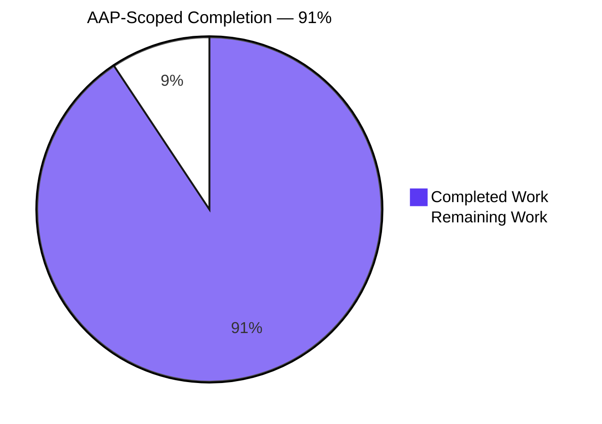
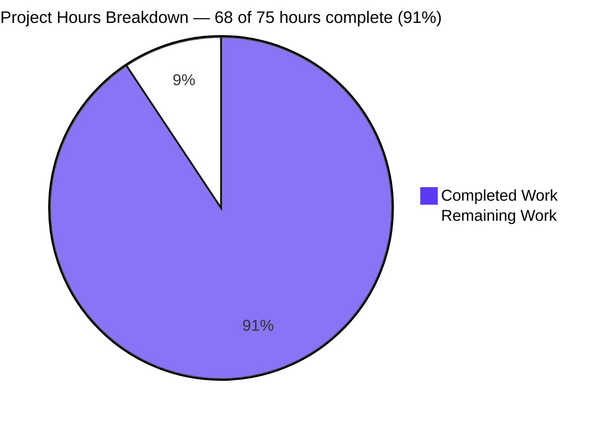

# 1. Executive Summary

## 1.1 Project Overview

This repository is a security scanning fixture corpus — deliberately vulnerable SCA and SAST samples plus the dependency declaration, lockfile, consumer record and executable check added here. The task: eliminate **GHSA-m5mm-p8h7-m29v** (CWE-79, CVE-2026-115897), cross-site scripting through an unescaped `</script` ending a serialized function body in `serialize-javascript` below 7.1.3, reported against `package.json`. The manifest now pins fixed release 7.1.4 exactly, the lockfile records that resolution by digest, and the check proves the pinned release neutralises the exploit invariant. Nothing is deployed.

## 1.2 Completion Status



| Metric | Hours |
|---|---|
| Total Hours | 75 |
| Completed Hours (Baseline: Human with agentic-assist) | 68 |
| Remaining Hours | 7 |

Completion is measured against the agreed scope and the work needed to put its deliverables into service: **68 / 75 = 90.7%, reported as 91%**. Thirteen of fourteen requirements are complete; one — exercising the gate on a 20.x runtime rather than only 22.x — is three-quarters done, and two evidence and operational items remain open.

## 1.3 Key Accomplishments

- [x] `serialize-javascript` pinned to exactly `7.1.4`, outside the affected `<7.1.3` range
- [x] Lockfile records the resolution by registry URL and `sha512` digest
- [x] Audit reports zero vulnerabilities with the advisory identifier absent
- [x] Check passes on 7.1.4 and fails on 1.4.0, distinguishing fixed from vulnerable
- [x] All 23 documented 1.4.0 → 7.1.4 changes carry their arrival release
- [x] Both retired-advisory sets confirmed against a live affected-pin baseline
- [x] Fixture corpus byte-identical; no ignore rule, CI or scan configuration added
- [x] Exact messages, exit code 1 on every failure, stack traces only on request

## 1.4 Critical Unresolved Issues

**3 of 14** requirements remain open: one partial, two outstanding evidence or operational items.

| Issue | Impact | Owner | ETA |
|---|---|---|---|
| The verification gate has only been exercised on Node 22.23.5; the 20.x line of the declared `>=20.0.0` floor is unverified | A consumer on a conforming 20.x runtime has no evidence that the check behaves identically | Backend engineer | 2 h |
| One documented change (3.1.0 placeholder hardening) is evidenced from source diff and the advisory record, not by executing the injection it closes | The record's claim for that row rests on reading rather than observation | Security engineer | 3 h |
| The check's literal XSS payload will be reported by scanners and nothing suppresses it (accepted as an expected result) | Recurring scan noise around an inert, deliberately unindexed file | Security engineer | 2 h |

## 1.5 Access Issues

No access issues identified. The public npm registry and its advisory endpoint are reachable, no credential or registry authentication is required, and no private registry or proxy is configured. The one limitation is environmental rather than access-related: only Node 22.23.5 is provisioned, which is why the 20.x line is recorded as unverified.

## 1.6 Recommended Next Steps

1. **[High]** Run the full gate — audit, lockfile read-back, check both directions — on a conforming Node 20.x runtime.
2. **[Medium]** Produce execution evidence for the 3.1.0 placeholder-hardening change.
3. **[Medium]** Annotate or suppress the expected scanner finding on the check's payload.
4. **[Low]** Keep the exact pin and the `--package-lock-only` / `--prefix` discipline in review checklists.

# 2. Project Hours Breakdown

## 2.1 Completed Work Detail

| Component | Hours | Description |
|---|---|---|
| Dependency declaration (`package.json`) | 4 | Exactly six fields: identity, `private: true`, corpus description, the exact pin `"7.1.4"` and `engines.node ">=20.0.0"`, with `scripts`, `devDependencies`, `overrides`, `resolutions`, `type` and `main` deliberately absent. Conformance verified field by field and against a caret-range control that proves the pin is load-bearing. |
| Reproducible resolution (`package-lock.json`) | 5 | npm-generated `lockfileVersion` 3 document mirroring the pin, with one package entry carrying the public-registry tarball URL, an `sha512` digest equal to both the registry's published integrity and a recomputed digest of the fetched artifact, and the engine floor. Regeneration from the manifest alone is byte-identical; drift and tampering are rejected by `npm ci`. |
| Consumer delta record (`serialize-javascript-migration.md`) | 22 | Release-by-release research across the twenty-one published releases between 1.4.0 and 7.1.4, and the record it produced: twenty-three numbered changes with arrival releases and consumer consequences, the behaviours confirmed unchanged, the runtime floor, the exact-pin rationale, the lockfile reproducibility table, both retired-advisory sets, the no-fix-fallback determination, the corpus safety notice and a runnable verification recipe. |
| Executable verification (`serialize-javascript-xss-check.js`) | 15 | The four assertions (function source present, no case-insensitive `</script` surviving, string-borne closing-script still escaped, resolved version reported), the install-directory contract with argument precedence and blank handling, four exact message strings, exit-code discipline on every path, and diagnostics that disclose no stack unless explicitly requested. |
| Verification evidence | 13 | The audit gate and its affected-pin baselines, the fixed/vulnerable payload comparison across 1.4.0, 7.1.2, 7.1.3 and 7.1.4, the escaping matrix over delimiter, case, split-body and length variants, the exit-path and argument-precedence matrices, corpus continuity, and end-to-end execution of the documented recipe. |
| Artefact hardening and accuracy | 9 | Claim-level accuracy of the record's advisory cells and release attributions; install directories the recipe derives so no local process can pre-create them; diagnostics that print one clean `FAIL:` line with a stack only on request; a string-escape assertion that accepts any casing of the escaped form; and a header that states the pass/fail contract. |
| **Total** | **68** | Matches Completed Hours in Section 1.2. |

## 2.2 Remaining Work Detail

| Category | Hours | Priority |
|---|---|---|
| Re-verify the gate on a conforming Node 20.x runtime (the declared floor's 20.x line is unexercised) | 2 | High |
| Produce execution evidence for the 3.1.0 placeholder-hardening change recorded in the migration record | 3 | Medium |
| Annotate or suppress the expected SAST finding on the check's literal payload | 2 | Medium |
| **Total** | **7** | Matches Remaining Hours in Section 1.2 and the pie chart in Section 7. |

# 3. Test Results

The project has no unit-test framework, runner or coverage tool — the executable check is its entire behavioural suite, and the dependency audit is its declaration-level gate. The table records every execution performed against the delivered tree on Node v22.23.5 and npm 11.21.3, aggregated by what each area proves.

| Area / Category | Framework | Tests | Passed | Failed | Coverage | What This Proves |
|---|---|---|---|---|---|---|
| Dependency audit and advisory absence | npm audit (11.21.3) | 3 | 3 | 0 | Not measurable — no coverage tool | The declared resolution raises no advisory, the finding identifier is absent from the machine-readable report, and every severity total is zero |
| Lockfile generation and read-back | npm + Python 3.13 | 3 | 3 | 0 | Not measurable | The committed resolution is the package manager's own output, records 7.1.4 with the engine floor, and regenerates without an install directory |
| Executable check — pass direction | `serialize-javascript-xss-check.js` (Node 22.23.5) | 2 | 2 | 0 | Four assertions, all reached | The pinned release neutralises the closing-script prefix and reports its resolved version, in both the argument and environment forms |
| Executable check — negative control and failure contract | `serialize-javascript-xss-check.js` | 3 | 3 | 0 | Four exit paths | An affected release fails with the exact bare-prefix message and exit 1, and a missing or unresolvable directory fails with its exact message rather than guessing |
| Documented recipe replay | bash + npm + node | 3 | 3 | 0 | n/a | The published verification recipe runs as written, creates private install directories, and produces the documented PASS and FAIL outcomes |
| Install from the committed files | npm (`ci`, `ls`) | 3 | 3 | 0 | n/a | A consumer installs exactly 7.1.4 and nothing else from the committed manifest and lockfile |
| Syntax and parse gate | Node + Python | 3 | 3 | 0 | n/a | The only executable file parses cleanly and both JSON documents are valid |

**Totals observed: 20 executions, 20 passed, 0 failed.**

**Not Covered**

- **Runtime portability.** Every execution used Node 22.23.5; no run has exercised a runtime on the 20.x line of the declared `>=20.0.0` floor.
- **Engine enforcement.** The floor is declared, not enforced — `engine-strict` is false and a runtime pin is deliberately not committed — so a sub-floor install warns rather than fails. A human should confirm behaviour on a supported-but-older runtime before relying on it.
- **Rendering in a consuming page.** The invariant is asserted at serialization only. No test renders serialized output into an HTML document, because this repository contains no page, DOM or server.
- **The package's option surface.** `unsafe`, `ignoreFunction` and the `space`/`isJSON` forms are documented in the migration record but no test exercises them; they lie outside this change's scope.
- **One documented change.** The 3.1.0 placeholder-hardening row is evidenced from source diff and the advisory record rather than by executing the injection it closes.
- **Regression protection.** Nothing runs the check or the audit automatically, so there is no suite to re-run on a future change; the gate is manual by design.
- **The fixture corpus.** The deliberately vulnerable Python samples are not executed, because their weakness is the ground truth scanners are calibrated against.

# 4. Runtime Validation & UI Verification

- ✅ **Operational** — Dependency resolution through the npm CLI: manifest read, lockfile mirror, single entry at 7.1.4
- ✅ **Operational** — Audit gate: `npm audit --audit-level=low` reports zero vulnerabilities with the advisory identifier absent
- ✅ **Operational** — Check pass path against installed 7.1.4, in both the argument and `SERIALIZE_JAVASCRIPT_DIR` forms
- ✅ **Operational** — Check negative control against installed 1.4.0: exact bare-prefix FAIL line, exit 1
- ✅ **Operational** — Failure contract: missing directory and unresolvable directory each produce their documented message and exit 1
- ✅ **Operational** — Published recipe end to end: privately derived install directories (mode `2700`), documented PASS then FAIL
- ✅ **Operational** — Install from the committed manifest and lockfile: `npm ci` adds one package, `npm ls` shows only `serialize-javascript@7.1.4`
- ⚠ **Partial** — Runtime floor: the gate has run only on Node 22.23.5; the 20.x line of the declared `>=20.0.0` floor is unexercised
- ❌ **Failing** — None

**No UI, page or browser surface exists**, so no visual or browser-driven verification applies: there is no server, route, port, socket, database, queue, container or DOM in the tree, the manifest declares no `scripts`, `bin` or `main`, and the payload is data inside a serialization check rather than displayed markup.

**Never exercised at runtime:** the check's header prose (text, not behaviour); the package's `unsafe` and `ignoreFunction` options and the `space`/`isJSON` argument forms; the 3.1.0 placeholder-hardening change recorded in the migration record; sub-floor engine behaviour on the delivered manifest; and any consuming application's rendering of serialized output. Each is reported as uncovered rather than assumed.

# 5. Compliance & Quality Review

## 5.1 Compliance Matrix

| Deliverable | Benchmark | Status |
|---|---|---|
| Dependency declaration (`package.json`) | Vulnerable-component elimination with an exact, auditable pin | ✅ Pass |
| Resolution record (`package-lock.json`) | Reproducible build with artifact integrity pinning | ✅ Pass |
| Behavioural proof (`serialize-javascript-xss-check.js`) | Evidence rather than assertion, with a failing negative control | ✅ Pass |
| Consumer record (`serialize-javascript-migration.md`) | Complete, accurate change documentation for upgraders | ✅ Pass |
| Failure contract of the check | Deterministic exit codes and exact diagnostics on every path | ✅ Pass |
| Diagnostic hygiene | No stack trace or foreign absolute path disclosed by default | ⚠ Pass with caveat — the stack is opt-in, but a `MODULE_NOT_FOUND` raised while loading a corrupt install still carries Node's own "Require stack" text inside the error message, scoped to the directory the operator supplied |
| Secret and credential hygiene | No credential, token or connection material in delivered files | ✅ Pass |
| Scope discipline | Minimal diff; deliberate fixtures and their pins preserved | ✅ Pass |
| Fixture corpus integrity | Scanner ground truth intact and unindexed for the new files | ✅ Pass |
| Runtime portability | Behaviour verified across the declared runtime floor | ⚠ Partial — verified on Node 22.23.5 only |
| Regression gating | A future regression to an affected release is detected automatically | ⚠ Partial — the audit and the check are manual by decision |
| Executable artefact quality | Reviewable, no dead code, no placeholder path | ⚠ Pass with caveat — 69 lines against the agreed ~40-line estimate, with no dead or duplicated path |

## 5.2 AAP & Rule Divergences and Gaps

| # | What the AAP/Rule Required | What Was Delivered Instead | Why It Diverged | Impact | Remediation |
|---|---|---|---|---|---|
| D1 | The check is "approximately 40 lines including its header comment" (§0.7.2) | `serialize-javascript-xss-check.js` ships at 69 lines | The same specification requires four assertions, four message strings, the installed-version read, the argument contract and a flush-safe failure path; reaching 40 would mean deleting content it mandates | None functional: every assertion, message and exit code is present and observed | None required; enforcing the estimate would need a scope change that drops mandated content |
| D2 | The record enumerates "sixteen" deltas (§0.6.3, §0.7.2, §0.10.1) | 23 numbered deltas, including all sixteen specified | The specification's own exhaustiveness requirement (§0.6.3), its "every output change" statement (§0.4.4) and its honest-documentation standard (§0.12.2) outrank a count; artifact-verified change points exist beyond the sixteen at 1.6.0, 1.7.0, 2.1.1, 3.1.0, 7.0.3 and 7.1.3 | Favourable: the seven added rows (six distinct change points, `Map` and `Set` being separate rows) record output or security changes a consumer would otherwise meet silently | None required; a reader comparing record to specification sees 23 where it says sixteen |
| D3 | Delta 9 states the upgrade "also removes the `randombytes` advisory exposure that 6.0.0 and 6.0.1 carried" (§0.6.3) | The advisory clause is absent; only the verified dependency-removal fact remains | No advisory exists for `randombytes` in npm's bulk advisory endpoint, OSV or the GitHub advisory database, so the clause asserted an exposure that never existed | None security-wise; the record states only what is verifiable | None required |
| D4 | The retired-advisory table shows "—" for `GHSA-qj8w-gfj5-8c6v`'s CVE and severity (§0.8.2) | The row records `CVE-2026-34043` and Moderate | OSV's record for that advisory carries both; a dash reads as "none assigned", which is false | Improves accuracy of the retired set | None required |
| D5 | Delta 17's arrival release was specified as 1.6.1 | The record states 1.6.0 | Installed-artifact comparison: 1.5.0 emits a method shorthand, both 1.6.0 and 1.6.1 emit a function expression | None; the release attribution is artifact-verified | None required |
| D6 | Verification commands install into literal paths under a shared parent (§0.11.1, commands 5-7) | The published recipe derives both prefixes with `mktemp -d` and requires a freshly created, private directory | The specification scopes the target as "for example" outside the checkout (§0.10.1), and a predictable shared path lets another local process substitute the package and forge a PASS | Every binding property preserved: install outside the checkout, PASS with exit 0 on 7.1.4, FAIL with exit 1 on 1.4.0, private mode `2700`, all re-verified by run | None required; a reader following the printed recipe gets the documented outcomes |
| D7 | Command 8 expects `git status` to list the four added paths (§0.11.1) | The four files are committed on the delivered branch, so the status is clean | Delivery is committed and pushed; the equivalent and stronger evidence is the diff against the pre-change base — four additions, zero modifications, zero deletions | None; the delivered file set is exactly the four specified paths | None required |
| D8 | User-specified rules apply to the delivered work (§0.12.1) | No rules document exists for this project, so no rule is complied with or departed from | The rules document is empty and no rule text was supplied with the project | None | None required; stated here so the absence is explicit rather than implied |

**D1 — the check's size.** `serialize-javascript-xss-check.js` is 69 lines where the agreed estimate was about 40. The extra length is not padding: lines 37-49 implement the install-directory contract and the resolution-failure message, lines 51-59 carry the four assertions and the payload, and lines 60-69 implement the failure path that keeps a piped stderr from being truncated. Deleting any of them to reach the estimate would remove a behaviour the same specification mandates. The decision a maintainer has to make is whether the numeric estimate or the behavioural contract governs; the delivered code follows the contract, and the file's header states the contract rather than the estimate.

**D2 — the delta count.** The record enumerates 23 changes between 1.4.0 and 7.1.4, seven rows more than the sixteen specified. The additions are not editorial: `Map` and `Set` values serialized as `{}` until 1.7.0 and as `new Map(...)`/`new Set(...)` afterwards (`serialize-javascript-migration.md`, rows 18-19), `RegExp` output changed shape at 2.1.1 (row 20), method shorthand stopped being emitted at 1.6.0 (row 17), and the 3.1.0 and 7.0.3 security releases each changed behaviour a consumer would meet (rows 21-22). A record that stopped at sixteen would leave those silent while claiming completeness. The decision for a maintainer is whether to keep the longer, accurate table — the recommendation — or to restate the claim as a partial list.

**D6 — the recipe's install paths.** The published recipe creates both install directories with `mktemp -d` rather than installing into fixed paths under a shared temporary parent. The reason is concrete: the check executes code from the directory it is handed, so a predictable path lets another local process pre-create or swap `node_modules/serialize-javascript`, which would both execute foreign code and print the PASS line the recipe treats as proof. Every property that matters survives — the install happens outside the checkout, the target release passes, the affected release fails, and the directory is owner-only (mode `2700`, observed). No decision is outstanding unless a maintainer wants the fixed paths back, which would reintroduce the exposure.

No user-specified rules exist for this project, so no rule divergence is possible; D8 records that determination rather than leaving it implied.

# 6. Risk Assessment

| Risk | Category | Severity | Probability | Mitigation | Status |
|---|---|---|---|---|---|
| A behavioural regression (a relaxed pin, an edited lockfile, a broken assertion) is caught only when someone runs the gate, because no CI job, npm script or runner exists | Technical | Medium | Medium | Run `npm audit --audit-level=low` and the check in both directions at every dependency change; the check's exit codes are gate-ready | Open — accepted by scope decision |
| The check executes code from the directory it is handed and asserts the terminator invariant, not the version, so a substituted or mistaken directory can run foreign code and print PASS | Technical | Medium | Low | The published recipe requires a freshly created private directory (`mktemp -d`, mode `2700`), and the resolved version is printed before any assertion | Open — mitigated procedurally |
| The runtime floor is declared but not enforced: `engine-strict` is false and committing a runtime pin is out of scope, so a sub-floor Node warns and proceeds | Operational | Low | Medium | Floor recorded in the manifest and the lockfile, documented in the migration record, and being re-verified on a conforming 20.x runtime | Open — accepted |
| A consumer that opts into the package's `unsafe` option emits unescaped markup by design, reinstating the exposure the pin removes | Security | Medium | Low | Migration record row 1 flags the option as security-relevant; the exact pin keeps the audited release in place | Open — documented residual risk |
| A future advisory against a release at or above 7.1.4 is not picked up automatically — the pin is exact and nothing re-scans on a schedule | Security | Medium | Medium | Re-run the audit at each install or scan; treat the clean audit as a point-in-time fact, not a standing guarantee | Open — by design |
| Scanners keep reporting the corpus's deliberate fixtures and the check's literal payload, drowning the findings that matter | Operational | Low | High | Index the Python samples as fixtures (already done) and annotate or suppress the check's expected finding downstream | Open — one action outstanding |
| Reproducibility depends on the public registry still serving 7.1.4, since the repository stores the digest rather than a vendored copy | Integration | Low | Low | The committed `sha512` converts substitution, corruption or unavailability into a hard integrity failure rather than a silent install | Accepted |
| A bare `npm install` in the checkout root would create an untracked install directory in a tree with no ignore rule | Operational | Low | Medium | Documented discipline: `--package-lock-only` for lockfile work, `--prefix` for installs; the worktree is clean today with no untracked paths | Accepted |

# 7. Visual Project Status



**Remaining work by category**

| Category | Hours | Priority |
|---|---|---|
| Runtime floor re-verification (Node 20.x line) | 2 | High |
| Execution evidence for the 3.1.0 placeholder-hardening change | 3 | Medium |
| Downstream annotation of the expected SAST finding | 2 | Medium |
| **Total** | **7** | |

**Status by capability**

| Capability | State |
|---|---|
| Dependency declaration pinned outside the affected range | Complete |
| Resolution recorded and reproducible by digest | Complete |
| Exploit invariant proven neutralised, with a failing negative control | Complete |
| 1.4.0 → 7.1.4 change record with arrival releases | Complete |
| Fixture corpus preserved byte-identical | Complete |
| Behaviour verified across the declared runtime floor | Partial (22.x only) |
| Automated regression gate | Not present by scope decision |

# 8. Summary & Recommendations

The repository no longer resolves a release of `serialize-javascript` affected by GHSA-m5mm-p8h7-m29v. `package.json` pins the fixed release 7.1.4 exactly, `package-lock.json` records that resolution by public-registry URL and `sha512` digest, and an executable check demonstrates that the pinned release neutralises the closing-script prefix that the advisory is about. That is two independent proofs rather than one: the audit shows the declaration is clean and the check shows the behaviour is fixed, and the check also fails on 1.4.0, so a green run means the vulnerable case was excluded rather than never tested. Combined with the fixture corpus remaining byte-identical, the delivered surface is exactly four new files and 342 added lines.

**91% complete (68 of 75 hours).** Thirteen of fourteen planned requirements are met; the one partial is portability of the verification across the runtime floor, and two further items are outstanding evidence or operational work. The seven remaining hours are small but they are the difference between "verified on this host" and "verified as specified": a second-runtime run of the gate, execution evidence for one documented change, and a downstream annotation so the corpus's scans stay readable. None of them requires code changes to the four delivered files.

The critical path to production is short because this repository deploys nothing. In order: re-run the gate on a conforming Node 20.x runtime (2 h), produce the outstanding execution evidence for the 3.1.0 row (3 h), and annotate the expected scanner finding (2 h). After that the only standing obligations are disciplinary — keep the pin exact, use `--package-lock-only` and `--prefix` so no install directory enters the tree, and re-run the audit whenever dependencies are touched.

**Success metrics observed:** `npm audit --audit-level=low` reports zero vulnerabilities with the advisory identifier absent; the lockfile read-back states 7.1.4 with the `>=20.0.0` floor; the check passes against 7.1.4 in both invocation forms with exit 0 and fails against 1.4.0 with the exact message and exit 1; an install from the committed files yields `serialize-javascript@7.1.4` and nothing else; 20 of 20 recorded executions behaved as specified; the worktree is clean with ten tracked files.

**Production readiness: ready for its intended role, not deployable by design.** A consumer of this manifest can rely on resolving no affected release, on a digest-enforced resolution, and on a repeatable proof that the release behaves correctly. What it cannot rely on is automation: no CI job or runner exists, the floor is declared rather than enforced, and the proof runs only when an operator runs it. Those are scope decisions recorded as such, not gaps in the delivered code, and they are the first things a team adopting this manifest into a pipeline should add.

# 9. Development Guide

## 9.1 System Prerequisites

| Requirement | Version | Why |
|---|---|---|
| Node.js | `>=20.0.0` (verified on 22.23.5) | The pinned release declares `engines.node ">=20.0.0"`; below it npm warns and the package is unsupported |
| npm | Lockfile version 3 support — npm 7 or later (verified on 11.21.3) | The committed `package-lock.json` is `lockfileVersion` 3 |
| git | Any current version | Inspecting the change set and confirming a clean tree |
| Python 3 | Any 3.x (verified on 3.13.18) | Optional: used only to print the lockfile fields in the read-back step |

There is no service, database, message broker, container or port to provision, and no environment variable, secret or credential is required. Do not create a Python virtualenv for this project and do not install `requirements-vulnerable.txt`.

## 9.2 Environment Setup

```bash
git clone <repository-url> proactive_insights_security
cd proactive_insights_security
node -v            # must be >= 20.0.0
npm -v
git status --porcelain -uall   # expect no output on a clean checkout
```

Two constraints shape every command below. npm's local prefix is the checkout root, so a bare `npm install` would create a `node_modules` directory inside a tree that deliberately has no ignore rule; use `--package-lock-only` when working on the lockfile and `--prefix <dir>` for every install. And never install the Python fixture pins — `requirements-vulnerable.txt` is a deliberate scanner fixture whose header forbids installation.

## 9.3 Dependency Installation

Resolve the declared dependency without installing it into the checkout:

```bash
npm install --package-lock-only --no-audit --no-fund     # "up to date"; no node_modules created
python3 -c "import json;d=json.load(open('package-lock.json'));print(d['lockfileVersion'], d['packages']['node_modules/serialize-javascript']['version'], d['packages']['node_modules/serialize-javascript']['engines'])"
# expected: 3 7.1.4 {'node': '>=20.0.0'}
```

To install the dependency the way a consumer would, do it in a directory outside the checkout:

```bash
mkdir -p ../install-check && cp package.json package-lock.json ../install-check/
cd ../install-check && npm ci --no-audit --no-fund   # "added 1 package"; exit 0
npm ls --all                                         # proactive-insights-security@1.0.0 └── serialize-javascript@7.1.4
cd - >/dev/null
```

## 9.4 Verification Steps

**Declaration gate — no known-vulnerable resolution:**

```bash
npm audit --audit-level=low                                        # "found 0 vulnerabilities", exit 0
npm audit --json | grep -q 'GHSA-m5mm-p8h7-m29v' && echo PRESENT || echo ABSENT   # ABSENT
```

**Syntax and parse gate:**

```bash
node --check serialize-javascript-xss-check.js    # exit 0, no output
```

**Behavioural gate — the check in both directions.** The check needs a directory holding an installed copy, because the checkout never holds `node_modules`. Create the directories privately:

```bash
dir="$(mktemp -d)"
npm install --prefix "$dir" --no-audit --no-fund serialize-javascript@7.1.4
SERIALIZE_JAVASCRIPT_DIR="$dir" node serialize-javascript-xss-check.js
# serialize-javascript version: 7.1.4
# PASS: closing-script prefix neutralised (GHSA-m5mm-p8h7-m29v)   -> exit 0

vuln="$(mktemp -d)"
npm install --prefix "$vuln" --no-audit --no-fund serialize-javascript@1.4.0
SERIALIZE_JAVASCRIPT_DIR="$vuln" node serialize-javascript-xss-check.js
# serialize-javascript version: 1.4.0
# FAIL: serialized function source still contains a bare closing-script prefix: {…}   -> exit 1
```

The second run is not optional: a green run on 7.1.4 alone proves only that the script executes, whereas the failing run proves it detects the vulnerability. Both directories are owner-only (mode `2700`) and outside the checkout.

**Failure contract** (each exits 1 with the quoted message):

```bash
env -u SERIALIZE_JAVASCRIPT_DIR node serialize-javascript-xss-check.js
# FAIL: no install directory given (pass it as the first argument or set SERIALIZE_JAVASCRIPT_DIR)
node serialize-javascript-xss-check.js /path/with/nothing/installed
# FAIL: cannot resolve serialize-javascript from /path/with/nothing/installed
```

## 9.5 Example Usage

The check is the project's entire executable surface. Both invocation forms are equivalent — pass the install directory first, or export `SERIALIZE_JAVASCRIPT_DIR` — and the first argument wins if both are given. Set `DEBUG=1` to include a stack trace when an unexpected error needs diagnosing; leave it unset so a failing run prints one clean `FAIL:` line naming only the directory you supplied.

```bash
node serialize-javascript-xss-check.js "$dir"          # positional form, equivalent to the environment variable
DEBUG=1 node serialize-javascript-xss-check.js "$dir"  # adds a stack trace on unexpected errors
```

## 9.6 Troubleshooting

| Symptom | Cause | Resolution |
|---|---|---|
| `npm WARN EBADENGINE` on install | Runtime below the declared `>=20.0.0` floor; `engine-strict` is false, so npm warns and proceeds | Install Node 20 or later; the floor is declared, not enforced |
| `FAIL: cannot resolve serialize-javascript from <dir>` | The directory holds no installed copy, or the argument is a regular file | Install into it first with `npm install --prefix <dir> --no-audit --no-fund serialize-javascript@7.1.4` |
| `FAIL: no install directory given (…)` | Neither the first argument nor a non-blank `SERIALIZE_JAVASCRIPT_DIR` was supplied; blank and whitespace values count as absent | Pass the directory as the first argument |
| `FAIL: serialized function source still contains a bare closing-script prefix` | The install directory holds an affected release — expected when running the negative control | If you meant to test the fixed release, check the printed version line first |
| `npm error code EINTEGRITY` | The tarball did not match the committed `sha512` digest | Do not edit the lockfile by hand; delete the cache entry for that tarball and reinstall, or re-fetch from the public registry |
| `npm error code EUSAGE … does not satisfy` | `package.json` and `package-lock.json` disagree | Restore the exact pin, then regenerate the lockfile with `npm install --package-lock-only --no-audit --no-fund` |
| An untracked `node_modules` appears in `git status` | A bare `npm install` ran at the checkout root | Remove it and re-run with `--package-lock-only` or `--prefix <dir>` |
| `npm install` fails resolving the release | The public registry is unreachable | Do not hand-write a lockfile — an invented digest would attest to an artifact nobody fetched; restore network access and rerun |
| Scanner reports an XSS payload in `serialize-javascript-xss-check.js` | The file contains the advisory's inert test vector and is deliberately not indexed as a fixture | Expected and unreconciled by design; annotate or suppress it downstream |

# 10. Appendices

## A. Command Reference

All commands run from the repository root unless stated otherwise.

| Purpose | Command |
|---|---|
| Resolve the dependency without installing | `npm install --package-lock-only --no-audit --no-fund` |
| Print the recorded resolution | `python3 -c "import json;d=json.load(open('package-lock.json'));print(d['lockfileVersion'], d['packages']['node_modules/serialize-javascript']['version'], d['packages']['node_modules/serialize-javascript']['engines'])"` |
| Dependency audit gate | `npm audit --audit-level=low` |
| Confirm the advisory is absent | `npm audit --json \| grep -q 'GHSA-m5mm-p8h7-m29v' && echo PRESENT \|\| echo ABSENT` |
| Syntax check the executable | `node --check serialize-javascript-xss-check.js` |
| Install the fixed release outside the checkout | `npm install --prefix "$dir" --no-audit --no-fund serialize-javascript@7.1.4` |
| Install the affected release for the negative control | `npm install --prefix "$vuln" --no-audit --no-fund serialize-javascript@1.4.0` |
| Run the check (environment form / positional form) | `SERIALIZE_JAVASCRIPT_DIR="$dir" node serialize-javascript-xss-check.js` / `node serialize-javascript-xss-check.js "$dir"` |
| Install from the committed files as a consumer | `npm ci --no-audit --no-fund` in a directory holding `package.json` and `package-lock.json` |
| Confirm the delivered file set | `git diff --name-status <base-commit>..HEAD` |

## C. Key File Locations

| Path | Role | Size |
|---|---|---|
| `package.json` | The fix: exact pin `"serialize-javascript": "7.1.4"`, `private: true`, `engines.node ">=20.0.0"` | 12 lines |
| `package-lock.json` | The resolution: `lockfileVersion` 3, one entry at 7.1.4 with registry URL, `sha512` digest and engine floor | 27 lines |
| `serialize-javascript-migration.md` | The consumer record: finding, why 7.1.4 rather than 7.1.3, 23 deltas, unchanged behaviours, retired advisories, fallback determination, runtime floor, lockfile reproducibility, verification recipe, explicit non-goals | 234 lines |
| `serialize-javascript-xss-check.js` | The executable proof: argument/environment contract at 39-47, resolved-version print at 49, four assertions at 51-59, failure path at 60-69 | 69 lines |
| `requirements-vulnerable.txt` | Deliberate SCA fixture (`PyYAML==5.3.1`, `requests==2.19.0`) — never installed | 4 lines |
| `security_fixture/insecure_yaml.py`, `weak_crypto.py`, `unsafe_tempfile.py` | Deliberate SAST fixtures — never hardened | 7 / 8 / 6 lines |
| `security_fixture/README.md` | Fixture index; deliberately does not list the check | 11 lines |
| `README.md` | Project title | 1 line |

## D. Technology Versions

| Component | Version | Notes |
|---|---|---|
| Node.js | v22.23.5 verified; floor `>=20.0.0` | Declared in the manifest and the lockfile; a conforming 20.x runtime has not been exercised |
| npm | 11.21.3 | Lockfile `lockfileVersion` 3 |
| Python | 3.13.18 | Used only for the lockfile read-back; the Python pins are not installed |
| serialize-javascript | 7.1.4 | Exact pin; first fixed release is 7.1.3, target is one patch later |
| Affected range | `<7.1.3` | Advisory scope; 7.1.4 lies outside it |
| Python fixture pins | `PyYAML==5.3.1`, `requests==2.19.0` | Deliberately vulnerable, never installed or upgraded |

## E. Environment Variable Reference

| Variable | Required | Purpose |
|---|---|---|
| `SERIALIZE_JAVASCRIPT_DIR` | Required unless the install directory is passed as the first argument | Directory holding an installed copy of the package that the check resolves and executes |
| `DEBUG` | Optional | Any non-empty value appends a stack trace to an unexpected-error report; unset or empty keeps the output to one clean `FAIL:` line |

No other environment variable, secret or credential is read or required.

## F. Developer Tools Guide

| Tool | Status | How it is used here |
|---|---|---|
| npm audit | Available, authoritative | The declaration-level gate: zero advisories expected, advisory identifier absent |
| `serialize-javascript-xss-check.js` | The project's entire behavioural suite | Exit 0 on a fixed install, exit 1 on an affected one; run both directions |
| `node --check` | Available | The only static gate; no linter, type checker or formatter is configured |
| Test framework / runner / coverage tool | Not present, not required | The check is a stand-alone executable assertion; adding a runner is out of scope |
| CI pipeline / scanner configuration | Not present, not required | A scan gate is a separate control from resolving one finding |

## G. Glossary

- **GHSA-m5mm-p8h7-m29v** — the GitHub advisory this change eliminates: cross-site scripting through an unescaped `</script` at the end of a serialized function body.
- **CVE-2026-115897** — the CVE identifier for that advisory (alias `CVE-2026-115754`).
- **CWE-79** — improper neutralization of input during web-page generation, the weakness class the advisory maps to.
- **Closing-script prefix** — the `</script` sequence that terminates a script element; if it survives serialization, following content is parsed as markup.
- **Spoofed `toString()`** — an object whose function-valued property reports attacker-chosen source text, the precondition the exploit needs.
- **Negative control** — running the check against a known-affected release to prove it fails; without it a passing run proves only that the script executed.
- **Exact pin** — a dependency declaration of one precise version (`"7.1.4"`) rather than a range, so the audited, locked and installed versions cannot diverge.
- **Integrity digest** — the `sha512` hash of the published tarball recorded in the lockfile; a substituted artifact fails verification.
- **Engine floor** — the minimum runtime the dependency declares (`node >=20.0.0`), recorded in the manifest and the lockfile.
- **SCA / SAST fixture** — a deliberately vulnerable dependency file or source sample kept so scanners have known ground truth; these are preserved unchanged.
