# Technical Specification

# 1. Introduction

## 1.1 Executive Summary

The repository `proactive_insights_security` is not an application. It is a deliberately insecure fixture corpus used to exercise security tooling: three tiny Python modules give static analysis (SAST) known-bad code patterns to find, and one pip requirements file gives dependency analysis (SCA) known-vulnerable versions to report. The entire checkout is six tracked files totalling 36 lines, with no build manifest, no package metadata, no test suite, no CI definition and no scanner configuration. Both README files state the intent unambiguously — `requirements-vulnerable.txt` carries the header "Intentionally outdated dependencies for dependency-scanner testing only. / Do not install these packages or use this file in a real application.", and `security_fixture/README.md` opens with "These files are intentionally small static-analysis fixtures."

**Core business problem.** A security scanner is only trustworthy if its findings can be checked against ground truth. Without a corpus of inputs whose defects are known in advance, a team cannot distinguish a rule that fires correctly from a rule that is silently disabled, mis-scoped, or backed by a stale vulnerability database. The problem this repository addresses is therefore evaluative rather than functional: it supplies deterministic, unambiguous, known-bad inputs so that scanner behaviour — detection, attribution and stability of results — can be observed and compared across tool versions, rule packs and database revisions. The fixture README makes the variability explicit: "A scanner may report findings differently depending on enabled rules and vulnerability databases."

**Key stakeholders and users.**

| Stakeholder | Interest in the repository | Artifacts they consume |
|---|---|---|
| Application security engineers | Confirm that the rules protecting production code still fire | The three modules in `security_fixture/` |
| Security tooling and platform teams | Regression-test scanners, rule packs and advisory-database updates | The whole fixture set, both code and manifest |
| Developers and reviewers triaging findings | Recognise which patterns are expected rather than newly introduced | The fixture-to-pattern map in `security_fixture/README.md` |
| Auditors, trainers and reviewers | Demonstrate detection capability in an isolated setting | Documented fixtures, under the stated isolation rules |

**Expected business impact and value proposition.**

- *Attributable findings.* Each module contains exactly one defect class in one or two executable statements, so a reported finding maps back to a single named pattern instead of an ambiguous pile of code. `security_fixture/README.md` publishes that mapping: `insecure_yaml.py` "unsafe YAML loading pattern", `weak_crypto.py` "weak hashing and non-cryptographic randomness", `unsafe_tempfile.py` "predictable shared temporary-file path", `../requirements-vulnerable.txt` "deliberately old dependency versions for SCA testing".
- *Two independent surfaces.* Code scanning and dependency scanning can be exercised separately, including the informative case where a pinned dependency (`requests`) is declared in the manifest but never imported, while the other (`PyYAML`) is both pinned and imported by `security_fixture/insecure_yaml.py`.
- *Reproducibility at trivial cost.* Every input is static and hand-written, so two scanner runs over the same commit should be directly comparable; there is no generated data, no network dependency at analysis time and no nondeterminism in the source text.
- *Zero remediation debt.* Because nothing here is meant to be fixed, the fixtures cannot drift into "already corrected" states that would mask a rule regression.

**Critical constraint.** The repository is unsafe by design and must stay isolated. `security_fixture/README.md` instructs: "Use these only in an isolated test repository. Do not install the outdated dependencies or deploy this code." The root `README.md` — 29 bytes containing only the heading `# proactive_insights_security` — adds no usage guidance and does not describe the fixtures beside it. Everything in this specification describes the fixtures as analysis targets; it describes no deployable behaviour, because none is intended.

## 1.2 System Overview

### 1.2.1 Project Context

**Business context and market positioning.** The repository is an internal engineering-assurance asset, not a commercial product. Its position in the delivery lifecycle is upstream of any application: it validates the instruments that judge other code. Two input formats are published as fixtures because they cover the two independent halves of a modern security toolchain — a Python source tree for static analysis, and a pip requirements manifest for dependency analysis. The title `proactive_insights_security` is the project's only self-description: the root `README.md` is a single 29-byte heading containing that name, and no other file in the tree elaborates on it or on any surrounding product.

**Current system limitations.** Nothing in the repository references a predecessor, a replaced artifact, or a migration path. The limitation being solved is not the shortcoming of an earlier system but the absence of an evaluation corpus: a scanner with no known-bad inputs yields findings whose correctness cannot be established. Two properties of the fixtures trace directly to that limitation — the vulnerabilities are deliberate, and each one is reduced to the smallest statement that still exhibits the pattern, so that a reporting difference between two scanner versions is attributable to the scanner rather than to code complexity.

**Integration with the existing enterprise landscape.** No integration code exists: there is no CI definition, no scanner configuration, no baseline or suppression file, no SBOM and no report-format handling — a recursive search of every tracked file for `.github`, `workflow`, `bandit`, `semgrep`, `snyk`, `pip-audit`, `safety`, `pytest` and `unittest` returns no matches. Integration is instead purely by file-format contract:

| Artifact | Format contract | Enterprise consumer class |
|---|---|---|
| `security_fixture/insecure_yaml.py`, `weak_crypto.py`, `unsafe_tempfile.py` | Valid Python 3 source, one function per module | SAST engines and rule-pack test harnesses |
| `requirements-vulnerable.txt` | Pip requirements file, two exact `==` pins, resolvable from public PyPI | SCA engines and advisory-database feeds |
| `security_fixture/README.md` | Markdown index mapping path to pattern | Human reviewers reconciling reported findings |

**Repository provenance.** The tree was assembled by upload rather than by evolution: `git log` shows an initial commit containing only `README.md`, a second commit adding `requirements-vulnerable.txt`, and a third adding the four files under `security_fixture/`; a transient file `security_fixture/asdasd` was created and deleted within the same history. All seven commits share one author identity and one date, the tip is `6c7b396`, and the two branches present, `main` and `2011_01`, are identical in content.

### 1.2.2 High-Level Description

**Primary system capabilities.** The corpus exhibits four documented defect classes, three in code and one in dependencies.

| Capability | Location | Pattern demonstrated |
|---|---|---|
| Untrusted YAML deserialization | `security_fixture/insecure_yaml.py` lines 4 and 7 | `yaml.load(user_supplied_yaml, Loader=yaml.Loader)`; the full `Loader` admits arbitrary Python object tags, so an attacker-authored document can execute code |
| Guessable token generation | `security_fixture/weak_crypto.py` lines 7-8 | Unkeyed `hashlib.md5(str(user_id).encode())` suffixed with `random.randint(1000, 9999)`; deterministic digest plus a 9,000-value Mersenne Twister suffix yields reproducible, enumerable tokens |
| Predictable shared temporary file | `security_fixture/unsafe_tempfile.py` lines 3-4 | Literal `/tmp/report.txt` opened in `"w"` mode; the fixed name in a world-writable directory invites collision, truncation and symlink-redirected writes |
| Vulnerable dependency pins | `requirements-vulnerable.txt` lines 3-4 | `PyYAML==5.3.1` and `requests==2.19.0`, both old enough to match published advisories |

The dependency pins are the only capability whose severity is external to the repository; the file names no CVE identifiers, so advisory matching is performed by the consuming scanner:

| Package | Pinned version | Representative advisory | First fixed release |
|---|---|---|---|
| PyYAML | 5.3.1 | CVE-2020-14343 — arbitrary code execution when untrusted YAML is parsed | 5.4 |
| requests | 2.19.0 | CVE-2018-18074 — `Authorization` header re-sent to an http URI after an https-to-http redirect | 2.20.0 |
| requests | 2.19.0 | CVE-2023-32681, CVE-2024-35195, CVE-2024-47081 — proxy-credential leak, session TLS-verification downgrade, `.netrc` leak | 2.31.0, 2.32.2, 2.32.4 |

**Major system components.**

| Component | Path | Role | Technical surface |
|---|---|---|---|
| Project title | `README.md` | Names the repository | One Markdown H1, no trailing newline |
| Dependency manifest | `requirements-vulnerable.txt` | SCA target | Two comment lines plus two `==` pins; no extras, markers, hashes or index URLs |
| Deserialization fixture | `security_fixture/insecure_yaml.py` | SAST target | `import yaml`; one function `load_config(user_supplied_yaml)` of one statement |
| Cryptography fixture | `security_fixture/weak_crypto.py` | SAST target | `import hashlib`, `import random`; one function `create_token(user_id)` returning an f-string |
| Temporary-file fixture | `security_fixture/unsafe_tempfile.py` | SAST target | No imports; one function `write_report(contents)` using builtin `open` |
| Fixture index | `security_fixture/README.md` | Maps each path to its pattern and states the isolation rule | Four list entries plus a safety notice |

**Core technical approach.** Each fixture is a single module-level function with exactly one unannotated parameter, no return annotation, no decorator, no class, no module constant and no error handling; parsing the modules confirms this structure. The reduction is deliberate, so that a detection result depends on one statement rather than on interaction between statements. Three consequences shape how the corpus behaves:

- *Analysis-only code.* No module defines an entry point, imports another module in the tree, or is called by anything in the repository. The files are meant to be parsed by an analyzer, not executed.
- *Minimal runtime surface.* Beyond `PyYAML` the imports are standard library (`hashlib`, `random`, builtin `open`), and `requests` is pinned without ever being imported — so a scanner can report a vulnerable dependency that has no corresponding call site. The modules are nonetheless syntactically valid Python 3 and compile cleanly; the f-string in `weak_crypto.py` requires interpreter 3.6 or newer.
- *No packaging layer.* One flat directory, no `__init__.py`, no distribution metadata, no lockfile; discovery happens by walking the tree.

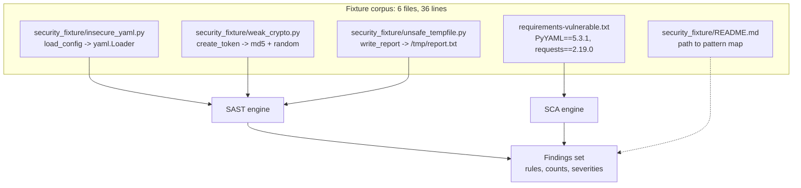

### 1.2.3 Success Criteria

The repository states no formal acceptance criteria, no KPI thresholds and no service levels, and it contains no test suite, no expected-findings baseline and no CI gate that could enforce them. The objectives below are derived from what the fixtures unambiguously contain; each is observable in scan output and, by construction, has a known-correct answer.

| Measurable objective | Observable evidence of success | Verification locus |
|---|---|---|
| Detect unsafe deserialization | At least one finding attributed to the `yaml.load` call on line 7 | `security_fixture/insecure_yaml.py` |
| Detect weak hashing and weak randomness | Findings for both `hashlib.md5` (line 7) and `random.randint` (line 8) | `security_fixture/weak_crypto.py` |
| Detect predictable temporary file creation | At least one finding attributed to the literal path on line 3 | `security_fixture/unsafe_tempfile.py` |
| Report vulnerable dependencies | Both pins reported with at least one matching advisory | `requirements-vulnerable.txt` |
| Attribute findings to intent | Every reported finding maps to an entry in the fixture index, with nothing unexplained | `security_fixture/README.md` |
| Reproduce results | Identical finding set for the same commit, scanner version and rule configuration | Repeated scans |

**Critical success factors.**

- *The fixtures stay vulnerable.* Any hardening edit — `yaml.safe_load`, `secrets`, `tempfile.mkstemp`, a version bump — removes the ground truth the corpus exists to provide.
- *Isolation is preserved.* `requirements-vulnerable.txt` and `security_fixture/README.md` both forbid installing the pins or deploying the code; an installed vulnerable `PyYAML` would turn an analysis exercise into a live exposure.
- *Scan configuration is recorded with results.* The fixture index warns that findings vary with enabled rules and vulnerability databases, so a result set is only meaningful alongside the rule pack and advisory-database revision that produced it.
- *Analyzers read the files directly.* No build step, packaging or generation step exists between the committed bytes and the analyzer, so the inputs cannot be transformed unintentionally.

**Key performance indicators.** No target values are recorded in the repository. The fixtures do support measuring four things that matter to a scanner programme: pattern-class coverage against the four documented defect classes; false-negative and false-positive counts per fixture; finding stability between consecutive scanner or database releases; and the latency with which a rule-pack update is reflected in results. Whether any of these are tracked, and against what thresholds, is decided outside this repository.

## 1.3 Scope

### 1.3.1 In-Scope

#### 1.3.1.1 Core Features and Functionalities

The in-scope functionality is the provision of known-bad inputs for security analyzers. Nothing in the repository computes a business result; its features are fixtures.

| Must-have capability | Artifact | Defining characteristic |
|---|---|---|
| Unsafe deserialization specimen | `security_fixture/insecure_yaml.py` | `load_config(user_supplied_yaml)` returns `yaml.load(user_supplied_yaml, Loader=yaml.Loader)`; untrusted input path is explicit in the parameter name |
| Weak-cryptography specimen | `security_fixture/weak_crypto.py` | `create_token(user_id)` returns `"<md5 hex>-<4-digit int>"`, combining an unkeyed hash with a non-cryptographic PRNG |
| Insecure temporary-file specimen | `security_fixture/unsafe_tempfile.py` | `write_report(contents)` writes verbatim to the literal path `/tmp/report.txt` and returns that path |
| Vulnerable dependency specimen | `requirements-vulnerable.txt` | Exactly two pins, `PyYAML==5.3.1` and `requests==2.19.0`, with a comment header labelling them test-only |
| Fixture index and safety notice | `security_fixture/README.md` | Maps each of the four paths to its pattern class and states the isolation rule |
| Repository identity | `README.md` | Single H1 heading, `# proactive_insights_security` |

**Primary user workflows.** All three workflows are performed by external tooling or humans; the repository supplies inputs only.

1. *Static-analysis sweep.* A SAST engine is pointed at `security_fixture/`; the three modules are parsed and the deserialization, weak-hash, weak-randomness and temporary-file rules are expected to fire.
2. *Dependency-analysis sweep.* An SCA engine is pointed at `requirements-vulnerable.txt`; both pins should resolve to published advisories. `requests` exercises the case of a flagged dependency with no import site anywhere in the tree.
3. *Reconciliation.* A reviewer compares the reported finding set against the path-to-pattern list in `security_fixture/README.md` to confirm that everything reported was intended and that nothing intended is missing.

**Essential integrations.** The only integration in scope is the file-format contract with consuming analyzers described in [1.2.1 Project Context](#121-project-context): valid Python 3 source for code analyzers and a pip requirements file for dependency analyzers. No API, hook, plugin or schema belongs to the repository.

**Key technical requirements.**

- *Syntactic validity.* Every module must parse and compile under Python 3; the f-string returned by `create_token` sets the floor at Python 3.6. All three modules compile cleanly.
- *Single-defect isolation.* Each module exposes exactly one function taking exactly one argument, so a finding is attributable to one or two statements and never to control flow.
- *Manifest resolvability.* Both pins use exact `==` equality with no extras, environment markers, hashes or index URLs, so an advisory lookup is unambiguous.
- *Analysis without execution.* The corpus must be analyzable with no installed third-party package other than the deliberately vulnerable `PyYAML`, and no interpreter entry point exists.

#### 1.3.1.2 Implementation Boundaries

**System boundary.** The system under specification is the committed tree: six files and 36 lines of content, contained in the root and the single flat folder `security_fixture/`. There is no `__init__.py`, no distribution or build metadata, no lockfile, no generated artifact and no deployment surface. A full recursive listing of files not under `.git` returns exactly the six paths named in this section.

**User groups covered.**

| User group | Covered because | Not covered because |
|---|---|---|
| Application security engineers and reviewers | They scan the three modules and read the fixture index | They receive no dashboard, report or automation from the repository |
| Security tooling and rule-pack maintainers | The fixtures are stable regression inputs for detection logic | No expected-findings file or test harness is provided to compare against |
| Trainers and auditors | The documented patterns are self-describing | No training material, walkthrough or severity guidance is included |
| Application end users | — | No user-facing behaviour, interface or service exists |

**Geographic and market coverage.** None. The repository contains no locale, currency, time-zone, regional or regulatory logic, and its artifacts are location-independent: they produce the same inputs wherever an analyzer runs.

**Data domains included.**

| Data domain | Presence | Detail |
|---|---|---|
| Code under analysis | Included | Three Python modules, standard library only except `PyYAML` |
| Dependency metadata | Included | Two package coordinates with pinned versions in one requirements file |
| Untrusted-input shapes | Included as parameter names only | YAML text, a user identifier, and report contents — no sample payloads or datasets |
| Persistent or personal data | Not included | No database, no storage layer, no network calls, no credentials and no personal data |

One runtime side effect exists in the code and is out of scope operationally: `write_report` targets the fixed path `/tmp/report.txt`. Nothing in the repository executes it, and the fixtures are not run in the normal course of use.

### 1.3.2 Out-of-Scope

#### 1.3.2.1 Explicitly Excluded Features and Capabilities

| Excluded item | Status in the repository |
|---|---|
| Application, service, CLI or user interface | Absent; no entry point, framework import or route definition exists |
| Authentication, authorization or session management | Absent; `create_token` only demonstrates a weak token format and validates nothing |
| Network or HTTP client behaviour | Absent; `requests` is pinned in the manifest but never imported |
| Data persistence or storage | Absent; no database driver, ORM, file store or schema exists |
| Remediated or "secure" counterpart fixtures | Absent; all three modules are intentionally weak, so there are no positive controls to test false-positive rate |
| Fixtures in any language other than Python, or for dependency ecosystems other than pip | Absent; the tree holds three `.py` modules and one requirements file |
| Tests, CI pipelines, containers, infrastructure-as-code, deployment manifests | Absent; no test, workflow, Dockerfile or IaC file exists |
| Scanner configuration, expected-findings baseline, suppression or severity policy, SBOM, security policy | Absent; no such file exists and no tracked file references a scanner by name |
| Documentation beyond two short READMEs | Absent; the root README is a title only and the fixture README is 11 lines |

#### 1.3.2.2 Future Phase Considerations

The repository records no roadmap, backlog or future-phase plan, and this specification does not invent one. For completeness, the capabilities an extension phase would need to add are precisely the absences listed above, most consequentially: a machine-readable expected-findings manifest, which would turn the reconciliation workflow into an automated regression gate; secure counterpart fixtures, which would expose false positives; and CI wiring, which would make the corpus self-verifying on every change. None of these exists today, and none should be inferred as committed work.

#### 1.3.2.3 Integration Points Not Covered

- No pipeline integration: no CI job, pre-commit hook, or scheduled scan definition consumes the fixtures automatically.
- No report ingestion: results are never converted to or from a machine-readable findings format within the repository.
- No issue-tracking, ticketing or exception-approval linkage for findings.
- No artifact registry, package index or vulnerability-database integration; the advisories behind the pins are resolved entirely by the consuming scanner.
- No telemetry, logging or metrics export of any kind.

#### 1.3.2.4 Unsupported Use Cases

- *Installing or running the dependencies.* `requirements-vulnerable.txt` states: "Do not install these packages or use this file in a real application." Its pins are advisory-matching inputs, not a runtime environment.
- *Deploying or reusing the code.* `security_fixture/README.md` states: "Do not install the outdated dependencies or deploy this code." The modules are not a library: they have no callers, no error handling and no input validation, and their functions are not safe to invoke with real input.
- *Treating any module as a reference or sample implementation.* The patterns are anti-patterns; `insecure_yaml.py` carries an in-file warning that untrusted input must not be passed to `yaml.load` in real applications.
- *Use outside an isolated test repository.* The fixture README restricts use to "an isolated test repository".
- *Performance, load, availability or capacity evaluation.* No executable flow exists to measure, and no service-level objective is defined anywhere in the tree.

## 1.4 References

- `README.md` — 29-byte single H1: the repository's only self-description and proof that no root-level usage documentation exists.
- `requirements-vulnerable.txt` — the SCA input: two comment lines labelling the file test-only, then `PyYAML==5.3.1` and `requests==2.19.0`.
- `security_fixture/` — the flat folder containing all four analysis targets and the fixture index; no `__init__.py`, no sub-folders.
- `security_fixture/README.md` — maps each fixture path to its pattern class, names `../requirements-vulnerable.txt` as the SCA target, and states the isolation rule and the rule/database dependence of findings.
- `security_fixture/insecure_yaml.py` — `import yaml` plus `load_config(user_supplied_yaml)` returning `yaml.load(..., Loader=yaml.Loader)`; establishes the unsafe-deserialization specimen and the only third-party import in the tree.
- `security_fixture/weak_crypto.py` — `create_token(user_id)` combining `hashlib.md5` with `random.randint(1000, 9999)`; establishes the weak-hash and weak-randomness specimen and the Python 3.6 f-string floor.
- `security_fixture/unsafe_tempfile.py` — `write_report(contents)` writing to the literal `/tmp/report.txt`; establishes the predictable-temporary-file specimen.
- Git metadata via `git log --name-status`, `git ls-tree`, `git diff main 2011_01` — established the upload-assembled history, the transient `security_fixture/asdasd` file, and that both branches are identical.
- [web] NVD, *CVE-2020-14343 Detail* (https://nvd.nist.gov/vuln/detail/CVE-2020-14343) — PyYAML before 5.4 allows code execution on untrusted YAML; CVSS 3.1 score 9.8.
- [web] PyYAML, *CHANGES* (https://raw.githubusercontent.com/yaml/pyyaml/master/CHANGES) — 5.4 moves arbitrary `python/object` tags to `UnsafeLoader`, confirming 5.4 as the first fixed release.
- [web] Snyk, *PyYAML@5.3.1 vulnerability report* (https://security.snyk.io/package/pip/PyYAML/5.3.1) — vulnerable range `[5.1b1, 5.4)` for the pinned version.
- [web] Snyk, *requests@2.19.0 vulnerability report* (https://security.snyk.io/package/pip/requests/2.19.0) — advisories matching the pinned `requests` version.
- [web] requests project, *Community Updates* (https://requests.readthedocs.io/en/latest/community/updates/) — fixed releases 2.20.0, 2.31.0, 2.32.0 for the redirect, proxy-credential and TLS-verification issues.
- [web] Debian Security Tracker, *CVE-2018-18074* (https://security-tracker.debian.org/tracker/CVE-2018-18074) — `Authorization` header sent to http after an https-to-http redirect; fixed in 2.20.0.
- [web] NVD, *CVE-2023-32681 Detail* (https://nvd.nist.gov/vuln/detail/CVE-2023-32681) — `Proxy-Authorization` leak on redirects; fixed in 2.31.0.
- [web] IBM, *Requests SSL Verification Issue Fixed in 2.32.0* (https://www.ibm.com/support/pages/security-bulletinrequests-ssl-verification-issue-fixed-2320) and *requests 2.32.4 may leak .netrc credentials* (https://www.ibm.com/support/pages/security-bulletin-requests-2324-may-leak-netrc-credentials-malicious-urls-due-url-parsing-flaw) — CVE-2024-35195 and CVE-2024-47081 fixed releases.
- [web] PyYAML, *PyYAMLDocumentation* (https://pyyaml.org/wiki/PyYAMLDocumentation) — `yaml.load` with `Loader` "supports all predefined tags and may construct an arbitrary Python object" and is unsafe for untrusted documents.
- [web] Python documentation, *random* (https://docs.python.org/3/library/random.html) and *hashlib* (https://docs.python.org/3/library/hashlib.html) — the Mersenne Twister is deterministic and unsuitable for security purposes; MD5 has known collision weaknesses.
- [web] Python documentation, *tempfile* (https://docs.python.org/3/library/tempfile.html) and OpenStack Security Guide, *Create, use, and remove temporary files securely* (https://security.openstack.org/guidelines/dg_using-temporary-files-securely.html) — fixed names in shared temp directories permit symlink and TOCTOU attacks, motivating atomic `mkstemp`-style creation.
- [web] MITRE, *CWE-377: Insecure Temporary File* (https://cwe.mitre.org/data/definitions/377.html) — classification of the `unsafe_tempfile.py` pattern.

# 2. Product Requirements

## 2.1 Feature Catalog


This section decomposes the repository into discrete, testable features. A feature here is a committed artifact whose presence and content a tool or reviewer can verify — none is a service, job or process. Six features account for the entire tracked tree of six files and 36 lines: three static-analysis fixtures (`F-001`–`F-003`), one dependency-analysis fixture (`F-004`), the fixture index (`F-005`) and the set of isolation guardrails (`F-006`). The root `README.md` is not a feature: it is a 29-byte single heading, `# proactive_insights_security`, carrying no requirement content.

### 2.1.1 Catalog Conventions and Scope

**Identifier scheme.** Features are `F-XXX`; their requirements, defined in [2.2 Functional Requirements](#22-functional-requirements), are `F-XXX-RQ-YYY`. Identifiers are stable for the whole specification and are used unchanged in the traceability matrix in [2.5 Traceability Matrix](#25-traceability-matrix).

**Priority vocabulary.** *Critical* — without it the corpus contains no defect for an analyzer to detect, so the product has no purpose. *High* — required to interpret the corpus correctly or to keep it isolated. *Medium* — supporting content whose loss degrades usability without invalidating the fixtures. No feature is rated Low.

**Status vocabulary.** Proposed, Approved, In Development, Completed. All six features are **Completed**, because every artifact they describe exists in the working tree at tip commit `6c7b396` and compiles or parses cleanly.

**Requirement version.** All requirements in this specification form baseline **v1.0**, established at commit `6c7b396` ("Delete security_fixture/asdasd", the seventh and current commit). No earlier requirement version is recoverable from the repository: history shows only file uploads and deletions, never a change to fixture content other than the addition of the files themselves.

| ID | Feature name | Category | Priority |
|---|---|---|---|
| F-001 | Unsafe YAML Deserialization Fixture | Static analysis fixture | Critical |
| F-002 | Weak Cryptographic Token Fixture | Static analysis fixture | Critical |
| F-003 | Predictable Temporary File Fixture | Static analysis fixture | Critical |
| F-004 | Vulnerable Dependency Manifest | Dependency analysis fixture | Critical |
| F-005 | Fixture Index and Ground-Truth Mapping | Documentation | High |
| F-006 | Isolation and Safety Guardrails | Safety guardrail | High |

| ID | Status | Primary artifact | Documented pattern |
|---|---|---|---|
| F-001 | Completed | `security_fixture/insecure_yaml.py` | Unsafe YAML loading (`Loader=yaml.Loader`) |
| F-002 | Completed | `security_fixture/weak_crypto.py` | Weak hashing (`md5`) + non-cryptographic randomness |
| F-003 | Completed | `security_fixture/unsafe_tempfile.py` | Predictable shared temporary-file path |
| F-004 | Completed | `requirements-vulnerable.txt` | Deliberately outdated dependency pins |
| F-005 | Completed | `security_fixture/README.md` | Path-to-pattern map and variability caveat |
| F-006 | Completed | `requirements-vulnerable.txt` lines 1–2; `security_fixture/README.md` lines 10–11; module docstrings | Do-not-install / do-not-deploy / isolated-test-only notices |

### 2.1.2 F-001 Unsafe YAML Deserialization Fixture

| Attribute | Value |
|---|---|
| Feature ID | F-001 |
| Feature name | Unsafe YAML Deserialization Fixture |
| Category | Static analysis fixture (SAST) |
| Priority | Critical |
| Status | Completed |
| Primary artifact | `security_fixture/insecure_yaml.py`, 7 lines, 243 bytes |
| Public surface | One function, `load_config(user_supplied_yaml)` |
| Requirements | F-001-RQ-001 … F-001-RQ-004 (4) |

**Overview.** The module is the corpus's deserialization specimen. Line 4 is `import yaml`, line 6 declares `def load_config(user_supplied_yaml):`, and line 7 — the whole body — is `return yaml.load(user_supplied_yaml, Loader=yaml.Loader)`. Passing the full `Loader` selects PyYAML's most permissive constructor set: every predefined tag resolves, including the `!!python/object` family, so an attacker-authored document can instantiate arbitrary Python objects and execute code. The parameter name states the threat model in the source text: input is user-supplied. Nothing in the repository calls the function.

**Business value.** It gives a security programme a stable, single-statement ground truth for its deserialization rules (CWE-502). Because the file is hand-written committed bytes with no generator or build step between the source and the analyzer, a rule that regresses from firing to silent shows up as a change in the finding set, not as a change in code.

**User benefits.** Application security engineers get one named function to attach an expected-finding annotation to. Rule authors get an obvious taint source, since the untrusted-input path is named in the parameter. Reviewers get an in-file warning — the docstring at lines 1–3 states "Do not pass untrusted input to yaml.load in real applications" — so the anti-pattern cannot be mistaken for a recommended usage example.

**Technical context.** This is the only third-party import in the entire tree, and therefore the only place where the pinned PyYAML distribution declared by `F-004` is actually exercised; the two features are deliberately coupled. The function carries no validation, no exception handling, no loader allow-list and no `safe_load` or `SafeLoader` alternative — a text search of every tracked file for `safe_load`, `SafeLoader`, `FullLoader` and `unsafe_load` returns no matches. The return value is unannotated and passed through unchanged.

| Dependency type | Detail |
|---|---|
| Prerequisite features | None. The module parses, compiles and is analyzable with the standard library alone; `F-004` supplies the manifest that names the distribution it imports |
| System dependencies | CPython 3.x to parse (verified compiling under 3.12.3); `PyYAML` installed only if an analyzer resolves imports or if the function is executed, which the repository forbids |
| External dependencies | `PyYAML==5.3.1` via `requirements-vulnerable.txt:3` — the same pin that carries CVE-2020-14343 (fixed in 5.4) |
| Integration requirements | A SAST engine with a rule matching `yaml.load`/`Loader` usage; the repository provides no rule configuration, suppression file or expected-findings manifest to wire it up |

### 2.1.3 F-002 Weak Cryptographic Token Fixture

| Attribute | Value |
|---|---|
| Feature ID | F-002 |
| Feature name | Weak Cryptographic Token Fixture |
| Category | Static analysis fixture (SAST) |
| Priority | Critical |
| Status | Completed |
| Primary artifact | `security_fixture/weak_crypto.py`, 8 lines, 302 bytes |
| Public surface | One function, `create_token(user_id)` |
| Requirements | F-002-RQ-001 … F-002-RQ-004 (4) |

**Overview.** Line 7 computes `digest = hashlib.md5(str(user_id).encode()).hexdigest()`; line 8 returns `f"{digest}-{random.randint(1000, 9999)}"`. One function therefore exhibits two independent weakness classes: an unkeyed MD5 digest (CWE-328) and a suffix drawn from the Mersenne Twister (CWE-338), which the Python documentation describes as "completely unsuitable for cryptographic purposes". Because `str(user_id)` makes the digest a pure function of the identifier and the suffix has only 9,000 possible values (fewer than 13.1 bits), every token the function emits for a given identifier is reproducible by anyone who knows that identifier.

**Business value.** A single fixture exercises two rule families and their composition without a second file. Token generation is one of the highest-frequency real-world findings in application code, so an evaluator covering it with one small, unambiguous module keeps the corpus compact.

**User benefits.** A reviewer sees the exact expected token shape — 32 lowercase hex characters, a hyphen, four digits. A rule author gets a caller-free function with a fully specified output contract, so an assertion on the produced value is trivial. Security trainers get a self-contained demonstration that determinism plus a small alphabet defeats the secrecy a token is supposed to provide.

**Technical context.** Exactly two imports, both standard library (`hashlib` line 2, `random` line 3), plus a comment at line 6 flagging the intent. The body is two statements. There is no salt, key, HMAC, `secrets`, `base64`, `uuid`, `os.urandom`, expiry, signature or verification logic anywhere — a text search confirms zero matches for all of these across the tree. The f-string at line 8 sets a Python 3.6 minimum for parsing the module.

| Dependency type | Detail |
|---|---|
| Prerequisite features | None. Standard library only |
| System dependencies | CPython 3.6 or newer (f-string); `hashlib.md5` and `random` from the standard library |
| External dependencies | None. Deliberately no pinned distribution backs this fixture, which contrasts with `F-001` |
| Integration requirements | A SAST engine with rules for weak hash algorithms and insecure pseudo-random use; no configuration exists in the repository |

### 2.1.4 F-003 Predictable Temporary File Fixture

| Attribute | Value |
|---|---|
| Feature ID | F-003 |
| Feature name | Predictable Temporary File Fixture |
| Category | Static analysis fixture (SAST) |
| Priority | Critical |
| Status | Completed |
| Primary artifact | `security_fixture/unsafe_tempfile.py`, 6 lines, 204 bytes |
| Public surface | One function, `write_report(contents)` |
| Requirements | F-003-RQ-001 … F-003-RQ-004 (4) |

**Overview.** The module has no imports. Line 3 binds the literal `path = "/tmp/report.txt"`, line 4 opens it with `with open(path, "w") as report:`, line 5 writes `contents` verbatim, and line 6 returns the path. A fixed filename in a world-writable directory yields the full insecure-temporary-file pattern (CWE-377): concurrent writers collide and truncate each other, and an attacker who pre-creates the name as a symlink redirects the write to a target of their choosing.

**Business value.** It covers the file-system category of the corpus at zero dependency cost, so the fixture is analyzable on any host with a Python parser and no installed packages at all. That independence makes it the most portable of the three code fixtures.

**User benefits.** A reviewer can locate the defect exactly, because the target path is a literal with no variable indirection. Trainers can show the secure counterpart (`tempfile.mkstemp`, `NamedTemporaryFile`) by contrasting one line of code.

**Technical context.** Three statements. There is no `tempfile` import, no exclusive-create mode `"x"`, no `encoding=`, no permission or umask handling, no PID and no random component — all verified absent by text search. The path is a POSIX absolute path, so line 3 encodes a platform assumption while the module itself compiles on any platform.

| Dependency type | Detail |
|---|---|
| Prerequisite features | None. No imports at all |
| System dependencies | A Python 3 parser. The literal `/tmp/report.txt` assumes a POSIX-style filesystem if the function is ever executed |
| External dependencies | None |
| Integration requirements | A SAST engine with an insecure-temporary-file rule; no configuration exists in the repository |

### 2.1.5 F-004 Vulnerable Dependency Manifest

| Attribute | Value |
|---|---|
| Feature ID | F-004 |
| Feature name | Vulnerable Dependency Manifest |
| Category | Dependency analysis fixture (SCA) |
| Priority | Critical |
| Status | Completed |
| Primary artifact | `requirements-vulnerable.txt` (repository root), 4 lines, 178 bytes |
| Public surface | Two pinned package coordinates |
| Requirements | F-004-RQ-001 … F-004-RQ-005 (5) |

**Overview.** The file is a pip requirements file consisting of exactly two comment lines and two exact pins: `PyYAML==5.3.1` (line 3) and `requests==2.19.0` (line 4). It is the whole SCA surface of the repository. Its deliberate asymmetry is the most instructive property of the corpus: `PyYAML` is pinned *and* imported by `F-001`, while `requests` is pinned and imported nowhere — the string `requests` occurs exactly once in the entire tracked tree, on line 4 of this file. A dependency scanner therefore has ground truth for both a vulnerable dependency with a call site and one without.

**Business value.** It exercises advisory matching completely independently of code analysis, so the two halves of a security toolchain can be evaluated, and regressions localized, separately. Both pins sit well behind their first fixed releases, so any maintained advisory database should match them.

**User benefits.** Exact `==` pins remove resolver ambiguity: an advisory lookup maps to one version per package, and a reported finding can be reproduced from the manifest alone. Comment lines make the file's purpose legible at the point of use, before anyone considers installing it.

**Technical context.** The file contains exactly two `==` operators and nothing else: no extras, environment markers, hashes, index URLs, version ranges or local paths. No lockfile, `setup.py`, `pyproject.toml`, `package.json`, `__init__.py` or other manifest exists anywhere in the tree, so this file is the single dependency declaration in the repository. Installing it is explicitly forbidden by its own header and by `security_fixture/README.md`.

| Package | Pinned version | Advisories matched (published, external) | First fixed release |
|---|---|---|---|
| PyYAML | 5.3.1 (released 2020-03-18) | CVE-2020-14343 — arbitrary code execution when untrusted YAML is parsed; CVSS 3.1 base 9.8 | 5.4 (2021-01-19), practically 5.4.1 |
| requests | 2.19.0 (released 2018-06-12) | CVE-2018-18074 — `Authorization` header re-sent to an http URI after an https-to-http redirect | 2.20.0 |
| requests | 2.19.0 | CVE-2023-32681, CVE-2024-35195, CVE-2024-47081 — proxy-credential leak, session TLS-verification downgrade, `.netrc` credential leak | 2.31.0, 2.32.0 (first installable 2.32.2), 2.32.4 |

| Dependency type | Detail |
|---|---|
| Prerequisite features | None required to analyze the manifest; `F-001` is what demonstrates the imported case for the `PyYAML` pin |
| System dependencies | A pip-compatible requirements parser or an SCA engine. Advisory data is reached at scan time, not at analysis time, and the repository itself performs no network access |
| External dependencies | `PyYAML` and `requests` from public PyPI, plus the consuming scanner's advisory database (NVD, OSV, GitHub Advisory Database or equivalent) |
| Integration requirements | An SCA engine pointed at the file; the repository supplies no SBOM, allow-list, ignore file or severity policy |

### 2.1.6 F-005 Fixture Index and Ground-Truth Mapping

| Attribute | Value |
|---|---|
| Feature ID | F-005 |
| Feature name | Fixture Index and Ground-Truth Mapping |
| Category | Documentation |
| Priority | High |
| Status | Completed |
| Primary artifact | `security_fixture/README.md`, 11 lines, 572 bytes |
| Public surface | Four mapping entries plus two notices |
| Requirements | F-005-RQ-001 … F-005-RQ-004 (4) |

**Overview.** The index opens with the H1 `# Security scanner fixtures` and the sentence "These files are intentionally small static-analysis fixtures." Lines 5–8 are four bullets that map each analysis target to its pattern: `insecure_yaml.py` → "unsafe YAML loading pattern", `weak_crypto.py` → "weak hashing and non-cryptographic randomness", `unsafe_tempfile.py` → "predictable shared temporary-file path", and `../requirements-vulnerable.txt` → "deliberately old dependency versions for SCA testing". Line 10 states the isolation rule and line 11 the variability caveat.

**Business value.** This file converts three modules that merely look wrong into documented ground truth. It is the only reconciliation reference a reviewer has, and the `../requirements-vulnerable.txt` entry is the only cross-folder reference in the tree, which makes the SCA target discoverable from inside `security_fixture/` where the code fixtures live.

**User benefits.** A reviewer reconciles a finding set against four bullets instead of inferring intent. A tooling team learns from line 11 that a result set only means something alongside the rule pack and advisory-database revision that produced it.

**Technical context.** The index deliberately states no CVE identifier, severity rating or expected finding count — a text search for `cve`, `ghsa`, `severity`, `critical`, `high` and `expected` across the tree returns no match — which keeps the document valid across advisory-database and rule-pack revisions. It is Markdown readable by humans only; nothing parses it automatically.

| Dependency type | Detail |
|---|---|
| Prerequisite features | `F-001`, `F-002`, `F-003` and `F-004`: every path it names must exist for the map to be accurate |
| System dependencies | None; a Markdown reader for human consumption |
| External dependencies | None |
| Integration requirements | None automated. Reconciliation is a manual comparison performed by a reviewer |

### 2.1.7 F-006 Isolation and Safety Guardrails

| Attribute | Value |
|---|---|
| Feature ID | F-006 |
| Feature name | Isolation and Safety Guardrails |
| Category | Safety guardrail |
| Priority | High |
| Status | Completed |
| Primary artifacts | `requirements-vulnerable.txt` lines 1–2; `security_fixture/README.md` lines 10–11; docstrings of all three modules |
| Public surface | Documentary notices only |
| Requirements | F-006-RQ-001 … F-006-RQ-004 (4) |

**Overview.** Three documentary guardrails keep a deliberately unsafe corpus from being mistaken for a working library or an installable environment. First, `requirements-vulnerable.txt` opens with "Intentionally outdated dependencies for dependency-scanner testing only." and "Do not install these packages or use this file in a real application." Second, `security_fixture/README.md:10` reads "Use these only in an isolated test repository. Do not install the outdated dependencies or deploy this code." Third, each module's docstring begins with the literal prefix `Static-analysis fixture:` — `insecure_yaml.py:1` "unsafe YAML deserialization pattern", `weak_crypto.py:1` "weak cryptographic choices", `unsafe_tempfile.py:1` "predictable temporary file name" — so intent is legible in the first line of any file a reviewer opens.

**Business value.** The instruction not to install the pins is the only control preventing a contributor or an automated job from turning an analysis exercise into a live exposure, since nothing in the tree enforces it technically. Publishing the rule inside the artifacts themselves means it travels with any copy of the files.

**User benefits.** A newcomer learns the intent from the first line of whichever file they opened. A reviewer quoting a finding can cite the artifact's own disclaimer, which removes any ambiguity about whether the defect is accidental.

**Technical context.** The guardrails are documentary. The tree has no CI workflow, no pre-commit hook, no container or infrastructure definition, no packaging metadata, no test harness, no scanner configuration and no `.gitignore` — verified by exhaustive text search — so nothing imports, executes, installs or gates the fixtures. The absence of an ignore file has one observed consequence: an untracked `security_fixture/__pycache__/` directory holding CPython 3.12 bytecode for all three modules sits in the working tree, evidence that the modules have been compiled locally and that no rule keeps generated bytecode out of the checkout.

| Dependency type | Detail |
|---|---|
| Prerequisite features | `F-001`–`F-005`: every notice lives inside one of those artifacts, so the guardrails cannot exist without them |
| System dependencies | None |
| External dependencies | None |
| Integration requirements | None. No automated policy, lint rule or CI check verifies the notices or the isolation rule |


## 2.2 Functional Requirements


This sub-section states every requirement the repository satisfies, grouped by the feature it belongs to. Twenty-five requirements cover the six features of [2.1 Feature Catalog](#21-feature-catalog). Each requirement is written so that a scanner result, a text search or an AST inspection yields a pass or fail without human judgement.

**Conventions.** *Priority* uses the MoSCoW vocabulary: every requirement here is **Must-Have**, because the corpus consists of deliberately minimal artifacts in which removing any single stated property removes the defect class the feature exists to demonstrate — no requirement qualifies as Should-Have or Could-Have. *Complexity* rates the effort of building the artifact, not of testing it; all are **Low** at one to five lines of content each, so complexity is stated per requirement rather than asserted globally. Verification evidence is cited as `path:line` throughout, and the consolidated matrix appears in [2.5 Traceability Matrix](#25-traceability-matrix).

### 2.2.1 F-001 Requirements (Unsafe YAML Deserialization Fixture)

**Requirement details.**

| Requirement ID | Description | Priority | Complexity |
|---|---|---|---|
| F-001-RQ-001 | `security_fixture/insecure_yaml.py` exposes exactly one public callable, `load_config`, taking exactly one unannotated parameter | Must-Have | Low |
| F-001-RQ-002 | The callable must parse with PyYAML's permissive `Loader` (`Loader=yaml.Loader`), never a safe loader | Must-Have | Low |
| F-001-RQ-003 | The parsed object must be returned unchanged, with no validation, sanitization or exception handling | Must-Have | Low |
| F-001-RQ-004 | The module must import PyYAML, and the manifest must declare the PyYAML distribution the fixture relies on | Must-Have | Low |

**Acceptance criteria.**

| Requirement ID | Acceptance criteria |
|---|---|
| F-001-RQ-001 | AST of the module contains exactly one `FunctionDef`, named `load_config`, with `args == ["user_supplied_yaml"]`, `returns is None` and an empty decorator list; no `ClassDef`, no module constant, no second callable; `python -m py_compile` succeeds |
| F-001-RQ-002 | Source line 7 is `return yaml.load(user_supplied_yaml, Loader=yaml.Loader)`; a repository-wide search for `safe_load`, `SafeLoader`, `FullLoader` and `unsafe_load` returns no match; a rule matching `yaml.load` fires on this line |
| F-001-RQ-003 | The function body is a single `return` statement; no `try`, `except`, `raise`, `assert`, `isinstance` or length check exists anywhere in the module |
| F-001-RQ-004 | `import yaml` at line 4 is the only third-party import in the tree; `PyYAML==5.3.1` is present at `requirements-vulnerable.txt:3` |

**Technical specifications.**

| Requirement ID | Input parameters / data requirements | Output / response | Performance criteria |
|---|---|---|---|
| F-001-RQ-001 | One positional argument, untyped and without default; no sample payload, dataset or fixture corpus is committed | Not applicable — the module is analyzed, not invoked | Analysis cost bounded by 7 source lines / 243 bytes; no I/O, no network |
| F-001-RQ-002 | The same single argument; no trusted-input variant exists | Object graph fully resolved by `yaml.Loader`, including `!!python/object` tags | Not applicable; parsing cost is the analyzer's, not the repository's |
| F-001-RQ-003 | Same as F-001-RQ-002 | The `yaml.load` result, untyped and unannotated | Not applicable |
| F-001-RQ-004 | Dependency coordinates only | `PyYAML` importable at line 4; distribution pinned at `==5.3.1` | Not applicable |

**Validation rules.**

| Requirement ID | Business rule | Data validation | Security / compliance requirement |
|---|---|---|---|
| F-001-RQ-001 | One defect must be attributable to one function, so the fixture cannot hide a finding in a call graph | Parameter count must remain exactly 1 and untyped, so a taint-tracking rule has one unambiguous source | Fixture must stay importable at module level so the analyzer can resolve the import graph |
| F-001-RQ-002 | The unsafe loader choice is the defect and must never be "fixed" | No safe-loader alternative may be added; upgrading PyYAML above 5.4 must not be accompanied by rewriting the call to `safe_load` | Demonstrates CWE-502; the in-file docstring at lines 1–3 must keep warning that untrusted input must not reach `yaml.load` in real applications |
| F-001-RQ-003 | A fixture must not mitigate its own defect | No input validation, no allow-list of tags, no error handling may be introduced | The pass-through return is what makes arbitrary object construction reachable |
| F-001-RQ-004 | The SAST and SCA surfaces must remain connected through this import | Pin must stay `==`-exact | The pin is the control for CVE-2020-14343; it must remain below 5.4 until intentionally changed |

### 2.2.2 F-002 Requirements (Weak Cryptographic Token Fixture)

**Requirement details.**

| Requirement ID | Description | Priority | Complexity |
|---|---|---|---|
| F-002-RQ-001 | `security_fixture/weak_crypto.py` exposes exactly one public callable, `create_token`, taking exactly one unannotated parameter | Must-Have | Low |
| F-002-RQ-002 | The token prefix must be an unkeyed MD5 hex digest of the stringified identifier | Must-Have | Low |
| F-002-RQ-003 | The token suffix must come from the non-cryptographic `random` module, exactly four decimal digits | Must-Have | Low |
| F-002-RQ-004 | The return value must be a single string of exactly 37 characters, carrying no expiry, signature or verification | Must-Have | Low |

**Acceptance criteria.**

| Requirement ID | Acceptance criteria |
|---|---|
| F-002-RQ-001 | AST contains exactly one `FunctionDef`, named `create_token`, with `args == ["user_id"]`, `returns is None`, empty decorator list and a two-statement body; no `ClassDef`; `python -m py_compile` succeeds |
| F-002-RQ-002 | Line 7 reads `digest = hashlib.md5(str(user_id).encode()).hexdigest()`; no salt, key, `hmac`, `pbkdf2`, `scrypt`, `bcrypt`, `argon2` or other hash family appears anywhere in the tree; a weak-hash rule fires on line 7 |
| F-002-RQ-003 | Line 8 contains `random.randint(1000, 9999)`; `secrets`, `os.urandom`, `SystemRandom` and `getrandbits` appear nowhere in the tree; a weak-randomness rule fires on line 8 |
| F-002-RQ-004 | For any identifier the returned string matches `^[0-9a-f]{32}-[0-9]{4}$` (37 characters, a 32-character digest, a hyphen, four digits) and is identical across repeated calls; the tree contains no expiry, TTL, timestamp, signature or verify logic |

**Technical specifications.**

| Requirement ID | Input parameters / data requirements | Output / response | Performance criteria |
|---|---|---|---|
| F-002-RQ-001 | One positional argument, untyped, no default; no user records or identifiers are committed | Not applicable — analyzed, not invoked | Analysis cost bounded by 8 source lines / 302 bytes |
| F-002-RQ-002 | Any object coercible by `str()`; the identifier space itself is not constrained by the fixture | 32 lowercase hexadecimal characters | Not applicable; MD5 is constant-cost and the fixture is never run in the corpus workflow |
| F-002-RQ-003 | None beyond the identifier | One integer in the inclusive range 1000–9999 (9,000 values, fewer than 13.1 bits) | Not applicable |
| F-002-RQ-004 | As above | Single `str` of length 37, deterministic in the identifier; no session, cookie, database row or expiry record is produced or retained | Not applicable; no persistence layer exists to measure |

**Validation rules.**

| Requirement ID | Business rule | Data validation | Security / compliance requirement |
|---|---|---|---|
| F-002-RQ-001 | A single function keeps the weak-hash and weak-randomness findings attributable to one file | Exactly one untyped parameter preserves the untrusted-identifier assumption | Module must remain importable so the AST is walkable |
| F-002-RQ-002 | The unkeyed digest is the defect; adding a secret would destroy the fixture | Digest input must stay `str(user_id)` with no salt or per-user key | Demonstrates CWE-328; determinism is what makes the token reproducible and therefore reportable as a genuine weakness |
| F-002-RQ-003 | The suffix must stay drawn from the Mersenne Twister, which Python documents as unsuitable for cryptography | Range must remain exactly `1000` to `9999`; the alphabet must not widen | Demonstrates CWE-338; `secrets` must not be substituted |
| F-002-RQ-004 | Token shape must be stable so reviewers can assert on it | Output must remain a single hyphen-joined string rather than a tuple or object | No expiry, signature or server-side state may be added; their absence is the defect the fixture demonstrates |

### 2.2.3 F-003 Requirements (Predictable Temporary File Fixture)

**Requirement details.**

| Requirement ID | Description | Priority | Complexity |
|---|---|---|---|
| F-003-RQ-001 | `security_fixture/unsafe_tempfile.py` exposes exactly one public callable, `write_report`, taking exactly one unannotated parameter, with no imports | Must-Have | Low |
| F-003-RQ-002 | The write target must be the hardcoded absolute literal `/tmp/report.txt` | Must-Have | Low |
| F-003-RQ-003 | The file must be opened in text write mode `"w"` through a context manager, and the content written verbatim | Must-Have | Low |
| F-003-RQ-004 | The function must return the path it wrote to | Must-Have | Low |

**Acceptance criteria.**

| Requirement ID | Acceptance criteria |
|---|---|
| F-003-RQ-001 | AST contains exactly one `FunctionDef`, named `write_report`, with `args == ["contents"]`, `returns is None`, empty decorator list, three-statement body; the module has no `Import` or `ImportFrom` node; `python -m py_compile` succeeds |
| F-003-RQ-002 | Line 3 is `path = "/tmp/report.txt"`; no `tempfile` import, no `mkstemp`, no `NamedTemporaryFile`, no PID, hostname or random component appears in the module; an insecure-temporary-file rule fires on line 3 |
| F-003-RQ-003 | Line 4 is `with open(path, "w") as report:` and line 5 is `report.write(contents)`; no `encoding=`, no exclusive-create mode `"x"`, no `os.open` flags, no `chmod` or `umask` call exists |
| F-003-RQ-004 | Line 6 is `return path`, so the fixed location is exposed to the caller as a string |

**Technical specifications.**

| Requirement ID | Input parameters / data requirements | Output / response | Performance criteria |
|---|---|---|---|
| F-003-RQ-001 | One positional argument, untyped, no default; no report payload is committed | Not applicable — analyzed, not invoked | Analysis cost bounded by 6 source lines / 204 bytes; no imports to resolve |
| F-003-RQ-002 | None | Absolute path string `/tmp/report.txt` | Not applicable; the repository never creates the file |
| F-003-RQ-003 | The `contents` value, written without transformation | Side effect: a text file at the fixed path, truncated on each call | Not applicable |
| F-003-RQ-004 | None | The same path string the write targeted | Not applicable |

**Validation rules.**

| Requirement ID | Business rule | Data validation | Security / compliance requirement |
|---|---|---|---|
| F-003-RQ-001 | The fixture must remain dependency-free so it stays analyzable on any host | Exactly one untyped parameter | Module must remain importable and side-effect free at import time; no file is created on import |
| F-003-RQ-002 | The predictable path is the defect and must not be parameterized or made unique | Path must remain a single string literal, not a parameter or environment lookup | Demonstrates CWE-377: no atomic creation, no owner-only permissions, no `O_EXCL` |
| F-003-RQ-003 | Truncating write mode is part of the defect being demonstrated | Content must be written verbatim with no escaping, encoding declaration or sanitization | Non-exclusive `"w"` mode is what allows collision, truncation of another process's data and symlink redirection |
| F-003-RQ-004 | Returning the path documents that the name is publicly known | Return type stays a plain string | The fixed, discoverable location is the exploitable property and must remain observable to the analyzer |

### 2.2.4 F-004 Requirements (Vulnerable Dependency Manifest)

**Requirement details.**

| Requirement ID | Description | Priority | Complexity |
|---|---|---|---|
| F-004-RQ-001 | `requirements-vulnerable.txt` at repository root must be a valid pip requirements file containing exactly two requirement lines | Must-Have | Low |
| F-004-RQ-002 | The manifest must pin PyYAML to exactly `5.3.1` | Must-Have | Low |
| F-004-RQ-003 | The manifest must pin requests to exactly `2.19.0`, and requests must remain unimported anywhere in the tree | Must-Have | Low |
| F-004-RQ-004 | Both pins must be exact, bare and publicly resolvable — no extras, markers, hashes, ranges or index URLs | Must-Have | Low |
| F-004-RQ-005 | The manifest must remain the sole dependency declaration in the repository | Must-Have | Low |

**Acceptance criteria.**

| Requirement ID | Acceptance criteria |
|---|---|
| F-004-RQ-001 | The file parses as a pip requirements file and yields exactly two requirement entries, on lines 3 and 4, after two comment lines |
| F-004-RQ-002 | Line 3 equals `PyYAML==5.3.1`; an SCA scan of the file reports PyYAML with at least one matching advisory (CVE-2020-14343 for versions below 5.4) |
| F-004-RQ-003 | Line 4 equals `requests==2.19.0`; the string `requests` occurs exactly once in the tracked tree, on that line; an SCA scan reports the pin with at least one matching advisory while no call site exists |
| F-004-RQ-004 | The file contains exactly two `==` operators and no `>=`, `<=`, `~=`, `!=`, `;`, `--`, `http` or `@` sequence; both coordinates resolve from public PyPI |
| F-004-RQ-005 | No `setup.py`, `pyproject.toml`, `package.json`, lockfile, `__init__.py` or alternative requirements file exists anywhere in the tree |

**Technical specifications.**

| Requirement ID | Input parameters / data requirements | Output / response | Performance criteria |
|---|---|---|---|
| F-004-RQ-001 | File consumed by a requirements parser; encoding is default UTF-8, 178 bytes | Two parsed requirement entries, no error | Parse cost trivial; no resolver invocation required for analysis |
| F-004-RQ-002 | Package name `PyYAML`, version `5.3.1` | One requirement entry resolvable on public PyPI | Advisory lookup is the scanner's cost, not the repository's |
| F-004-RQ-003 | Package name `requests`, version `2.19.0` | One requirement entry resolvable on public PyPI, with no import site anywhere | As above |
| F-004-RQ-004 | Two `name==version` coordinates, nothing else | Deterministic, single-version resolution per package | No network access at analysis time; only the scanner's advisory feed is reached |
| F-004-RQ-005 | None | A tree with exactly one dependency declaration | Not applicable |

**Validation rules.**

| Requirement ID | Business rule | Data validation | Security / compliance requirement |
|---|---|---|---|
| F-004-RQ-001 | The file must look like a real manifest so SCA tooling exercises its normal path | Comment lines must precede the pins so the intent is read before the coordinates | Installing the file is forbidden by lines 1–2 and must never become a build step |
| F-004-RQ-002 | The pin must stay inside the vulnerable range the corpus documents | Exact `==` equality; no range that a resolver could move past 5.4 | Represents CVE-2020-14343; upgrading the pin without a stated purpose breaks the fixture |
| F-004-RQ-003 | A flagged dependency with no import site is an intentional and documented case | Exactly one occurrence of the name in the tree; no `import requests` | Represents CVE-2018-18074, CVE-2023-32681, CVE-2024-35195 and CVE-2024-47081 |
| F-004-RQ-004 | Determinism of the advisory match is the point of the fixture | No extras, markers, hashes or index URLs may be added | No private index or credential reference may be introduced; the file must remain inert as data |
| F-004-RQ-005 | One declaration keeps the SCA surface unambiguous | Any new manifest must be treated as a scope change to this feature | Adding packaging metadata would create an installable surface that the isolation rule forbids |

### 2.2.5 F-005 Requirements (Fixture Index and Ground-Truth Mapping)

**Requirement details.**

| Requirement ID | Description | Priority | Complexity |
|---|---|---|---|
| F-005-RQ-001 | `security_fixture/README.md` must map each of the four analysis targets to its defect class | Must-Have | Low |
| F-005-RQ-002 | The index must cover every fixture file in the folder and reference an existing SCA target | Must-Have | Low |
| F-005-RQ-003 | The index must state the isolation rule and the rule/database variability caveat | Must-Have | Low |
| F-005-RQ-004 | The index must name no CVE identifier, severity rating or expected finding count | Must-Have | Low |

**Acceptance criteria.**

| Requirement ID | Acceptance criteria |
|---|---|
| F-005-RQ-001 | Lines 5–8 contain four bullet entries naming `insecure_yaml.py`, `weak_crypto.py`, `unsafe_tempfile.py` and `../requirements-vulnerable.txt`, each followed by its documented pattern, matching the mappings recorded in [2.1 Feature Catalog](#21-feature-catalog) |
| F-005-RQ-002 | The three `.py` files in `security_fixture/` each appear in the index and no indexed path is missing; the relative reference `../requirements-vulnerable.txt` resolves to a file that exists |
| F-005-RQ-003 | Line 10 contains "Use these only in an isolated test repository. Do not install the outdated dependencies or deploy this code."; line 11 contains "A scanner may report findings differently depending on enabled rules and vulnerability databases." |
| F-005-RQ-004 | A case-insensitive search of the index for `cve`, `ghsa`, `severity`, `critical`, `high` and `expected` returns no match |

**Technical specifications.**

| Requirement ID | Input parameters / data requirements | Output / response | Performance criteria |
|---|---|---|---|
| F-005-RQ-001 | None; the file is read by a human | Four path-to-pattern entries in Markdown list form | Not applicable |
| F-005-RQ-002 | The four fixture paths on disk | A one-to-one correspondence between indexed paths and existing files | Not applicable |
| F-005-RQ-003 | None | Two explicit normative sentences, one per line | Not applicable |
| F-005-RQ-004 | None | A version-independent index that stays valid across advisory-database revisions | Not applicable |

**Validation rules.**

| Requirement ID | Business rule | Data validation | Security / compliance requirement |
|---|---|---|---|
| F-005-RQ-001 | Each entry must name the pattern, not just the file, so a finding can be classified without reading the code | Paths must be correct relative to the fixture folder; the SCA entry uses `../` deliberately | The index must not present any pattern as recommended practice |
| F-005-RQ-002 | A missing entry makes a reported finding unattributable | Every fixture file present must be listed; added files require an added entry | Coverage must be re-checked whenever a fixture is added or removed |
| F-005-RQ-003 | The isolation rule is the only documented control over installing or deploying the fixtures | Wording must keep both prohibitions: install and deploy | Both sentences must remain in the deployed copy of the folder, not only in the repository README |
| F-005-RQ-004 | Advisory data changes over time, so the index must not encode it | No CVE IDs, severities or expected counts may be added | Keeping severity policy outside the repository prevents a stale claim from becoming the corpus's own defect |

### 2.2.6 F-006 Requirements (Isolation and Safety Guardrails)

**Requirement details.**

| Requirement ID | Description | Priority | Complexity |
|---|---|---|---|
| F-006-RQ-001 | `requirements-vulnerable.txt` must carry the do-not-install header above its pins | Must-Have | Low |
| F-006-RQ-002 | `security_fixture/README.md` must restrict use to an isolated test repository and forbid deploying the code | Must-Have | Low |
| F-006-RQ-003 | Each fixture module's docstring must open with the literal label `Static-analysis fixture:` | Must-Have | Low |
| F-006-RQ-004 | The tree must expose no way to execute, install or gate the fixtures | Must-Have | Low |

**Acceptance criteria.**

| Requirement ID | Acceptance criteria |
|---|---|
| F-006-RQ-001 | Lines 1–2 read "Intentionally outdated dependencies for dependency-scanner testing only." and "Do not install these packages or use this file in a real application." and precede both pins |
| F-006-RQ-002 | Line 10 of the fixture README contains the isolated-test-repository instruction and both the install and deploy prohibitions |
| F-006-RQ-003 | Line 1 of `insecure_yaml.py`, `weak_crypto.py` and `unsafe_tempfile.py` begins with `Static-analysis fixture:` followed by the module's pattern name; the check passes for all three files |
| F-006-RQ-004 | Repository-wide searches return no match for `__main__`, `argparse`, `sys.argv`, `def main`, CI workflow files, `Dockerfile`, infrastructure definitions, packaging metadata, test frameworks and scanner configuration names |

**Technical specifications.**

| Requirement ID | Input parameters / data requirements | Output / response | Performance criteria |
|---|---|---|---|
| F-006-RQ-001 | None; comment lines in a requirements file | Two normative comment lines that a human reads before the coordinates | Not applicable; comments are ignored by the parser |
| F-006-RQ-002 | None | One normative sentence covering isolation, install and deploy | Not applicable |
| F-006-RQ-003 | None | Three module docstrings sharing one literal prefix | Not applicable |
| F-006-RQ-004 | None | A tree whose only executable content is three uncalled functions | Not applicable; the repository has no runtime to benchmark |

**Validation rules.**

| Requirement ID | Business rule | Data validation | Security / compliance requirement |
|---|---|---|---|
| F-006-RQ-001 | Intent must be visible at the point where someone might install the file | Header must stay above line 3 so no reader reaches a pin without seeing it | Prevents an installed vulnerable `PyYAML` in a shared environment |
| F-006-RQ-002 | Isolation must be stated where the code lives, not only at repository root | Both prohibitions must be present in the same paragraph | Prevents reuse of the modules as a library or a deployed component |
| F-006-RQ-003 | Every file must be self-identifying when read in isolation | The prefix must be the first text of each module docstring | Prevents a copied fixture from being mistaken for production code |
| F-006-RQ-004 | No automation may import, execute or install the fixtures | No entry point, workflow, container, packaging file or test harness may be added | The absence of a gating surface is the control; an untracked `security_fixture/__pycache__/` shows bytecode can appear in the working tree, so ignore rules must be added deliberately rather than assumed |


## 2.3 Feature Relationships


Every relationship below is observable in the committed files. The corpus is intentionally sparse: one code-to-manifest coupling, one documentation-to-artifact coupling, one notice-to-artifact coupling, and no shared code at all. Two of the six features, `F-002` and `F-003`, have no dependency edge beyond being listed in the fixture index.

### 2.3.1 Feature Dependency Map

`F-001` is the only feature that creates a dependency on another: line 4 of `security_fixture/insecure_yaml.py` imports `yaml`, and `requirements-vulnerable.txt:3` pins the PyYAML distribution that provides it, which is the sole code-to-manifest linkage in the tree. `F-005` depends on all four analysis targets for its accuracy, since its four bullets name their paths, and `F-006` has no independent artifact — its notices are carried inside `F-001`, `F-004` and `F-005`.

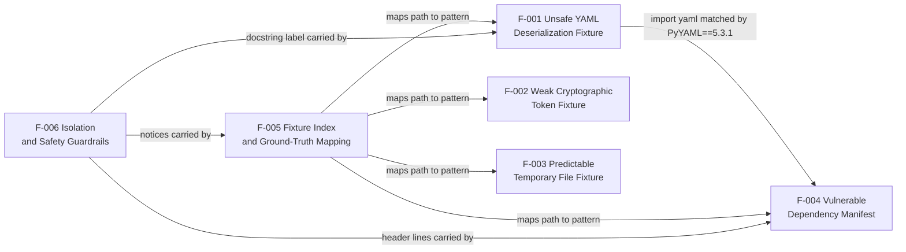

| Feature | Depends on | Nature of the dependency | Evidence |
|---|---|---|---|
| F-001 | F-004 (soft) | Import-time dependency on the PyYAML distribution the manifest pins; static analysis of the module still succeeds without it installed | `security_fixture/insecure_yaml.py:4`, `requirements-vulnerable.txt:3` |
| F-002 | None | Standard library only | `security_fixture/weak_crypto.py:2-3` |
| F-003 | None | No imports at all | `security_fixture/unsafe_tempfile.py` (no import statement) |
| F-004 | None | Data file; advisory matching is performed entirely by the consumer | `requirements-vulnerable.txt:3-4` |
| F-005 | F-001, F-002, F-003, F-004 | Its four entries name those paths; a renamed or deleted target makes an entry wrong | `security_fixture/README.md:5-8` |
| F-006 | F-001, F-004, F-005 | Its notices exist only inside those artifacts | `insecure_yaml.py:1`, `weak_crypto.py:1`, `unsafe_tempfile.py:1`, `requirements-vulnerable.txt:1-2`, `security_fixture/README.md:10-11` |

### 2.3.2 Integration Points

Each integration point is a file-format contract with a consumer outside the repository. Nothing in the tree invokes a consumer, and no consumer configuration, baseline or expected-findings file exists to be wired up.

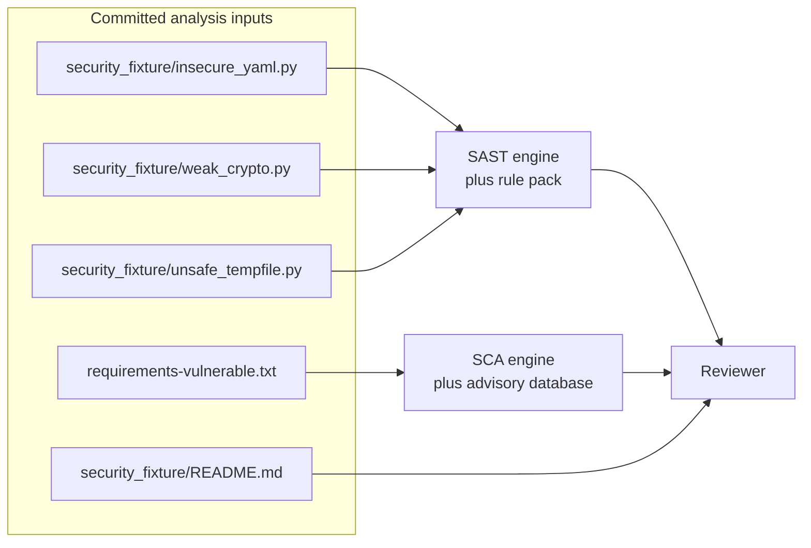

| Feature | Integration point | Contract the repository honours | Repository-side wiring |
|---|---|---|---|
| F-001, F-002, F-003 | SAST engine and rule pack | Valid Python source, module-level functions, no generated or minified content, no build step between commit and analyzer | None — no rule configuration, suppression file, inline suppression comment or baseline exists |
| F-004 | SCA engine and advisory database | Valid pip requirements file with exact `==` pins resolvable from public PyPI | None — no `.safety-policy.yml`, ignore file or SBOM exists |
| F-005 | Human reviewer | Markdown path-to-pattern list in the same folder as the code fixtures | None — reconciliation is manual, never automated |
| F-006 | Any reader or automated job | Unambiguous in-file prohibition on installing or deploying | None — no pre-commit hook, CI gate or lint rule enforces the notices |

**Documented cross-reference.** The only reference that leaves `security_fixture/`, and the only link between the code fixtures and the dependency fixture, is the index entry `../requirements-vulnerable.txt` at `security_fixture/README.md:8`. The root `README.md` documents none of these linkages; it contains no reference to any other file.

### 2.3.3 Shared Components

| Shared component | Features sharing it | Evidence and limits |
|---|---|---|
| CPython 3 interpreter and its parser | F-001, F-002, F-003 | All three modules compile under CPython 3.12.3; the f-string at `weak_crypto.py:8` sets a 3.6 minimum for the set as a whole |
| Structural convention: exactly one module-level function, exactly one unannotated parameter, no class, no decorator, no return annotation, no error handling | F-001, F-002, F-003 | Confirmed by AST inspection of all three modules: `load_config(user_supplied_yaml)` 1 statement, `create_token(user_id)` 2 statements, `write_report(contents)` 3 statements |
| Docstring label `Static-analysis fixture:` | F-001, F-002, F-003 | First line of each module: `insecure_yaml.py:1`, `weak_crypto.py:1`, `unsafe_tempfile.py:1` |
| Python standard library | F-002, F-003 | `hashlib` and `random` in `weak_crypto.py:2-3`; builtin `open` in `unsafe_tempfile.py:4` |

**Components that deliberately do not exist.** No `__init__.py`, no shared utility module, no common constants or type definitions, no shared configuration file, no shared test helper and no package namespace. No module imports another: the complete import set across the tracked tree is `yaml`, `hashlib` and `random`. The three functions have no callers anywhere in the repository. Because there is no packaging layer, the fixtures are discovered only by walking the folder.

### 2.3.4 Common Services

The repository contains no service of any kind, and no feature relies on a shared in-tree service:

| Service class | Status | Verification |
|---|---|---|
| Logging, metrics and telemetry | Absent | No logging import, no metrics client, no exporter anywhere in the tree |
| Configuration management | Absent | No config file, environment lookup or settings module |
| Authentication, session and authorization | Absent | `create_token` produces a token-shaped string only; it validates nothing and stores no session |
| Persistence and storage | Absent | No database driver, ORM, schema or file store |
| Network and HTTP client | Absent | `requests` is pinned but imported nowhere; no `urllib`, `socket` or `http` reference exists |
| Scheduling, messaging and job execution | Absent | No worker, queue, timer or task definition |

The services that matter to these features therefore all sit on the consumer side of the contract — the SAST engine and its rule pack for `F-001` to `F-003`, the SCA engine and its advisory database for `F-004`, and a human reviewer for `F-005`. The corpus supplies inputs and receives nothing back; no result, report or status is stored in the repository.


## 2.4 Implementation Considerations


The repository has no runtime, so the considerations below treat "performance" as the cost imposed on an analyzer and on a human reading the artifact, and "scalability" as the behaviour of the corpus when fixtures are added. Each per-feature table records only what the committed bytes support.

### 2.4.1 Cross-Feature Constraints

| Dimension | Observable constraint | Evidence |
|---|---|---|
| Language floor | CPython 3.6 or newer, set by the f-string in `weak_crypto.py:8`; all three modules compile under 3.12.3 with no warnings | `security_fixture/weak_crypto.py:8`; `py_compile` of all three modules |
| Build and packaging | Nothing to build and nothing to install: no `__init__.py`, `setup.py`, `pyproject.toml`, `package.json`, lockfile or build target; analyzers must discover the fixtures by walking the directory | Recursive file listing of the tree |
| Test surface | No test framework, no expected-findings baseline and no CI definition, so no automated check exists that the fixtures are still vulnerable or still detected | Repository-wide search for test and CI markers |
| Ignore rules | No `.gitignore` and no `.blitzyignore`; an untracked `security_fixture/__pycache__/` holding CPython 3.12 bytecode for all three modules sits in the working tree | Directory listing; `git status` |
| Platform assumption | `unsafe_tempfile.py` hardcodes the POSIX path `/tmp/report.txt`, so the module compiles on any platform but the pattern only means what it says on a POSIX-style filesystem | `security_fixture/unsafe_tempfile.py:3` |
| Data payloads | No sample YAML document, user identifier or report body is committed; untrusted-input shapes exist only as parameter names | `insecure_yaml.py:6`, `weak_crypto.py:5`, `unsafe_tempfile.py:2` |
| Change control | History is seven commits by one author on one date; `main` and `2011_01` are identical in file content, and no commit message records a requirement change, so requirement versions must be tracked outside the repository | `git log`; `git ls-tree` on both branches |
| Analysis cost bound | The whole corpus is 1,528 bytes across 36 lines, so a full scan is bounded by six file reads and needs no network access at analysis time | Byte and line counts of all six tracked files |

### 2.4.2 F-001 Unsafe YAML Deserialization Fixture

| Dimension | Consideration |
|---|---|
| Technical constraints | `import yaml` makes the module the only file with a third-party import, so an analyzer running without PyYAML can still parse it but cannot resolve the import; the call must keep the keyword form `Loader=yaml.Loader`, since `yaml.load` without a loader argument no longer exhibits the full permissive behaviour |
| Performance requirements | No runtime path. The module is 7 lines and 243 bytes with one statement in the function body, so parsing and rule evaluation are constant-cost; no generated or minified code exists to slow a parser |
| Scalability considerations | Nothing to scale. Coverage grows only by adding further fixtures, and each new one must be independent of this module, since no module imports another |
| Security implications | This is the corpus's most severe specimen: the full `Loader` resolves `!!python/object` tags, so a scanner that *executes* the function on untrusted input would be compromised. Analysis must remain static, and the pinned PyYAML 5.3.1 (CVE-2020-14343) must never be installed in a shared environment — a constraint the file's own docstring and the manifest header both state |
| Maintenance requirements | The rule the fixture guards is that `yaml.load` with a permissive loader is unsafe; upgrading PyYAML past 5.4 does not make this call safe, because arbitrary tags move to `UnsafeLoader` rather than disappearing. Any edit must preserve the single-callable shape, the unvalidated return, and the docstring warning at lines 1–3 |

### 2.4.3 F-002 Weak Cryptographic Token Fixture

| Dimension | Consideration |
|---|---|
| Technical constraints | Standard library only, so the fixture is analyzable with no installed packages; `str(user_id)` fixes the digest input as the identifier's string form, and the f-string at line 8 fixes the output as one hyphen-joined string |
| Performance requirements | No runtime path. 8 lines and 302 bytes; MD5 is constant-cost and is never invoked in the corpus workflow, so there is no latency budget to meet |
| Scalability considerations | The token alphabet is fixed by construction — 9,000 suffix values and a deterministic digest — so the fixture does not scale with input size by design; widening the range or adding a key would remove the weakness |
| Security implications | Two independent rule families share one file, so a scanner that reports only one of weak hashing or weak randomness produces a partial result that is directly visible against the count of two. The function is not safe to use for any real token: no expiry, no signature, no server-side state, and full reproducibility from the identifier alone |
| Maintenance requirements | The comment at line 6 and the docstring label state the intent and must stay. Any substitution of `secrets`, `os.urandom`, a salted digest or an HMAC destroys the fixture; the output contract `^[0-9a-f]{32}-[0-9]{4}$` is the assertion reviewers rely on and must remain exact |

### 2.4.4 F-003 Predictable Temporary File Fixture

| Dimension | Consideration |
|---|---|
| Technical constraints | Zero imports, so this is the only fixture an analyzer can evaluate with no dependency resolution at all; the path is a single string literal and the write mode a single literal `"w"` |
| Performance requirements | No runtime path. 6 lines and 204 bytes; no file is created at import time, so the repository has no side effect on the working tree |
| Scalability considerations | Concurrency is precisely what the fixture refuses to handle: a fixed name in a shared directory cannot support more than one writer, and that absence of scalability is the defect rather than a limitation |
| Security implications | If executed, the write would truncate any existing `/tmp/report.txt` and, through a pre-created symlink, redirect content to a file the attacker chooses. No exclusive-create flag, owner-only permission or atomic creation is present |
| Maintenance requirements | Keep the literal path, the truncating mode and the returned path; introducing `tempfile`, a parameterised path, a PID or a random component would silently convert the file into a correct example and remove the finding, and the index entry at `security_fixture/README.md:7` must continue to describe the pattern it now shows |

### 2.4.5 F-004 Vulnerable Dependency Manifest

| Dimension | Consideration |
|---|---|
| Technical constraints | Must remain parseable by any pip-compatible parser; exact `==` pins are required so that one version per package reaches the advisory lookup, and the two comment lines must stay above the pins |
| Performance requirements | No runtime path. Two coordinates and 178 bytes; resolution is the consumer's cost, and the repository performs no network access at any point |
| Scalability considerations | The manifest grows by one line per package, but every addition must stay inside a published advisory range to preserve the fixture's purpose; the `requests` entry deliberately has no import site, so the corpus scales across code and dependency surfaces independently |
| Security implications | Installing the file would deploy a PyYAML vulnerable to CVE-2020-14343 and a requests vulnerable to CVE-2018-18074, CVE-2023-32681, CVE-2024-35195 and CVE-2024-47081 into whatever environment resolves it. It must be treated strictly as advisory-matching input; no hash, index URL or credential reference may be added |
| Maintenance requirements | Three things must move together: the pin, the advisory expectations in the consuming scanner's database revision, and the index entry at `security_fixture/README.md:8`. A version bump without a documented reason deletes the ground truth for two of the four documented defect classes |

### 2.4.6 F-005 Fixture Index and Ground-Truth Mapping

| Dimension | Consideration |
|---|---|
| Technical constraints | Plain Markdown with relative paths; the `../requirements-vulnerable.txt` form is required because the SCA target sits outside the folder, and the file is read by humans only, so no schema or automated parser constrains it |
| Performance requirements | No runtime path. 11 lines and 572 bytes; an entire reconciliation is four comparisons |
| Scalability considerations | Coverage is manual: each added, renamed or removed fixture requires a matching edit to the list, and no automated check compares the list against the directory contents, so drift is possible and is the main scalability limit of this feature |
| Security implications | The index is the sole defence against a real finding being dismissed as intended, and against an intended finding being reported as new. Because it names no CVE, severity or expected count, it cannot itself leak a stale security claim into a review |
| Maintenance requirements | Update lines 5–8 whenever the fixture set changes; preserve lines 10–11 verbatim, since the isolation rule and the variability caveat are the normative statements `F-006` depends on |

### 2.4.7 F-006 Isolation and Safety Guardrails

| Dimension | Consideration |
|---|---|
| Technical constraints | Documentary only. The notices are comment lines and docstrings, enforced by nothing, and the tree has no hook, workflow, container, infrastructure definition, packaging metadata or test harness that could enforce them |
| Performance requirements | None. Guardrails impose no cost and add no execution path |
| Scalability considerations | The notices are per-artifact and must be replicated in every new fixture; there is no central policy file, so compliance grows linearly with the corpus and depends on the author remembering the docstring prefix |
| Security implications | The absence of any gating surface is the control that keeps vulnerable pins out of shared environments and keeps uncalled functions out of deployed services. The observed untracked `__pycache__` directory shows the modules have been compiled locally and that no rule keeps generated bytecode out of the checkout |
| Maintenance requirements | Keep the two header lines in first position, keep the docstring prefix first in every module, and keep both prohibitions on `security_fixture/README.md:10`. Add an ignore rule only as a deliberate decision, since none exists today |


## 2.5 Traceability Matrix


The matrices below connect each feature to the artifact that implements it, each requirement to a verification method with a located evidence point, and each documented pattern to the consumer that is expected to detect it. Requirement identifiers are the ones defined in [2.2 Functional Requirements](#22-functional-requirements); identifiers F-001 to F-006 are defined in [2.1 Feature Catalog](#21-feature-catalog).

### 2.5.1 Feature-to-Artifact Traceability

| Feature | Artifact and line range | Defect class represented | Requirements |
|---|---|---|---|
| F-001 | `security_fixture/insecure_yaml.py:1-7` | CWE-502 unsafe deserialization, via `yaml.Loader` at line 7 | F-001-RQ-001 … 004 |
| F-002 | `security_fixture/weak_crypto.py:1-8` | CWE-328 weak hash (line 7); CWE-338 insecure randomness (line 8) | F-002-RQ-001 … 004 |
| F-003 | `security_fixture/unsafe_tempfile.py:1-6` | CWE-377 insecure temporary file, from the literal path at line 3 | F-003-RQ-001 … 004 |
| F-004 | `requirements-vulnerable.txt:3-4` | Vulnerable dependency pins: PyYAML 5.3.1, requests 2.19.0 | F-004-RQ-001 … 005 |
| F-005 | `security_fixture/README.md:5-8`, `:10-11` | Not a defect; the path-to-pattern ground truth and the isolation rule | F-005-RQ-001 … 004 |
| F-006 | `requirements-vulnerable.txt:1-2`; `security_fixture/README.md:10`; line 1 of all three modules | Not a defect; the documented safety boundary around the corpus | F-006-RQ-001 … 004 |

### 2.5.2 Requirement-to-Verification Traceability

Verification methods are the four that the repository actually supports: **AST** (parse the module and inspect its structure), **search** (repository-wide text or regex search), **compile** (`python -m py_compile`), and **scan** (run a SAST or SCA engine and compare its findings with the documented pattern).

| Requirement ID | Verification method | Evidence locus |
|---|---|---|
| F-001-RQ-001 | AST + compile | `security_fixture/insecure_yaml.py:6` |
| F-001-RQ-002 | Search + scan | `security_fixture/insecure_yaml.py:7` |
| F-001-RQ-003 | AST + search | `security_fixture/insecure_yaml.py:7` |
| F-001-RQ-004 | Search | `security_fixture/insecure_yaml.py:4`; `requirements-vulnerable.txt:3` |
| F-002-RQ-001 | AST + compile | `security_fixture/weak_crypto.py:5` |
| F-002-RQ-002 | Search + scan | `security_fixture/weak_crypto.py:7` |
| F-002-RQ-003 | Search + scan | `security_fixture/weak_crypto.py:8` |
| F-002-RQ-004 | Search + AST | `security_fixture/weak_crypto.py:7-8` |
| F-003-RQ-001 | AST + compile | `security_fixture/unsafe_tempfile.py:2` |
| F-003-RQ-002 | Search + scan | `security_fixture/unsafe_tempfile.py:3` |
| F-003-RQ-003 | Search | `security_fixture/unsafe_tempfile.py:4-5` |
| F-003-RQ-004 | AST | `security_fixture/unsafe_tempfile.py:6` |
| F-004-RQ-001 | Search (requirements parse) | `requirements-vulnerable.txt:1-4` |
| F-004-RQ-002 | Scan | `requirements-vulnerable.txt:3` |
| F-004-RQ-003 | Scan + search | `requirements-vulnerable.txt:4` |
| F-004-RQ-004 | Search | `requirements-vulnerable.txt:3-4` |
| F-004-RQ-005 | Search (tree listing) | Repository root; whole tree |
| F-005-RQ-001 | Search | `security_fixture/README.md:5-8` |
| F-005-RQ-002 | Search (tree listing) | `security_fixture/README.md:5-8` |
| F-005-RQ-003 | Search | `security_fixture/README.md:10-11` |
| F-005-RQ-004 | Search | `security_fixture/README.md` (whole file) |
| F-006-RQ-001 | Search | `requirements-vulnerable.txt:1-2` |
| F-006-RQ-002 | Search | `security_fixture/README.md:10` |
| F-006-RQ-003 | Search | `insecure_yaml.py:1`; `weak_crypto.py:1`; `unsafe_tempfile.py:1` |
| F-006-RQ-004 | Search | Whole tree |

### 2.5.3 Documented-Pattern Coverage Matrix

Each row pairs the pattern published in `security_fixture/README.md` with the feature that exhibits it and the consumer expected to report it.

| Documented pattern (index line) | Exhibiting feature | Expected detection surface | Verification outcome available today |
|---|---|---|---|
| Unsafe YAML loading pattern (`README.md:5`) | F-001 | SAST rule for `yaml.load` with a permissive loader | Finding expected at `insecure_yaml.py:7`; no baseline file records it |
| Weak hashing and non-cryptographic randomness (`README.md:6`) | F-002 | Two SAST rules: weak hash, insecure PRNG | Two findings expected at `weak_crypto.py:7` and `:8`; no baseline records them |
| Predictable shared temporary-file path (`README.md:7`) | F-003 | SAST rule for unsafe temporary-file creation | One finding expected at `unsafe_tempfile.py:3`; no baseline records it |
| Deliberately old dependency versions for SCA testing (`README.md:8`) | F-004 | SCA advisory matching against a vulnerability database | Two advisory matches expected, one per pin; no baseline records them |

### 2.5.4 Related Process Flowcharts

Two diagrams describe the corpus's process relationships. [2.3.1 Feature Dependency Map](#231-feature-dependency-map) shows which features depend on which, and [2.3.2 Integration Points](#232-integration-points) shows the file-format contract between the fixtures and their SAST, SCA and human consumers. The chart below is the verification procedure those contracts imply; it is the workflow a team performs manually today, because no automation for it exists in the repository.

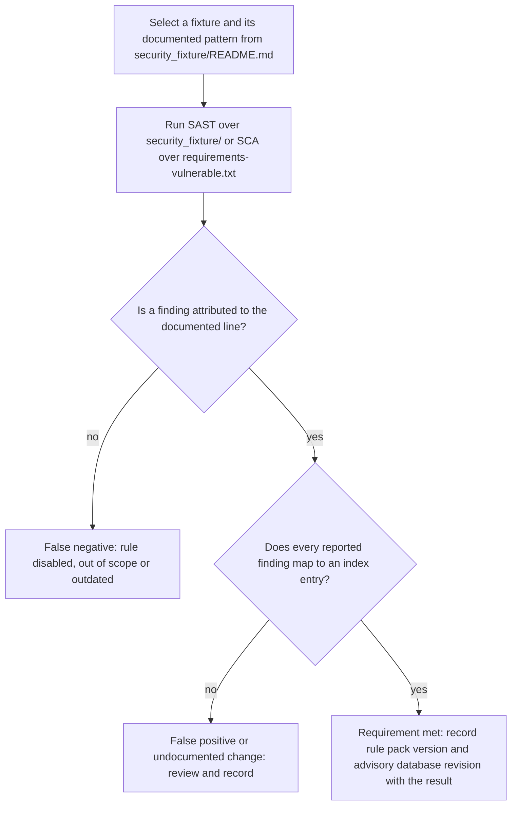

### 2.5.5 Requirement Versions

| Version | Basis | Scope | Change basis |
|---|---|---|---|
| v1.0 | Commit `6c7b396`, the current tip | All 25 requirements across F-001 to F-006 | Baseline established by this specification from the committed files |

No earlier requirement version exists. History contains seven commits, all dated the same day by the same author, consisting of an initial commit with only `README.md`, an upload adding `requirements-vulnerable.txt`, creation of `security_fixture/`, a deletion and re-creation of that folder, a transient `security_fixture/asdasd` file that was added and deleted within the same history, and a final upload. No commit changes the content of a fixture after it was introduced, and no commit message records a requirement change. Requirement revisions must therefore be tracked outside the repository, keyed to a commit identifier.

### 2.5.6 Assumptions

- The consuming analyzer reports the pattern classes that `security_fixture/README.md` documents; a scanner whose rule pack omits one of the four patterns produces a false negative that is a property of the scanner, not of the corpus.
- Advisory data for the two pins is supplied by the consuming scanner and is current at scan time. The repository names no CVE, so no verdict about which advisories apply can be derived from the tree alone.
- The fixtures are analyzed statically and never executed; `load_config` and `write_report` would have real side effects on untrusted input and on the local filesystem respectively.
- Callers exist outside the repository. Nothing in the tree invokes the three functions, so any consumer must bring its own harness.
- The Python 3.6 floor implied by `weak_crypto.py:8` reflects the minimum interpreter any consumer uses; the tree was verified to compile under 3.12.3.
- "Findings" means analyzer output attributed to a file and line in this tree; no severity scale, threshold or acceptance percentage is defined anywhere in the repository, so none is asserted here.

### 2.5.7 Constraints

- **Safety.** The corpus is unsafe by design: installing `requirements-vulnerable.txt` or deploying the modules is prohibited by both the manifest header and `security_fixture/README.md:10`.
- **Immutability of the defects.** Any remediation edit — `safe_load`, `secrets`, `tempfile.mkstemp`, a version bump — deletes ground truth and must be treated as withdrawing a requirement, not as a fix.
- **No automation.** No CI gate, hook, baseline, suppression file or expected-findings manifest exists, so every requirement above is verified by inspection or by an out-of-tree scan.
- **Single dependency declaration.** `requirements-vulnerable.txt` is the only manifest in the tree; adding packaging metadata would create an installable surface the isolation rule forbids.
- **Environment assumptions.** A POSIX-style `/tmp` for the temporary-file fixture, and a PyPI-reachable advisory source for the dependency fixture; neither is provisioned by the repository.
- **Sparse documentation.** Beyond the fixture index and the 29-byte root title, no design, usage or policy document exists, so intent is recoverable only from the artifacts and their inline notices.


## 2.6 References


Related sections of this specification: [1.2 System Overview](#12-system-overview) for the corpus description, [1.3 Scope](#13-scope) for what is explicitly out of scope, and [2.1 Feature Catalog](#21-feature-catalog) through [2.5 Traceability Matrix](#25-traceability-matrix) for the requirements derived from the artifacts below.

**Repository artifacts**

- `README.md` — the 29-byte single H1 `# proactive_insights_security`; established that the root carries no usage, install or feature documentation and therefore contributes no feature.
- `requirements-vulnerable.txt` — the entire SCA surface: do-not-install header on lines 1–2, `PyYAML==5.3.1` on line 3, `requests==2.19.0` on line 4; established F-004 and F-006-RQ-001, and the pin that F-001 depends on.
- `security_fixture/` — the flat folder holding all four analysis targets and the fixture index; confirmed there is no `__init__.py`, no sub-folder and no shared module, which is the basis for the "no shared code" finding in [2.3.3 Shared Components](#233-shared-components).
- `security_fixture/README.md` — the path-to-pattern map on lines 5–8, the isolation rule on line 10 and the variability caveat on line 11; established F-005 and F-006-RQ-002, and the `../requirements-vulnerable.txt` cross-reference.
- `security_fixture/insecure_yaml.py` — `import yaml` on line 4 and `return yaml.load(user_supplied_yaml, Loader=yaml.Loader)` on line 7; established F-001 in full.
- `security_fixture/weak_crypto.py` — `hashlib.md5(str(user_id).encode()).hexdigest()` on line 7 and `f"{digest}-{random.randint(1000, 9999)}"` on line 8; established F-002 and the Python 3.6 floor.
- `security_fixture/unsafe_tempfile.py` — the literal `/tmp/report.txt` on line 3, the `"w"` context-manager write on lines 4–5 and the returned path on line 6; established F-003.
- Git metadata via `git ls-files`, `git log --pretty`, `git branch -a` and `git status` — established the six-file tracked inventory, the seven-commit single-author history, identical `main` and `2011_01` contents, and the untracked `security_fixture/__pycache__/` bytecode cited in F-006.
- Tree-wide text searching and AST inspection with `git grep`, `python -m py_compile` and an AST walk over all three modules — established every absence claim (no `safe_load`, `secrets`, `tempfile`, `__main__`, CI, tests or scanner configuration) and the shared structural convention of one unannotated function per module.

**Web sources**

- [web] NVD, *CVE-2020-14343 Detail* (https://nvd.nist.gov/vuln/detail/CVE-2020-14343) — PyYAML before 5.4 allows code execution on untrusted YAML; CVSS 3.1 base 9.8; establishes the vulnerable range behind the `PyYAML==5.3.1` pin.
- [web] GitHub Advisory Database, *GHSA-8q59-q68h-6hv4* (https://github.com/advisories/GHSA-8q59-q68h-6hv4) — records affected `< 5.4`, patched `5.4`, corroborating the first fixed release in [2.1.5](#215-f-004-vulnerable-dependency-manifest).
- [web] PyYAML, *CHANGES* (https://github.com/yaml/pyyaml/blob/main/CHANGES) — 5.4 (2021-01-19) moves arbitrary `python/object` tags to `UnsafeLoader`, which is why upgrading the pin alone does not make `yaml.load` with a permissive loader safe.
- [web] Debian Security Tracker, *CVE-2018-18074* (https://security-tracker.debian.org/tracker/CVE-2018-18074) — `Authorization` header sent to an http URI after an https-to-http redirect; fixed in requests 2.20.0.
- [web] requests project, *Community Updates* (https://requests.readthedocs.io/en/latest/community/updates) — release history and dates for 2.19.0, 2.20.0, 2.31.0, 2.32.0 and 2.32.4, the fixed releases cited for the `requests` pin.
- [web] NVD, *CVE-2023-32681 Detail* (https://nvd.nist.gov/vuln/detail/CVE-2023-32681) — `Proxy-Authorization` leak on redirects; patched in 2.31.0.
- [web] GitHub Advisory Database, *GHSA-9wx4-h78v-vm56* (https://github.com/advisories/GHSA-9wx4-h78v-vm56) — TLS verification not applied after a `verify=False` request; CVE-2024-35195, patched in 2.32.0.
- [web] GitHub Advisory Database, *GHSA-9hjg-9r4m-mvj7* (https://github.com/advisories/GHSA-9hjg-9r4m-mvj7) — `.netrc` credential leak; CVE-2024-47081, patched in 2.32.4.
- [web] Snyk, *requests 2.19.0 vulnerability report* (https://security.snyk.io/package/pip/requests/2.19.0) — corroborates the advisories matching the pinned `requests` version.
- [web] Python documentation, *random* (https://docs.python.org/3/library/random.html) and *secrets* (https://docs.python.org/3/library/secrets.html) — the Mersenne Twister is documented as "completely unsuitable for cryptographic purposes", with `secrets` recommended instead; the basis for the F-002-RQ-003 security requirement.
- [web] Python documentation, *tempfile* (https://docs.python.org/3/library/tempfile.html) and OpenStack Security Guide, *Create, use, and remove temporary files securely* (https://security.openstack.org/guidelines/dg_using-temporary-files-securely.html) — fixed names in shared directories permit TOCTOU and symlink attacks, and atomic `mkstemp`-style creation is the recommended alternative; the basis for the F-003 security requirements.
- [web] MITRE, *CWE-377: Insecure Temporary File* (https://cwe.mitre.org/data/definitions/377.html) — classification of the pattern in `security_fixture/unsafe_tempfile.py`; the CWE-502, CWE-328 and CWE-338 labels used for F-001 and F-002 follow the same classification scheme.


# 3. Technology Stack

## 3.1 Programming Languages

The checkout contains one general-purpose programming language, Python, and no other. Every claim in this sub-section is drawn from the six tracked files and from compiling them with the interpreter present in the working tree.

### 3.1.1 Language Inventory by Component

| Component | Language | Version constraint observed | Evidence |
|---|---|---|---|
| `security_fixture/insecure_yaml.py` | Python 3 source | Syntax valid on any Python 3; no version-floor feature beyond the language itself | `import yaml` at line 4, one function at lines 6-7 |
| `security_fixture/weak_crypto.py` | Python 3 source | **Python 3.6 or newer** — the f-string at line 8 is a syntax error on 3.5 and on any Python 2 | `return f"{digest}-{random.randint(1000, 9999)}"` at line 8 |
| `security_fixture/unsafe_tempfile.py` | Python 3 source | Syntax valid on Python 3.0+; semantically POSIX-oriented because of the literal `/tmp/report.txt` | Lines 3-5 |
| `requirements-vulnerable.txt` | Pip requirements format | Not applicable — declarative dependency coordinates, no executable syntax | Lines 3-4 |
| `README.md`, `security_fixture/README.md` | Markdown | Not applicable — documentation only | Full contents of both files |

No JavaScript/TypeScript, Swift, Kotlin, Objective-C, Java, C/C++, Go, Ruby or shell source exists anywhere in the tree. A keyword sweep of every tracked file for `react`, `typescript`, `swift`, `kotlin`, `objective-c`, `electron` and `docker` returns no matches, and `git log --all --name-only` shows that no file in any commit ever held another language.

### 3.1.2 Language Level and Feature Floor

The floor is set by exactly one construct: the f-string in `create_token`, which dates the corpus to Python 3.6 at the earliest. Nothing else narrows or raises it:

- No `match` statement, no walrus operator, and no positional-only parameters, so there is no Python 3.8/3.10 requirement.
- No type annotations, `typing` import, dataclass, async syntax or `from __future__` import, so nothing depends on post-3.6 typing machinery.
- No `__init__.py`, `pyproject.toml`, `setup.py` or `package.json`, so no packaging metadata declares a supported interpreter set — the effective version range exists only as an inference from the source.

All three modules compile cleanly with `python3 -m py_compile` on the CPython 3.12.3 interpreter in the working tree, and an untracked `security_fixture/__pycache__/` holds `insecure_yaml.cpython-312.pyc`, `unsafe_tempfile.cpython-312.pyc` and `weak_crypto.cpython-312.pyc`, which confirms that the local development interpreter is CPython 3.12.

```python
digest = hashlib.md5(str(user_id).encode()).hexdigest()
return f"{digest}-{random.randint(1000, 9999)}"   # requires Python >= 3.6
```

### 3.1.3 Selection Criteria and Justification

Python was selected for reasons intrinsic to a scanner fixture corpus, each visible in the files:

1. **Syntax-heavy defect fidelity.** The four defect classes the corpus documents — permissive deserialization, unkeyed hashing, non-cryptographic randomness, shared temporary paths — all express in single Python statements that a SAST rule can match on one line (`security_fixture/insecure_yaml.py:7`, `weak_crypto.py:7-8`, `unsafe_tempfile.py:3`). No framework, control flow or indirection sits between the statement and the finding.
2. **Zero install cost for analysis.** Two of the three modules import only the standard library (`hashlib`, `random`) or nothing at all (builtin `open`), so a scanner can evaluate them without resolving a single dependency (see [2.4.4](#244-f-003-predictable-temporary-file-fixture)).
3. **A native dependency-analysis pairing.** Python's `requirements.txt` convention gives the corpus a second, non-code analysis surface in a format every SCA engine already parses, with exact `==` pins that map one-to-one onto an advisory lookup.
4. **Maximum analyzer coverage per byte.** The three modules total 749 bytes, so scanner throughput is dominated by the tool, not the input.

### 3.1.4 Language Constraints and Dependencies

| Constraint | Detail | Evidence |
|---|---|---|
| Interpreter skew against the pins | The pinned `PyYAML==5.3.1` declares support only for Python 2.7 and 3.5-3.8, yet the ambient interpreter is CPython 3.12.3 where that pin cannot be installed; the modules are therefore analysed under 3.12 while their manifest names an interpreter era that no longer matches | `requirements-vulnerable.txt:3`; ambient `python3 -VV` reports 3.12.3 |
| Python 2 exclusion | `weak_crypto.py` cannot be parsed by Python 2 because of the f-string, so the corpus is Python 3 only despite PyYAML 5.3.1 also supporting 2.7 | `security_fixture/weak_crypto.py:8` |
| Platform specificity | The `/tmp/report.txt` literal in `unsafe_tempfile.py` is a POSIX path assumption; the module compiles identically on Windows but then demonstrates a different pattern | `security_fixture/unsafe_tempfile.py:3` |
| No runtime entry point | No `if __name__ == "__main__":` block, no console-script entry, no `__init__.py`; the interpreter is used to parse and scan the files, never to run them as an application | All three modules |
| Generated-language artifacts | CPython bytecode (`__pycache__/*.cpython-312.pyc`) appears in the working tree untracked; no `.gitignore` excludes it, so it is a live, if untracked, component of the local stack | `git status`; directory listing of `security_fixture/__pycache__/` |


## 3.2 Frameworks & Libraries

No application framework exists in the repository. There is no web framework, no test framework, no ORM, no CLI framework and no task scheduler; the entire library surface is one third-party import plus two standard-library modules.

### 3.2.1 Core Library Inventory

| Library | Version | Kind | Where used | Role |
|---|---|---|---|---|
| PyYAML | `5.3.1` (pinned) | Third-party, PyPI | `security_fixture/insecure_yaml.py:4,7` | Supplies the `load` callable and the permissive `Loader` class that constitute the deserialization fixture |
| `hashlib` | Bundled with CPython (no pin) | Standard library | `security_fixture/weak_crypto.py:2,7` | Provides `md5`, the unkeyed hash in the token fixture |
| `random` | Bundled with CPython (no pin) | Standard library | `security_fixture/weak_crypto.py:3,8` | Provides `randint`, the Mersenne Twister-backed 4-digit suffix |
| builtin `open` | Bundled with CPython (no pin) | Builtin | `security_fixture/unsafe_tempfile.py:4` | Performs the truncating write to `/tmp/report.txt` |

`requests==2.19.0` is pinned in `requirements-vulnerable.txt:4` but is imported nowhere: a grep of every `.py` file for `requests` and `import requests` returns no matches. It is a declared dependency with zero call sites, which is the fixture's deliberate cross-surface case rather than an oversight.

### 3.2.2 Framework Absences

| Framework class | Status | Consequence for the stack |
|---|---|---|
| Web/API (Flask, Django, FastAPI) | Absent — no route, handler or server import in any file | Nothing to serve, no port, no request lifecycle |
| Test (pytest, unittest) | Absent — no `test_` file, no `unittest` import, no assertion | The corpus has no self-verifying gate ([2.4.1](#241-cross-feature-constraints)) |
| Build/packaging (setuptools, hatch, poetry) | Absent — no `setup.py`, `pyproject.toml`, `setup.cfg`, `Pipfile` or lockfile | Modules are analysed in place, never installed |
| Data/ORM (SQLAlchemy, pymongo) | Absent | No schema, no connection string, no model |
| CLI (click, argparse, typer) | Absent — no entry point of any kind | The three functions have no callers inside the tree |
| Logging/telemetry | Absent — no `logging` import, no handler, no exporter | No output channel to instrument |

### 3.2.3 Compatibility Requirements

The one real compatibility obligation is between the PyYAML pin and the interpreter, and the two disagree:

| Requirement | Observation | Source |
|---|---|---|
| Interpreter support of the pin | PyYAML 5.3.1 declares Python 2.7 and 3.5-3.8 only and ships no CPython 3.12 wheel, so on the ambient 3.12.3 interpreter it must build from sdist | PyPI metadata for `PyYAML 5.3.1`; `python3 -VV` |
| Build toolchain of the pin | PyYAML releases older than 6.0.1 cannot build under Cython 3 — `setup.py` calls `self.cython_sources(...)`, which Cython 3's `build_ext` no longer provides, aborting with `AttributeError: cython_sources`; PyYAML 6.0.1 pinned `Cython<3` and 6.0.2 added Cython 3.x support | [web] yaml/pyyaml issue #736; PyYAML CHANGES |
| Call-signature requirement of the fixture | The fixture must keep the keyword form `Loader=yaml.Loader`; `yaml.load` without a loader argument raises in PyYAML 6.x, so omitting it would replace the finding with a `TypeError` | `security_fixture/insecure_yaml.py:7` |
| Loader semantics across versions | `yaml.Loader` remains the *unsafe* loader in current releases, not a deprecation shim: under the ambient PyYAML 6.0.3 its MRO still includes `UnsafeConstructor`, and `yaml.load("!!python/object/apply:os.getcwd []", Loader=yaml.Loader)` executes `os.getcwd` | Verified by execution against PyYAML 6.0.3 |
| Standard-library stability | `hashlib.md5` and `random.randint` are present unchanged through CPython 3.6-3.12; `hashlib.md5` still accepts the default `usedforsecurity` behaviour and emits no error, so the fixture compiles and runs unmodified on 3.12 | `security_fixture/weak_crypto.py:7-8`; execution output `a1d0c6e83f027327d8461063f4ac58a6-6636` |
| Installed-versus-declared drift | The ambient environment holds PyYAML 6.0.3 and requests 2.34.2 — neither is the pinned version. The pins exist purely as advisory-matching input and are intentionally never installed, exactly as the manifest header instructs | `requirements-vulnerable.txt:1-2`; ambient `yaml.__version__`, `requests.__version__` |

### 3.2.4 Justification of Library Choices

- **PyYAML over a hand-rolled parser.** The rule under test is a rule about the real library: SAST engines key on `yaml.load` with a permissive `Loader`, so the fixture must import the genuine package for the signature, the loader class hierarchy and the tag-resolution behaviour to be authentic.
- **Standard library only elsewhere.** Using `hashlib.md5` and `random.randint` directly keeps the weak-cryptography fixture dependency-free and prevents a scanner's dependency-resolution step from interfering with its code scan.
- **No test framework, by design.** The corpus is consumed by external scanners whose rules and advisory databases change independently; a repository-local harness would assert scanner behaviour the repository does not control, and `security_fixture/README.md:11` warns that findings vary with those inputs.


## 3.3 Open Source Dependencies

The repository has exactly two declared open-source dependencies, both held in a single pip requirements file, and both deliberately old.

### 3.3.1 Declared Dependency Set

| Package | Pinned version | Registry | Import site in tree | Advisory status (external) |
|---|---|---|---|---|
| `PyYAML` | `5.3.1` | Public PyPI | `security_fixture/insecure_yaml.py:4` (`import yaml`) | CVE-2020-14343, CVSS 3.1 base 9.8; affected `<5.4`, fixed `5.4` |
| `requests` | `2.19.0` | Public PyPI | None — pinned, never imported | CVE-2018-18074 (fixed `2.20.0`), CVE-2023-32681 (fixed `2.31.0`), CVE-2024-35195 (fixed `2.32.2`), CVE-2024-47081 (fixed `2.32.4`) |

The manifest is four lines in total, of which two are the warning header:

```
# Intentionally outdated dependencies for dependency-scanner testing only.

# Do not install these packages or use this file in a real application.

PyYAML==5.3.1
requests==2.19.0
```

### 3.3.2 Manifest Structure and Constraints

| Property | Observed value | Why it matters |
|---|---|---|
| Format | Plain `requirements.txt` pip format, filename `requirements-vulnerable.txt` | Any pip-compatible parser consumes it; the non-standard name prevents accidental installation by tooling that auto-discovers `requirements.txt` |
| Version operator | Exact `==` on both coordinates | One version per package reaches the advisory lookup, so a reported finding is unambiguous |
| Extras, environment markers, hashes, `--index-url`, `-r`, `-e` | All absent | No conditional resolution and no integrity digest to reconcile; a scanner cannot be confused by a compound requirement |
| Lockfile / constraints file | None — no `requirements.lock`, no `constraints.txt`, no `poetry.lock`, no `Pipfile.lock` | The transitive closure is unrecorded; the consumer's resolver decides it at scan time |
| Header comments | Lines 1-2 brand the pins as test-only and forbid installation | The only licence-adjacent governance text in the repository |

The deliberate design point is the asymmetry between code and manifest: `PyYAML` is both pinned and imported, while `requests` is pinned and never imported. That gives the corpus a dependency finding with no corresponding call site — a case SCA and SAST must report on different surfaces ([1.3.1.1](#1311-core-features-and-functionalities)).

### 3.3.3 Registry and Resolution Requirements

- Both coordinates resolve from the public PyPI index; no private index, mirror, proxy, credential or `--extra-index-url` appears in any tracked file (`requirements-vulnerable.txt` is the only file that names a package at all).
- Resolution is a **consumer-side** act: nothing in the repository fetches, vendors, downloads or verifies a package, so a scan can run fully offline once the SCA engine has its advisory database.
- The advisory database revision is part of the input contract. `security_fixture/README.md:11` states that a scanner "may report findings differently depending on enabled rules and vulnerability databases", so the same pins can yield different finding sets across database revisions.

### 3.3.4 Governance Gaps in the Dependency Surface

| Gap | Evidence |
|---|---|
| No licence file, notice or third-party attribution for the two dependencies | No `LICENSE`, `NOTICE`, `COPYING` or `THIRD-PARTY` file exists at any path |
| No dependency-update automation or advisory tooling | A grep of every tracked file for `snyk`, `dependabot`, `pip-audit`, `safety`, `bandit`, `semgrep`, `trivy`, `sbom` and `cyclonedx` returns no matches |
| No integrity metadata | No hash, signature or lockfile accompanies either pin |
| No allowed/denied package policy | No configuration file of any kind exists outside `requirements-vulnerable.txt` |

These gaps are intentional for a fixture corpus: hardening any of them would remove the very conditions the corpus exists to exercise ([3.8](#38-security-implications-of-the-stack-choices)).


## 3.4 Third-Party Services

The system integrates with no third-party service. There is no external API call, no authentication provider, no monitoring or telemetry service and no cloud provider in the code or configuration, because no code and no configuration that could reach a network exist.

### 3.4.1 Service-Class Inventory

| Service class | Status | Evidence |
|---|---|---|
| External APIs / HTTP integrations | Absent | A grep of every tracked file for `http://`, `https://`, `urllib`, `socket`, `requests` and `os.environ` matches only the dependency line `requirements-vulnerable.txt:4`; no call site exists |
| Authentication / identity provider (e.g. Auth0, OIDC, OAuth) | Absent | `create_token` in `security_fixture/weak_crypto.py:5-8` mints a string from MD5 plus `random.randint`; it validates nothing, stores nothing and contacts nothing |
| Monitoring, logging, APM, error reporting | Absent | No `logging` import, no handler, no exporter, no agent configuration in the tree |
| Cloud services (compute, managed data, secrets, queues) | Absent | No SDK import, no endpoint, no region, no credential reference, no IaC file |
| Secrets management / vault | Absent | No secret literal, environment lookup or config file; the only literal path is `/tmp/report.txt` |
| Notification / incident tooling | Absent | No webhook, no URL, no integration key |

### 3.4.2 External Systems That Do Participate

Two external systems bound the stack even though the repository contains no client code for either:

| External system | Nature of the dependency | Evidence |
|---|---|---|
| Public PyPI | The registry from which both pinned coordinates resolve, used by the *consumer's* resolver, not by any code here | `requirements-vulnerable.txt:3-4` |
| Consuming scanner's vulnerability/advisory database | The source of record for what each pin is reported as; the repository names no CVE, so severity and identity come wholly from this external database | No CVE string appears in any tracked file; `security_fixture/README.md:8,11` |
| Git hosting (GitHub) | Transport only: the checkout's `origin` is `https://github.com/lakshya-blitzy/proactive_insights_security.git`, with `main` and `2011_01` published | `git remote -v`; `git branch -a` |

### 3.4.3 Integration Implications

- **No credentials to manage.** With zero service integrations there is no key, token, client secret or certificate in the repository, so the stack's secret-management requirement is nil — and must stay nil, since a committed credential would be a second, unintended class of finding.
- **Offline analyzability.** Because nothing calls out, a scan of the corpus needs only the advisory database loaded by the SCA engine; dependencies are never fetched by the repository itself.
- **No availability or latency contract with a provider.** Findings depend on the consumer's database revision, not on a service the repository could call ([3.3.3](#333-registry-and-resolution-requirements)).


## 3.5 Databases & Storage

There is no database and no storage tier. The only write in the repository is the fixture defect itself, and the only durable state is the Git object store.

### 3.5.1 Persistence Inventory

| Storage class | Status | Evidence |
|---|---|---|
| Relational database (PostgreSQL, MySQL, SQLite) | Absent | No driver import, no connection string, no DDL, no migration directory |
| Document database (MongoDB, etc.) | Absent | No `pymongo`/`motor` import, no URI, no collection model |
| Key-value store or cache (Redis, Memcached) | Absent | No client import, no cache configuration, no `functools.lru_cache` or memoisation |
| ORM or query layer | Absent | No `sqlalchemy`, no model class; the tree holds three standalone functions |
| Object or blob storage (S3, GCS, Azure Blob) | Absent | No SDK import, no bucket or container name, no credential reference |
| Schema, migrations, seed data, fixtures-as-data | Absent | No `.sql`, `.json`, `.csv` or dataset file exists |

### 3.5.2 The One Persistence Path

`security_fixture/unsafe_tempfile.py` is the sole code path that writes anything:

```python
path = "/tmp/report.txt"
with open(path, "w") as report:
    report.write(contents)
```

Its storage characteristics, all of them defects rather than design:

| Characteristic | Observation |
|---|---|
| Location | A fixed name inside the world-writable `/tmp` directory, shared by every process on the host (line 3) |
| Mode | `"w"` — truncating; a second caller silently destroys the first caller's content (line 4) |
| Durability | No `flush`, `fsync`, atomic rename, exclusive-create flag or file permission control; the write survives only as long as the host's `/tmp` does |
| Read-back | None — nothing in the repository reads the file, and the function returns only the path string (line 6) |
| Concurrency | Unsupported by construction: one fixed path cannot serve two writers, which is exactly the pattern the fixture demonstrates |
| Runtime status | Not executed by any workflow; the repository's analysis path never invokes it ([1.3.1.2](#1312-implementation-boundaries)) |

### 3.5.3 State Held by the Toolchain

| Artifact | Location | Role |
|---|---|---|
| Git object store | `.git/` | The only durable, intentional persistence: seven commits across `main` and `2011_01` |
| CPython bytecode cache | `security_fixture/__pycache__/` (`*.cpython-312.pyc`) | Generated, untracked, and not excluded by any ignore rule, so it survives in the working tree |
| Files written by analysis | None in the tree | Scanners write their reports outside the repository; the corpus provides no report path or output directory |

No `.gitignore` or `.blitzyignore` exists, so the generated bytecode is not excluded by policy — only by accident of not having been committed.


## 3.6 Development & Deployment

The repository has a development workflow only in the narrow sense of being authored and committed; it has no build, no container, no pipeline and no deployment target.

### 3.6.1 Development Tooling Observed

| Tool | Version / form | Evidence |
|---|---|---|
| CPython interpreter | 3.12.3 (`GCC 13.3.0` build) | Ambient `python3 -VV`; `*.cpython-312.pyc` in `security_fixture/__pycache__/` |
| Module compiler | `python3 -m py_compile` (standard library) | All three modules compile with exit status 0 on 3.12.3 |
| Version control | Git, with `origin` at `https://github.com/lakshya-blitzy/proactive_insights_security.git` | `git remote -v` |
| Authoring channel | Web upload — commit subjects `Add files via upload` for both `requirements-vulnerable.txt` and the four fixture files | `git log` |
| Linters, formatters, type checkers | Absent — no `.flake8`, `.pylintrc`, `ruff.toml`, `.pre-commit-config.yaml`, `mypy.ini` or editor config | Directory listing of the root |
| Environment capture | Absent — no `venv/`, `.python-version`, `tox.ini`, `environment.yml`, `Dockerfile` or devcontainer file | Directory listing of the root |

### 3.6.2 Build System

There is no build system. The six tracked files are consumed exactly as committed:

- No packaging metadata: no `setup.py`, `pyproject.toml`, `setup.cfg`, `package.json` or `MANIFEST.in`.
- No package initialiser: no `__init__.py`, so `security_fixture` is a plain directory rather than an importable package; the fixtures are imported (or scanned) by explicit path.
- No build target, task runner or `Makefile`. The only transformation that ever occurs is implicit bytecode compilation by the interpreter, which produces the untracked `__pycache__` directory.

This is a deliberate property: a build step between the committed bytes and the analyser would make a scan result depend on the build, not on the source ([1.2.3](#123-success-criteria)).

### 3.6.3 Containerization

Absent. No `Dockerfile`, `.dockerignore`, `docker-compose.yml`, Kubernetes manifest, Helm chart or devcontainer configuration exists, and `git log --all --name-only` shows none was ever committed. The consequence is that the isolation the fixture README requires — use "only in an isolated test repository", do not install the pins, do not deploy the code (`security_fixture/README.md:10`) — is enforced by convention and human discipline alone, with no container boundary, no read-only mount and no ephemeral filesystem to contain an accidental execution.

### 3.6.4 CI/CD

Absent at every layer:

| Pipeline element | Status |
|---|---|
| CI definition | None — no `.github/workflows/`, `.gitlab-ci.yml`, `Jenkinsfile`, `.circleci/`, `azure-pipelines.yml`, `Bitbucket` pipeline or buildkite file |
| Trigger, gate or check | None; nothing runs on push or pull request, so the corpus is never re-validated automatically |
| Test execution | None; no test framework or test file exists |
| Artifact publication | None; nothing is packaged, tagged or pushed |
| Deployment target, environment, release process | None; there is no deployable artifact, no environment definition and no release in the repository |

GitHub hosts the code (`origin`), but no GitHub Actions workflow or other automation is configured, so hosting is the only GitHub capability in use.

### 3.6.5 Toolchain Requirements Derived From the Stack

| Requirement | Rationale |
|---|---|
| A Python 3.6+ interpreter for parse-level checks, Python 3.8-3.12 for the observed toolchain | Set by the f-string floor and by the 3.12.3 interpreter that compiles the modules cleanly |
| A SAST engine with rules for permissive YAML loaders, MD5, non-cryptographic PRNG use and shared temporary paths | The three code fixtures target those rule families |
| An SCA engine plus a pinned advisory-database revision | The two pins are resolvable but never installed; the database revision determines the finding set ([3.3.3](#333-registry-and-resolution-requirements)) |
| No package installation into a shared environment | `requirements-vulnerable.txt:1-2` and `security_fixture/README.md:10` both forbid it, and PyYAML 5.3.1 cannot build on the ambient 3.12 toolchain anyway ([3.2.3](#323-compatibility-requirements)) |
| Ephemeral, isolated execution context whenever a fixture is run | `write_report` targets `/tmp/report.txt` and `load_config` executes `!!python/object` tags under `yaml.Loader` ([3.5.2](#352-the-one-persistence-path), [3.8](#38-security-implications-of-the-stack-choices)) |


## 3.7 Stack Integration and Compatibility Requirements

Every integration in this stack is a file-format contract. The repository produces inputs; the interpreter and the consuming analysers supply the only moving parts.

### 3.7.1 Stack Layering

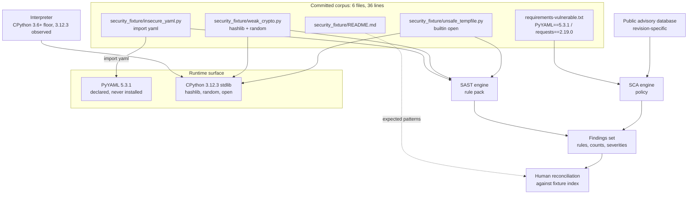

### 3.7.2 Integration Contracts

| Contract | Producer | Consumer | Requirement that must hold | Failure mode if broken |
|---|---|---|---|---|
| Python 3 source validity | The three fixture modules | SAST engine's parser | Module must parse under the analyser's Python grammar; the f-string sets the 3.6 floor | Analyser reports a syntax error instead of the intended defect |
| Permissive-loader signature | `security_fixture/insecure_yaml.py:7` | SAST rule for unsafe deserialization | Call must keep the keyword form `Loader=yaml.Loader`; PyYAML 6.x rejects `yaml.load` without a loader | Finding disappears and a `TypeError` replaces it |
| Pip requirements format | `requirements-vulnerable.txt` | SCA engine's manifest parser | Exact `==` pins, one coordinate per line, no extras or markers | Advisory lookup becomes ambiguous or the file is skipped |
| Version-to-advisory mapping | Pinned versions | SCA engine's advisory database | Both pins must remain inside a published affected range | SCA reports nothing; a documented defect class loses its ground truth ([3.8.1](#381-dependency-risk)) |
| Result attribution | `security_fixture/README.md:5-8` | Human reviewer | Every finding maps to one index entry, and every entry to one finding | An intended finding is treated as new, or a real one is dismissed as intended |
| Interpreter availability | Ambient CPython | Anyone compiling or running a fixture | A Python 3.6+ interpreter must exist; 3.12.3 is what the tree was verified against | Modules cannot be parsed or executed |

### 3.7.3 Compatibility Matrix

| Component | Requires | Compatible with the observed toolchain | Note |
|---|---|---|---|
| Fixture modules | Python 3, with 3.6+ for `weak_crypto.py` | Yes — all three compile on CPython 3.12.3 | Stdlib-only except one import |
| PyYAML `5.3.1` | Python 2.7 or 3.5-3.8; a Cython build toolchain | **No** — no CPython 3.12 wheel, and sdist builds fail under Cython 3 with `AttributeError: cython_sources` | Declared but never installed; installing it is also explicitly forbidden ([3.2.3](#323-compatibility-requirements)) |
| `requests 2.19.0` | Its own runtime dependencies, none of which are pinned here | Untested in this repository — no call site exists | Present only as an advisory-matching coordinate |
| PyYAML `6.0.3` (ambient) | Python 3.8+ | Yes — and it still resolves `yaml.Loader` to an `UnsafeConstructor` subclass, so the deserialization fixture remains live under it | Observed by execution in the working tree |
| CPython stdlib `hashlib`, `random`, `open` | Nothing beyond the interpreter | Yes — signatures unchanged across 3.6-3.12 | `hashlib.md5` runs without error or warning in the fixture call |

### 3.7.4 Coupling Rules for Changes

Four coupling rules follow directly from the contracts above; breaking any one silently invalidates the stack:

1. **Pin, advisory revision and index entry move together.** `requirements-vulnerable.txt:3-4`, the consuming scanner's database revision and `security_fixture/README.md:8` describe the same fact from three sides.
2. **Loader class and call form are one contract.** Replacing `yaml.Loader` with `yaml.safe_load`, or dropping the keyword, changes both the finding and the exploitability.
3. **The path literal and the write mode are one contract.** Parameterising `/tmp/report.txt` or switching to `tempfile` removes the defect the module exists to exhibit.
4. **The interpreter is not declared anywhere.** No `.python-version`, `tox.ini` or packaging metadata records it, so a change of interpreter is invisible to the repository and can only be caught by the analyser's parse result.


## 3.8 Security Implications of the Stack Choices

In this repository every stack choice is a deliberate exposure. The security question is therefore not whether the stack is vulnerable — it is by construction — but what the exposure is, and what keeps it contained to an analysis exercise.

### 3.8.1 Dependency Risk

| Coordinate | Advisories | Affected → fixed | Residual exposure here |
|---|---|---|---|
| `PyYAML==5.3.1` | CVE-2020-14343 — arbitrary code execution when untrusted YAML reaches `full_load`/`FullLoader`; CVSS 3.1 base **9.8**. CVE-2020-1747 is the earlier defect that 5.3.1 fixed | `<5.4` → `5.4` (5.4.1 is a stub-compatibility follow-up; latest release line is `6.0.3`) | The pin is never installed and cannot build on the 3.12.3 toolchain. Residual risk falls entirely on any environment that does install it, which `requirements-vulnerable.txt:2` forbids |
| `requests==2.19.0` | CVE-2018-18074 (`Authorization` header re-sent to an http URI after an https-to-http same-host redirect), CVE-2023-32681 (`Proxy-Authorization` leak on redirect), CVE-2024-35195 (session keeps TLS verification disabled after one `verify=False`), CVE-2024-47081 (`.netrc` credential leak via crafted URLs) | `2.20.0`, `2.31.0`, `2.32.2`, `2.32.4` respectively; 2.32.0 was yanked, so 2.32.2 is the first installable fix for the third | Zero runtime exposure: the package has no import site in the tree. Its only role is to be reported by an SCA engine |

Both pins are old enough to be trivially matched by any advisory database, which is their entire purpose. The stack's real dependency risk is therefore one of **accidental installation**, not of exploitation inside this repository.

### 3.8.2 Application-Code Risk

| Fixture | Weakness | Why the choice is unsafe | Contained because |
|---|---|---|---|
| `insecure_yaml.py` | `yaml.load(..., Loader=yaml.Loader)` — the full, unsafe loader | `Loader` resolves `!!python/object` / `!!python/object/apply` tags into live Python calls. Verified in the working tree against the ambient PyYAML 6.0.3: `yaml.load("!!python/object/apply:os.getcwd []", Loader=yaml.Loader)` executed `os.getcwd`. The hazard is therefore **not** limited to the 5.3.1 pin — `Loader` is the unsafe constructor in current releases too | No caller exists; nothing in the repository passes it a document |
| `weak_crypto.py` | Unkeyed `hashlib.md5` plus `random.randint(1000, 9999)` | The digest is deterministic from `str(user_id)` and the suffix has only 9,000 values (≈13 bits) drawn from a Mersenne Twister, so tokens are reproducible and enumerable; there is no key, expiry, signature or server-side state | No caller; the function is not wired to any authentication flow — the repository has no authentication at all ([3.4.1](#341-service-class-inventory)) |
| `unsafe_tempfile.py` | Literal `/tmp/report.txt` opened with `"w"` | A predictable name in a world-writable directory permits collision, truncation of another writer's file, and symlink-redirected writes to an attacker-chosen target; no exclusive create, no owner-only permission, no atomic rename | No caller; the write only occurs if someone invokes the function directly |

### 3.8.3 Supply-Chain and Integrity Posture

| Property | Status | Effect on the stack |
|---|---|---|
| Dependency integrity digests | None — no `--hash`, no lockfile, no signature | Nothing in the repository could detect a substituted package |
| SBOM / CycloneDX / manifest export | None | Downstream consumers receive no bill of materials from the corpus |
| Ignore rules | No `.gitignore` and no `.blitzyignore` | Generated bytecode sits untracked in the tree; nothing prevents a future commit of build residue |
| Secret material | None — a grep for `token=`, `api_key`, `secret`, `password`, `os.environ` and `getenv` finds no match beyond the dependency line | No credential class of finding, and no credential to rotate |
| Scan gating | No CI, hook or check | A change that silently fixes a fixture — the corpus's primary threat — is not caught automatically ([3.6.4](#364-cicd)) |

### 3.8.4 Controls That Keep the Exposure Contained

Four controls, all documentary rather than technical, are what separate this stack from a live vulnerability:

1. **Explicit prohibition, in two places.** `requirements-vulnerable.txt:1-2` forbids installation and real application use; `security_fixture/README.md:10` forbids installing the outdated dependencies or deploying the code and restricts use to an isolated test repository.
2. **In-file warnings at the point of risk.** `insecure_yaml.py:1-3` states that untrusted input must not reach `yaml.load` in real applications, and `weak_crypto.py:6` marks MD5 and the PRNG as intentionally weak.
3. **No execution path.** No entry point, no `__main__` block, no caller and no CI job invokes any fixture, so the intended mode is static analysis, not runtime exercise.
4. **Absence of the surrounding stack.** With no service, no database, no credential and no deployment, a fixture cannot reach a production system even if misused ([3.4](#34-third-party-services), [3.6](#36-development--deployment)).

The corresponding weakness is that none of these controls is enforced by tooling: any of the four can be defeated by a single `pip install -r requirements-vulnerable.txt` in a shared environment, which is why the isolation requirement in [3.6.5](#365-toolchain-requirements-derived-from-the-stack) is the stack's most consequential operational constraint.


## 3.9 Deviation from the Reference Technology Stack

The reference stack supplied as default context assumes a deployed multi-tier product. This repository is a scanner fixture corpus, so exactly one reference element is present — the Python language — and every other element is absent by design rather than by omission.

### 3.9.1 Element-by-Element Assessment

| Reference element | Status in this repository | Evidence | Interpretation |
|---|---|---|---|
| Python (primary language) | **Present**, minimally | `hashlib`/`random` fixtures plus one `import yaml`; CPython 3.12.3 in the tree | The only reference element the system genuinely uses |
| AWS (cloud platform) | Absent | No SDK, endpoint, region, IAM or account reference in any tracked file | No runtime to host |
| Docker (containerization) | Absent | No `Dockerfile`, `.dockerignore` or compose file, ever committed | Isolation is left to the operator ([3.6.3](#363-containerization)) |
| Terraform (IaC) | Absent | No `.tf` file or state reference | Nothing to provision |
| GitHub Actions (CI/CD) | Absent | No `.github/workflows/`; GitHub is used only as the Git remote | No gate, no automation ([3.6.4](#364-cicd)) |
| Flask (backend framework) | Absent | No `flask` import, route or WSGI entry point | No HTTP surface |
| Auth0 (authentication) | Absent | No SDK, tenant, client ID or callback; `create_token` validates nothing | No identity requirement exists ([3.4.1](#341-service-class-inventory)) |
| MongoDB (database) | Absent | No driver import, URI, model or schema | No data to persist ([3.5.1](#351-persistence-inventory)) |
| Langchain (AI framework) | Absent | No import, model reference or prompt asset | No AI component of any kind |
| React + TypeScript (web frontend) | Absent | No `package.json`, `.tsx`/`.jsx`/`.ts` file or bundler config | No user interface |
| TailwindCSS | Absent | No stylesheet, `tailwind.config.*` or build step | Follows from the absent frontend |
| React-Native + TypeScript (cross-platform mobile) | Absent | No mobile project or manifest | No client application |
| Swift (iOS) | Absent | No `.swift`, `.xcodeproj` or `Package.swift` | No native mobile target |
| Kotlin (Android) | Absent | No `.kt`, Gradle or Android manifest | No native mobile target |
| Objective-C (macOS) | Absent | No `.m`/`.h`, Xcode project or CocoaPods file | No desktop application |
| ElectronJS (desktop) | Absent | No `package.json`, main-process file or installer config | No desktop application |

A keyword sweep of every tracked file for these names returns no match, and `git log --all --name-only` shows that no such file existed in any commit — so the absences are historical, not the result of a cleanup.

### 3.9.2 Consequences of the Deviation

- **The stack is one layer deep.** Where the reference assumes infrastructure, service, data and client tiers, this system has a file layer and an analysis layer, joined by format contracts ([3.7.2](#372-integration-contracts)). Every reference element that would imply a runtime, a network boundary or stored state has no counterpart.
- **The Python presence is narrower than the reference implies.** Python appears as an interpreter and one third-party library, not as a Flask application: no packaging metadata, no `__init__.py`, no framework, no test suite ([3.1.1](#311-language-inventory-by-component), [3.2.2](#322-framework-absences)).
- **Adopting any missing element would change the system's purpose.** A CI workflow, container image or service tier added to this tree would give the deliberately vulnerable pins a path toward execution and would require the isolation controls in [3.8.4](#384-controls-that-keep-the-exposure-contained) to be re-engineered. Nothing tracked in the repository proposes such an extension; [1.3.2.2](#1322-future-phase-considerations) records the same absence.
- **The deviations are not technical debt against this system's requirements.** For a corpus whose success criterion is that analysers produce deterministic findings from known-bad inputs, an empty framework and deployment tier is the correct stack: it removes every variable between the committed bytes and the scan result.


## 3.10 References

**Repository files and folders**

- `requirements-vulnerable.txt` — the only dependency manifest: two warning comments plus `PyYAML==5.3.1` and `requests==2.19.0`, with no extras, markers, hashes or index URLs.
- `security_fixture/insecure_yaml.py` — `import yaml` and `load_config` calling `yaml.load(..., Loader=yaml.Loader)`; established the single third-party import and the permissive-loader contract.
- `security_fixture/weak_crypto.py` — `hashlib.md5` plus `random.randint(1000, 9999)` in `create_token`; established the standard-library-only stack and the Python 3.6 f-string floor.
- `security_fixture/unsafe_tempfile.py` — the sole persistence path, `open("/tmp/report.txt", "w")`; established the absence of a storage tier and the POSIX path assumption.
- `security_fixture/README.md` — path-to-pattern index plus the isolation rule and the variability caveat that make the advisory-database revision part of the input contract.
- `README.md` — 29-byte single H1, `# proactive_insights_security`; the repository's only self-description and its only Markdown at root.
- `security_fixture/` — flat folder holding the three Python fixtures and their index; contains no package initialiser, configuration or test.
- `security_fixture/__pycache__/` — untracked `insecure_yaml/unsafe_tempfile/weak_crypto` `.cpython-312.pyc` files; evidence that the local interpreter is CPython 3.12 and that no ignore rule excludes generated bytecode.

**Repository commands and metadata**

- `git ls-files`, `git log --all --stat`, `git log --all --name-only` — the six tracked paths, the seven-commit history, the transient `security_fixture/asdasd`, and proof that no build, CI, container or IaC file was ever committed.
- `git remote -v`, `git branch -a` — `origin` at `https://github.com/lakshya-blitzy/proactive_insights_security.git`, branches `main` and `2011_01`.
- `python3 -VV` (`3.12.3`), `python3 -m py_compile` on all three modules, and `yaml.__version__`/`requests.__version__` in the ambient environment (`6.0.3` / `2.34.2`) — the interpreter and installed-versus-declared drift.
- Execution of `yaml.load("!!python/object/apply:os.getcwd []", Loader=yaml.Loader)` under PyYAML 6.0.3 and of `create_token(42)` — confirmed `yaml.Loader` still subclasses `UnsafeConstructor` and that the fixture output format is `<32-hex-md5>-<4-digit>`.

**Web sources**

- [web] NVD, *CVE-2020-14343 Detail* (CVSS 3.1 base 9.8; PyYAML `<5.4`) — https://nvd.nist.gov/vuln/detail/CVE-2020-14343
- [web] GitHub Advisory Database, *Improper Input Validation in PyYAML* (GHSA-8q59-q68h-6hv4) — patched in 5.4.
- [web] yaml/pyyaml, *CHANGES* and *Releases* — 5.3.1 (2020-03-18) fixed CVE-2020-1747; 5.4 (2021-01-19) fixed CVE-2020-14343 by moving arbitrary tags to `UnsafeLoader`; 6.0.1 pinned `Cython<3`, 6.0.2 added Cython 3.x, latest 6.0.3 (2025-09-25).
- [web] PyPI, *PyYAML 5.3.1 metadata* — declares Python 2.7 and 3.5-3.8 only, no CPython 3.12 wheel.
- [web] yaml/pyyaml issue #736, *Unable to build PyYAML < 6.0.1 from source or sdist* — `AttributeError: cython_sources` under Cython 3.
- [web] NVD, *CVE-2018-18074* and Red Hat Bugzilla 1643830 — requests `Authorization` header retained across an https-to-http same-host redirect; fixed 2.20.0.
- [web] NVD, *CVE-2023-32681 Detail* — `Proxy-Authorization` leak; fixed 2.31.0.
- [web] GitHub Advisory Database, *GHSA-9wx4-h78v-vm56* — session TLS verification left disabled after `verify=False`; fixed 2.32.x (2.32.0 yanked, 2.32.2 installable).
- [web] GitHub Advisory Database, *GHSA-9hjg-9r4m-mvj7* — `.netrc` credential leak; fixed 2.32.4.
- [web] requests, *Community Updates* release history and PyPI metadata — 2.32.5 (2025-08-18) and 2.34.2 (2026-05-14, Python ≥3.10) as the current line.


# 4. Process Flowchart

## 4.1 Process Model and Notation

The repository contains no running process. Its complete flow-bearing content is three module-level functions — `load_config` (`security_fixture/insecure_yaml.py:6-7`), `create_token` (`security_fixture/weak_crypto.py:5-8`) and `write_report` (`security_fixture/unsafe_tempfile.py:2-6`) — and none of them is called by anything in the tree. A word-boundary search of all six tracked files returns zero occurrences of `if`, `else`, `elif`, `while`, `for`, `try`, `except`, `raise`, `finally` and `assert`, and zero occurrences of `__main__`, `def main`, `argparse` or `sys.argv`. There is therefore no in-repository decision tree, no request handler, no job runner and no event loop to chart.

The flows in this section are the processes the corpus actually participates in. Each is charted at the level at which its control logic really lives, and every diamond in every diagram is attributed either to the consumer of the corpus or to the library the fixture calls — never to repository code.

### 4.1.1 Flow Families and Where the Control Logic Lives

| # | Flow family | Executor | Where the control logic lives | In-tree evidence |
|---|---|---|---|---|
| 1 | Evaluator journey: select configuration, obtain corpus, scan, reconcile | Evaluator, SAST engine, SCA engine, reviewer — all outside the tree | Consumer-side engines and human judgement | `security_fixture/README.md:5-11`; the six tracked files as read-only inputs |
| 2 | In-function data flows behind each documented defect (`F-001`, `F-002`, `F-003`) | CPython 3 interpreter plus PyYAML, `hashlib`, `random` and the POSIX filesystem, only if a fixture is executed | Library internals: PyYAML constructor selection, Mersenne Twister state, `open()` semantics | `insecure_yaml.py:4,7`; `weak_crypto.py:2-3,7-8`; `unsafe_tempfile.py:3-6` |
| 3 | Fixture maintenance and ground-truth change | Author, reviewer, Git host | Human discipline; no gate exists | `git log` (7 commits); absence of any CI, hook or test definition |
| 4 | Dependency-analysis flow (`F-004`) | SCA engine plus its advisory database | Consumer-side resolver and advisory matcher | `requirements-vulnerable.txt:3-4` |

Two deliberate exclusions follow from the evidence. There is no state machine inside the repository: no variable survives a call, because no call is made and no module-level constant or class attribute exists (`2.3.3`). And there is no scheduled or event-driven flow: the tree holds no timer, queue, worker, webhook or workflow definition, so the only event that ever changes the corpus is a Git commit.

### 4.1.2 Actors and Swim Lanes

Every diagram in this section uses the same actor set. Lanes are drawn as Mermaid subgraphs, one per actor or system boundary.

| Lane | Actor | Responsibility in the flow | Touchpoint in the tree |
|---|---|---|---|
| L1 | Evaluator (human) | Fixes the scanner version, rule pack and advisory-database revision before a run; decides whether a result set is acceptable | Clones the tree; reads `security_fixture/README.md` |
| L2 | Git host (origin) | Distributes the six files; holds the two identical branches `main` and `2011_01` | `.git`; hosting only, no Actions workflow configured (`3.6.4`) |
| L3 | CPython 3 interpreter (3.6+ grammar, 3.12.3 observed) | Parses and compiles the modules; the only component that can execute them | `security_fixture/__pycache__/*.cpython-312.pyc` |
| L4 | PyYAML (`PyYAML==5.3.1` pinned, never installed by the repository) | Supplies `yaml.load` and the permissive `Loader` semantics | `insecure_yaml.py:4,7` |
| L5 | SAST engine plus rule pack | Consumes the three modules and emits code findings | `insecure_yaml.py`, `weak_crypto.py`, `unsafe_tempfile.py` |
| L6 | SCA engine plus advisory database | Consumes the two pins and matches published advisories | `requirements-vulnerable.txt:3-4` |
| L7 | POSIX filesystem | Sink for the one write path, at the fixed name `/tmp/report.txt` | `unsafe_tempfile.py:3-4` |
| L8 | Reviewer (human) | Maps each reported finding to one of the four documented patterns | `security_fixture/README.md:5-8` |

Shapes follow one legend throughout: stadium `([ ])` for a start or end point, rectangle for a process step, diamond `{ }` for a decision, and cylinder `[( )]` for a persisted artifact or finding set. Dotted edges carry information that no gate validates.

### 4.1.3 High-Level System Workflow

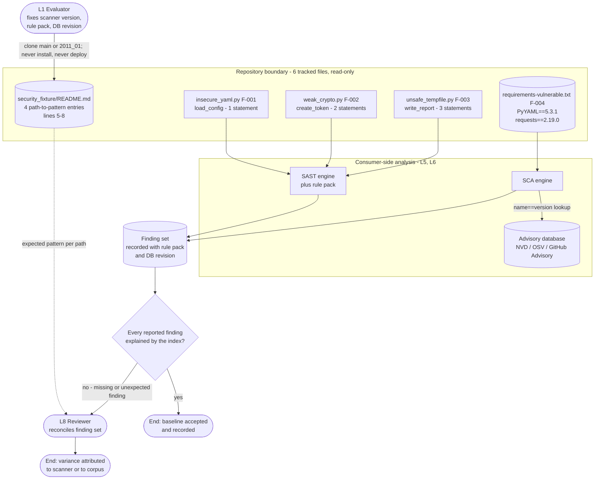

The workflow is one-directional. The corpus is read, never written: no arrow returns from the analysis lanes to the repository box. The two artifacts that leave the boundary are the finding set and the human reconciliation judgement, and both persist outside the tree (`3.5.3`). Because the evaluation is a corpus-wide pass over six files and 1,528 bytes, it has no partial-progress state and no resume point — a run either completes against all six files or fails against the file that raised.


## 4.2 Core Business Processes

The corpus supports one business process — evaluating whether a security scanner reports the defects the corpus documents — and three supporting processes: the change workflow that keeps the corpus a valid ground truth, and the two defect flows the corpus exists to expose. Each is charted below with its decision points, its failure paths and the requirement identifiers it satisfies.

### 4.2.1 End-to-End Evaluator Journey

The journey has eight steps and three genuine decision points. It starts whenever an evaluator decides to test a scanner configuration and ends when the result set is either accepted as a baseline or attributed to a specific cause.

| Step | Actor | Action | Evidence | Exit condition |
|---|---|---|---|---|
| S1 | L1 Evaluator | Fix the scanner version, rule pack and advisory-database revision before any read, so the result set is reproducible | `security_fixture/README.md:11` states that findings vary with enabled rules and databases | Configuration recorded |
| S2 | L1 Evaluator | Clone `origin`; `main` and `2011_01` are identical in content, so either branch yields the same six files | `git log` (tip `6c7b396`), `git diff --stat main 2011_01` empty | Six files present |
| S3 | L1 Evaluator | Check whether the intended run requires installing `requirements-vulnerable.txt` | `requirements-vulnerable.txt:1-2` and `security_fixture/README.md:10` forbid installation and deployment | Run proceeds only in analysis-only mode, or stops |
| S4 | L5 SAST engine | Parse the three modules with a CPython 3 parser (3.6+ grammar; 3.12.3 observed) and evaluate rule families for permissive loader use, MD5, non-cryptographic PRNG use and a fixed temporary path | `insecure_yaml.py:7`; `weak_crypto.py:7-8`; `unsafe_tempfile.py:3` | Findings emitted per matching line |
| S5 | L6 SCA engine | Parse the two exact pins, resolve each `name==version` coordinate and match it against the advisory database | `requirements-vulnerable.txt:3-4` | Advisory findings, or none if the database is stale |
| S6 | L8 Reviewer | Map every finding to one of the four index bullets | `security_fixture/README.md:5-8` | Each finding either explained or listed as variance |
| S7 | L8 Reviewer | Decide whether the finding set equals the documented ground truth | Four documented patterns versus the emitted set | Accept, or enter an attribution branch |
| S8 | L1 Evaluator | Record the accepted set as a baseline, or raise a defect against the rule pack, the database revision, or the corpus | No in-tree baseline file exists, so the record lives outside the repository | End state |

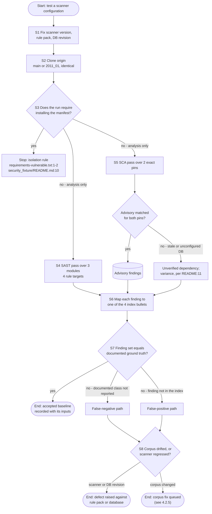

**System interactions.** Three boundaries are crossed and none of them by repository code: file bytes cross into the SAST engine, `name==version` coordinates cross into the SCA engine, and strings cross into the reviewer's judgement. The requirement identifiers the journey exercises are `F-001-RQ-002` (permissive loader), `F-002-RQ-002` and `F-002-RQ-003` (MD5, PRNG), `F-003-RQ-002` (fixed path), `F-004-RQ-002` and `F-004-RQ-003` (both pins reported) and `F-005-RQ-002` (index covers every fixture).

**Error handling paths.** Four failures are reachable, all consumer-side: the isolation gate at S3 (documentary only, no technical control); a stale or unconfigured advisory database, which yields an unverified dependency rather than a false clean result; a missing finding, which `security_fixture/README.md:11` explicitly names as configuration-dependent; and an unexpected finding, which the index cannot explain because it names no CVE, severity or expected count (`F-005-RQ-004`). No step has a retry, a timeout or a compensating action in the repository.

**Timing.** No step carries a duration in the repository: there is no timeout, no sleep, no polling interval and no SLA statement anywhere in the tree. The only measurable work bound is input size — six file reads totalling 1,528 bytes across 36 lines (`2.4.1`) — so any latency expectation belongs to the consumer.

### 4.2.2 F-001 Unsafe YAML Deserialization Flow

This is the flow a scanner reports on and a trainer demonstrates. It is one statement long in the repository; the decisions inside it belong to PyYAML's constructor selection.

| Step | Location | Action | Observed behaviour |
|---|---|---|---|
| P1 | `insecure_yaml.py:6` | Bind the parameter `user_supplied_yaml`; no type check, no length check | Any object is accepted |
| P2 | `insecure_yaml.py:7` | `yaml.load(document, Loader=yaml.Loader)` | The permissive loader is selected explicitly by keyword |
| D1 | PyYAML parser | Does the document parse? | A malformed document raises `yaml.parser.ParserError` |
| D2 | PyYAML composer | Is the document empty? | Empty input returns `None` |
| D3 | PyYAML constructor | Does any node carry a `!!python/*` tag? | Tagged nodes are constructed; untagged ones become dicts, lists and scalars |
| P3 | `insecure_yaml.py:7` | Return the constructed object unchanged | No sanitization, no allow-list, no validation (`F-001-RQ-003`) |

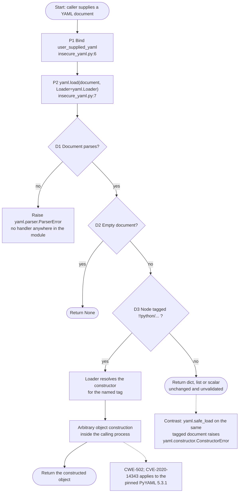

**Verified behaviour.** Executed against the committed module, `load_config("a: 1\nb: [x, y]")` returned `{'a': 1, 'b': ['x', 'y']}`; `load_config("!!python/object/apply:os.getcwd []")` returned the current working directory, proving the constructor executed; `load_config("a: [1, 2")` raised an uncaught `yaml.parser.ParserError`; `load_config("")` returned `None`; and `yaml.safe_load` on the same tagged document raised `yaml.constructor.ConstructorError`. The probe ran under the ambient interpreter with PyYAML 6.0.3; `Loader` is permissive in both 5.3.1 and 6.x, since 5.4 moved the `!!python/*` constructors into `UnsafeLoader` rather than removing them.

**Decision points and error states.** The repository contributes no decision and no error state of its own: `F-001-RQ-003` requires the parsed object to be returned with no validation and no exception handling, so every failure in this flow surfaces as an exception in the caller. `ModuleNotFoundError` for `yaml` is also reachable, because the manifest that provides PyYAML must not be installed (`F-006-RQ-001`).

**Timing.** Constant-cost: one library call over a caller-supplied document. The repository imposes no bound on document size, depth or alias expansion, since no limit is coded.

### 4.2.3 F-002 Weak Token Generation Flow

The token flow is the only flow in the corpus that produces a value with a fixed, assertable shape: 32 lowercase hexadecimal characters, a hyphen and four decimal digits — 37 characters in total (`F-002-RQ-004`).

| Step | Location | Action | Observed behaviour |
|---|---|---|---|
| P1 | `weak_crypto.py:5` | Bind `user_id`; no validation of type or domain | Any object accepted |
| P2 | `weak_crypto.py:7` | `str(user_id).encode()` | Identifier coerced to its string form |
| P3 | `weak_crypto.py:7` | `hashlib.md5(...).hexdigest()` | 32 hex characters; unkeyed, unsalted, deterministic |
| P4 | `weak_crypto.py:8` | `random.randint(1000, 9999)` | One value from 9,000 possibilities (under 13.1 bits) drawn from the shared Mersenne Twister |
| P5 | `weak_crypto.py:8` | `f"{digest}-{suffix}"` | Single string; no expiry, signature or stored state |

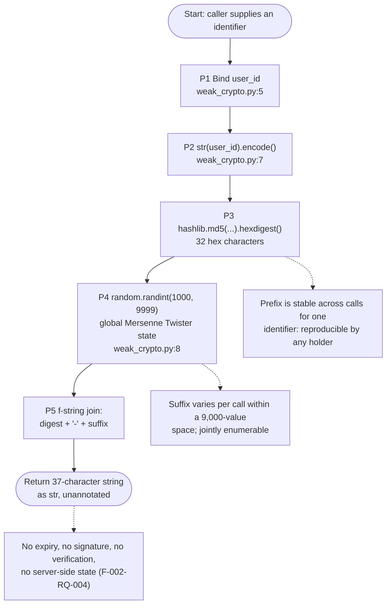

**Verified behaviour.** `create_token(42)` returned `a1d0c6e83f027327d8461063f4ac58a6-9146`; the 32-character prefix equalled `hashlib.md5(b"42").hexdigest()`; the prefix was identical on a second call for identifier `42` while the four-digit suffix differed; identifier `43` produced a different prefix; and `create_token(None)` returned a well-formed token derived from `str(None)`. The output matched `^[0-9a-f]{32}-[0-9]{4}$` in every case.

**Decision points and error states.** The flow contains no branch: `F-002-RQ-001` requires a two-statement body and `F-002-RQ-004` forbids expiry or verification logic. There is no failure path for ordinary input, because `str()` coerces every object; the only exceptions reachable are those of a caller-supplied `__str__` or of `hashlib` itself. The flow retains no state: nothing is stored, so the same identifier always yields the same prefix and a replayed token is indistinguishable from a fresh one. That absence of state is the defect the fixture demonstrates (CWE-328, CWE-338), not an omission in the flow.

**Timing.** Constant-cost. MD5 and `random.randint` are both fixed-work operations, and the flow performs no I/O, so there is no latency, timeout or retry to chart.

### 4.2.4 F-003 Predictable Temporary File Write Flow

This is the only flow in the corpus that touches persistent storage, and the only one whose failure leaves a partial artifact behind.

| Step | Location | Action | Observed behaviour |
|---|---|---|---|
| P1 | `unsafe_tempfile.py:2` | Bind `contents`; no type check, no encoding declared | A non-`str` argument fails at write time |
| P2 | `unsafe_tempfile.py:3` | Bind the literal `/tmp/report.txt` | One fixed, publicly guessable name in a world-writable directory |
| P3 | `unsafe_tempfile.py:4` | `open(path, "w")` inside a context manager | Truncating, non-exclusive, symlink-following open |
| D1 | Filesystem | Does the name already exist? | Absent: created with mode governed by the process umask (0o644 observed). Regular file: truncated. Symlink: the link target is opened and truncated |
| P4 | `unsafe_tempfile.py:5` | `report.write(contents)` | Content written verbatim, no escaping, no encoding argument |
| P5 | Context-manager exit | Buffered write flushed, descriptor closed | No `fsync`, no atomic rename, no permission hardening |
| P6 | `unsafe_tempfile.py:6` | `return path` | The fixed location is disclosed to the caller |

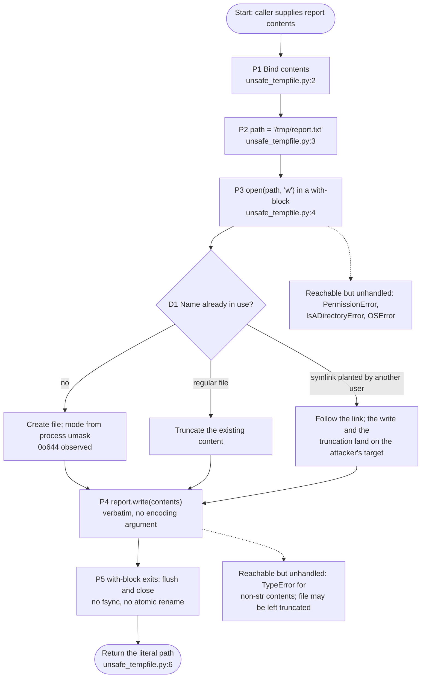

**Verified behaviour.** `write_report("probe-content")` created `/tmp/report.txt` with mode `0o644` under the default umask, wrote the content verbatim and returned the literal path string. The probe file was removed afterwards, so the corpus is unchanged.

**Decision points.** The single decision — whether the fixed name is already in use — is made by the operating system, not by the code: no exclusive-create flag, no ownership check, no `tempfile` call and no random or process-unique component exists anywhere in the module (`F-003-RQ-002`, `F-003-RQ-003`). Two concurrent writers therefore collide by construction, and a pre-created symlink redirects the write; that is the demonstrated weakness (CWE-377).

**Timing.** One open, one write and one close, with no timeout and no retry. Durability is not assured, since the flush at close puts the bytes in the page cache and no `fsync`, atomic rename or read-back occurs.

### 4.2.5 Fixture Maintenance and Ground-Truth Change Process

Changing the corpus is the process that protects every other flow: a fixture that becomes safe silently removes the ground truth a scanner is judged against. Git history shows the process has always been performed by upload and never been gated.

| Step | Actor | Action | Evidence |
|---|---|---|---|
| M1 | Author | Add or edit the file | Commit subjects `Add files via upload` for both the manifest and the four fixture files |
| M2 | Author | Confirm the edit preserves the defect — the loader stays permissive, the digest stays unkeyed, the path stays literal, the pins stay inside a published advisory range | `F-001-RQ-002`, `F-002-RQ-002`, `F-003-RQ-002`, `F-004-RQ-002`, `F-004-RQ-004` |
| M3 | Author | Update `security_fixture/README.md:5-8` if the set of paths changed, including the `../requirements-vulnerable.txt` entry that points outside the folder | `F-005-RQ-002` |
| M4 | Author | Keep the guardrail notices: the `Static-analysis fixture:` docstring prefix and the isolation rule | `F-006-RQ-001` to `F-006-RQ-003` |
| M5 | Author | Commit and push to `origin`; `main` and `2011_01` are kept identical in content | `git log`, empty diff between branches |

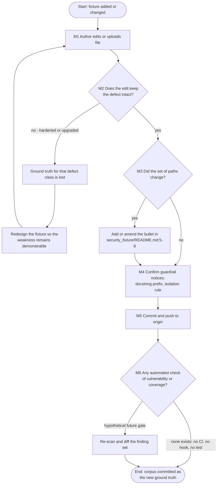

**Error states in this process.** The history records one observable drift event: `security_fixture/asdasd` was created in `7fa13bd` and deleted in the tip commit `6c7b396`, leaving the fixture index naming four paths that never included it. Nothing detected the transient file — no CI definition, hook, test or scanner configuration exists (`3.6.4`) — which is exactly the gap `M6` makes explicit. The reviewer is the only control, and `security_fixture/README.md:5-8` is the only checklist.

**Timing.** No review interval, freeze window or release cadence is recorded. All seven commits carry one author identity and one date (2026-11-20), and no commit message states a requirement change, so a change to the corpus is dated only by the Git commit that carries it.


## 4.3 Integration Workflows

Every integration in this repository is a file-format contract. No SDK is imported, no credential is stored, no endpoint is called and no message is published: the tree contains no `urllib`, `socket`, `http` or `subprocess` reference, and `requests` — the one HTTP client named anywhere — appears only as a pin at `requirements-vulnerable.txt:4` with no import site. The workflows below are therefore the flows a consuming system performs over the committed files.

### 4.3.1 Data Flow Between Systems

| # | Producer | Consumer | Payload | Format contract | Volume |
|---|---|---|---|---|---|
| DF1 | Repository (`F-001`, `F-002`, `F-003`) | SAST engine | Three Python modules | Valid CPython 3.6+ source, one module-level function each, no generated content | 749 bytes, 21 lines |
| DF2 | Repository (`F-004`) | SCA engine | Two dependency coordinates | pip requirements file, two bare `==` pins, no extras, markers, hashes or index URLs | 178 bytes, 4 lines |
| DF3 | Repository (`F-005`) | Reviewer | Path-to-pattern map | Markdown list of four entries, one of them `../requirements-vulnerable.txt` | 572 bytes, 11 lines |
| DF4 | Consumer | Advisory database | `name` plus exact `version` for `PyYAML` 5.3.1 and `requests` 2.19.0 | Coordinate pair; the repository names no CVE, so matching is the consumer's job | Two coordinates |
| DF5 | Consumer | Reviewer or CI system | Finding set | Format chosen by the engine; the repository defines no report schema, SARIF profile or output path | Four documented patterns expected |
| DF6 | Consumer | Repository | Nothing | No write-back path exists: no upload, no badge, no results file, no baseline commit | Zero bytes |

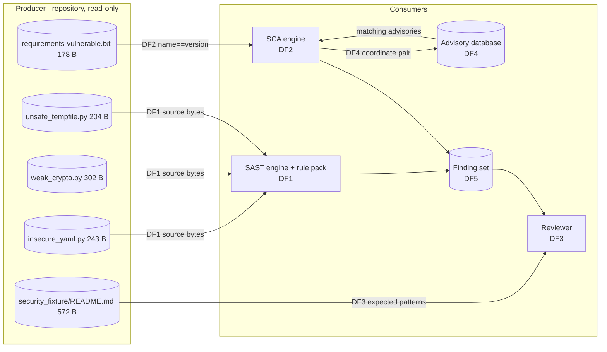

The flow is acyclic and stateless: no payload returns to the repository (DF6), so a scan cannot alter the ground truth it measures. The one mutation a consumer can cause is indirect — importing a module makes CPython write `security_fixture/__pycache__/*.cpython-312.pyc`, which sits untracked in the working tree because no ignore rule exists (`3.5.3`).

### 4.3.2 API Interactions

| Interaction | Initiator | Endpoint class | Request payload | Response used | Failure mode carried by the repository |
|---|---|---|---|---|---|
| Package metadata resolution for `PyYAML==5.3.1` | SCA engine or resolver | Public PyPI index | Package name and exact version | Release existence and metadata; no install is permitted (`F-006-RQ-001`) | None coded; an unreachable index yields no resolution, and the exact `==` pin gives the resolver no fallback version (`F-004-RQ-004`) |
| Package metadata resolution for `requests==2.19.0` | SCA engine or resolver | Public PyPI index | Package name and exact version | Release existence; the archive is never fetched for execution | As above |
| Advisory lookup | SCA engine | NVD, OSV, GitHub Advisory Database or equivalent | Coordinate pair | Zero or more advisories, with fixed versions | Advisory data is reached at scan time, so a stale database produces an unverified dependency rather than a clean result (`security_fixture/README.md:11`) |
| Any other HTTP interface | None | None | None | None | No endpoint, base URL, token, header or credential appears anywhere in the tree |

Two consequences follow. First, no interaction is authenticated, because none is initiated by repository code. Second, the pinned HTTP client is never exercised: `requests` has no call site, which is precisely the asymmetry `F-004` exists to demonstrate — a vulnerable dependency reported without a vulnerable line of code.

### 4.3.3 Event Processing Flows

No event-driven flow exists. The tree holds no publisher, subscriber, queue, topic, worker, timer, cron entry or webhook receiver; a search for `celery`, `queue`, `schedule`, `cron`, `hook` and `workflow` returns no match, and no `while` or `for` loop exists that could poll.

| Event class | Status | Consequence for the flow |
|---|---|---|
| Repository change event | External only: a Git commit pushed to `origin` | The corpus updates in place; no subscriber is notified, so a consumer sees the change only on its next run |
| Push-triggered automation | Absent | `origin` is hosted on GitHub, but no Actions workflow or other CI definition is configured (`3.6.4`), so a push triggers no scan |
| Scheduled rescan | Absent | No timer, cadence or release window is defined; rescan timing is entirely the consumer's choice |
| Internal domain event | Absent | The three functions raise no event, write no log line and publish nothing (`log`, `print` counts are zero) |

### 4.3.4 Batch Processing Sequence

A full-corpus scan is the only batch in the workflow, and its whole input is six files and 1,528 bytes.

| Step | Unit | Action | Ordering constraint | Failure policy in the repository |
|---|---|---|---|---|
| B1 | Whole corpus | Enumerate the working tree; no manifest or package index exists to drive discovery | Directory walk order | None; a missing file simply produces no finding |
| B2 | Three modules | Parse each with a CPython 3 parser, 3.6+ grammar | Independent — no module imports another (`2.3.3`) | Undefined; the engine decides whether a parse failure aborts the batch |
| B3 | Three modules | Evaluate rule pack per file | Independent | Undefined |
| B4 | One manifest | Parse two requirement entries | Must follow B1 so the file is found outside `security_fixture/` | Undefined |
| B5 | Two coordinates | Query the advisory database | One lookup per coordinate; exact pins make each lookup single-valued | Undefined; a stale database degrades to unverified |
| B6 | Whole corpus | Aggregate findings into one set | Deterministic aggregation | No deduplication or severity policy exists in the tree |
| B7 | Whole corpus | Emit the finding set to the consumer's own sink | None | No output path, schema or retention rule is specified |

Batch properties are fixed by the inputs rather than configured: there is no chunking, parallelism, checkpoint or resume point, because the batch is smaller than a single page of source. Determinism holds whenever the rule pack and advisory-database revision are held constant, which is why `security_fixture/README.md:11` makes the revision part of the result set's identity. Idempotence holds as well: every input is read-only, so re-running the batch over an unchanged commit yields the same finding set, and the only residue is the bytecode cache.

### 4.3.5 Integration Sequence Diagram

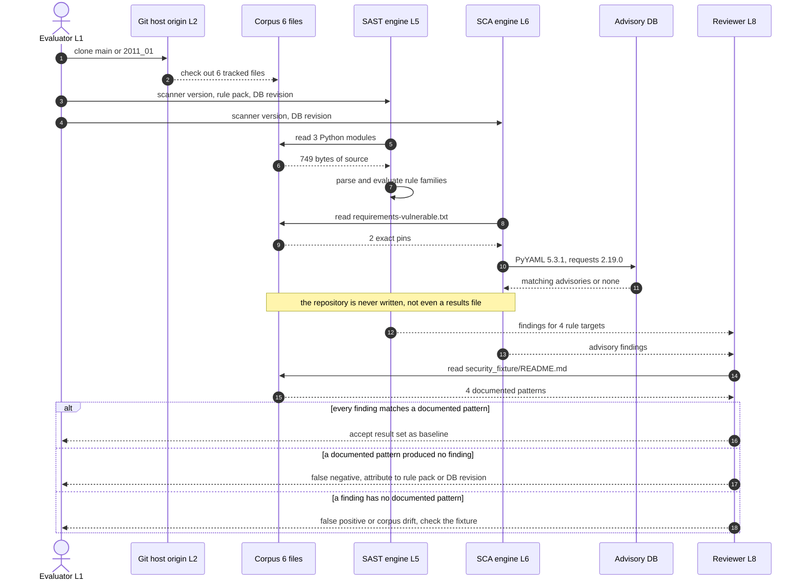


## 4.4 Flowchart Requirements

Every diagram in this section obeys the requirements below. The rule that shapes all of them is attribution: a decision drawn as a diamond is either the consumer's or the operating system's or PyYAML's, never the repository's, because the repository contains zero conditional statements.

### 4.4.1 Start and End Points, Process Steps, Decision Diamonds

**Start and end points.** Each flow has exactly one start and a closed set of ends, so a diagram never terminates ambiguously.

| Flow | Start point | End points | Diagram |
|---|---|---|---|
| Evaluator journey | "test a scanner configuration" | Accepted baseline; defect raised against rule pack or database; corpus fix queued; stopped at the isolation gate | 4.2.1 |
| F-001 deserialization | Caller supplies a YAML document | Constructed object returned; `None` for an empty document; `ParserError` raised | 4.2.2 |
| F-002 token generation | Caller supplies an identifier | 37-character string returned; no failure end for ordinary input | 4.2.3 |
| F-003 report write | Caller supplies report contents | Literal path returned; uncaught filesystem exception | 4.2.4 |
| Fixture maintenance | Fixture added or changed | New ground truth committed; fixture redesigned | 4.2.5 |
| Integration | Clone of `main` or `2011_01` | Finding set delivered to the reviewer; baseline accepted or variance attributed | 4.3.5 |

**Process steps.** The repository contributes six executable statements in total, and each maps to one node in the diagrams.

| File | Executable statements | Diagram nodes | Rule targets |
|---|---|---|---|
| `security_fixture/insecure_yaml.py` | 1 (`return yaml.load(..., Loader=yaml.Loader)`, line 7) | P2 | Permissive loader (`F-001-RQ-002`) |
| `security_fixture/weak_crypto.py` | 2 (line 7 digest, line 8 formatted return) | P3, P4, P5 | MD5 (`F-002-RQ-002`), weak PRNG (`F-002-RQ-003`) |
| `security_fixture/unsafe_tempfile.py` | 3 (line 3 path, lines 4-5 open and write, line 6 return) | P2, P3, P4, P6 | Fixed temporary path (`F-003-RQ-002`) |

**Decision diamonds.** Every diamond used anywhere in this section is inventoried here with its owner. None belongs to repository code.

| Diamond | Flow | Owner of the decision | Basis |
|---|---|---|---|
| Does the run require installing the manifest? | 4.2.1 S3 | Human rule, not code | `requirements-vulnerable.txt:1-2`; `security_fixture/README.md:10` |
| Advisory matched for both pins? | 4.2.1 | SCA engine and its database revision | `F-004-RQ-002`, `F-004-RQ-003` |
| Finding set equals documented ground truth? | 4.2.1 S7 | Reviewer | `security_fixture/README.md:5-8` |
| Corpus drifted, or scanner regressed? | 4.2.1 S8 | Reviewer | Absence of any baseline or CI gate (`3.6.4`) |
| Document parses? / Empty document? / Node tagged `!!python/...`? | 4.2.2 D1-D3 | PyYAML parser, composer and constructor | `insecure_yaml.py:7` |
| Name already in use? | 4.2.4 D1 | Operating system, via `open(path, "w")` | `unsafe_tempfile.py:4` |
| Does the edit keep the defect intact? / Did the path set change? / Any automated check? | 4.2.5 M2, M3, M6 | Author, then "none exists" | `F-001-RQ-002` to `F-004-RQ-004`; absent CI |
| Every reported finding explained by the index? | 4.1.3 | Reviewer | Same four index entries |

### 4.4.2 System Boundaries and User Touchpoints

| Boundary | Inside the boundary | Outside the boundary | What crosses, and in which direction |
|---|---|---|---|
| Repository tree | Six tracked files, 1,528 bytes, 36 lines; `.git` with seven commits | Everything else | File bytes leave; nothing enters |
| Process boundary of a fixture | One module-level function of one to three statements | CPython interpreter; PyYAML; `hashlib` and `random`; the POSIX filesystem | Argument values enter; return value or exception leaves |
| Analysis boundary | Rule pack, scanner version and advisory-database revision chosen by the evaluator | The corpus, which carries no configuration | Findings leave; no suppression, baseline or ignore file enters |
| Trust boundary | Untrusted input named in the source: `user_supplied_yaml` (`insecure_yaml.py:6`), a guessable identifier (`weak_crypto.py:5`), shared `/tmp` (`unsafe_tempfile.py:3`) | The calling process, which receives whatever the fixture constructs | The `!!python/*` constructor path crosses this boundary — the core finding of `F-001` |

**User touchpoints.** The corpus has no user interface, no command line, no API and no service endpoint. Three human touchpoints exist, and all three are reads of documentation:

| Touchpoint | Actor | What is read | Why it matters |
|---|---|---|---|
| T1 | Evaluator | `security_fixture/README.md:10` | The only statement of the isolation rule that keeps the vulnerable pins out of a live environment |
| T2 | Reviewer | `security_fixture/README.md:5-8` | The only ground-truth map against which a finding set is reconciled |
| T3 | Reviewer or trainer | Module docstring line 1 of each fixture (`Static-analysis fixture: ...`) | Establishes intent in the first line of any file opened in isolation (`F-006-RQ-003`) |

### 4.4.3 Error States and Recovery Paths

| Error state | Detected at | Visible in diagram | Recovery path | Control in the repository |
|---|---|---|---|---|
| Run would need the vulnerable pins installed | Before scanning | 4.2.1 S3 → stop node | Switch to analysis-only mode or an ephemeral environment; never install | Documentary only (`F-006-RQ-001`, `F-006-RQ-002`) |
| Module cannot be parsed by the interpreter in use | Parse time | 4.2.1 S4 | Use CPython 3.6+; the f-string at `weak_crypto.py:8` sets the floor | None coded |
| `PyYAML` absent when a fixture is executed | `import yaml`, line 4 | 4.2.2 P2 | Analyse statically, or use a throwaway environment; the pin must not reach a shared environment | None coded |
| Malformed YAML document | Inside `yaml.load` | 4.2.2 D1 → `ParserError` | Caller catches the exception, or the scan run aborts; the module has no handler (`F-001-RQ-003`) | None coded, deliberately |
| Tagged document under a safe loader | Inside the constructor | 4.2.2 contrast node | Not reachable through the fixture; reachable through a hardened variant | None coded |
| Non-`str` report contents | At `report.write` | 4.2.4 error note | Re-run with a string; the target file may be left truncated | None coded |
| `/tmp/report.txt` unusable or already a link | At `open` | 4.2.4 D1 → error note | Re-run on an isolated host, or fix the fixture to a unique path — a change forbidden by `F-003-RQ-002` | None coded |
| Advisory database stale or unreachable | At SCA lookup | 4.2.1 DBQ → variance node | Refresh the database and record its revision with the result set | None; the caveat sits at `security_fixture/README.md:11` |
| Documented pattern produces no finding | Reconciliation | 4.2.1 false-negative branch | Attribute to rule pack or database revision, then re-run | None; no expected-findings baseline exists |
| Finding with no documented pattern | Reconciliation | 4.2.1 false-positive branch | Check corpus drift first, then the rule's precision | None; the index names no severity or expected count |
| Bytecode left in the working tree | After any import | 4.3.1 note | Delete it, or add an ignore rule as a deliberate decision | None; no `.gitignore` exists |

### 4.4.4 Timing and SLA Considerations

The repository states no service level, no target duration and no latency budget for any flow, and it defines no timeout, sleep, polling interval, retry delay or backoff — searches for `timeout`, `sleep` and `retry` across all tracked files return zero matches.

| Timing element | Status | Evidence |
|---|---|---|
| Timeout on any operation | None | No `timeout` token exists; no I/O operation carries one |
| Retry or backoff interval | None | No `retry`, `sleep` or loop construct exists |
| Scan latency budget | Not stated; bounded only by input size | Six files, 36 lines, 1,528 bytes (`2.4.1`) |
| Review turnaround after a corpus change | Not stated | No template, hook, assignment rule or release cadence exists |
| Advisory-freshness window | Not stated | `security_fixture/README.md:11` requires the revision to be recorded but sets no age limit |
| Only clock in the tree | Git commit timestamps: seven commits, one author, one date (2026-11-20) | `git log` |

Timing therefore appears in the diagrams only as ordering, never as a duration: batch steps are sequenced, not scheduled, and the evaluator journey's dependencies are causal rather than timed. Any figure an operator needs — scan duration, false-negative target, database refresh interval — must be defined where the scanner runs, alongside the configuration the journey fixes at step S1. The objectives that could be measured are listed in [1.2.3 Success Criteria](#123-success-criteria).


## 4.5 Validation Rules

Validation in this corpus runs in the opposite direction from a normal application: nothing validates its input, and the checks that matter are the ones a reviewer or scanner applies to the artifacts. The rules below are stated with the requirement identifier that carries them, so a validation failure traces to a testable property rather than to an opinion.

### 4.5.1 Business Rules at Each Step

| Step | Business rule | Requirement | Enforced by |
|---|---|---|---|
| 4.2.1 S1 | A result set is meaningful only alongside the rule pack and advisory-database revision that produced it | `F-005-RQ-003`; `security_fixture/README.md:11` | Human discipline; no run manifest is written |
| 4.2.1 S2 | Both branches must yield identical content, so a finding set is branch-independent | `2.4.1` change-control row | Observation only; `main` and `2011_01` happen to be identical |
| 4.2.1 S3 | The pinned packages must never be installed and the code must never be deployed | `F-006-RQ-001`, `F-006-RQ-002` | Documentary notices only |
| 4.2.1 S6 | Every reported finding must map to one of four documented patterns, with nothing unexplained | `F-005-RQ-001`, `F-005-RQ-002` | Manual reconciliation against `security_fixture/README.md:5-8` |
| 4.2.1 S8 | A variance is attributed to the scanner, the database or the corpus before any artifact is edited | Derived from `security_fixture/README.md:11` | Human judgement |
| 4.2.2 P2 | The call must keep the permissive `Loader`; a safe loader would destroy the specimen | `F-001-RQ-002` | Code review; a search for `safe_load`/`SafeLoader` must stay at zero matches |
| 4.2.2 P3 | The parsed object must be returned unvalidated, with no exception handling | `F-001-RQ-003` | Absence of `try`, `except`, `raise` and `assert` anywhere in the module |
| 4.2.3 P3 | The digest must stay unkeyed and unsalted | `F-002-RQ-002` | Absence of `hmac`, `pbkdf2`, `scrypt`, `bcrypt`, `argon2` and `secrets` in the tree |
| 4.2.3 P4 | The suffix range must stay exactly 1000-9999, from the non-cryptographic generator | `F-002-RQ-003` | Absence of `secrets`, `os.urandom`, `SystemRandom`, `getrandbits` |
| 4.2.3 P5 | The output must remain a single 37-character string with no expiry or signature | `F-002-RQ-004` | Pattern assertion `^[0-9a-f]{32}-[0-9]{4}$` plus absence of expiry or verify logic |
| 4.2.4 P2 | The write target must stay the literal `/tmp/report.txt` | `F-003-RQ-002` | Absence of `tempfile`, `mkstemp`, `NamedTemporaryFile`, PID or random components |
| 4.2.4 P3 | Truncating, non-exclusive mode `"w"` is part of the defect and must not be hardened | `F-003-RQ-003` | Absence of `encoding=`, mode `"x"`, `os.open` flags, `chmod` and `umask` |
| 4.2.5 M3 | Every fixture file must appear in the index and the `../requirements-vulnerable.txt` entry must resolve | `F-005-RQ-002` | Manual comparison of the folder against `README.md:5-8` |
| 4.2.5 M4 | Each module must open with the `Static-analysis fixture:` docstring label | `F-006-RQ-003` | First text of each module docstring |
| 4.2.5 M6 | No automation may import, execute, install or gate the fixtures | `F-006-RQ-004` | Absence of any CI, hook, container, packaging or test definition |

### 4.5.2 Data Validation Requirements

| Data input | Validation applied in the repository | What the requirement demands instead | Evidence |
|---|---|---|---|
| `user_supplied_yaml` | None — untyped, unchecked, passed straight to `yaml.load` | No validation or sanitization may be added (`F-001-RQ-003`) | `insecure_yaml.py:6-7` |
| `user_id` | None — coerced with `str()` only | No salt, key or domain check (`F-002-RQ-002`) | `weak_crypto.py:7` |
| `contents` | None — written verbatim, no encoding declared | No escaping or encoding declaration (`F-003-RQ-003`) | `unsafe_tempfile.py:2,5` |
| Requirement coordinates | Exactly two bare `name==version` entries; the parser rejects malformed lines | No extras, markers, hashes, ranges or index URLs (`F-004-RQ-004`) | `requirements-vulnerable.txt:3-4` |
| Index entries | Paths must resolve on disk, including the out-of-folder `../` reference | One entry per fixture, none missing (`F-005-RQ-002`) | `security_fixture/README.md:5-8` |

The last two rows are the only inputs the corpus validates at all, and both are validated by their consumer rather than by code in the tree. For the three function inputs there is no schema, no length bound, no type check and no assertion: the whole tree contains zero `isinstance` calls and zero `assert` statements. `user_supplied_yaml` is the only input whose untrusted status is declared, and it is declared in the parameter name rather than enforced.

### 4.5.3 Authorization Checkpoints

No authorization checkpoint exists in the repository, and three of its documented defects are precisely the absence of one.

| Candidate checkpoint | Status | Consequence for the flow |
|---|---|---|
| Tag allow-list before object construction (`F-001`) | Absent — `Loader=yaml.Loader` admits the `!!python/*` family | Any document author obtains constructor invocation inside the analysing process (CWE-502) |
| Token issuance authority (`F-002`) | Absent — the function is not given an issuer, an audience, a secret or a verifier, and no caller authenticates anything first | Anyone who knows the identifier can recompute the token prefix; nothing distinguishes a genuine token from a forged one |
| Token verification or expiry at a checkpoint (`F-002`) | Absent — no verify, decode, compare or TTL logic exists anywhere in the tree | A replayed token is indistinguishable from a fresh one, and no revocation path exists |
| File-ownership check before writing the shared path (`F-003`) | Absent — no `O_EXCL`, no ownership or permission check, no `lstat` | A pre-created symlink redirects the write, and permissions are whatever the umask yields |
| Authentication or authorization in an API flow | Not applicable — no API, no session, no credential and no user record exists | Established in [4.3.2](#432-api-interactions) |
| Access control over the corpus itself | Repository-level only: ordinary Git and host permissions; the tree defines no policy file, role, token or secret | An unauthorised reader sees only documented, already-public fixture patterns |

The single control that constrains behaviour is documentary: `security_fixture/README.md:10` restricts use to an isolated test repository, and `requirements-vulnerable.txt:1-2` forbids installation. Neither is enforced by code, and no CI check inspects them (`F-006-RQ-004`).

### 4.5.4 Regulatory and Compliance Checks

No regulatory control is implemented, and no compliance artifact exists: the tree holds no `LICENSE`, `SECURITY.md`, `CONTRIBUTING.md`, policy file, SBOM, retention rule, audit log or consent record — verified against the complete six-file listing. Logging is absent entirely (`log` and `print` counts are zero), so the flows produce no audit trail from the repository side.

What the corpus does carry is a set of defect classifications that a consumer's compliance reporting consumes:

| Classification | Where it applies in the flow | Named in the repository? |
|---|---|---|
| CWE-502, arbitrary code execution through deserialization | 4.2.2 constructor path | No — the index names the pattern only |
| CWE-328, use of a weak hash; CWE-338, non-cryptographic PRNG | 4.2.3 steps P3 and P4 | No — same pattern-level wording |
| CWE-377, insecure temporary file | 4.2.4 write path | No |
| CVE-2020-14343 (PyYAML below 5.4); CVE-2018-18074, CVE-2023-32681, CVE-2024-35195, CVE-2024-47081 (requests below 2.20.0 / 2.31.0 / 2.32.2 / 2.32.4) | 4.2.1 advisory lookup | No — a search for `cve` and `ghsa` across the tree returns no match (`F-005-RQ-004`) |

The omission is deliberate and is itself a design rule: `F-005-RQ-004` forbids naming a CVE, a severity rating or an expected finding count in the index, so that a compliance report generated from the corpus cannot inherit a stale claim. The consequence for the flow is that every classification, severity and remediation decision is made on the consumer side against a specific advisory-database revision, and the repository's contribution is limited to a reproducible input and a path-to-pattern map.


## 4.6 Technical Implementation — State Management

The corpus holds no application state. There is no session, no request context, no database row, no cache entry and no module-level variable: the whole code surface is six statements inside three functions, and each returns its value directly. The state that does exist belongs to the artifacts and to the process that imports them, and it is charted below.

### 4.6.1 State Transitions

Three state sequences are observable: the lifecycle of a fixture artifact, the lifecycle of the one file the corpus can write, and the process-global state of the pseudo-random generator that `create_token` consumes.

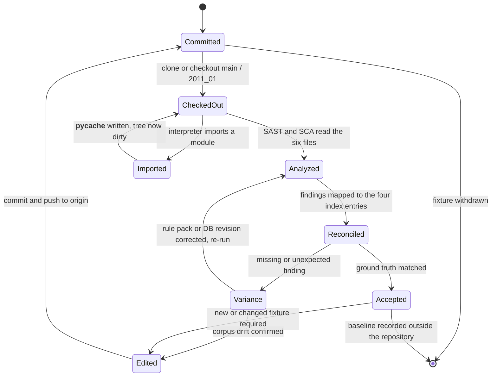

**Artifact lifecycle.** Movement is driven by Git and by the consumer, never by code in the tree. `Committed` is the only stable state and the only one that matters as ground truth; `Imported` is a side state that leaves bytecode behind; `Analyzed`, `Reconciled` and `Accepted` are consumer states with no representation inside the repository, which is why no baseline, no report and no status file exists (`3.5.3`). The observed history contains one deletion arc — `security_fixture/asdasd` created in `7fa13bd` and removed in the tip commit `6c7b396` — showing that the `Edited → Committed → [*]` path has been exercised without any gate.

| State sequence | Trigger | State that persists | Evidence |
|---|---|---|---|
| Fixture lifecycle | Git operations plus consumer runs | Only committed bytes; `.git` holds seven commits | `git log`; `git ls-files` |
| Report-file lifecycle | Execution of `write_report` | `/tmp/report.txt` exists, or is truncated or absent; nothing in the tree records it | `unsafe_tempfile.py:3-6`; observed creation with mode `0o644` |
| PRNG state | One call to `create_token` advances the shared Mersenne Twister | The generator's state belongs to the process, not the function; a later call in the same process sees an advanced state | `weak_crypto.py:8`; observed suffix changing between two calls for the same identifier |

The PRNG row is the only place where call order changes a result: `create_token` is a pure function of the identifier for its 32-character prefix, but its suffix depends on process-global generator state that neither the function nor the repository controls, seeds or records. Reproducing a specific suffix therefore requires replaying the same call sequence in a fresh process, which the corpus neither does nor documents.

### 4.6.2 Data Persistence Points

| Persistence point | Location | Written by | Lifetime | In version control |
|---|---|---|---|---|
| Git object store | `.git/` | Author commits | Permanent for the branch | Is the version control |
| Report file | `/tmp/report.txt` | `write_report` at `unsafe_tempfile.py:4-5` | Until overwritten or until `/tmp` is cleared | No; never committed, and the repository never creates it during analysis |
| Bytecode cache | `security_fixture/__pycache__/` | CPython on import | Until deleted; invalidated by source change | No – untracked, and no ignore rule excludes it |
| Finding set | Consumer's own sink | SAST and SCA engines | Consumer-defined | No; no output path or schema exists in the tree |
| Function return values | Process memory | The three functions | Duration of the call | No; nothing is retained after return |

There is no other write path. No database driver, ORM, migration, key-value client, queue or blob-storage SDK appears anywhere in the tree, and no seed or fixture data file exists (`3.5.1`). The corpus is a read-only producer: its own flows leave the working tree byte-identical, except for the bytecode directory that the interpreter adds on the consumer's behalf.

### 4.6.3 Caching Requirements

No caching is implemented and none is required. The tree contains no `functools.lru_cache`, no memoisation dictionary, no cache directory and no TTL constant; each call recomputes from its arguments, so a repeated call to `create_token` recomputes the same MD5 and a repeated call to `write_report` rewrites the same path.

| Cache | Status | Key and invalidation | Consequence for the flow |
|---|---|---|---|
| Application-level cache | Absent | Not applicable | Every call is a full recomputation; cost is constant and the corpus needs no warm-up |
| Bytecode cache | Present, generated by CPython | Interpreter magic number plus a source mtime/size record; regenerated whenever the source changes or the interpreter version differs | The three observed files are `insecure_yaml.cpython-312.pyc` (534 bytes), `unsafe_tempfile.cpython-312.pyc` (532 bytes) and `weak_crypto.cpython-312.pyc` (650 bytes), each beginning with magic `0x0dcb` (CPython 3.12) |
| Analysis-result cache | Absent | Not applicable | A finding set is always recomputed; only a consumer-provided cache could persist it |
| Advisory-data cache | Consumer-side only | Consumer-defined | Determines how stale a reported advisory set can be (`security_fixture/README.md:11`) |

The bytecode cache has one workflow consequence: a scanner that imports the modules rather than parsing them writes into the working tree, so the tree is no longer guaranteed clean after a run. Because no `.gitignore` exists, those files are visible to `git status` and could be committed accidentally, which would add derived artifacts to a corpus whose value depends on being exactly six hand-written files.

### 4.6.4 Transaction Boundaries

The corpus defines no transaction. There is no database, so no commit, rollback, isolation level or lock is available, and no atomic-rename idiom appears in the write path.

| Candidate boundary | Scope | What it guarantees | What it does not |
|---|---|---|---|
| `with open(path, "w") as report:` (`unsafe_tempfile.py:4-5`) | Resource scope | The descriptor is closed and the buffered write flushed on exit, even on exception inside the block | Atomicity, isolation, durability: the file is truncated before the write, so a failure mid-write leaves a partial file |
| `write_report` call | One call | Nothing; three statements with no rollback | Two concurrent calls interleave on the same path, and a failed call leaves the previous content destroyed |
| `create_token` call | One call | Nothing to guarantee: no state is mutated outside the process PRNG | Reproducibility, because the suffix consumes shared generator state |
| `load_config` call | One call | Nothing; the constructed object is returned and never rolled back | A partially constructed object graph is not observable, but the code executed during construction is |
| Scanner run over the corpus | Whole batch | Nothing beyond the engine's own behaviour | Checkpointing, resume, all-or-nothing semantics (`4.3.4`) |
| Git commit | One commit | The only genuine atomic unit in the workflow: a commit is all-or-nothing and immutable once written | Anything about the truth of its contents |

The practical boundary that operators should treat as transactional is the Git commit: it is the only operation in the entire workflow that either fully happens or does not happen. Everything a scanner derives from those commits is recomputable, which is what allows the workflow to have no rollback path at all — recovering a fixture is `git checkout` of the committed bytes.


## 4.7 Technical Implementation — Error Handling

The corpus handles no errors. Searches across all six tracked files return zero `try`, `except`, `raise`, `finally` and `assert` statements, so every failure propagates out of the fixture to whatever called it. That absence is required, not accidental: `F-001-RQ-003` forbids validation or exception handling in the deserialization fixture, because a fixture that guarded its own defect would demonstrate nothing.

### 4.7.1 Failure Modes and Propagation

| # | Failure | Origin | Exception | Observed or derived | Effect on the flow |
|---|---|---|---|---|---|
| FM1 | PyYAML not importable | `import yaml`, `insecure_yaml.py:4` | `ModuleNotFoundError` | Derived: the pin must never be installed (`F-006-RQ-001`), so an executing environment normally lacks it | Fixture cannot be executed; static analysis still succeeds |
| FM2 | Malformed YAML document | `yaml.load`, `insecure_yaml.py:7` | `yaml.parser.ParserError` | Observed with input `"a: [1, 2"` | Returns no value; the caller sees the parser error verbatim |
| FM3 | Tagged node refused by a safe loader | Constructor, not reachable through the fixture | `yaml.constructor.ConstructorError` | Observed with `yaml.safe_load` on the same tagged document | Only reachable if someone hardens the fixture, which `F-001-RQ-002` forbids |
| FM4 | Non-`str` report contents | `report.write`, `unsafe_tempfile.py:5` | `TypeError`; `UnicodeEncodeError` for unencodable text | Derived from `open(path, "w")` with no `encoding=` | File already truncated at open, so a partial artifact remains |
| FM5 | Target path unusable: not writable, a directory, or a link to a protected file | `open`, `unsafe_tempfile.py:4` | `PermissionError`, `IsADirectoryError`, `OSError` | Derived; the write is unconditional in mode `"w"` | No file produced; no cleanup attempted |
| FM6 | Module cannot be parsed | Interpreter, on any module | `SyntaxError` below CPython 3.6 for the f-string at `weak_crypto.py:8` | Derived from the f-string syntax | All three modules use a shared grammar floor (`2.3.3`) |
| FM7 | Advisory lookup returns nothing | Consumer, at 4.2.1 S5 | No exception; an empty result | Documented variance at `security_fixture/README.md:11` | Silent under-reporting risk, not a failure |

Every failure in the table terminates the affected call; none is caught, retried, translated or logged. There is no exception hierarchy, no custom error type and no error code in the tree, so a caller can only distinguish failures by the exception class the standard library or PyYAML raised.

### 4.7.2 Error Handling Flowchart

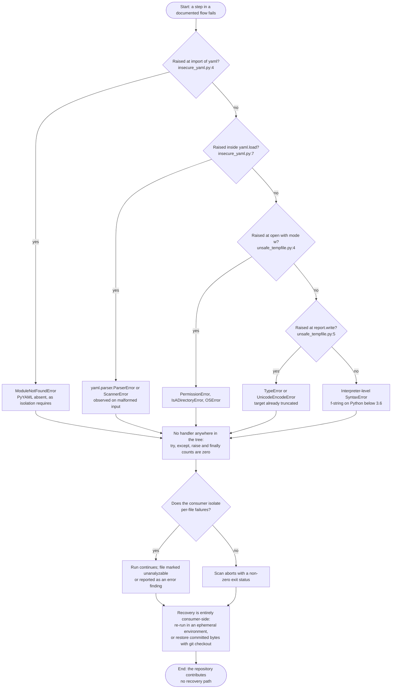

### 4.7.3 Retry Mechanisms

No retry mechanism exists at any layer. There is no loop construct in the tree — `for` and `while` counts are zero in code — and no library call in the corpus accepts a retry, timeout or backoff parameter.

| Operation | Retry in the repository | Retry available to the consumer | Effect of the absence |
|---|---|---|---|
| `yaml.load` (`insecure_yaml.py:7`) | None | The engine may re-run the file | A nondeterministic parse failure is not retried, and a fixed document fails identically on every attempt |
| `open`/`write` (`unsafe_tempfile.py:4-5`) | None | The caller may re-run the function | A colliding or symlinked write is not detected or retried; the second caller simply overwrites |
| `hashlib.md5`/`random.randint` (`weak_crypto.py:7-8`) | None | Not applicable | No failure path exists for ordinary input, so there is nothing to retry |
| Advisory lookup (consumer) | None | Yes, engine-defined | A transient network failure surfaces as an unverified dependency unless the engine retries |
| Scan run over six files | None | Yes, by re-running the scan | Because the inputs are read-only, a re-run is byte-for-byte reproducible given the same rule pack and database revision |

The one place where retry semantics change an outcome is the write path: because `open(path, "w")` truncates unconditionally, retrying a failed write does not restore the previous content, so a retry is not idempotent for any data that occupied the path before the first attempt.

### 4.7.4 Fallback Processes

| Failure | Fallback defined in the repository | Fallback that actually applies |
|---|---|---|
| Vulnerable pins cannot be installed in the target environment | Yes, documentary: do not install | Analysis-only scanning; the pins are resolved as text and matched against advisories without installation |
| PyYAML absent at execution time | No | Parse the module statically instead of importing it; `insecure_yaml.py` is valid source, so this always works |
| Malformed YAML document | No | None: the exception reaches the caller uncaught |
| `/tmp/report.txt` unavailable | No | None: the fixture has one hard-coded path and no alternative (`F-003-RQ-002`) |
| Advisory database stale or unreachable | Yes, documentary: record the revision, expect variance | Re-run against a refreshed database and record the new revision with the result set |
| A documented pattern produces no finding | No | Reviewer attributes the miss to the rule pack or database rather than to the corpus (4.2.1 S8) |
| A finding has no documented pattern | No | Reviewer checks corpus drift, then rule precision; the index names no severity or expected count to compare against |

Every fallback that exists is a documented rule rather than a coded one, and each is carried by the same two sentences: the isolation notice at `security_fixture/README.md:10` and the variability caveat at line 11. Neither is executable, and neither is checked by any automation (`F-006-RQ-004`).

### 4.7.5 Error Notification Flows and Recovery Procedures

**Notification.** The corpus emits no signal of its own: no logging import, no `print`, no metrics client, no exception hook, no alert, no webhook and no status file exists, and no `log` token appears in any tracked file. The complete notification surface is the exception object that reaches the caller's stack and the exit status the caller chooses to give the run. Human-facing notification exists only as documentation read before a run — the do-not-install header at `requirements-vulnerable.txt:1-2`, the isolation rule at `security_fixture/README.md:10` and the docstring warning at `insecure_yaml.py:1-3`.

**Recovery procedures.** Recovery is defined outside the repository, and the following sequence is the only one the artifacts support:

| # | Recovery step | Authority | Evidence |
|---|---|---|---|
| R1 | Contain the run: ephemeral host, no installed pins, no deployment | Isolation rule | `security_fixture/README.md:10`; `requirements-vulnerable.txt:1-2` |
| R2 | Restore the corpus from version control if any file was disturbed, including the `/tmp` side effect and the bytecode directory | Git history | `git checkout` of the tip `6c7b396`; untracked `__pycache__` observed |
| R3 | Re-establish the ground truth by re-reading the four index entries before interpreting any finding | Index | `security_fixture/README.md:5-8` |
| R4 | Re-run with the same rule pack and advisory-database revision, recording both with the result | Variability caveat | `security_fixture/README.md:11` |
| R5 | If the corpus itself caused the variance, follow the maintenance flow in 4.2.5 and never harden a fixture to make a scan pass | Feature requirements | `F-001-RQ-002`, `F-002-RQ-002`, `F-003-RQ-002`, `F-004-RQ-002` |

There is no automated recovery, no self-healing path and no compensating transaction anywhere in the workflow; step R5 in particular exists to stop the most damaging recovery an operator could improvise, which is to convert a vulnerable fixture into a safe one and thereby delete the ground truth the corpus provides.


## 4.8 Required Diagrams: Inventory and Conventions

This section indexes the ten diagrams of the process documentation, states which required diagram type each one satisfies, and fixes the conventions a future editor must follow. Each diagram was rendered with a Mermaid CLI parser to confirm its syntax before publication.

### 4.8.1 Diagram Inventory

| # | Diagram | Type | Sub-section | Lanes or participants | What it establishes | Evidence base |
|---|---|---|---|---|---|---|
| D-1 | High-level system workflow | `flowchart TD` with subgraph lanes | 4.1.3 | Repository boundary, consumer-side analysis, two human actors | The corpus is a one-directional read-only input; nothing returns to the tree | Six tracked files; `security_fixture/README.md:5-11`; absent CI |
| D-2 | End-to-end evaluator journey | `flowchart TD` with four decision diamonds | 4.2.1 | Steps S1-S8, each attributed in the companion table | The only business process the corpus supports, including the isolation gate and both variance branches | `F-005-RQ-002`; `security_fixture/README.md:11` |
| D-3 | F-001 deserialization flow | `flowchart TD` | 4.2.2 | Caller, PyYAML parser, composer and constructor | Constructor selection decides whether arbitrary objects are built | `insecure_yaml.py:6-7`; probe results |
| D-4 | F-002 token generation flow | `flowchart TD` | 4.2.3 | Caller, `hashlib`, `random` | Determinism of the prefix and the 9,000-value suffix space | `weak_crypto.py:5-8`; probe results |
| D-5 | F-003 report write flow | `flowchart TD` | 4.2.4 | Caller, POSIX filesystem | The three states of the fixed path: absent, existing, symlinked | `unsafe_tempfile.py:2-6`; probe results |
| D-6 | Fixture maintenance flow | `flowchart TD` | 4.2.5 | Author, index, commit | A fixture edit that removes the defect destroys the ground truth; no gate catches it | `git log`; `F-001-RQ-002` to `F-006-RQ-004` |
| D-7 | Data flow between systems | `flowchart LR` with producer/consumer lanes | 4.3.1 | Repository, SAST engine, SCA engine, advisory database, reviewer | Payload per integration edge, with byte volumes | Six files; 749 / 178 / 572 byte payloads |
| D-8 | Integration sequence | `sequenceDiagram` with `alt` branches | 4.3.5 | Seven participants L1-L8 | Order of interactions and the three reconciliation outcomes | Sections 4.2.1, 4.3.2, 4.3.4 |
| D-9 | Artifact lifecycle | `stateDiagram-v2` | 4.6.1 | Committed, checked out, imported, analyzed, reconciled, accepted, variance, edited | Which states persist and which leave a trace | `git log`; untracked `__pycache__`; `unsafe_tempfile.py` |
| D-10 | Error handling flow | `flowchart TD` with five failure exits | 4.7.2 | Import, parser, open, write, interpreter; then consumer | Every failure path terminates outside the repository | Zero `try`/`except` in the tree; observed `ParserError` |

### 4.8.2 Coverage of the Required Diagram Types

| Required diagram type | Where satisfied | Notes |
|---|---|---|
| High-level system workflow | D-1 (4.1.3) | Boundary, actors and the one-way data direction; the same six files also appear as lanes in D-7 |
| Detailed process flow for each core feature | D-3 for `F-001`, D-4 for `F-002`, D-5 for `F-003`, D-2 and D-6 covering `F-004` advisory matching and `F-005`/`F-006` maintenance duties | `F-004` has no code path of its own; its flow is the SCA lane and advisory branch of D-2 and payload DF2/DF4 of D-7 |
| Error handling flowcharts | D-10, plus the error exits inside D-2, D-3 and D-5 | D-10 is the consolidated view; the per-flow exits stay in their own diagrams so each failure is readable where it occurs |
| Integration sequence diagrams | D-8 | Includes the three mutually exclusive reconciliation outcomes as `alt` branches |
| State transition diagrams | D-9 | The remaining two state sequences — the report file and the process PRNG — are tabulated in 4.6.1, because each has only two or three reachable states and a diagram would add no information |

**Swim lanes.** Lanes are drawn wherever a flow genuinely crosses an actor or a system boundary: D-1 (repository versus consumer-side analysis), D-7 (producer versus consumers) and D-8 (one participant per actor). The three fixture-level diagrams D-3, D-4 and D-5 are single-actor sequences inside one function call, so each node carries its owning step identifier and line reference instead of a lane header; splitting them into lanes would separate statements that execute in one process.

### 4.8.3 Conventions and Identifier Index

| Convention | Rule |
|---|---|
| Shapes | Stadium `([ ])` start or end; rectangle process; diamond decision; cylinder persisted artifact or finding set |
| Decision attribution | Every diamond is owned by a consumer or library, never by repository code, and is listed in 4.4.1 |
| Node labels | Step identifier first, then the artifact or line that anchors it, so every node traces to a file and a line |
| Edge labels | State the condition, and mark a data-carrying edge with its payload identifier |
| Dotted edges | Information that no gate validates, such as the index-to-reviewer mapping |
| Timing | Ordering only; no diagram carries a duration, because the repository defines no timeout or SLA (4.4.4) |
| Maintenance | A fixture edit that changes a statement count, line reference or payload size must be applied to the diagram, its companion table and 4.8.1 together |

| Identifier family | Meaning | Defined in |
|---|---|---|
| S1-S8 | Steps of the evaluator journey | 4.2.1 |
| P1-P6, D1-D3 | Process steps and decision points inside fixture flows | 4.2.2, 4.2.3, 4.2.4 |
| M1-M6 | Steps of the fixture maintenance flow | 4.2.5 |
| DF1-DF6 | Integration data flows and their payloads | 4.3.1 |
| B1-B7 | Batch processing steps | 4.3.4 |
| T1-T3 | Human touchpoints | 4.4.2 |
| FM1-FM7 | Failure modes | 4.7.1 |
| R1-R5 | Recovery procedure steps | 4.7.5 |
| L1-L8 | Actors and swim lanes | 4.1.2 |
| D-1 to D-10 | Diagrams | 4.8.1 |


## 4.9 References

**Repository files**

- `security_fixture/insecure_yaml.py` — `F-001`: the parameter at line 6, the `import yaml` at line 4 and the single `return yaml.load(user_supplied_yaml, Loader=yaml.Loader)` at line 7 that the 4.2.2 and 4.7.2 flows chart; also the docstring warning at lines 1-3.
- `security_fixture/weak_crypto.py` — `F-002`: the `hashlib.md5(...).hexdigest()` at line 7 and the `random.randint(1000, 9999)` f-string at line 8 that fix the token flow and its 37-character output contract.
- `security_fixture/unsafe_tempfile.py` — `F-003`: the literal `/tmp/report.txt` at line 3, the `with open(path, "w")` at line 4, the write at line 5 and the returned path at line 6 that make up the only persistence path.
- `requirements-vulnerable.txt` — `F-004`, `F-006`: lines 1-2 carry the do-not-install guardrail that forms the isolation gate of 4.2.1; lines 3-4 are the two exact pins consumed by the SCA lane and advisory lookup.
- `security_fixture/README.md` — `F-005`, `F-006`: lines 5-8 are the four-entry ground-truth map used in the reconciliation step; line 10 supplies the isolation rule; line 11 supplies the rule/database variability caveat that governs the variance branches.
- `README.md` — the single 29-byte heading `# proactive_insights_security`; the only repository-level self-description and evidence that no other documentation exists.
- `security_fixture/` — the flat, package-less folder holding all four analysis targets, with no `__init__.py`, which is why discovery in the flow is a directory walk.
- `security_fixture/__pycache__/` — untracked CPython 3.12 bytecode (`insecure_yaml`, `unsafe_tempfile`, `weak_crypto`, `.cpython-312.pyc`; 534, 532 and 650 bytes; magic `0x0dcb`), the only residue a consumer's run can leave in the working tree.
- `.git/` — seven commits with tip `6c7b396`, branches `main` and `2011_01` identical in content, the transient `security_fixture/asdasd` created in `7fa13bd` and deleted in the tip, and the commit timestamps that are the only clock in the workflow.

**Specification cross-references**

- [1.2 System Overview](#12-system-overview) — component inventory, defect classes and the success criteria whose measurement these flows serve.
- [1.2.3 Success Criteria](#123-success-criteria) — the objectives that 4.4.4 notes are the only measurable timing and quality targets.
- [2.1 Feature Catalog](#21-feature-catalog) — `F-001` to `F-006` identifiers, artifacts and documented patterns used throughout this section.
- [2.2 Functional Requirements](#22-functional-requirements) — `F-00x-RQ-YYY` identifiers cited as the business and validation rules at every step.
- [2.3 Feature Relationships](#23-feature-relationships) — the import and documentation couplings, and the statement that no module imports another, which allows the batch steps of 4.3.4 to run in any order.
- [2.4 Implementation Considerations](#24-implementation-considerations) — the analysis-cost bound and change-control constraints that 4.2.1 and 4.4.4 rely on for timing statements.
- [3.5 Databases & Storage](#35-databases--storage) — the persistence inventory and the single write path reproduced in 4.6.2.
- [3.6 Development & Deployment](#36-development--deployment) — the absence of CI, build and container layers that makes the maintenance flow of 4.2.5 gateless.

**External sources**

- No web lookup was performed for this section. Advisory identifiers used in 4.2.2, 4.5.4 and D-3 (CVE-2020-14343, CVE-2018-18074, CVE-2023-32681, CVE-2024-35195, CVE-2024-47081) and their fixed releases are carried from [2.1 Feature Catalog](#21-feature-catalog) and [2.4 Implementation Considerations](#24-implementation-considerations), where they were established against published advisory data; the repository itself names no CVE, GHSA identifier or severity.
- Runtime behaviour reported in 4.2.2, 4.2.3 and 4.2.4 (uncaught `yaml.parser.ParserError`, execution of a `!!python/object/apply` tag, digest equality with `md5('42')`, per-call suffix variation, `/tmp/report.txt` created with mode `0o644`) was observed by importing the committed modules directly in a disposable interpreter session under PyYAML 6.0.3; the probe artifacts were removed afterwards and the working tree was left unchanged.


# 5. System Architecture

## 5.1 High-Level Architecture

The architecture of `proactive_insights_security` is unusually thin, and describing it accurately requires stating what it is not before stating what it is. The repository runs nothing: it has no entry point, no server, no scheduled job, no framework, no database and no configuration. Its six tracked files are a **static analysis-input corpus** — a set of deliberately defective artifacts whose only function is to be read by security tooling and to yield a known-correct set of findings. Every architectural property below follows from that single purpose.

### 5.1.1 System Overview

**Architecture style.** The repository is a *shared-nothing, file-format-contract corpus*. There are no in-process component relationships to speak of: no module in `security_fixture/` imports another, no shared state exists between them, and no build, packaging or generation step sits between the committed bytes and the analyzer. Components are coupled only by the **formats they present** — valid Python 3 source, a pip requirements file and Markdown — so the integration surface is the file system and nothing else.

**Rationale.** A scanner's finding is evidence only if the input that produced it is fixed and minimal. Introducing a runtime, a framework, a package manifest or a build pipeline would place transformations between the committed bytes and the analyzer, and any resulting finding would then be attributable to the transformation rather than to the defect. Two structural consequences of that rationale are visible in the tree:

- *Reduction to one defect per module.* Each fixture module holds exactly one function with one unannotated parameter and no error handling — `load_config` in `security_fixture/insecure_yaml.py:6-7`, `create_token` in `security_fixture/weak_crypto.py:5-8`, `write_report` in `security_fixture/unsafe_tempfile.py:2-6`. A detection result therefore depends on one statement, not on interaction between statements.
- *Absence of every optional tier.* A recursive search of the tree finds no `__main__` block, no `print`, no logging import, no socket, `urllib`, `http`, `subprocess` or `threading` import, no `class`, no `try`/`except`/`raise`, and no loop construct in code. The three Import statements in the entire checkout are `yaml` (`insecure_yaml.py:4`), `hashlib` and `random` (`weak_crypto.py:2-3`).

**Architectural principles and patterns.** Six principles govern the design, each observable in the files rather than merely asserted:

| Principle | Statement | Evidence |
|---|---|---|
| Single-defect reduction | One function, one statement carrying the defect, no helper logic | Lines 6-7 of `insecure_yaml.py`; 5-8 of `weak_crypto.py`; 2-6 of `unsafe_tempfile.py` |
| Contract-only integration | Consumers integrate by parsing a file format, never by calling an API | No server, CLI, entry point or exported package; no `__init__.py` |
| Defect preservation | Hardening a fixture destroys the ground truth the corpus provides | `security_fixture/README.md:10`; docstring warning at `insecure_yaml.py:1-3` |
| Isolation | The pins are never installed and the code is never deployed | `requirements-vulnerable.txt:1-2`; `security_fixture/README.md:10` |
| Zero own configuration | No scanner config, baseline, suppression file or expected-findings file, so the consumer's rule pack is the only variable | No YAML/TOML/INI config exists; no CI definition exists |
| Flat discovery | One directory level, no package structure, artifacts found by traversing the tree | `security_fixture/` has four file children and no sub-folders |

**System boundaries and major interfaces.** The boundary is the Git working tree at commit `6c7b396`. It is crossed in exactly four ways:

- **Inbound:** none in the service sense — no ports, no endpoints, no request handling, no event subscriptions, no inbound webhooks. Artifacts arrive only by commit.
- **Outbound, read-only, to scanners:** three Python modules offered to a SAST engine as AST-parseable source, and one requirements file offered to an SCA engine as two exact `==` pins.
- **Outbound, documentary, to humans:** `security_fixture/README.md` maps each path to the pattern it demonstrates, and `README.md` supplies the project name only.
- **Leakage at execution time:** if a fixture is *executed* rather than parsed, two edges leave the boundary — `import yaml` binds to whatever PyYAML distribution the interpreter has installed (not to the pinned 5.3.1), and `write_report` writes the fixed path `/tmp/report.txt` on the host. The supported analysis path never crosses either edge.

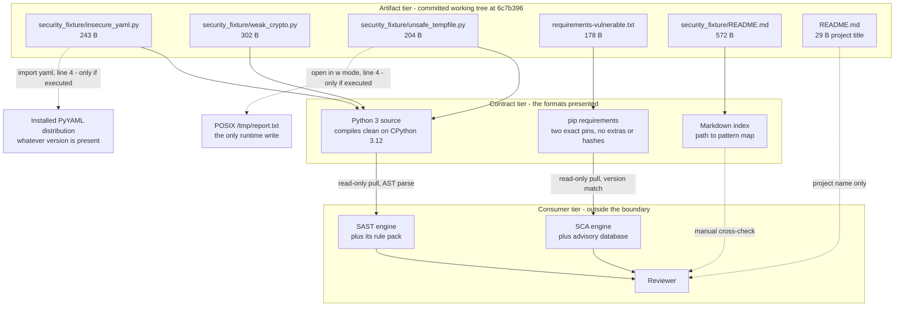

### 5.1.2 Core Components

Six tracked components make up the corpus, plus one generated artifact. The table consolidates each component's dependencies and integration points into one column so that it stays within four columns.

| Component (path) | Primary responsibility | Key dependencies and integration points | Critical considerations |
|---|---|---|---|
| Deserialization fixture — `security_fixture/insecure_yaml.py` | Exhibit unsafe YAML deserialization for SAST rule `F-001` | Depends on the third-party `yaml` distribution (PyYAML); consumed by a SAST engine as source text, never imported by another in-repo module | The defect is carried by one statement, `yaml.load(user_supplied_yaml, Loader=yaml.Loader)`, line 7; passing `Loader` explicitly keeps it executable on both PyYAML 5.x and 6.x |
| Cryptography fixture — `security_fixture/weak_crypto.py` | Exhibit weak hashing and non-cryptographic randomness for SAST rule `F-002` | Standard library only (`hashlib`, `random`); consumed by a SAST engine as source text | Two distinct defects in one function — unkeyed MD5 (line 7) and `random.randint` (line 8) — so a rule pack may report one or two findings; the f-string sets a Python 3.6 grammar floor |
| Temporary-file fixture — `security_fixture/unsafe_tempfile.py` | Exhibit a predictable shared temporary path for SAST rule `F-003` | No imports; uses builtin `open`; the only component with a runtime write path (`/tmp/report.txt`) | The literal path in a world-writable directory is the entire defect (lines 3-4); truncating `"w"` mode means a second caller destroys the first caller's content |
| Dependency manifest — `requirements-vulnerable.txt` | Supply vulnerable version pins for SCA rule `F-004` | Consumed by an SCA engine, which resolves each pin against an advisory database; referenced from `security_fixture/README.md:8` by relative path | Two comment lines forbid installation; both pins are exact `==` with no extras, markers, hashes or index URLs, so their advisory match is entirely the engine's work |
| Fixture index — `security_fixture/README.md` | Map each fixture path to the pattern it demonstrates and state the isolation rule | Read by humans reconciling findings; its only cross-component reference is the textual link `../requirements-vulnerable.txt` at line 8 | Carries the ground-truth mapping, so an unindexed finding or an unindicated fixture signals corpus drift |
| Project title — `README.md` | Name the repository | None; documentation only | 29 bytes, one Markdown H1, no trailing newline; documents none of the fixtures beside it |
| Bytecode cache — `security_fixture/__pycache__/` | CPython's compiled form of the three modules | Produced by the interpreter, not by any repository step; untracked and not excluded by any ignore rule | The only generated artifact in the tree; three `*.cpython-312.pyc` files show the modules were imported under CPython 3.12 at least once |

The public surface of the corpus is correspondingly small: three module-level functions, each the sole export of its module, each taking exactly one unannotated argument with no return annotation and no raised exception of its own.

| Component | Public surface | Imports and runtime side effects | In-repo coupling |
|---|---|---|---|
| `insecure_yaml.py` | `load_config(user_supplied_yaml)` | `import yaml` at line 4; no side effect at import beyond binding the name | None |
| `weak_crypto.py` | `create_token(user_id)` | `hashlib`, `random`; mutates the process-wide PRNG state on each call | None |
| `unsafe_tempfile.py` | `write_report(contents)` | Builtin `open`; truncates and writes `/tmp/report.txt` | None |
| `requirements-vulnerable.txt` | Two requirement lines as text | None — parsed, never installed | Referenced by relative path from the index |
| `security_fixture/README.md` | Five list entries plus a two-line safety notice | None | Names `../requirements-vulnerable.txt` at line 8 |
| `README.md` | One H1 heading | None | None |

### 5.1.3 Data Flow Description

**Primary flows.** Because nothing executes, data flows in one direction only: outward, by being read. Four flows account for all movement.

- **DF-A, static read path.** A SAST engine walks the tree, reads the 749 bytes of the three fixture modules, parses each into an abstract syntax tree and evaluates its rules against it. The payload is source text; nothing is written back to the repository.
- **DF-B, dependency resolution path.** An SCA engine reads the 178 bytes of `requirements-vulnerable.txt`, extracts the two exact pins and resolves each against an advisory database it holds or queries itself. The payload is requirement lines; the repository performs no resolution.
- **DF-C, reconciliation path.** A reviewer reads the 572-byte fixture index and maps each reported finding to a documented pattern. This is a dotted, unvalidated edge: no automation checks that the mapping is current.
- **DF-D, in-repository flow: none.** No module imports another, no function is called by another, and no file in the tree reads another file. The single intra-tree reference is the Markdown link at `security_fixture/README.md:8`, which points at `../requirements-vulnerable.txt` for human navigation and carries no executable meaning.

**Integration patterns and protocols.** Every edge is a *pull*: the consumer reads a file from a checkout it already has. There is no push, no streaming, no subscription, no callback, no queue, no polling loop and no handshake, and the five protocol families a specification normally enumerates here are all absent — no HTTP/REST, GraphQL, gRPC, AMQP or database wire protocol appears anywhere in the tree. The repository is therefore protocol-agnostic by construction; the effective protocol is `read(2)` over the file system, and the effective contract is the file format.

**Data transformation points.** Two transforms occur inside repository code, and both are the defects rather than plumbing: PyYAML's composer and constructor turn document text into Python objects at `insecure_yaml.py:7` — a transform that constructs arbitrary tagged objects when handed `Loader` and is the whole point of rule `F-001` — and the f-string at `weak_crypto.py:8` assembles a 37-character token from a 32-hex-character digest, a hyphen and a four-digit integer. Two further transforms happen in the consumer and are outside the boundary: the analyzer's own AST parse, and its version-to-advisory matching. There is no code generation, templating or build step in the repository that could transform an artifact before analysis.

**Key data stores and caches.** Two durable or semi-durable stores exist and both are incidental; there is no cache in the repository at all.

| Store | Class | Contents and lifetime | Architectural role |
|---|---|---|---|
| `.git/` object store | Durable, intentional | Seven commits across branches `main` and `2011_01`, tip `6c7b396` | The only versioned state; the recovery authority when a fixture is disturbed |
| `security_fixture/__pycache__/` | Generated, untracked | Three `*.cpython-312.pyc` files, rebuilt whenever the interpreter imports a module | Accident of a prior import; contributes nothing to analysis and is not excluded by any ignore rule |
| `/tmp/report.txt` | Volatile, host-scoped | Overwritten by every `write_report` call; no `flush`, `fsync`, atomic rename or permission control | The single runtime write in the corpus, and a defect rather than a storage design |
| Consumer-side rule pack, advisory database, findings store | Outside the boundary | Owned by the scanning toolchain | The only place analysis results persist |

Byte volumes are fixed and small enough to enumerate exactly: 749 bytes of Python source, 178 bytes of requirements text, 572 bytes of index, 29 bytes of title — 1,528 bytes in total. Any change to those figures means the corpus has changed, which is why the per-file sizes are worth recording alongside findings. The producer-to-consumer payloads are diagrammed in 4.3.1 (D-7) and the integration sequence in 4.3.5 (D-8).

### 5.1.4 External Integration Points

No external system is integrated by code. Each row below is a file-format contract honoured by a party outside the repository, and every one of them is a *requirement on the consumer* rather than an interface the repository implements.

| External system | Integration type | Data exchange pattern and protocol/format | SLA requirements |
|---|---|---|---|
| SAST engine and its rule pack | Outbound pull, read-only | Batch file read of three Python modules; AST-level parsing of Python 3 source; findings returned to the consumer | None defined in the repository; no latency, throughput or availability target exists, and no CI invocation is configured |
| SCA engine and its advisory database | Outbound pull, read-only | Batch read of one pip requirements file; exact-version match against advisories; CVE identifiers are not present in the file and must come from the database | None defined; the index at `security_fixture/README.md:11` only warns that results vary with the database revision |
| Python interpreter plus an installed PyYAML distribution | Indirect, runtime-only | `import yaml` at `insecure_yaml.py:4` binds to whichever distribution is present; observed execution used PyYAML 6.0.3, never the pinned 5.3.1 | None defined; import failure (`ModuleNotFoundError`) is an accepted outcome because installing the pin is forbidden |
| Host POSIX file system (`/tmp`) | Outbound side effect, runtime-only | Truncating text write to the fixed path `/tmp/report.txt`, no encoding argument | None defined; no cleanup, retry or permission requirement exists |
| Human reviewer | Manual, documentary | Markdown index read against a findings report; no machine-readable schema | None defined; reconciliation is manual and per-run |
| Git remote (`origin`) | Source distribution only | Git protocol fetch of the same six files on branches `main` and `2011_01` | None defined; consumed by checkout, not by runtime |

**Interfaces that do not exist.** To prevent an implementer from searching for them: the repository exposes no HTTP or HTTPS endpoint, no webhook receiver, no message-queue publisher or consumer, no database connection string, no cloud-storage client, no identity provider integration, no SMTP or notification channel and no scheduled job. Searches for `socket`, `urllib`, `http`, `subprocess`, `os.environ` and `logging` across every tracked file return no matches.


## 5.2 Component Details

Each component is described below on the five dimensions the architecture requires: purpose and responsibilities, technologies and frameworks, key interfaces, data persistence and scaling. Where a dimension has no meaning for a static artifact — persistence for a module that stores nothing, for example — that is stated rather than filled with a general claim.

### 5.2.1 Deserialization Fixture — `security_fixture/insecure_yaml.py`

**Purpose and responsibilities.** The module exists to present one unsafe YAML deserialization pattern to a SAST engine (rule `F-001`). It carries no business logic: `load_config` is a single-statement passthrough that hands its argument to PyYAML's full-featured loader and returns the result. Its stated responsibility is documentary as well as demonstrative — the docstring at lines 1-3 names the pattern and warns against reproducing it.

**Technologies and frameworks.** CPython 3 source with one third-party import, `yaml` (PyYAML, pinned as `PyYAML==5.3.1` in the manifest but never installed). The security consequence is a property of the loader selected: with `Loader=yaml.Loader` the composer and constructor will build arbitrary tagged Python objects, verified by constructing a benign local class from the document `!!python/object:__main__.P {a: 1}`, whereas the same document under `yaml.safe_load` raises `ConstructorError`. Passing `Loader` explicitly also keeps the statement valid on PyYAML 6.x, where `yaml.load` without the argument raises `TypeError`.

**Key interfaces.** One module-level function: `load_config(user_supplied_yaml)` at line 6, returning `yaml.load(user_supplied_yaml, Loader=yaml.Loader)` at line 7. The parameter is unannotated and unvalidated; PyYAML requires a stream-like object or string, so a valid document such as `"a: 1\nb: [1,2]\n"` returns `{'a': 1, 'b': [1, 2]}`, a malformed document raises `yaml.parser.ParserError`, and `None` raises `AttributeError: 'NoneType' object has no attribute 'read'`. The module has no `__all__`, no classes, no constants and no in-repo callers, and imports nothing from the repository.

**Data persistence.** None. The function reads text, builds objects in memory and returns them; it writes no file, opens no connection and keeps no state between calls.

**Scaling considerations.** Not applicable at runtime — the module is analysed, not invoked, and its 243 bytes are constant work for any parser. The only scaling dimension that matters is rule coverage: the single call site is the only place a `yaml.load` rule can fire, so a rule-pack change alters the result set without any change to this file.

### 5.2.2 Cryptography Fixture — `security_fixture/weak_crypto.py`

**Purpose and responsibilities.** The module exhibits two independent weaknesses that security rules treat separately: an unkeyed MD5 digest (line 7) and a non-cryptographic PRNG used in a security-relevant value (line 8). Because both live in one function, a rule pack may legitimately report one or two findings for this file, which is the module's main interpretive hazard.

**Technologies and frameworks.** Standard library only — `hashlib` for MD5 and `random` for the four-digit suffix. The f-string on line 8 sets a grammar floor of Python 3.6; `python3 -m py_compile` succeeds on CPython 3.12, and the untracked bytecode in `security_fixture/__pycache__/` carries the CPython 3.12 magic number, so 3.12 is the version the files have actually been compiled under.

**Key interfaces.** One function: `create_token(user_id)` at line 5, returning a 37-character string composed of a 32-character lowercase hex digest, a hyphen and a four-digit decimal integer. Observed: `create_token(7)` returned `8f14e45fceea167a5a36dedd4bea2543-3640`, and an immediate second call with the same argument returned the identical prefix with a different suffix. The input is coerced with `str()` and encoded with the default UTF-8 codec, so a non-encodable string raises `UnicodeEncodeError`; there is no annotation, no key, no salt, no expiry and no verification routine anywhere in the corpus.

**Data persistence.** None on the repository side. The token's entropy space is 32 hex characters of deterministic input plus a suffix drawn from 9,000 values, and no server-side store, session record or revocation list exists to compensate — the corpus contains no storage layer at all.

**Scaling considerations.** The function's cost is constant per call. The architectural point is statefulness of the shared PRNG: the default `random` instance is seeded from the operating system's entropy source on first use and advanced by each draw, so the suffix space is not reproducible across processes even though the prefix is deterministic for a given `user_id`. Any consumer that measures token predictability must account for both halves independently.

### 5.2.3 Temporary-File Fixture — `security_fixture/unsafe_tempfile.py`

**Purpose and responsibilities.** The module exhibits a predictable shared temporary-file path (rule `F-003`). It is the only component in the corpus that can alter host state, and it does so through builtin `open` rather than the `tempfile` module, which is precisely the pattern being demonstrated.

**Technologies and frameworks.** Pure CPython 3 with no imports at all — `open`, `with` and string literals. Nothing in the module names a temporary-directory API, a mode constant or a permissions mask.

**Key interfaces.** One function: `write_report(contents)` at line 2. It binds the literal `path = "/tmp/report.txt"`, opens it in truncating text mode as a context manager, writes `contents` verbatim and returns the path string rather than a handle. Observed: `write_report("probe")` returned `/tmp/report.txt` and created it. Non-string content raises `TypeError`; an unwritable, occupied or symlinked path raises `PermissionError`, `IsADirectoryError` or `OSError`; in every case the truncation has already happened at `open`, so a failed call can leave a partial artifact behind.

**Data persistence.** A single fixed path on the host, shared by every process: no unique name, no exclusive-create flag, no atomic rename, no `flush` or `fsync` and no permission control. Content survives only as long as the host's `/tmp` does, and a second caller silently overwrites the first. Nothing in the repository reads the file back, and the analysis path never creates it.

**Scaling considerations.** One writer per host is the hard ceiling, by construction. There is no queueing, no locking, no retry and no alternative path: a second concurrent caller fails or truncates rather than waiting.

### 5.2.4 Dependency Manifest — `requirements-vulnerable.txt`

**Purpose and responsibilities.** The file is the corpus's SCA target (rule `F-004`): two exact pins old enough to match published advisories, preceded by two comment lines that forbid installing them. Its responsibility is to be *read as text and resolved by someone else*; no code path in the repository consumes it.

**Technologies and frameworks.** Pip requirements syntax at its simplest — no extras, environment markers, hashes, index URLs or version ranges — with both packages resolvable from public PyPI. `PyYAML==5.3.1` corresponds to the only third-party import in the corpus; `requests==2.19.0` has no corresponding call site anywhere, which is deliberate enough to be architecturally significant: an SCA finding can exist for a package that no fixture exercises.

**Key interfaces.** A line-oriented text contract of four lines: two comments (lines 1-2) and two `==` pins (lines 3-4), 178 bytes in total. The only reference to it inside the tree is the relative Markdown link `../requirements-vulnerable.txt` at `security_fixture/README.md:8`, which resolves an ancestor path rather than a sibling one — the sole cross-boundary-style reference in the corpus. No CVE identifier, severity or expected finding count appears in the file; advisory matching belongs entirely to the consumer.

**Data persistence.** None. The file is authoritative only as a committed artifact; it is never installed, so no resolved environment records its versions.

**Scaling considerations.** Fixed at two pins. Growth is by adding lines, and each added pin multiplies SCA work without any corresponding code change — a maintenance cost the repository absorbs without a gate, since no CI job runs the scan.

### 5.2.5 Documentation Components — `security_fixture/README.md` and `README.md`

**Purpose and responsibilities.** `security_fixture/README.md` (572 bytes, 11 lines) is the corpus's ground-truth index: an H1, a one-sentence preamble, four list entries mapping each fixture path to the pattern it demonstrates (lines 5-8) and a two-line safety notice (lines 10-11) forbidding installation and deployment and warning that findings vary with enabled rules and vulnerability databases. The root `README.md` (29 bytes) supplies the project name `proactive_insights_security` and nothing else — no usage instructions, no fixture documentation, no links.

**Technologies and frameworks.** Markdown only, with no front matter, schema, anchor convention or generated content. The index is readable by humans and not designed to be machine-parsed as a manifest, so it cannot be validated automatically.

**Key interfaces.** The index's interface is its entry order and path strings, which a reviewer compares against a findings report. Its safety notice is the corpus's only human-facing control and is documentary, not enforceable.

**Data persistence.** Committed text; the two files are the durable statement of intent that the other four artifacts only imply.

**Scaling considerations.** One index entry per fixture. As the corpus grows, the index is the component most likely to drift, because nothing in the repository ties an entry to a file's existence — the decay that makes an unindexed finding or an unindicated fixture the primary signal of corpus drift.

### 5.2.6 Component Interaction Diagram

The interaction view has three layers and no call edges: components reach consumers only through the format they present. Solid edges are machine-read; dotted edges are human-only and unvalidated.

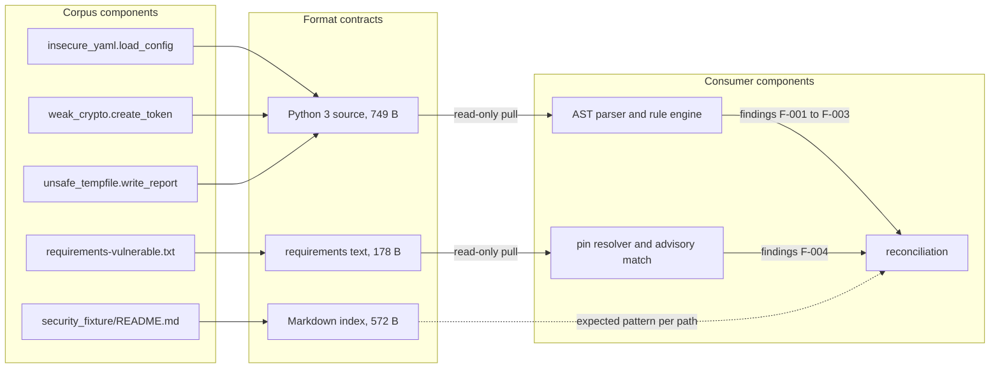

Two structural consequences follow. First, the three fixture modules are interchangeable from the analyzer's point of view: the same contract carries all of them, so adding a fourth fixture requires no interface change. Second, the manifest is the only component whose consumer performs a network-side resolution, and it is also the only one whose finding cannot be attributed to a call site — the shape of the correlation gap noted in 5.2.4.

### 5.2.7 State Transition Diagrams

Repository artifacts are immutable once committed, so the only state machines that exist belong to the two mutable runtime resources. The artifact lifecycle itself — committed, checked out, imported, analysed, reconciled, accepted, variance, edited — is documented as D-9 in 4.6.1; this section adds the two resource-level machines that 4.6.1 leaves tabulated.

**A-3a: the temporary-file target.** The path has three reachable initial states and two failure exits, all of them consequences of holding a fixed name in a shared directory.

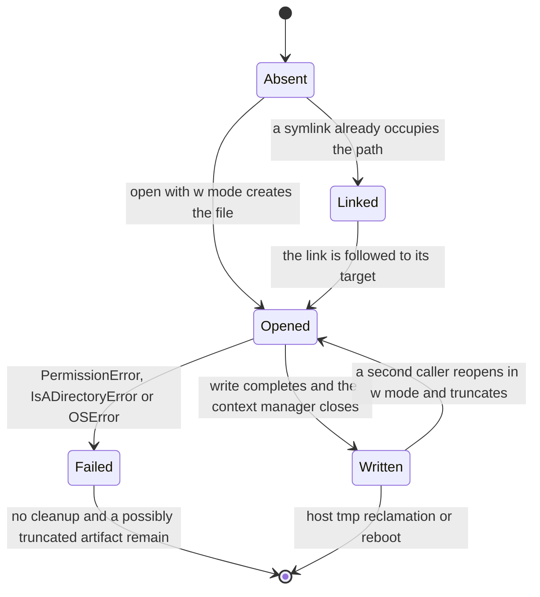

**A-3b: the process PRNG.** `create_token` mutates shared interpreter state, which is why two calls with identical input still differ.

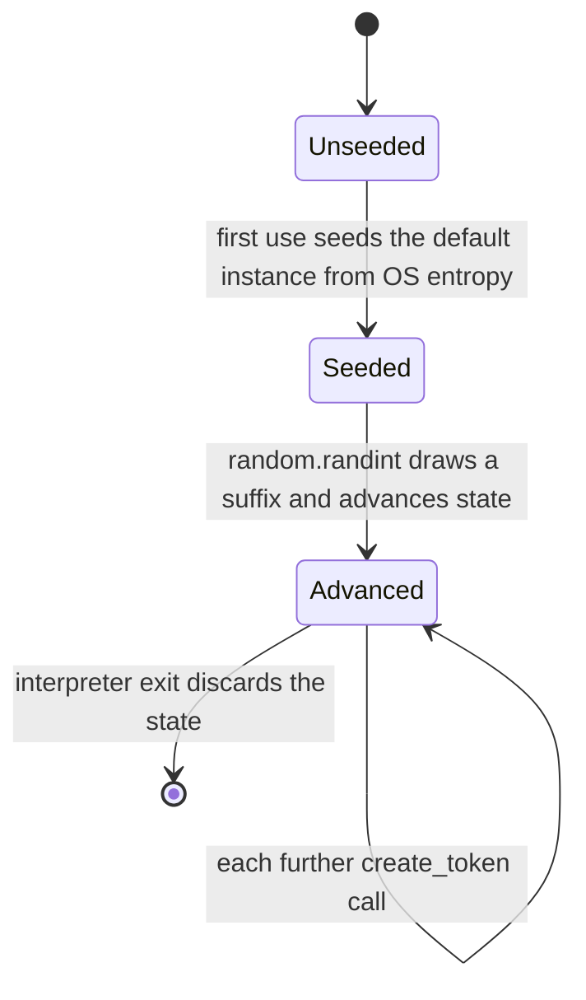

### 5.2.8 Sequence Diagram for the Key Analysis Flow

The one flow the architecture supports spans the boundary twice: the operator hands a checkout to two engines in parallel, and the reviewer closes the loop against the index. The three `alt` outcomes are the reconciliation results the corpus can produce; the cross-actor sequence with its lane identifiers is documented as D-8 in 4.3.5.

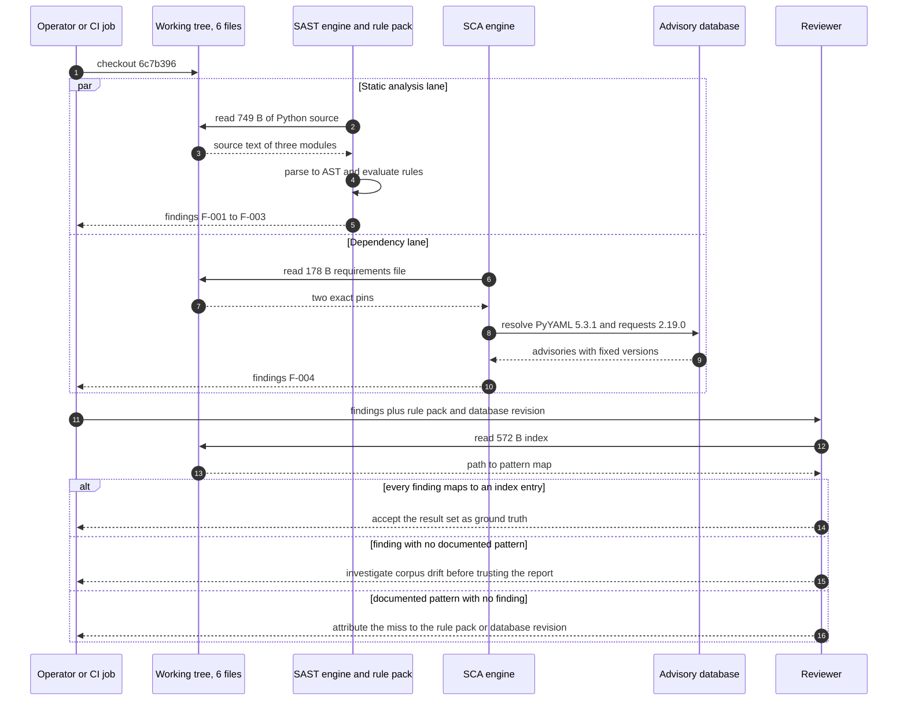


## 5.3 Technical Decisions

Every architectural choice in this repository is a deliberate subtraction: what was left out is the decision. The register below records each decision as an architecture decision record, and the sub-sections that follow justify the five categories the specification requires.

### 5.3.1 Architecture Decision Register

| ID | Decision | Alternatives rejected and why | Status and consequence |
|---|---|---|---|
| ADR-01 | Flat, un-packaged fixture corpus at one directory level | An installable package (`setup.py`, `pyproject.toml`, `__init__.py`) — packaging adds a build step and a discovery rule between the bytes and the analyzer | Accepted; the tree has no manifest and no package marker, so discovery is plain tree traversal |
| ADR-02 | Integration by file-format contract only | A CLI, an importable library or a hosted endpoint — each would require a runtime, a caller and a versioned interface that a scanner does not need | Accepted; the entire public surface is three functions, none of them called by anything in the tree |
| ADR-03 | One defect per module in one statement | A single realistic "vulnerable application" sample — realistic code makes a finding's cause ambiguous and its severity dependent on context | Accepted; each module is 6-8 lines with one function and no helpers |
| ADR-04 | Pin vulnerable versions and forbid installation | Vendoring a resolved environment or shipping a lockfile — either would create a working install with a live exposure | Accepted; `requirements-vulnerable.txt:1-2` forbids installation, and no lockfile exists |
| ADR-05 | Use a fixed `/tmp` path instead of `tempfile` | `tempfile.mkstemp` or `NamedTemporaryFile` — both are the correct pattern and would remove the defect being demonstrated | Accepted as the defect itself; `unsafe_tempfile.py:3` is the deliberate literal |
| ADR-06 | No validation, error handling, logging or tests | Defensive coding — a fixture that guards its own defect demonstrates nothing, and a test asserting the defect would freeze the wrong contract | Accepted; `try`, `except`, `raise`, `assert`, `print` and every logging import are absent from the tree |
| ADR-07 | No scanner configuration, baseline or expected-findings file | A checked-in rule pack or suppression file — it would bind results to one vendor's rule identifiers and hide rule-pack variance | Accepted; variance is disclosed in prose at `security_fixture/README.md:11` instead |
| ADR-08 | Markdown index as the ground-truth registry | A machine-readable `expected-findings.json` or YAML manifest — machine-readable truth invites automatic comparison but also schema maintenance and a second source of severity claims | Accepted with a known cost: the index is human-only, so drift cannot be detected automatically |

### 5.3.2 Architecture Style: Reduction Over Realism

The style is best described as *minimal representative corpus*: the smallest set of artifacts that still triggers every rule class the corpus intends to cover. The tradeoff is explicit and runs in one direction — realism is sacrificed for attribution. A 7-line module whose only statement is a `yaml.load` call makes a finding's cause unambiguous; the same defect inside a realistic application would require a reviewer to reconstruct which input path reached which call.

| Quality attribute | Effect of the chosen style | Cost accepted |
|---|---|---|
| Attribution accuracy | A finding maps to one statement in one file, so rule precision can be measured directly | The corpus says nothing about how a rule behaves in large, indirect code |
| Reproducibility | Inputs are committed text; nothing regenerates them, so a re-run over the same commit is byte-identical | Any change to the corpus is a manual, reviewable edit with no generation step to reconcile |
| Extensibility | A new defect class is a new module plus one index entry, with no interface change (5.2.6) | Growth is linear and manual; nothing prevents two fixtures from drifting into overlapping patterns |
| Operability | Nothing to deploy, monitor or scale | No runtime signals exist, so the corpus cannot report its own health (5.4.1) |
| Security of the asset itself | Damage is bounded by the isolation rule; nothing is installed and nothing listens | The asset is genuinely dangerous if the rule is ignored, since `yaml.Loader` yields code execution (5.2.1) |

### 5.3.3 Communication Pattern: Pull-Based File Contracts

The corpus communicates by *being pulled*. Consumers read files from a checkout they already hold; the repository never initiates contact, pushes a notification, responds to a request or negotiates a handshake. This choice follows from the consumer set — static analyzers are batch readers by nature, and a scanner that required the target to serve a protocol would invert the direction of trust.

| Pattern | Use here | Fallback that would have been needed in a service architecture | Why it is absent |
|---|---|---|---|
| Synchronous request/response | Not used | Timeout, retry, circuit breaker, error mapping | No endpoint exists; no HTTP, `socket` or `urllib` import appears in the tree |
| Asynchronous messaging | Not used | Queue, dead-letter topic, consumer offset tracking, idempotency keys | No broker client, no message schema, no producer |
| Event publication | Not used | Event contract, subscription registry, delivery guarantees | No hooks, no webhooks and no scheduled job exist |
| Batch file read | **The only pattern** | — | The format is the contract; the transport is `read(2)` |

Two consequences deserve architectural note. Because the pattern carries no acknowledgement, the repository cannot know whether an artifact was analysed; a scan that never happened is indistinguishable from a clean scan from the corpus's point of view. And because the contract is a format rather than a schema version, there is no compatibility window to manage — a consumer either parses Python 3 source and pip requirements or it does not.

### 5.3.4 Data Storage Rationale: Committed Source as the Only Store

The authoritative store is the Git object store; every other persistence surface is incidental. This was chosen because the corpus's value is *identity across time*: a finding is meaningful only against a specific commit, so the versioned byte sequence — not a database row — is the correct unit of truth. The two incidental stores, the CPython bytecode cache and the `/tmp` write, are documented in 5.2.3 and 5.2.7 and are not storage decisions at all.

| Store candidate | Decision | Rationale observed in the repository |
|---|---|---|
| Relational or document database | Rejected | There is no record to keep, no query to serve and no driver import anywhere |
| Object or blob storage | Rejected | The artifacts are 1,528 bytes of text that must be reviewable in a diff |
| Git object store | **Chosen** | Seven commits give every finding a stable coordinate; restore is a checkout of `6c7b396` |
| `/tmp/report.txt` | Unintended | A defect, not a store: fixed name, truncating write, no durability guarantee |
| `__pycache__/` | Unintended | Generated by the interpreter, untracked, not excluded by any ignore rule |

### 5.3.5 Caching Strategy: None, and Why That Is Correct

There is no cache in the repository: no `functools` import, no memoisation, no precomputed artifact, no generated file checked in. Caching would be actively harmful here, because a cache is a copy of the input and any divergence between the copy and the committed bytes would corrupt the ground truth. The single cached artifact that exists is the interpreter's own bytecode.

| Cache class | Status | Justification |
|---|---|---|
| Application-level memoisation | Absent | Two of the three functions are pure pass-throughs; the third has no reuse pattern |
| Precomputed or generated fixtures | Absent | Generation would put a process between the committed bytes and the analyzer |
| Response or result cache | Absent | No responses are served and no results are held; findings live with the consumer |
| CPython bytecode cache | Present, untracked | Only proves the modules were imported once under CPython 3.12; contributes nothing to analysis and is regenerated on demand |

The absence has one maintenance consequence worth stating: because nothing caches rule results, every scan pays full price for every file. At 749 bytes of source that cost is irrelevant, but it means the corpus scales in analyzer time, not in repository cleverness.

### 5.3.6 Security Mechanism Selection: Intentional Absence Inside a Security Asset

The corpus implements no security control, and every omission is the demonstrated defect or a condition of it. This is the one place where the usual "defence in depth" reasoning inverts: adding controls would destroy the asset's purpose.

| Control | Status in the repository | Selection rationale |
|---|---|---|
| Input validation and output encoding | Absent by design | Unvalidated input is the premise of `F-001` (`insecure_yaml.py:6-7`); validating it would remove the defect |
| Cryptographic primitives | Weak by design | Unkeyed MD5 and a non-cryptographic PRNG are the substance of `F-002` (`weak_crypto.py:7-8`) |
| Safe temporary-file handling | Absent by design | The literal shared path is the substance of `F-003` (`unsafe_tempfile.py:3-4`) |
| Dependency freshness | Inverted by design | `F-004` requires pins old enough to match advisories (`requirements-vulnerable.txt:3-4`) |
| Authentication, authorization, secrets management | Not applicable | Nothing is served, nothing authenticates, and no credential, token or key literal exists; the boundary has no user |
| Isolation control | Documentary | The only real control: `security_fixture/README.md:10` and `requirements-vulnerable.txt:1-2` forbid installing or deploying, and nothing enforces it |
| Contents of trust | Host and repository ACLs | Protection of the corpus depends entirely on file permissions and the Git remote's access policy, both outside the repository |

The architecturally significant fact is that the corpus's safety rests on a written rule rather than a mechanism. That is acceptable for a test asset and unacceptable for anything deployed, which is exactly what the two safety notices say.

### 5.3.7 Decision Tree for Classifying a Proposed Change

Because the corpus has no build, no tests and no gate, the only defence against accidental hardening is a decision procedure applied at review time. The tree below encodes the routing that the decision register implies.

```mermaid
flowchart TD
    S([Proposed change to the corpus]) --> Q1{Does it change what a scanner reads?}
    Q1 -->|no| Q2{Is it documentation or index text only?}
    Q2 -->|yes| D1["Update the index entry or prose<br/>and leave all four artifacts untouched"]
    Q2 -->|no| D2["Reject - no other artifact class exists<br/>in this architecture"]
    Q1 -->|yes| Q3{Does it preserve the existing defect?}
    Q3 -->|no| D3["Reject - hardening deletes the ground truth<br/>ADR-06, index line 10"]
    Q3 -->|yes| Q4{Does it introduce a new defect class?}
    Q4 -->|no| D4["Edit in place, then update the index entry,<br/>the byte sizes and 5.1.3 together"]
    Q4 -->|yes| Q5{One statement, one module, no helper logic?}
    Q5 -->|yes| D5["Add a module plus one index entry<br/>ADR-03, no interface change needed"]
    Q5 -->|no| D6["Split into minimal fixtures<br/>or defer until it can be reduced"]
    D4 --> V["Re-run the consumer scan and record<br/>the rule pack and database revision"]
    D5 --> V
```


## 5.4 Cross-Cutting Concerns

Cross-cutting concerns in this system have a single shared shape: the concern is not implemented inside the boundary, so the burden transfers wholly to the consumer. Each sub-section states the status plainly, names the substitute that actually applies, and avoids inventing targets the repository does not set.

### 5.4.1 Monitoring and Observability

The corpus emits no signal. It imports no metrics client, defines no health check or readiness probe, exposes no status endpoint, writes no status file, and contains no dashboard, alert rule or threshold. There is nothing to monitor, because nothing runs continuously — the artifacts are read and the analysis happens elsewhere.

| Signal class | Present in the repository | Where the signal actually lives |
|---|---|---|
| Metrics (counters, gauges, histograms) | None | Scanner output: finding counts per rule per file |
| Health or liveness surface | None | Not applicable; there is no process |
| Structured events or audit trail | None | Git history records edits, not executions |
| Alerts or notification channels | None | Consumer CI, if one exists outside this repository |
| Variance disclosure | Prose only | `security_fixture/README.md:11` warns that results vary with enabled rules and vulnerability databases |

What can be observed is entirely derivative and belongs to the consumer: pattern-class coverage against the four documented defects, false-positive and false-negative counts per fixture, finding stability between consecutive scanner or database releases, and the latency with which a rule-pack change reaches a result set. None of those has a target value recorded here, and the corpus offers no mechanism to enforce one.

### 5.4.2 Logging and Tracing

No logging framework, `print` call, trace identifier, span or correlation key exists in the tree; a search for `logging`, `logger` and `log.` across every tracked file returns no matches. The three functions therefore leave no runtime trace whatsoever — no record that a fixture was executed, by whom, or with what input.

| Concern | Status | Nearest substitute |
|---|---|---|
| Application logging | Absent | Module docstrings state intent: `insecure_yaml.py:1-3` and the two fixture docstrings |
| Structured or JSON logging | Absent | None |
| Distributed tracing, spans, correlation ids | Absent | None; there is no distributed call graph inside the boundary |
| Provenance of an artifact version | Indirect | The Git commit identity — findings should be recorded against `6c7b396` or its successor |
| Record of a scan | Consumer-side | The consumer's own report, which is the only durable evidence a scan occurred |

The practical consequence is that auditability is *version-based, not event-based*: a reviewer can prove which bytes were analysed by naming a commit, and cannot prove from the repository that any analysis took place.

### 5.4.3 Error Handling Patterns

There is no error boundary anywhere in the corpus: no `try`, `except`, `raise`, `finally` or `assert` statement, no custom exception type, no error code and no retry or fallback path. Every failure crosses the boundary as the original exception object raised by PyYAML, the standard library or the interpreter, so containment is a property of the consumer alone. The failure modes themselves — `FM1`-`FM7`, their exception types and their propagation — are catalogued in 4.7.1, and the detailed failure-path diagram is D-10 in 4.7.2; the architecture records only where containment sits and what the blast radius is.

| Pattern | Status | Architectural effect |
|---|---|---|
| Fail fast | Implicit | Every failure terminates the affected call; nothing is swallowed, so a defect cannot hide behind a handler |
| Error boundary or translation layer | Absent | A caller distinguishes failures only by exception class; there is no repository-specific error vocabulary |
| Retry, timeout or backoff | Absent | No loop construct exists in code, and no library call accepts such a parameter |
| Fallback path | Absent in code, documentary elsewhere | The applicable fallback is to analyse statically rather than execute (`F-006`), stated in the index |
| Compensation | Absent | A failed write cannot be undone: `open(path, "w")` has already truncated the target |
| Blast radius | One host path | `/tmp/report.txt` is the only state a failure can damage before an exception surfaces |

```mermaid
flowchart TD
    subgraph Inside["Inside the boundary - no handler at any level"]
        A["load_config<br/>insecure_yaml.py line 7"]
        B["create_token<br/>weak_crypto.py lines 7-8"]
        C["write_report<br/>unsafe_tempfile.py lines 4-5"]
    end
    subgraph Crossing["Boundary crossing"]
        P["Original exception only<br/>no wrapping, no code, no log record"]
    end
    subgraph Outside["Consumer - the sole containment layer"]
        ISO{"Per-file isolation?"}
        CONT["Run continues<br/>file marked unanalyzable or reported as error"]
        ABORT["Run aborts with a non-zero exit status"]
        REC["Re-run in an ephemeral host<br/>and restore committed bytes from git"]
    end
    A --> P
    B --> P
    C --> P
    P --> ISO
    ISO -->|yes| CONT
    ISO -->|no| ABORT
    CONT --> REC
    ABORT --> REC
```

### 5.4.4 Authentication and Authorization

Nothing in the corpus authenticates anything: there is no credential, token, key, certificate or session literal, no identity provider integration, no role model and no access-check code. That is correct for an artifact set with no endpoint — but it means the security of the asset is decided entirely outside it.

| Subject | Mechanism that actually applies | Authority and gap |
|---|---|---|
| Anyone reading the fixtures | File-system permissions of the working tree | No in-repo control; access equals checkout access |
| Anyone committing a change to a fixture | Git remote policy on `origin` | The only real gate; no `CODEOWNERS`, signing requirement or protected-branch rule exists in the tree |
| Operator running a scan | The isolation rule in prose | Documents the authority; no technical enforcement |
| Secret scanning of the corpus | Nothing to find | No credential literal exists, so this rule class has no fixture here |

The authorization gap is the architecture's weakest point in practice: because no automated gate and no ownership file exist, a well-intentioned commit that replaces `yaml.Loader` with `safe_load`, or enables validation, silently removes ground truth. Review discipline is the only control, which is why the decision tree in 5.3.7 is written as an operational procedure.

### 5.4.5 Performance Requirements and SLAs

The repository defines no latency, throughput, availability or error-budget target, and it contains no benchmark, timeout or performance test. What can be stated precisely is the bounded size of the work itself.

| Dimension | Target in the repository | Practical bound |
|---|---|---|
| Input volume | None stated | 1,528 bytes total: 749 B of source, 178 B of requirements, 572 B of index, 29 B of title |
| Unit of analysis | None stated | Three modules of 6-8 lines and two dependency pins |
| Availability | None stated | Equal to the availability of a checkout; no service, no uptime commitment |
| Latency | None stated | Dominated consumer-side: AST parsing is negligible, advisory resolution depends on the SCA engine and its database access |
| Concurrency | None stated | Unbounded for reads; one writer per host for `/tmp/report.txt` |
| Timeouts | None | No call accepts one, and no diagram carries a duration for that reason (4.4.4) |

The architectural point is that performance here is a property of the *consumer's* configuration, not of the corpus: the only realistic performance risk is an advisory-database lookup that fails or is stale, which degrades result completeness rather than speed.

### 5.4.6 Disaster Recovery

No recovery procedure, backup, snapshot, replication, failover or restore script exists. Recovery is a checkout. Because the artifacts are immutable committed text, the recovery objective is defined by version control rather than by a service-level target, and no RPO or RTO figure is stated anywhere in the tree.

| Failure | Impact | Recovery path the artifacts support | Evidence |
|---|---|---|---|
| Fixture hardened or deleted by an edit | Ground truth lost; scans report fewer findings | Restore from Git at the last known-good commit | Tip `6c7b396`; seven commits on `main` and `2011_01` |
| Working tree contaminated by local edits or a stray write | Findings no longer attributable to a commit | Discard local changes and re-checkout | No ignore rules and no clean-tree enforcement exist |
| Bytecode cache stale or inconsistent | None for analysis; possible confusion if inspected | Delete `security_fixture/__pycache__/`; the interpreter regenerates it | Three `*.cpython-312.pyc` files, untracked |
| `/tmp/report.txt` lost, truncated or symlink-redirected | No impact on analysis; the file is never read back | None needed, and none defined | `unsafe_tempfile.py:3-6` |
| Loss of the working tree copy | Total, but recoverable | Fetch the same six files from the configured `origin` remote | Remote refs `origin/main` and `origin/2011_01` exist |
| Rule pack or advisory database drift | Result set changes with no corpus change | Re-run against a recorded rule pack and database revision; the corpus cannot correct this | `security_fixture/README.md:11` |

Two limits are worth stating explicitly. The `origin` remote is the only copy outside this working tree, so durability depends on that remote's own guarantees rather than on anything in the repository. And the two branches carry identical content, so neither functions as a versioned rollback of the other — the commit graph, not a branch strategy, is the recovery mechanism.


## 5.5 References

- `README.md` — the project's only self-description: a single 29-byte H1, `# proactive_insights_security`, with no trailing newline; establishes the component of 5.1.2 and 5.2.5 that documents nothing else in the tree.
- `requirements-vulnerable.txt` — the SCA target: two comment lines forbidding installation (lines 1-2), then `PyYAML==5.3.1` and `requests==2.19.0` (lines 3-4); 178 bytes; source for 5.1.2, 5.2.4 and the dependency-lane rows of 5.1.4 and 5.3.4.
- `security_fixture/README.md` — the ground-truth index: four path-to-pattern entries (lines 5-8), the `../requirements-vulnerable.txt` reference (line 8) and the isolation and variance notice (lines 10-11); 572 bytes; source for 5.2.5, the variance disclosure in 5.4.1 and the recovery limits in 5.4.6.
- `security_fixture/insecure_yaml.py` — 7 lines, 243 bytes: `import yaml` (line 4) and `load_config` returning `yaml.load(user_supplied_yaml, Loader=yaml.Loader)` (lines 6-7); evidence for 5.1.1, 5.2.1, 5.3.6 and the PyYAML semantics recorded in the observations for 5.2.1.
- `security_fixture/weak_crypto.py` — 8 lines, 302 bytes: `hashlib` and `random` imports (lines 2-3), `create_token` with the MD5 digest (line 7) and the f-string suffix (line 8); evidence for 5.2.2, the Python 3.6 grammar floor and the PRNG state machine in 5.2.7.
- `security_fixture/unsafe_tempfile.py` — 6 lines, 204 bytes: the literal `path = "/tmp/report.txt"` (line 3) and the truncating `open(path, "w")` write (lines 4-5); evidence for 5.2.3, the only runtime write in 5.1.3 and the file-target state machine in 5.2.7.
- `security_fixture/` — the flat folder holding four file children and no sub-folders, with no `__init__.py`; establishes the un-packaged flat layout asserted in 5.1.1 and ADR-01.
- `security_fixture/__pycache__/` — three untracked `*.cpython-312.pyc` files whose magic number `cb0d0d0a` fixes CPython 3.12 as the compiling interpreter; evidence for the generated-artifact rows in 5.1.2, 5.1.3 and 5.3.5.
- `.git/` — seven commits by one author identity, tip `6c7b396`, branches `main` and `2011_01` with remote refs under `origin`; the persistence, provenance and recovery authority relied on in 5.1.3, 5.3.4 and 5.4.6.
- Internal cross-references: sections 1.2 (system overview and component inventory), 3.5 (storage), 4.3.1 and 4.3.5 (data flow D-7 and integration sequence D-8), 4.4.4 (absence of timing targets), 4.6.1 (artifact lifecycle D-9) and 4.7 (failure modes FM1-FM7, recovery R1-R5, diagram D-10).
- Runtime verification performed against this checkout with the ambient PyYAML 6.0.3 distribution, not the pinned 5.3.1: object construction through `Loader` versus `ConstructorError` under `safe_load`, `TypeError` for `yaml.load` without `Loader` on 6.x, the 37-character token shape and its varying suffix, and the `/tmp/report.txt` side effect. No external web sources were consulted.


# 6. SYSTEM COMPONENTS DESIGN

## 6.1 Core Services Architecture

### 6.1.1 Applicability Determination

**Core Services Architecture is not applicable for this system.**

`proactive_insights_security` ships no service. It contains no process that starts, listens, polls, schedules or shuts down. Its six tracked files — 1,528 bytes in total, 749 of them Python source — are a static analysis-input corpus whose only consumer is a scanner that reads them as text (5.1.1, 5.2). Every category this section is required to assess — service boundaries, inter-service communication, discovery, load balancing, circuit breaking, retry and fallback, scaling policy, fault tolerance, failover and degradation — presupposes at least one running, independently addressable unit. There is not one, so each category is assessed below as an absence with its evidence, rather than being filled with invented topology.

The determination rests on five tests, each of which the repository fails for a concrete, checkable reason.

| Applicability test | What a core services architecture requires | What the repository holds | Result |
|---|---|---|---|
| Deployable runtime unit | A process, container or function with a lifecycle and a start command | No entry point, no `__main__` block, no packaging metadata, no container or orchestrator descriptor — see 3.6.2 and 3.6.3 | Fail |
| Network boundary between components | A listener, client or message bus crossing a process boundary | Zero matches for `socket`, `ssl`, `http`, `urllib`, `grpc`, `amqp`, `kafka`, `redis`, `celery` across all six tracked files | Fail |
| Independently addressable identity | A host-and-port, queue name or registry key per component | No configuration of any kind: no env-var read (`os.environ`, `getenv`), no config file, no service name | Fail |
| Independent scaling or replica count | A knob that sets instances, concurrency or resource limits | No such declaration anywhere; the corpus is fixed bytes | Fail |
| Operability surface | Health probe, metric, log stream or admin endpoint | No health, readiness, metrics, tracing or logging construct — see 5.4.1 and 5.4.2 | Fail |

Three further structural facts settle the question rather than merely supporting it.

- **The entire callable surface is three functions.** `load_config` at `security_fixture/insecure_yaml.py:6-7`, `create_token` at `security_fixture/weak_crypto.py:5-8` and `write_report` at `security_fixture/unsafe_tempfile.py:2-6` are the only callables in the tree; each is the sole export of its module, none is called by another, and no module imports a sibling (5.2.6).
- **The one HTTP-capable dependency is never used.** `requirements-vulnerable.txt:4` pins `requests==2.19.0`, yet no `import requests` exists anywhere, and the file's own comment header forbids installing it. A pinned client library is not a communication pattern; it is the SCA target for rule `F-004`.
- **A service architecture would destroy the asset.** The corpus is worth exactly what it demonstrates: defects that a scanner finds by reading, not by running (principle "Defect preservation", 5.1.1; rule `F-006`, analyse statically rather than execute). Installing the pins and standing up a process would place execution between the committed bytes and the analyser, and the resulting findings would no longer be attributable to the fixtures.

Because the verdict is a negative one, each requested topic is mapped to the section where the underlying reality is actually documented, so no reader is left with a gap.

| Requested topic | Authoritative treatment elsewhere |
|---|---|
| Component responsibilities and boundaries | 5.2.1-5.2.5 (per-component detail), 5.1.2 (component table) |
| Interaction between units and data flow | 5.1.3 (flows `DF-A`-`DF-D`), 5.2.6 (interaction diagram), 4.3.5 (`D-8` sequence) |
| Failure propagation and containment | 5.4.3, with failure modes `FM1`-`FM7` in 4.7.1 and diagram `D-10` in 4.7.2 |
| Availability and recovery | 5.4.6 (recovery is a checkout; no RPO or RTO is stated) |
| Deployment and release | 3.6.2, 3.6.3 and 3.6.4 (no build, no container, no pipeline) |
| Performance and capacity | 5.4.5 (no latency, throughput or availability target exists) |


### 6.1.2 Service Components

No service component exists, so the six component-level areas are recorded as absences with the code that establishes each absence.

| Required area | Status in the repository | Evidence that settles it |
|---|---|---|
| Service boundaries and responsibilities | Absent as a service boundary; three module boundaries exist instead | One function per module, each the module's sole export: `insecure_yaml.py:6`, `weak_crypto.py:5`, `unsafe_tempfile.py:2` |
| Inter-service communication patterns | Absent; only in-process, synchronous Python calls are possible | Zero imports between in-repo modules; no IPC, queue, RPC or serialization protocol anywhere |
| Service discovery mechanisms | Absent; substitutes are directory traversal and a hand-maintained Markdown index | No registry, no env-var read, no config file; index at `security_fixture/README.md:5-8` |
| Load balancing strategy | Absent, and the one shared resource actively prevents parallelism | Fixed write target `/tmp/report.txt` at `unsafe_tempfile.py:3` |
| Circuit breaker patterns | Absent | No failure counter, state machine, probe or shared state in which one could live |
| Retry and fallback mechanisms | Absent in code; the only fallback is documentary | No `try`/`except`, no loop, no timeout parameter; fallback stated as `F-006` in prose |

**Service boundaries and responsibilities.** The nearest structural analogue to a service boundary is the module: `security_fixture/insecure_yaml.py` (243 bytes), `security_fixture/weak_crypto.py` (302 bytes) and `security_fixture/unsafe_tempfile.py` (204 bytes). Each module owns one rule target — `F-001` unsafe YAML deserialization, `F-002` weak hashing plus non-cryptographic randomness, `F-003` a predictable shared temporary path — and each exposes exactly one unannotated, unvalidated, single-parameter function with no error handling and no return annotation. The two remaining artifacts, `requirements-vulnerable.txt` and `security_fixture/README.md`, are not callable at all: one is two `==` pins read by an SCA engine, the other is a path-to-pattern map read by a human. Because no module imports another and no file in the tree reads another file, the boundaries carry no coupling to manage; the single intra-tree reference is the Markdown link `../requirements-vulnerable.txt` at `security_fixture/README.md:8`, which has navigation value only (5.2.4).

**Inter-service communication patterns.** There is no inter-service communication, and nothing in the tree could carry it: a search for `socket`, `http`, `urllib`, `grpc`, `amqp` and message-broker client names across every tracked file returns no matches. What remains is the plainest possible call semantics — if a caller outside the repository invokes one of the three functions, it is an in-process Python call with one positional argument, synchronous, with no timeout, no correlation identifier, no retry policy and no schema beyond the argument's runtime type. Library binding is the only other edge: `import yaml` at `insecure_yaml.py:4` resolves to whichever PyYAML distribution the interpreter has installed (observed 6.0.3, never the pinned 5.3.1), and `hashlib` and `random` at `weak_crypto.py:2-3` bind to the standard library. None of those bindings crosses a network boundary.

**Service discovery mechanisms.** Nothing is discoverable because nothing registers. There is no registry, no DNS name, no health advertisement, no environment-variable lookup and no configuration file — a search for `os.environ` and `getenv` across the tree returns nothing. The discovery substitute is mechanical: a scanner walks the checkout and finds artifacts by traversal, which is why the flat, one-level layout of `security_fixture/` is an architectural property rather than an accident (5.1.1, "Flat discovery"). The only catalogue of what exists is `security_fixture/README.md:5-8`, written by hand, unvalidated by any check, and therefore the component most likely to drift (5.2.5).

**Load balancing strategy.** No balancer, proxy, scheduler or concurrency limit exists. The one place the question becomes concrete is `write_report`: the literal `path = "/tmp/report.txt"` at `unsafe_tempfile.py:3` opened in truncating `"w"` mode at line 4 means every caller on a host contends for the same name, so a second call overwrites the first rather than being balanced, queued or rejected. That is a defect fixture, not a distribution strategy, and it fixes the practical ceiling at one writer per host (5.2.3).

**Circuit breaker patterns.** None, and none could exist: a breaker requires shared state across calls to hold open/half-open/closed transitions, plus a failure threshold and a probe. The corpus holds no module-level state, defines no class and imports nothing that manages connections. The only state a call mutates is the interpreter-wide `random` instance advanced by `create_token` (5.2.2, state machine `A-3b`), which records nothing about failures.

**Retry and fallback mechanisms.** No retry path exists in code. There is no `try`, `except`, `raise`, `finally` or `assert` statement, no loop construct at all in the three functions, and no call accepts a timeout or a retry count; a search for `retry`, `backoff`, `timeout` and `time.sleep` returns nothing. Failures therefore leave the boundary as the library's own exception objects — `yaml.YAMLError` or `AttributeError` from `load_config`, `UnicodeEncodeError` from `create_token`, `OSError`/`PermissionError`/`IsADirectoryError` from `write_report` — and containment is entirely the consumer's (5.4.3, with `FM1`-`FM7` in 4.7.1). The one fallback that exists is an instruction rather than a mechanism: analyse the fixtures statically instead of executing them (`F-006`), stated in `security_fixture/README.md:10` and enforced by nothing.

Diagram CS-1 shows the resulting interaction topology. Within the boundary there are three callables and two read-only artifacts; every edge into the corpus is either a read or a hypothetical in-process call, and no edge is a network hop.

**Diagram CS-1 — Service interaction topology (no network boundary, no shipped caller).**

```mermaid
flowchart TB
    subgraph Outside["Outside the boundary - no listener, no shipped caller"]
        OPC["Operator or CI job"]
        SASTX["SAST engine and rule pack"]
        SCAX["SCA engine and advisory database"]
        REV["Reviewer"]
    end
    subgraph Corpus["Inside the boundary - three callables, two read-only artifacts"]
        LY["load_config<br/>insecure_yaml.py:6-7"]
        WC["create_token<br/>weak_crypto.py:5-8"]
        UT["write_report<br/>unsafe_tempfile.py:2-6"]
        RQ["requirements-vulnerable.txt<br/>two exact pins"]
        IDX["security_fixture/README.md<br/>path-to-pattern map"]
    end
    subgraph Shared["Shared mutable resources - neither is a service"]
        PRNG["Process-wide random state"]
        TMPF["/tmp/report.txt<br/>fixed name, one writer per host"]
        PKG["Installed PyYAML distribution<br/>whatever version is present"]
    end
    OPC -->|"in-process call, one positional arg"| LY
    OPC -->|"in-process call, one positional arg"| WC
    OPC -->|"in-process call, one positional arg"| UT
    SASTX -->|"parses source text, never invokes"| LY
    SASTX -->|"parses source text, never invokes"| WC
    SASTX -->|"parses source text, never invokes"| UT
    SCAX -->|"reads the pins, resolves externally"| RQ
    REV -->|"manual reconciliation only"| IDX
    LY -->|"import binding, no network"| PKG
    WC --> PRNG
    UT --> TMPF
```


### 6.1.3 Scalability Design

Scaling is not a property of this repository, because nothing here holds capacity to scale. What can be documented precisely is where scale-out is possible, what bounds it, and which numbers a capacity planner would actually use.

| Dimension | Approach observed | Consequence |
|---|---|---|
| Horizontal scaling of analysis | Consumer-side only: each analyser worker reads its own read-only copy of the checkout | Unbounded fan-out for reads, since the corpus has no lock, cursor or connection to exhaust |
| Horizontal scaling of writes | Blocked by construction: `write_report` targets one fixed host path | One writer per host; concurrent callers truncate rather than queue (5.2.3) |
| Vertical scaling | Not expressible; no resource request, limit, thread count or buffer size exists to raise | The process simply uses what the caller's interpreter has |
| Auto-scaling triggers and rules | None; there is no metric, health probe or queue depth to trigger on (5.4.1) | Scaling decisions, if any, belong entirely to the consumer's platform |
| Resource allocation strategy | None declared; no container, no orchestrator descriptor, no memory or CPU statement (3.6.3) | Resource governance is external to the repository |

**Performance optimization techniques.** None are applied, and none is needed on the analysis path, which is dominated by consumer work: an AST parse of 749 bytes of source and an advisory resolution of two pins (5.4.5). Three facts bound the runtime instead. `create_token` does one MD5 over the decimal form of `user_id` and one `random.randint`, both constant-cost. `write_report` writes `len(contents)` bytes with no `flush`, `fsync`, atomic rename or buffering control, so its cost is set by the caller's payload. `load_config` is the only function whose cost varies with input, because PyYAML's composer and constructor process whatever document it is handed — and the single call at `insecure_yaml.py:7` passes no size, alias or depth limit, so its work grows with the document. Nothing in the corpus caches, batches, streams, memoises or lazily evaluates anything.

**Capacity planning guidelines.** The corpus yields exactly four planning quantities, all derived from committed bytes rather than from any stated target: 1,528 bytes of input in total, 749 of them Python source, split across three modules of 6-8 lines; two dependency pins per scan; one writer per host for `/tmp/report.txt`; and one index entry (`security_fixture/README.md:5-8`) per fixture, which must be updated by hand when a fixture is added. Because per-artifact cost is independent of corpus size, growth is linear in file count and adds no coordination cost — the exception being that each new pin multiplies SCA work with no code change (5.2.4). No latency, throughput, concurrency or availability target exists to plan against (5.4.5), and no gate re-validates the corpus after growth because no CI job runs (3.6.4).

Diagram CS-2 places the one tier that scales beside the tiers that cannot.

**Diagram CS-2 — Scalability architecture (consumer-side fan-out against a fixed corpus).**

```mermaid
flowchart LR
    subgraph Repo["Repository tier - fixed size, no scaling controls"]
        CORP["Corpus: six tracked files, 1,528 bytes<br/>749 bytes of Python source"]
    end
    subgraph Consumer["Consumer tier - the only tier that scales"]
        DIST["Work distribution<br/>not defined by the repository"]
        WA["Analyser worker 1"]
        WB["Analyser worker N"]
        AGGX["Findings store and reconciliation"]
    end
    subgraph Limits["Hard limits inside the corpus"]
        TMPL["/tmp/report.txt<br/>fixed name, one writer per host"]
        PINL["Two pins in one manifest<br/>fixed SCA work per scan"]
    end
    CORP -->|"read-only copy per worker"| WA
    CORP -->|"read-only copy per worker"| WB
    DIST --> WA
    DIST --> WB
    WA --> AGGX
    WB --> AGGX
    WA --> TMPL
    WB --> TMPL
    AGGX --> PINL
```

The asymmetry is the whole scalability story: read paths scale without limit because they mutate nothing, the write path is capped at one caller per host because it names one file, and no autoscaling rule, metric or resource declaration exists on either side of the boundary.


### 6.1.4 Resilience Patterns

Resilience in a corpus of committed text is a version-control property, not a runtime one. The five requested areas are therefore recorded as the mechanisms that genuinely apply, all of which sit outside the repository.

| Failure class | Effect inside the boundary | Recovery path that exists |
|---|---|---|
| Fixture edited, hardened or deleted | Ground truth lost; scans silently report fewer findings | Restore the file from Git at the last known-good commit |
| Fixture executed rather than parsed | `/tmp/report.txt` truncated or hijacked; exceptions surface unwrapped | Discard host state, re-checkout, re-analyse statically (`F-006`) |
| Working tree contaminated by local edits | Findings no longer attributable to a named commit | Discard local changes; re-checkout from `origin` |
| Stale bytecode in `security_fixture/__pycache__/` | No effect on analysis; possible confusion if inspected | Delete the directory; CPython regenerates it |
| Rule pack or advisory database drift | Result set changes with no change to the corpus | None available in the repository; record the rule pack and database revision with the report |

**Fault tolerance mechanisms.** None are implemented. There is no error boundary at any level — no `try`, `except`, `raise`, `finally` or `assert` statement exists in the three modules, and no custom exception, error code, watchdog or supervisor is defined. Every failure crosses the boundary as the original object raised by PyYAML, the standard library or the interpreter, so tolerance is achieved only if the consumer isolates each file and continues (5.4.3; `FM1`-`FM7` in 4.7.1). The blast radius is correspondingly tiny and entirely host-scoped: the only state a failure can damage before an exception surfaces is `/tmp/report.txt` at `unsafe_tempfile.py:3-5`, which is truncated at `open` and never read back.

**Disaster recovery procedures.** No backup job, snapshot, replication link or restore script exists, and no RPO or RTO figure is stated anywhere in the tree. The recovery procedure the artifacts actually support is a checkout of the six files at a known-good commit — tip `6c7b396`, with seven commits across branches `main` and `2011_01` — against the single remote `origin`. Recovery is byte-exact rather than service-level: the objective is to restore the committed text, not to restore a running system, and a "restored" fixture that has been hardened or modernised is a corrupted one for this corpus's purpose. Section 5.4.6 carries the full failure-and-recovery matrix.

**Data redundancy approach.** Redundancy is Git's, not the repository's: a content-addressed object store plus one remote copy (3.6.1 names `origin`). No snapshot, replica, mirror, archive or verified backup process exists inside the boundary. Two branches exist, but they carry identical content and therefore do not function as versioned rollback of one another — the commit graph is the recovery mechanism, not a branch strategy (5.4.6). Both pinned dependencies are unresolved here as well, so no lockfile or local wheel archive records what a resolved environment would have contained.

**Failover configurations.** None, and none is meaningful: failover needs a standby holding a second copy of live state, a health signal to detect the primary's loss, and a mechanism to redirect traffic. The corpus has no listener, no standby, no probe and no traffic, so loss of the working tree is recovered by re-fetching the same six files rather than by promoting a replica.

**Service degradation policies.** No rate limiter, circuit breaker, bulkhead, feature flag or fallback code path exists, so there is no runtime policy to degrade under load. Degradation in this system is analytic rather than operational, and it is documented in prose only: `security_fixture/README.md:11` warns that a scanner "may report findings differently depending on enabled rules and vulnerability databases", which means the same corpus can yield a different result set while every byte stays identical. The nearest thing to a degraded mode is the operational instruction to analyse statically rather than execute (`F-006`), and its enforcement is human judgement — the decision tree in 5.3.7 is the procedure that stands in for controls the repository does not have.

Diagram CS-3 traces a failure from its origin through the absent mechanisms to the recovery that actually works, so that the gap between the two halves is explicit.

**Diagram CS-3 — Resilience pattern implementations (absent mechanisms versus real recovery).**

```mermaid
flowchart TD
    subgraph Origin["Failure origins - no handler anywhere in the corpus"]
        F1["load_config: yaml.YAMLError or AttributeError"]
        F2["create_token: UnicodeEncodeError"]
        F3["write_report: OSError, PermissionError or IsADirectoryError"]
    end
    subgraph Absent["Mechanisms checked and found absent"]
        H{"Error boundary inside the corpus?"}
        R{"Retry, timeout or backoff?"}
        S{"Replica, standby or health probe?"}
    end
    subgraph Real["What actually contains and recovers a run"]
        ISO["Consumer isolates the failing file<br/>remaining fixtures still analysed"]
        RESET["Discard the working tree and re-checkout from origin"]
        CACHE["Delete security_fixture/__pycache__<br/>regenerated on next import"]
        TRUTH["Ground truth is the committed bytes at a named commit"]
    end
    F1 --> H
    F2 --> H
    F3 --> H
    H -->|"absent - exception crosses the boundary unwrapped"| R
    R -->|"absent - no loop construct and no timeout parameter"| S
    S -->|"absent - nothing listens, so nothing to fail over"| ISO
    ISO --> RESET
    RESET --> CACHE
    CACHE --> TRUTH
```


### 6.1.5 Diagram Inventory and Conventions

The three diagrams this section requires are placed in the sub-section whose claim each one supports, because a service-interaction diagram of a system with no services is only meaningful next to the evidence that establishes the absence.

| Diagram | Subject | Placed in | What it establishes |
|---|---|---|---|
| `CS-1` | Service interaction topology | 6.1.2 | Three callables and two read-only artifacts, with no network hop and no shipped caller |
| `CS-2` | Scalability architecture | 6.1.3 | Read paths fan out without limit, the write path is capped at one caller per host, no autoscaler exists |
| `CS-3` | Resilience implementations | 6.1.4 | Each failure crosses the boundary unwrapped; recovery is a Git checkout, not a failover |

Conventions follow the rest of this specification. Each diagram carries a bolded caption of the form "Diagram CS-n — subject" above its fence, uses node labels that name the file and line range the node represents, and distinguishes solid machine edges from dotted human-only edges (the convention introduced in 5.1.1). The `CS-` prefix keeps these identifiers distinct from the `D-1`-`D-10` series used for process and data-flow diagrams and from state machines `A-3a` and `A-3b` in 5.2.7. No diagram carries a duration, a timeout or a retry budget, because no such value exists in the repository (5.4.5).


### 6.1.6 Conditions Under Which This Section Would Apply

The verdict in 6.1.1 follows from what the tree contains, so it can be revised only by content the tree does not have. Each condition below names the artifact that would have to appear and the area that would then become live.

| Condition that would trigger this section | Artifact that would have to appear | Area that then applies |
|---|---|---|
| A long-running process with a lifecycle | A module with a `__main__` block or a server/worker framework import, plus a start command | Service boundaries, health and readiness, component responsibilities |
| Traffic crossing a process boundary | A `socket`, `http`, `urllib` or `grpc` import with a real call site, plus a source for the target address | Communication protocols, load balancing, circuit breaking, retry and fallback |
| A resolved dependency environment | A lockfile, virtual environment or container image with the two pins actually installed | Resource allocation, auto-scaling limits, capacity planning |
| More than one deployment instance | An orchestrator or process-manager descriptor declaring replicas or a schedule | Service discovery, failover, redundancy, degradation policy |
| Any operability surface | A metrics client, a log configuration or a health endpoint | Auto-scaling triggers, SLOs, degradation rules |

Two cautions apply to any such change. First, each condition contradicts the corpus's defining property: the pins are never installed and the code is never deployed (`requirements-vulnerable.txt:1-2`, `security_fixture/README.md:10`), and analysis must stay static for findings to be attributable to the fixtures (`F-006`, 5.1.1). A fixture repository that gains a runtime stops being a fixture repository and loses the ground truth it exists to provide. Second, the realistic case is the inverse of the table: the *consumer* — a scanning pipeline with workers, a findings store and an advisory-database service — is the system that has a service architecture. If that system is ever placed under this specification, this section should document it there and continue to treat this repository as its test input, at which point the present verdict stands unchanged.


### 6.1.7 References

Every claim in this section rests on the following repository artifacts. Cross-referenced specification sections are named inline in 6.1.1 through 6.1.6 and are not repeated here.

- `README.md` — 29 bytes, a single Markdown H1; establishes that the project supplies a name and no service description.
- `requirements-vulnerable.txt` — 178 bytes of four lines; establishes the only two dependency pins (`PyYAML==5.3.1` line 3, `requests==2.19.0` line 4), the prohibition on installing them (lines 1-2), and that `requests` is pinned yet never imported.
- `security_fixture/` — flat, one-level directory of four files with no sub-folders, no `__init__.py` and no configuration; establishes the absence of packaging, discovery metadata and any second tier.
- `security_fixture/insecure_yaml.py` — 7 lines; establishes the sole callable `load_config` (lines 6-7), the only third-party import in the tree (line 4), the unguarded PyYAML load with no size or depth limit (line 7), and the absence of any handler.
- `security_fixture/weak_crypto.py` — 8 lines; establishes `create_token` (lines 5-8), the standard-library-only imports (lines 2-3) and the process-wide PRNG state the call advances (line 8).
- `security_fixture/unsafe_tempfile.py` — 6 lines; establishes `write_report` (lines 2-6), the fixed path `/tmp/report.txt` (line 3), the truncating `"w"` mode (line 4) and the one-writer-per-host ceiling.
- `security_fixture/README.md` — 11 lines, 572 bytes; establishes the path-to-pattern index (lines 5-8), the cross-folder reference to `../requirements-vulnerable.txt` (line 8), the isolation rule forbidding installation and deployment (line 10) and the finding-variance warning (line 11).
- `security_fixture/__pycache__/` — untracked directory holding three `*.cpython-312.pyc` files; establishes the CPython 3.12 compilation record and the only disposable recovery artifact.
- `.git/` — object store with branches `main` and `2011_01`, tip `6c7b396` and seven commits; establishes the recovery authority, the redundancy position and the absence of a branch-based rollback.


## 6.2 Database Design

### 6.2.1 Applicability Determination

**Database Design is not applicable to this system.**

The repository `proactive_insights_security` is a static analysis-input corpus: six tracked files totalling 1,528 bytes whose only function is to be read by security scanners (see [3.5 Databases & Storage](#35-databases--storage) and [5.1.1 System Overview](#511-system-overview)). It contains no database, no database driver, no object-relational mapper, no schema definition, no migration, no seed data and no persistent store of its own. The single write in the entire tree targets an ephemeral file in `/tmp` and is a deliberately planted defect, not a storage design.

#### 6.2.1.1 Evidence of Absence

Each row states the artifact a database design would require and what a text search of every tracked file, every branch and every commit found instead.

| Capability a database design requires | Artifact that would constitute evidence | Observed in the repository | Verdict |
|---|---|---|---|
| Client library or driver | Import of `sqlite3`, `psycopg2`, `mysqlclient`, `pymongo`, `redis`, `boto3`, or similar | Exactly three import statements exist in the whole checkout: `import yaml` (`security_fixture/insecure_yaml.py:4`), `import hashlib` and `import random` (`security_fixture/weak_crypto.py:2-3`) | Absent |
| Connection configuration | DSN, URI, host/port, credentials, `os.environ`/`getenv` lookup | No `.env`, `.ini`, `.toml`, `.yml`, `.cfg` or `.json` file exists; no environment access appears in any file | Absent |
| Entity definitions or DDL | Model classes, `CREATE TABLE`, field declarations, indexes | No `class` statement anywhere; no DDL string; no `schema` or `migrat` token in any file | Absent |
| Stored data at rest | `.db`, `.sqlite`, `.sql`, `.csv`, `.parquet`, `.json` dataset | None in the working tree, on branch `main`, on branch `2011_01`, or in any of the seven commits | Absent |
| Query and access layer | SQL text, `cursor`, `commit()`, repository/DAO object | No query text in any file; the only keyword hit for `open(` in the corpus is the fixture write below | Absent |
| Migration tooling or versioned schema | `alembic/`, `migrations/`, `flyway`, version table | No such directory or file exists; no packaging manifest or build step exists either | Absent |
| Caching or messaging tier | Redis/Memcached client, queue producer/consumer, `lru_cache` | None; no socket, threading, `subprocess` or HTTP client is imported or referenced | Absent |
| ORM or persistence framework | `sqlalchemy`, `django.db`, `peewee`, `tortoise` | None; the repository declares no third-party dependency other than the two pins described below | Absent |

The manifest confirms the conclusion from the dependency side: `requirements-vulnerable.txt` pins exactly two distributions, `PyYAML==5.3.1` (a YAML parser) and `requests==2.19.0` (an HTTP client, never imported anywhere in the tree). Neither is a database driver or a storage client, and the file's own header forbids installing them.

#### 6.2.1.2 The Two Things That Touch Storage

Two storage-adjacent mechanisms exist, and neither is a database design. Recording them here prevents a reader from mistaking either for a persistence tier.

| Mechanism | Where it appears | What it actually does | Why it is not database design |
|---|---|---|---|
| Ephemeral file write | `security_fixture/unsafe_tempfile.py:3-6` | Binds the literal path `/tmp/report.txt`, truncates it with `open(path, "w")`, writes `contents` verbatim and returns the path string | No schema, no key, no record structure, no durability control, no reader anywhere, and no concurrency: one fixed path cannot serve two writers. The predictable path is the defect the fixture exists to demonstrate |
| Git object store | `.git/`, remote `origin` | Holds seven commits across branches `main` and `2011_01`, both at `6c7b396` | Version control of source text, not application state: nothing in the repository reads or writes it programmatically, and it is consumed by checkout rather than by runtime |

Analysis results — findings, rule-pack state and advisory databases — persist entirely inside the consuming scanner, outside the repository boundary ([5.1.4 External Integration Points](#514-external-integration-points)). Their storage design belongs to the scanning toolchain, not to this system.

#### 6.2.1.3 Scope of This Determination

This determination covers the whole committed tree at `6c7b396` on both branches, including content embedded in non-Python files: the Markdown index and the pip requirements file were searched along with the three modules, and neither carries schema, data or connection material. It excludes `.git/` internals, which are source control, and the untracked `security_fixture/__pycache__/` directory, which is interpreter output (three `*.cpython-312.pyc` files, 534/532/650 bytes).

The determination stops being true the moment a commit adds a driver import, a connection configuration, a schema or a data file. Because that is a structural change rather than a configuration change, the sub-sections that follow record the absence explicitly — area by area — instead of omitting the topics, so the design intent is unambiguous to anyone reading or extending the corpus.


### 6.2.2 Schema Design

No schema exists — relational, document, key-value or otherwise. There is nothing to normalize, nothing to key and nothing to constrain. What the repository does define are four transient data shapes and one human-readable index, described below because they are the only structures a reader will find.

#### 6.2.2.1 Entity Relationships

The system has no entities: no identifying key, no attribute set, no association, no cardinality and no enforced referential constraint. The four data-bearing shapes in the corpus all live only for the duration of one function call, and none is written to a store.

| Shape | Concrete form in the code | Lifetime | What determines its structure |
|---|---|---|---|
| Deserialized YAML document | Arbitrary object graph returned by `yaml.load(..., Loader=yaml.Loader)` at `security_fixture/insecure_yaml.py:7` | The caller's reference; never stored | The input document alone — its tags select the constructed Python types, including `!!python/object` payloads |
| Token string | `f"{digest}-{random.randint(1000, 9999)}"` at `security_fixture/weak_crypto.py:7-8`; 32 hex characters, a hyphen, four digits (37 characters) | Returned and discarded | Fixed by the f-string; no validation, no expiry, no server-side record |
| Report payload | Arbitrary text written verbatim to `/tmp/report.txt` at `security_fixture/unsafe_tempfile.py:4-5` | Until the next write to the same path or until `/tmp` is cleared | The caller-supplied string; no encoding argument, no encoding declaration |
| Requirement lines | `PyYAML==5.3.1` and `requests==2.19.0` at `requirements-vulnerable.txt:3-4`; two fields, name and version, exact `==` | Persistent only as committed bytes | pip's requirements grammar; no extras, markers, hashes or index URLs |

The single cross-file reference in the tree is a Markdown link at `security_fixture/README.md:8` pointing at `../requirements-vulnerable.txt`. It is a navigation aid, not a foreign key: no code resolves it, and nothing detects a broken or stale mapping.

#### 6.2.2.2 Data Models and Structures

The effective data model of the corpus is its function signatures: three module-level functions, each the sole export of its module, each taking one unannotated argument with no return annotation, no validation and no error handling.

| Public function | Input accepted | Output produced | Validation and typing |
|---|---|---|---|
| `load_config` (`insecure_yaml.py:6-7`) | YAML document text, named `user_supplied_yaml` | Whatever object graph the document constructs | None — no type check, no schema, no allow-list of tags; the explicit `Loader` is what admits arbitrary tagged objects |
| `create_token` (`weak_crypto.py:5-8`) | Any `user_id` coercible by `str()` | 37-character token string: MD5 hex of the identifier plus a four-digit suffix | None — no length, format or emptiness check; entropy limited to the ~9,000 PRNG values (about 13 bits) |
| `write_report` (`unsafe_tempfile.py:2-6`) | `contents`, any value the file object's `write` accepts | The path string `"/tmp/report.txt"` | None — no content validation, no size limit, no encoding, no permission setting |

Notably absent from every structure: a record identifier, a timestamp, a version field, a tenant or owner field, and any envelope or header. There is no serialization format of the system's own — no JSON, MessagePack, Avro or Protobuf is produced or consumed anywhere. The three persistent "models" a reader might expect to look for — user, token and report — exist as parameter names only; no instance of any of them survives a call, so there is no schema to evolve and no migration to write.

#### 6.2.2.3 Indexing Strategy

No index, key or constraint exists in the repository, because no store exists to index. The categories below are the ones an implementer would otherwise search for.

| Constraint or index class | Would guarantee | Present in repository |
|---|---|---|
| Primary key / unique key | Identity and de-duplication of records | Absent — no record store; `create_token` returns a value that would collide readily (identical `user_id` and a 1-in-9,000 suffix) with nothing to detect the collision |
| Foreign key / referential constraint | Integrity of cross-entity references | Absent — the only cross-file link is the Markdown pointer at `security_fixture/README.md:8`, unchecked by any code |
| NOT NULL / CHECK / DEFAULT | Domain integrity of fields | Absent — no field definitions exist; `load_config` accepts a null or malformed document without complaint |
| Secondary or covering index | Query acceleration | Absent — no query surface exists; lookups are performed by the consuming scanners over their own data |

The one artifact that functions as a *lookup aid* is `security_fixture/README.md:5-8`, which maps each of the four fixture paths to the pattern it demonstrates, to be used when reconciling scanner findings ([1.3.1.1 Core Features and Functionalities](#1311-core-features-and-functionalities)). It is a four-entry Markdown list maintained by hand: no key type, no uniqueness enforcement and no automated check that the mapping stays complete when a fixture is added.

#### 6.2.2.4 Partitioning Approach

No partitioning, sharding or bucketing scheme exists. The corpus is one flat directory, `security_fixture/`, holding four files at a single level, with two documentation and manifest files one level above; the entire artifact set is six files and 1,528 bytes.

If a partition boundary is sought, the only defensible one is the file: each fixture module isolates exactly one defect pattern, which is why a scanner can report on one rule independently of the others. That isolation is a fixture-design property, not a data-partitioning scheme — there is no partition key, no range or hash function, no partition pruning and no data volume that would justify one. At the observed scale, partitioning would add cost with no benefit.

#### 6.2.2.5 Replication Configuration

No replication exists inside the repository: no replica, no read replica, no multi-primary topology, no quorum or consensus protocol, no write-ahead log shipping and no change-data-capture stream. The repository cannot configure replication because it operates no store.

The nearest mechanism is source control distribution. Remote `origin` (`https://github.com/lakshya-blitzy/proactive_insights_security.git`) holds the same seven commits that both local branches point at, and branches `main` and `2011_01` are byte-identical at `6c7b396`, so every clone carries the full corpus. That is fan-out on clone, not replication: nothing replicates continuously, nothing reconciles conflicting writes, and no component verifies that a clone matches `origin`. Verification is manual and available cheaply — the tracked files are 29, 178, 572, 243, 302 and 204 bytes, and their MD5 digests (for example `b329775e1d27ae2eb0f6a7d7b037fd42` for `security_fixture/unsafe_tempfile.py`) identify a corpus revision unambiguously.

#### 6.2.2.6 Backup Architecture

There is no backup job, snapshot schedule, point-in-time recovery log, retention rule or restore procedure in the repository, and no configuration file in which such a policy could be expressed.

| Asset | Backup mechanism in effect | Restore path | Retention |
|---|---|---|---|
| The six tracked files (1,528 bytes) | Git history on `origin`: seven commits, no tags | Clone or `git checkout` any commit | Indefinite, as long as the remote exists; no local retention rule |
| Content deleted during development | Survives only inside Git history — the one-line placeholder `security_fixture/asdasd`, added in `7fa13bd` and removed at `6c7b396`, is the sole example | `git show 6c7b396^:security_fixture/asdasd` | As long as the commit graph is retained |
| `/tmp/report.txt` | None | None — the file is overwritten on every `write_report` call | Not applicable; volatile by design |
| `security_fixture/__pycache__/` | None needed — regenerated on import | Re-created by the interpreter | Not applicable; untracked and reproducible |

The recovery properties that follow are a consequence of the artifact set rather than of any policy: recovery point objective is effectively the last push to `origin`, recovery time objective is one clone, and restore fidelity is total because every artifact is a small text file whose byte length and digest can be compared against the figures in [5.1.3 Data Flow Description](#513-data-flow-description). No backup covers runtime state, since no runtime state is designed to persist.


### 6.2.3 Data Management

Data management in this repository reduces to one property: the corpus is text under version control, and nothing else. This sub-section records how the corpus is changed, identified, archived, written and cached, so that the absence of each database-grade procedure is explicit.

#### 6.2.3.1 Migration Procedures

No migration framework, migration directory, version ledger or forward/rollback script exists, and there is no schema whose evolution they would manage. Changes to the corpus are ordinary Git commits, applied with no validation gate: the repository contains no test, no CI workflow, no pre-commit hook and no expected-findings baseline, so a change takes effect the moment it is pushed.

The commit history shows exactly what "migration" means here:

| Commit | Change applied | Migration control observed |
|---|---|---|
| `1514815` / `ca07e41` | The `security_fixture` path deleted, then re-created | None — a path deletion and re-creation, with no data conversion |
| `2c6774f` / `41987e5` | `requirements-vulnerable.txt` added (4 lines), then four fixture files added in one commit | None — bulk upload, no review artifact in the tree |
| `7fa13bd` / `6c7b396` | One-line placeholder `security_fixture/asdasd` created, then removed | None — scratch content reached the default branch and was cleaned up later |

The only migration-adjacent compatibility constraint is a language floor rather than a data conversion: the f-string at `security_fixture/weak_crypto.py:8` requires Python 3.6 or newer, and the explicit `Loader=yaml.Loader` argument at `insecure_yaml.py:7` keeps the deserialization fixture meaningful on both PyYAML 5.x and 6.x. The pinned `PyYAML==5.3.1` is never installed (`requirements-vulnerable.txt:1-2`), so there is no pinned-versus-running version to reconcile.

#### 6.2.3.2 Versioning Strategy

| Versioning dimension | Mechanism present | Evidence |
|---|---|---|
| Source revision identity | Git commit SHA — `6c7b396` is the current tip of both branches | `git rev-parse --short HEAD`; refs `main`, `2011_01`, `origin/main`, `origin/2011_01` all identical |
| Release or schema version | None — no tag, no `__version__`, no `schema_version` field, no data-format header | `git tag -l` returns nothing; no version binding exists in any file |
| Dependency versioning | Two exact `==` pins in one requirements file; no lockfile, no hashes | `requirements-vulnerable.txt:3-4` |
| Data-content versioning | None beyond the commit graph; the fixture index carries no version marker | `security_fixture/README.md` is an 11-line list with no revision field |
| Compatibility contract for consumers | The file formats themselves: Python 3 source, pip requirements, Markdown | [5.1.2 Core Components](#512-core-components) |

Consumers therefore version the corpus by commit SHA alone. Any change to a fixture — including a cosmetic one — changes the identity of the input set without any accompanying version number, which is why the per-file byte lengths and digests recorded in [5.1.3 Data Flow Description](#513-data-flow-description) are the practical drift check.

#### 6.2.3.3 Archival Policies

No archival tier, lifecycle rule, time-to-live, cold-storage class or purge job exists. Nothing is archived because nothing is stored in the sense a policy would address: the corpus is small, read-only in normal use, and rewritten by commit rather than superseded over time.

The only mechanism that preserves superseded content is Git history. Content removed from the working tree remains retrievable by commit — the single example being the placeholder blob `security_fixture/asdasd`, whose content is the literal string `asdasdasd`, created in `7fa13bd` and deleted at `6c7b396`. Archival of analysis output is outside the boundary entirely: findings, rule-pack versions and advisory snapshots live in the consuming scanner under that tool's own retention policy, and the repository neither emits nor holds them.

#### 6.2.3.4 Data Storage and Retrieval Mechanisms

One code path writes to storage. Its characteristics are the closest thing in the repository to a storage design, and every one of them is a defect.

| Characteristic | Observed behaviour (`security_fixture/unsafe_tempfile.py:3-6`) |
|---|---|
| Location and naming | Fixed literal path `/tmp/report.txt` in the world-writable temporary directory, shared by every process on the host |
| Write mode | Text mode `"w"` — truncating, so a second caller silently destroys the first caller's content |
| Encoding and permissions | No `encoding` argument and no permission control; the file is created with the process umask |
| Durability and atomicity | No `flush`, no `fsync`, no `os.replace`, no exclusive-create flag; a crash mid-write leaves a partial file |
| Read-back and concurrency | No reader exists anywhere in the tree; the function returns only the path string, and one fixed path cannot serve concurrent writers |

Retrieval follows three read-only paths, none of which involves a query, a connection or a data-access layer:

| Retrieval path | Mechanism | Payload | Performed by |
|---|---|---|---|
| Static code analysis | File-system read of the three modules, then an AST parse | 749 bytes of Python source | SAST engine, outside the boundary |
| Dependency analysis | Line-oriented parse of the requirements file, then exact-version matching against advisories | Two `name==version` records | SCA engine, outside the boundary |
| Human reconciliation | Reading the fixture index against a findings report | Four path-to-pattern entries | Reviewer |

No API, no data-access object, no repository interface, no ORM session and no connection object is defined by the code; the integration surface is the file system and the contract is the file format ([5.1.1 System Overview](#511-system-overview)).

#### 6.2.3.5 Caching Policies

No caching policy exists at the data tier: no `lru_cache` or other memoisation decorator, no Redis or Memcached client, no HTTP cache directive, no materialised view and no precomputed results file. Every analysis run re-reads the corpus from disk, and because the artifacts total 1,528 bytes the cost of doing so is negligible.

The one cache present is interpreter-level: `security_fixture/__pycache__/` holds three `*.cpython-312.pyc` files (534, 532 and 650 bytes), written when the modules were imported under CPython 3.12. That cache holds compiled bytecode, not data, invalidates on source change, and has no bearing on analysis, since scanners parse the source rather than the bytecode. The directory is untracked (it appears as `?? security_fixture/__pycache__/` in `git status`) because no `.gitignore` exists, so the bytecode is excluded from the corpus by accident rather than by policy.


### 6.2.4 Compliance Considerations

Compliance obligations attach to the data a system holds. This system holds none of its own: it stores no records, collects no personal data, and emits no analysis output. Each control class below is therefore either absent at the data tier or satisfied only incidentally by source control and host file permissions.

| Control class | Would govern | Present in the repository | Nearest observable fact |
|---|---|---|---|
| Data retention | Stored records and their expiry | Absent | No store, no TTL, no purge job; Git history retains superseded content indefinitely |
| Backup and fault tolerance | Recovery of stored state | Absent at the data tier | Recovery depends entirely on the `origin` remote ([6.2.2.6 Backup Architecture](#6226-backup-architecture)) |
| Privacy controls | Personal and special-category data | Not applicable — no personal data is stored | Shapes only: parameter names `user_supplied_yaml`, `user_id`, `contents`; no sample payloads or datasets |
| Audit | Attribution of data access and change | Absent at runtime | Only Git commit metadata records change; no logging or event emission exists in the code |
| Access controls | Who may read or write stored data | Host file permissions and remote repository permissions only | No authentication, authorization, role, encryption at rest or key management anywhere |

#### 6.2.4.1 Data Retention Rules

No retention rule exists, and no stored record is subject to expiry. Two behaviours nevertheless bear on retention and are worth stating precisely.

First, deletion from the working tree is not erasure. Content removed in a commit remains in the Git object store — the placeholder `security_fixture/asdasd` removed at `6c7b396` is still retrievable from its parent commit — so any future content committed here would persist in history for as long as the remote retains it.

Second, the one file the code writes, `/tmp/report.txt`, is retained by the host's temporary-directory policy rather than by the repository. Every `write_report` call truncates whatever was there, so prior content is destroyed by the next call with no copy retained; no cleanup logic, maximum age or rotation exists in the code.

Analysis output — findings, suppressions and baselines — is retained by the consuming scanner under that tool's own policy, outside this repository's control ([1.3.2.3 Integration Points Not Covered](#1323-integration-points-not-covered)).

#### 6.2.4.2 Backup and Fault Tolerance Policies

No backup policy exists in the repository and no fault-tolerance mechanism is implemented. The corpus is recoverable because it is version-controlled text, not because any backup process runs; the recovery figures were set out in [6.2.2.6 Backup Architecture](#6226-backup-architecture).

Fault tolerance along the storage-adjacent paths is absent by construction:

| Failure point | Code behaviour | Consequence |
|---|---|---|
| `open(path, "w")` at `unsafe_tempfile.py:4` | No `try`/`except`; `OSError`/`PermissionError` propagate to the caller | No retry, no fallback path, no partial-result handling |
| Write interrupted mid-call | No `flush`, `fsync` or atomic rename | A truncated `/tmp/report.txt` survives, indistinguishable from a complete one |
| Two concurrent writers | One fixed path, truncating mode | The second writer silently overwrites the first; no lock, no lock file, no unique name |
| YAML parse failure | Exception from `yaml.load` propagates unchanged (`insecure_yaml.py:7`) | The caller receives the parser's exception; no schema check ever runs because there is no schema |

There is no redundancy of any kind: no replica, no mirror inside the repository, and no automatic verification that a checkout matches `origin`. The only durable state the system relies on is the Git history at the remote.

#### 6.2.4.3 Privacy Controls

The repository stores no personal data, so no consent, subject-access, erasure, minimisation or cross-border transfer control is implemented — the data domains in [1.3.1.2 Implementation Boundaries](#1312-implementation-boundaries) list untrusted-input shapes as parameter names only, with no sample payloads. No credential, API key, secret or `.env` file exists in the tree; the only secrets-adjacent item is the weak token produced by `create_token`.

Three fixture behaviours would be privacy-relevant in any system that persisted them, and their properties are stated here because they are properties of this code:

| Behaviour | Property | Consequence if persisted |
|---|---|---|
| `hashlib.md5(str(user_id).encode()).hexdigest()` (`weak_crypto.py:7`) | Deterministic and unsalted: the same identifier always yields the same 32-hex digest | The digest is a stable pseudonymous key, reversible by enumerating a small identifier space rather than by breaking the hash |
| `random.randint(1000, 9999)` (`weak_crypto.py:8`) | Mersenne Twister, non-cryptographic, about 9,000 possible values | The suffix adds roughly 13 bits, so the token space is enumerable per identifier; no expiry, signature or revocation state exists |
| `open("/tmp/report.txt", "w")` (`unsafe_tempfile.py:3-4`) | Fixed, world-readable-name path in a shared directory, no permission control | Another local user can read the content, pre-create the file, or redirect the write through a symlink |

No encryption is applied at rest or in transit by this repository, because it moves no data over a network. Transport protection on the `origin` remote is whatever the HTTPS transport provides.

#### 6.2.4.4 Audit Mechanisms

The code contains no audit mechanism: no `logging` import, no audit-log writer, no event publication, no metrics emission and no correlation identifier. Searches for logging and telemetry terms across every tracked file return no matches, and no log file, log directory or log configuration exists.

What survives as a record of change is the Git history — seven commits, each carrying author identity, timestamp and message, with `6c7b396` as the current tip of both branches. That history scales to source changes only. It records nothing about analysis runs, which leave no trace in the repository, and nothing about writes to `/tmp/report.txt`, whose previous content is destroyed without a copy. Data-access auditing is consequently impossible by design: there are no access events and no store to access.

The one evidentiary property the corpus does offer is reproducibility of findings, which depends on the fixture bytes rather than on any log. The byte lengths and MD5 digests recorded in [5.1.3 Data Flow Description](#513-data-flow-description) let an auditor prove which corpus revision produced a given finding set — the closest available substitute for an audit trail.

#### 6.2.4.5 Access Controls

No authentication, authorization, role, tenancy or row-level access control is implemented, and no code in the tree could enforce one. Control over the corpus is entirely external to it:

| Asset | Access control in effect | Enforced by |
|---|---|---|
| The six tracked files | Read access to the GitHub remote and to each clone; write access by push rights | The hosting platform and Git transport, not this repository |
| `/tmp/report.txt` | Process umask on creation; no explicit mode, ownership change or ACL | The host operating system |
| `security_fixture/__pycache__/` | None beyond directory permissions; untracked and regenerated on demand | The host file system |

`create_token` is not an access-control mechanism despite its name: it produces a value that nothing in the repository verifies, and because it combines an unsalted digest of the identifier with a four-digit suffix it cannot serve as a credential. There is no token store, no key material, no verification path and no expiry — a fact [1.3.2.1 Explicitly Excluded Features and Capabilities](#1321-explicitly-excluded-features-and-capabilities) also records for authentication and session management.


### 6.2.5 Performance Optimization

Performance optimization presumes a workload to optimize. This system executes no query, opens no connection and moves 1,528 bytes of committed text, so there is no latency, throughput or capacity behaviour to tune — and no service-level objective is defined anywhere in the tree ([1.3.2.4 Unsupported Use Cases](#1324-unsupported-use-cases)). The five areas below are recorded so that each is explicitly closed rather than merely unmentioned.

#### 6.2.5.1 Query Optimization Patterns

No query is issued by any code in the repository: no SQL text, no `SELECT`, no cursor, no query builder, no plan cache. The reads that do occur are performed by the consuming scanners, and their cost is bounded by the artifact set rather than by any access path this repository could add.

| Read pattern | Executed by | Cost driver | Optimization already inherent in the design |
|---|---|---|---|
| Tree walk plus per-file AST parse | SAST engine | Byte size and statement count of each module | One function and one or two statements of defect per module, so every parse is trivial and rule evaluation touches a single statement |
| Requirement-line scan and version match | SCA engine | Number of requirement lines | Two exact `==` pins with no extras, markers, hashes or index URLs, so matching is a direct comparison |
| Index read against a findings report | Reviewer | Number of findings | Four index entries covering every fixture path |

The only tuning levers that exist are editorial: keep artifacts small, keep one defect per module so a finding is attributable to one statement, and keep the pins exact. There is no join to restructure, no N+1 pattern to eliminate, no projection to narrow and no index to add, because there is no store and no query layer to place one in.

#### 6.2.5.2 Caching Strategy

No caching strategy exists at the data tier, and adding one would work against the corpus's purpose: a cache would place state between the committed bytes and the analyzer, and a finding could then depend on stale or warmed state rather than on the fixture ([5.1.1 System Overview](#511-system-overview)).

| Cache class | Present | Note |
|---|---|---|
| Application-level memoisation (`lru_cache`, custom cache) | Absent | No decorator or cache object appears in any module |
| Distributed cache (Redis, Memcached) | Absent | No client library is declared, imported or configured |
| Precomputed or materialised results | Absent | No findings file, no expected-results baseline, no report artifact exists in the tree |
| Interpreter bytecode cache | Present | `security_fixture/__pycache__/` — three `*.cpython-312.pyc` files; caches compiled code only, and scanners parse the source, so it never influences a finding |

Every run is therefore cold by design, and the cold cost is a read of 1,528 bytes.

#### 6.2.5.3 Connection Pooling

No connection pool exists, and none can: the repository establishes no network connection of any kind. There is no socket, HTTP client, database session or driver handle in any module, and the pinned `requests==2.19.0` is never imported, so even the packaged HTTP client contributes no connection. The only resource handle in the code is the file object at `security_fixture/unsafe_tempfile.py:4`, opened and closed within one `with` statement per call, with no reuse, keep-alive, pool size, timeout or acquisition policy to configure. Pool sizing, idle eviction and exhaustion behaviour are consequently undefined rather than tuned.

#### 6.2.5.4 Read/Write Splitting

There is nothing to split. Reads are file-system reads performed by consumers outside the boundary; the single write in the code targets a local path and is never exercised by the documented workflows. No replica exists to receive read traffic, no routing layer selects a target, and no read-after-write consistency question arises because nothing reads what `write_report` writes.

| Operation | Direction | Target | Volume in normal use |
|---|---|---|---|
| Corpus read by SAST engine | Read | Three `.py` files | 749 bytes per run |
| Manifest read by SCA engine | Read | `requirements-vulnerable.txt` | 178 bytes per run |
| Index read by reviewer | Read | `security_fixture/README.md` | 572 bytes per run |
| `write_report` output | Write | `/tmp/report.txt` | Zero — no workflow invokes the function |

Consequently the read-to-write ratio is undefined in practice and infinite in structure: reads occur on every scan, writes never occur at all.

#### 6.2.5.5 Batch Processing Approach

Processing is batch by construction and unmodifiable within the repository, because the repository contributes only inputs. A consumer enumerates the tree once, reads every artifact, and produces a complete findings set in a single pass.

| Batch property | Behaviour | Evidence |
|---|---|---|
| Batch unit and size | The whole corpus: 6 files, 1,528 bytes, 3 module functions, 4 documented patterns | File inventory; `security_fixture/README.md:5-8` |
| Invocation and scheduling | One-shot on demand; no schedule, trigger, queue or worker | No CI workflow, no `__main__` guard, no `cron` or task configuration |
| Streaming or chunking | Neither; each artifact is read whole, and no incremental or partial-scan mode exists | No chunk size, page size, offset or checkpoint appears in any file |
| Retry, backoff and idempotency | Absent; a failed read is simply re-attempted by re-running the consumer, and nothing records progress | No retry logic, no state file, no idempotency key |

Growth is additive and linear in the only dimension that matters: a new pattern is a new file plus a new index entry, with no batch-size parameter to revisit at any scale the corpus could realistically reach.


### 6.2.6 Required Diagrams

The prompt for this section calls for three diagrams. Two describe data structures and topologies that do not exist in this repository; rather than fabricate them, each is marked not applicable and a diagram of the structure that *does* exist is supplied in its place, so the reader sees the real data path.

| Required diagram | Applicable | Substitute supplied |
|---|---|---|
| Database schema diagram / ERD | No — no entity, key, attribute or relationship exists | [6.2.6.1](#6261-database-schema-diagram-erd): the three transient value shapes and their absence of persistence |
| Data flow diagram | Yes | [6.2.6.2](#6262-data-flow-diagram): artifact-to-consumer flows plus the single runtime write |
| Replication architecture | No — no replica, log shipping or quorum exists | [6.2.6.3](#6263-replication-architecture): the clone-based distribution topology of the Git remote |

#### 6.2.6.1 Database Schema Diagram (ERD)

An entity-relationship diagram requires entities with attributes, keys and associations. This repository has none: no table, no collection, no document type, no key and no enforced relationship ([6.2.2.1 Entity Relationships](#6221-entity-relationships)). An ERD drawn for this system would contain zero entities and zero relationships, so it is not applicable.

The diagram below instead shows what the code actually does with data — three values enter, three leave, and nothing is retained. Every shape is created and discarded within a single function call, except the report text, which reaches an ephemeral file.

```mermaid
flowchart LR
    subgraph YAML["load_config - insecure_yaml.py:6-7"]
        A1["user_supplied_yaml<br/>YAML document text"] --> B1["yaml.load with<br/>Loader=yaml.Loader"]
        B1 --> C1["arbitrary object graph<br/>types chosen by document tags"]
    end
    subgraph TOKEN["create_token - weak_crypto.py:5-8"]
        A2["user_id<br/>any str()-coercible value"] --> B2["md5 hex + random suffix"]
        B2 --> C2["37-character token"]
    end
    subgraph REPORT["write_report - unsafe_tempfile.py:2-6"]
        A3["contents<br/>caller-supplied text"] --> B3["open fixed path in w mode"]
        B3 --> C3["path string returned<br/>/tmp/report.txt"]
    end
    C1 -.-> NOSTORE["no entity, key, attribute<br/>or relationship exists"]
    C2 -.-> NOSTORE
    B3 --> TMP["/tmp/report.txt<br/>volatile, single fixed name"]
    NOSTORE --> VERDICT["ERD: not applicable"]
```

#### 6.2.6.2 Data Flow Diagram

Data moves in one direction only: outward, by being read. Three read-only flows reach the consuming tooling, one human flow supports reconciliation, and a single dotted flow represents the write that occurs only if a fixture is executed rather than parsed. Findings and advisory data live in stores the scanner owns; neither reaches this repository.

```mermaid
flowchart TB
    subgraph Corpus["Committed corpus at 6c7b396 - 6 files, 1528 bytes, read-only"]
        M1["insecure_yaml.py<br/>243 B"]
        M2["weak_crypto.py<br/>302 B"]
        M3["unsafe_tempfile.py<br/>204 B"]
        M4["requirements-vulnerable.txt<br/>178 B"]
        M5["security_fixture/README.md<br/>572 B"]
    end
    subgraph Boundary["Consumers outside the repository boundary"]
        SAST["SAST engine<br/>plus its rule pack"]
        SCA["SCA engine"]
        REV["Reviewer"]
        ADV["Advisory database<br/>scanner-owned"]
        FIND["Findings store<br/>scanner-owned"]
    end
    subgraph Host["Host file system - not a database"]
        TMP["/tmp/report.txt<br/>truncated on every call"]
        PYC["security_fixture/__pycache__<br/>3 untracked pyc files"]
    end
    M1 -->|"source read, AST parse"| SAST
    M2 -->|"source read, AST parse"| SAST
    M3 -->|"source read, AST parse"| SAST
    M4 -->|"line parse, exact version match"| SCA
    M5 -.->|"manual cross-check"| REV
    SCA -->|"version lookup"| ADV
    SAST -->|"findings"| FIND
    REV -->|"reconciliation"| FIND
    M3 -.->|"only if the fixture is executed"| TMP
    M1 -.->|"only if the module is imported"| PYC
```

No flow carries data back into the corpus, and there is no in-repository flow between artifacts: the sole intra-tree reference is the Markdown link at `security_fixture/README.md:8`, which carries navigation meaning only ([5.1.3 Data Flow Description](#513-data-flow-description)).

#### 6.2.6.3 Replication Architecture

No replication architecture exists. There is no primary, no replica, no synchronous or asynchronous log shipping, no multi-primary or quorum write, no failover target, no lag metric and no conflict resolution — because there is no store to replicate ([6.2.2.5 Replication Configuration](#6225-replication-configuration)).

What the repository does have is clone-based distribution through a single Git remote. Each clone receives the complete corpus at whatever commit it checks out; both branches point at the same commit and their trees are byte-identical.

```mermaid
flowchart TB
    ORIGIN["origin remote<br/>GitHub over HTTPS"]
    REF1["refs/heads/main<br/>6c7b396"]
    REF2["refs/heads/2011_01<br/>6c7b396"]
    CL1["Clone A<br/>6 tracked files, 1528 bytes"]
    CL2["Clone B<br/>6 tracked files, 1528 bytes"]
    ORIGIN --> REF1
    ORIGIN --> REF2
    REF1 -->|"clone or fetch"| CL1
    REF1 -->|"clone or fetch"| CL2
    REF2 -.->|"identical tree to main"| CL2
    CL1 -.->|"manual byte-length and MD5 comparison - no automatic reconciliation"| CL2
```

The dotted edges mark the two properties a real replication design would supply and this topology does not: verification that a clone matches the remote, and conflict handling when it does not. Both are manual, and the per-file lengths and digests in [5.1.3 Data Flow Description](#513-data-flow-description) are the only measuring instrument available.


### 6.2.7 References

- `README.md` — repository identity only: a single H1 heading, 29 bytes, no storage or configuration content
- `requirements-vulnerable.txt` — the only manifest in the tree: two exact pins (`PyYAML==5.3.1`, `requests==2.19.0`), neither a database driver or storage client, plus the two-line prohibition on installing them
- `security_fixture/` — flat folder holding the four analysis targets; no sub-folders, no data files, no schema artifacts
- `security_fixture/README.md` — the four-entry path-to-pattern index and the isolation notice; the only cross-file reference in the tree (`../requirements-vulnerable.txt` at line 8)
- `security_fixture/insecure_yaml.py` — `load_config` returning `yaml.load(user_supplied_yaml, Loader=yaml.Loader)`; establishes the unschematized deserialization shape and the Python/PyYAML compatibility floor
- `security_fixture/weak_crypto.py` — `create_token` returning an unsalted MD5 hex digest plus a four-digit PRNG suffix; establishes the transient token shape and the privacy-relevant properties recorded in 6.2.4.3
- `security_fixture/unsafe_tempfile.py` — `write_report` writing to the literal path `/tmp/report.txt` with `open(path, "w")` and returning only the path; establishes the sole write path, its absent durability controls and the absence of any reader
- `security_fixture/__pycache__/` — three untracked `*.cpython-312.pyc` files; establishes that the only caching present is interpreter-level and that no ignore rule exists
- `.git/` — seven commits, refs `main` and `2011_01` both at `6c7b396`, no tags, remote `origin` at `https://github.com/lakshya-blitzy/proactive_insights_security.git`; establishes Git as the only durable, versioned state and the only restore authority, and shows the sole deleted path ever committed (`security_fixture/asdasd`)
- [internal] `1.3 Scope`, `3.5 Databases & Storage`, `5.1 High-Level Architecture` — cross-referenced technical specification sections used to keep terminology, byte figures and the persistence inventory consistent
- [web] None — every claim in this section is drawn from the repository; no external source was required


## 6.3 Integration Architecture

### 6.3.1 Integration Applicability Determination

**No service-level integration architecture exists in this repository. A file-format contract surface does.**

The prompt for this section permits the not-applicable verdict only where the system integrates with nothing outside itself. That condition is not met literally, so the verdict is stated precisely instead: `proactive_insights_security` implements no endpoint, no client call site, no message producer or consumer, and no gateway, yet six surfaces do connect the committed corpus to code and parties outside it. Five are file-format contracts honoured by a consumer; one, `import yaml` at `security_fixture/insecure_yaml.py:4`, is a genuine runtime binding to a distribution the repository does not supply. What follows documents each surface — its protocol, its authentication position, its limits and its failure obligations — rather than asserting an integration tier that does not exist.

The evidence that bounds the whole section is the import set. Across every tracked file there are exactly three import statements — `yaml` (`security_fixture/insecure_yaml.py:4`), `hashlib` and `random` (`security_fixture/weak_crypto.py:2-3`) — and a search of all six files for `http`, `urllib`, `socket`, `grpc`, `soap`, `graphql`, `amqp`, `kafka`, `rabbit`, `sqs`, `celery`, `webhook`, `oauth`, `jwt`, `api_key`, `swagger` and `openapi` returns no match. Nothing in the tree can open a connection, subscribe to a topic or serve a request.

**Table 6.3-1 — Integration surfaces that exist, and whether repository code exercises them**

| Integration surface | Direction and mechanism | Format contract | Exercised by repository code |
|---|---|---|---|
| Three Python modules to a SAST engine | Outbound pull, read-only file read plus AST parse | CPython 3 source, 749 bytes, one function per module | No — the engine reads text; no in-repo caller exists |
| `requirements-vulnerable.txt` to an SCA engine | Outbound pull, read-only line parse | pip requirements grammar, two bare `==` pins, 178 bytes | No — the engine resolves the coordinates |
| `security_fixture/README.md` to a reviewer | Outbound, documentary | Markdown list, four path-to-pattern entries, 572 bytes | No — human reconciliation only |
| Installed PyYAML to `insecure_yaml.py` | Inbound runtime binding at import | Python module namespace supplying `load` and `Loader` | Yes — on import or execution, never during static analysis |
| Host file system `/tmp` to `write_report` | Outbound runtime side effect | POSIX path `/tmp/report.txt`, truncating text write, no encoding argument | Yes — on call; no documented workflow calls it |
| Git remote `origin` to the working tree | Distribution, checked out rather than called | Git object graph over HTTPS; both branches at `6c7b396` | No — git performs it, not repository code |

**What the verdict excludes, area by area.** Each requested area is closed here with the reason, and the sub-section that records the detail.

| Requested area | Verdict | Detail recorded in |
|---|---|---|
| API design: protocol, authN, authZ, rate limiting, versioning, documentation | No implemented API; three in-process callables and four file contracts stand in for one | 6.3.2 |
| Message processing: events, queues, streams, batch, error handling | No messaging of any kind; the only batch is the consumer's single-pass scan | 6.3.3 |
| External systems: third-party patterns, legacy interfaces, gateway, contracts | One real third-party binding (PyYAML), no gateway, no legacy system, seven consumer-side contracts | 6.3.4 |
| External dependency register | Two declared distributions plus a small platform set, each with version evidence | 6.3.6 |

Two consequences shape every sub-section that follows. First, the integration boundary is the file-system read: a consumer needs a checkout and nothing else, which is why 5.1.4 could describe every external point as "a requirement on the consumer rather than an interface the repository implements". Second, the runtime bindings are not part of the supported path at all — the isolation rule at `security_fixture/README.md:10` forbids installing the pins and deploying the code, and rule `F-006` requires static analysis, so the PyYAML binding and the `/tmp` write are documented here as leakage edges that analysis must avoid rather than as production integrations.


### 6.3.2 API Design

The repository publishes no API in any conventional sense: no endpoint, no schema, no version prefix and no client. What a consumer can integrate against is a set of file formats plus three Python callables that are never invoked by anything in the tree. This sub-section specifies that surface to the same standard an API specification would apply to a real interface, because a scanner's behaviour depends on these contracts exactly as a client's would.

#### 6.3.2.1 Protocol Specifications

No network protocol is implemented or consumed. The protocol stack of this system stops at `read(2)` over the file system for the analysis path, and at the CPython in-process call convention for a hypothetical caller. Searches of every tracked file return zero matches for `http`, `https`, `urllib`, `socket`, `ssl`, `grpc`, `soap`, `graphql`, `amqp` and message-broker client names; the single HTTP client named anywhere is the pin `requests==2.19.0` at `requirements-vulnerable.txt:4`, which has no import site.

**Table 6.3-2 — Callable contracts (the closest analogue to API operations)**

| Callable and location | Invocation protocol | Request shape | Response shape |
|---|---|---|---|
| `load_config` — `security_fixture/insecure_yaml.py:6-7` | Synchronous in-process Python call; no timeout, no retry parameter | One positional argument, `user_supplied_yaml`: YAML document text; unannotated, unvalidated | Whatever object graph `yaml.load(..., Loader=yaml.Loader)` constructs, including arbitrary tagged Python objects |
| `create_token` — `security_fixture/weak_crypto.py:5-8` | As above | One positional argument, `user_id`: any value coercible by `str()` | 37-character string matching `^[0-9a-f]{32}-[0-9]{4}$`; digest stable per identifier, four-digit suffix drawn from ~9,000 values |
| `write_report` — `security_fixture/unsafe_tempfile.py:2-6` | As above | One positional argument, `contents`: any value text-mode `write` accepts | The literal path string `"/tmp/report.txt"`; the file is the side effect, not the response |

**Table 6.3-3 — Transport-level features an API specification would define, and their status**

| Feature | Status | Observable fact |
|---|---|---|
| Message framing, content type, content negotiation | Absent | The formats are fixed by file extension and by pip's grammar; nothing negotiates |
| Correlation identifier, request identifier, idempotency key | Absent | No parameter of any function carries one; nothing is logged |
| Compression, pagination, chunking, partial read | Absent | Each artifact is read whole; no offset, page size or cursor appears in any file |
| Timeout, deadline, cancellation | Absent | No call accepts a timeout, and no socket exists to time out |
| Retry and backoff semantics | Absent | No `try`/`except`, no loop construct, no `retry` or `backoff` token in the tree |

The one protocol-level contract with real teeth is the write path: `open(path, "w")` at `security_fixture/unsafe_tempfile.py:4` fixes a single absolute name and truncating semantics, so the interface has no addressing scheme, no way to distinguish two callers and no way to signal that content was replaced.

#### 6.3.2.2 Authentication Methods

Nothing authenticates anything. No credential, key, certificate, header or environment lookup exists in the tree, and no code path reaches a party that could challenge it.

**Table 6.3-4 — Authentication mechanisms and their position**

| Mechanism | Present | Consequence |
|---|---|---|
| Credential in code, configuration or environment | Absent | No `.env`, `.ini`, `.toml`, `.json` or `.cfg` file exists, and no `os.environ`/`getenv` call appears in any file |
| Inbound caller authentication | Absent | Nothing listens; the three functions are reachable only as in-process calls, where the process identity is the only identity |
| Transport authentication (TLS, mTLS, API key) | Absent | No TLS or HTTP stack is imported; HTTPS applies only to the git transport of `origin`, outside the code |
| Token issuance and verification | Absent as a control; `create_token` only formats a string | `hashlib.md5(str(user_id).encode()).hexdigest()` (line 7) is unkeyed and unsalted, and `random.randint(1000, 9999)` (line 8) supplies about 13 bits; there is no verifier, store, expiry or signature anywhere |
| Identity assertion to an external service | Absent | `requests` is pinned and never imported, so no request carrying an identity is possible |

`create_token` is deliberately misleading by name: it mints a value that nothing in the repository checks, and because the digest is deterministic the same `user_id` always yields the same prefix, which makes the output a stable pseudonymous key rather than a credential (6.2.4.3 records the privacy consequence).

#### 6.3.2.3 Authorization Framework

No authorization framework exists: no role, scope, claim, tenant, owner field, policy file or permission check appears in any tracked file, and no call site would have anything to authorize, since nothing addresses a protected resource.

**Table 6.3-5 — Authorization checkpoints an integration would place, and what governs them instead**

| Checkpoint | Enforced in repository | What governs the asset instead |
|---|---|---|
| Corpus read access | No | Host file-system permissions on the clone; read access to the GitHub remote |
| Corpus write access | No | Git push rights on `origin`; no branch protection or review gate is configured in the tree |
| Fixture invocation | No | Caller discipline only; rules `F-001`, `F-002` and `F-003` all forbid guarding or validating the defect |
| Report file access | No | Process umask at creation of `/tmp/report.txt`; no explicit mode, ownership change or ACL |
| Analysis result access | No | Owned entirely by the consuming scanner, outside this boundary |

The corpus-level control statement in 6.2.4.5 applies unchanged here: the only enforceable controls are those of the host and of the git host, and the repository neither implements nor documents a policy layer. Authorization checkpoints named in a validation-rules sense do not exist either, because no request is validated anywhere: the three functions accept any argument and raise only what the library raises.

#### 6.3.2.4 Rate Limiting Strategy

No rate limiter, quota, throttle, concurrency limit or deadline exists. There is no counter, middleware, token bucket or semaphore, and no module imports `threading`, `asyncio`, `time` or any concurrency primitive that could host one.

**Table 6.3-6 — Limiter classes and the structural facts that replace them**

| Limiter class | Present | Structural substitute or consequence |
|---|---|---|
| Request quota / throttle / 429-equivalent | Absent | Nothing is served, so nothing can be throttled; caller pacing is unmanaged |
| Concurrency limit or connection pool | Absent | No socket, no session, no pool object; `requests` is never imported |
| Per-call timeout or deadline | Absent | No function accepts one; a slow `yaml.load` on a large document simply runs |
| Implicit serialization of writers | Present, as a defect | The fixed path `/tmp/report.txt` opened in truncating `"w"` mode means a second writer destroys the first writer's content rather than queuing behind it — a ceiling of one writer per host |
| Consumer-side schedule | Outside the boundary | No CI workflow, cron entry or trigger exists, so scan cadence is entirely the consumer's decision (4.3.3) |

The practical rate-limiting story is therefore inverted: the repository cannot protect itself, so the isolation rule at `security_fixture/README.md:10` and rule `F-006` (analyse statically rather than execute) are the only controls that bound load, and both are documentary rather than enforced.

#### 6.3.2.5 Versioning Approach

No API version scheme exists — no URI prefix such as `/v1`, no `Accept`-style media type, no version header, no `__version__` attribute, no schema version field and no release tag. The interface is versioned by commit identity alone.

**Table 6.3-7 — Versioning dimensions and their mechanism**

| Dimension | Mechanism | Evidence |
|---|---|---|
| Corpus / interface identity | Git commit SHA; current tip `6c7b396`, branches `main` and `2011_01` byte-identical | `git log --oneline -1`; empty diff between branches; no tags exist |
| Dependency version | Two exact `==` pins, no ranges, extras, markers, hashes or index URLs | `requirements-vulnerable.txt:3-4` |
| Language grammar floor | Python 3.6, set by the f-string at `weak_crypto.py:8`; verified compiling under CPython 3.12.3 | `py_compile` succeeds on all three modules; below 3.6 yields `SyntaxError` (FM6) |
| Library-API compatibility | The explicit `Loader=yaml.Loader` argument keeps the single statement valid on PyYAML 5.x and 6.x, whereas bare `yaml.load` requires `Loader` from 6.0 | `insecure_yaml.py:7`; a runtime probe constructed a tagged object under PyYAML 6.0.3 |
| Deprecation or sunset policy | None | No changelog, no release notes, no notice mechanism in the tree |

Because every fixture edit changes the interface without changing any version number, a consumer must pin the input by commit SHA and treat the per-file byte lengths (243, 302, 204, 178, 572 and 29 bytes) as the drift check that 5.1.3 records. There is no compatibility promise to make in the other direction: no consumer-facing contract declares which rules must fire, and `security_fixture/README.md:11` explicitly declines to fix the expected finding set.

#### 6.3.2.6 Documentation Standards

Documentation is Markdown prose plus one-line module docstrings; there is no machine-readable interface description of any kind.

**Table 6.3-8 — Documentation artifacts and their standard**

| Artifact | Location | Standard applied | Coverage |
|---|---|---|---|
| Project title | `README.md` (29 bytes) | Markdown H1, no trailing newline | Project name only; documents none of the fixtures |
| Fixture index | `security_fixture/README.md:5-8` | Markdown list, `path` + colon + pattern | Four entries covering all four rule targets, one of them the relative path `../requirements-vulnerable.txt` |
| Isolation and variance notice | `security_fixture/README.md:10-11` | Prose, two sentences | Prohibits installation and deployment; warns that findings vary with rule set and advisory-database revision |
| Module docstrings | `insecure_yaml.py:1-3`, `weak_crypto.py:1`, `unsafe_tempfile.py:1` | Plain-text docstring, one line each | Names the unsafe pattern; **no function-level docstrings or annotations exist** |
| Machine-readable API description | Absent | — | No OpenAPI, Swagger, JSON Schema, Avro, Protobuf, Postman collection or SARIF profile |
| Changelog, release notes, ADRs | Absent | — | No history document exists; git commit messages are the only narrative |

The de facto documentation standard is one docstring line naming the defect plus one index entry per fixture. It is hand-maintained and unvalidated: no lint, doc build, link check or CI job runs, so the index at `security_fixture/README.md:5-8` is the artifact most likely to drift from the tree, a risk already recorded for rule `F-005` in 6.1.2 and 6.2.2.3. For an integrator, the authoritative description of the interface is the source itself — three signatures that fit on one page.


### 6.3.3 Message Processing

Nothing in this repository sends, queues, streams, subscribes to or schedules a message. The whole optional messaging tier is absent: no broker client, no producer, no consumer, no worker, no timer and no event emitter. What exists instead is a single-pass, consumer-driven read of committed files, which is the only flow that can be called a message exchange at all. Each area below records that absence with the artifact that would have to appear for it to change.

#### 6.3.3.1 Event Processing Patterns

**Table 6.3-9 — Event patterns checked, and what would evidence each**

| Event pattern | Present | Artifact that would evidence it | What the tree holds instead |
|---|---|---|---|
| Publish/subscribe | Absent | A broker client import, a topic or exchange name, a producer call | Nothing emits; findings are produced and retained entirely inside the consumer's own tooling |
| Internal domain events | Absent | An event class, an emitter, a listener registration | The three functions return values and raise exceptions; no log line, no `print`, no callback |
| Change data capture / event sourcing | Absent | A log reader, an append-only event store | Git history exists but is never read programmatically |
| Push-triggered automation | Absent | A CI workflow file under `.github/` or equivalent | `origin` is hosted on GitHub, yet no workflow, hook file or pipeline definition is committed (3.6.4) |
| Inbound webhook or callback receiver | Absent | A route, a listener socket, a handler function | Nothing binds a port; no framework is imported |
| Timer, cron or scheduled rescan | Absent | A schedule entry, a scheduler library, a `while` loop | No loop construct appears in code, and scan timing is chosen by the consumer |

The only event class that genuinely exists is external to the repository: a commit pushed to `origin` changes the corpus in place. No subscriber is notified, so a consumer observes the change on its next run and cannot distinguish "unchanged corpus" from "unscanned corpus revision" without recording the commit SHA it read.

#### 6.3.3.2 Message Queue Architecture

No queue exists in any form — no broker, no queue name, no topic, no partition key, no consumer group, no acknowledgement, no visibility timeout, no dead-letter destination and no ordering guarantee. No AMQP, MQTT, Kafka, Redis or SQS client is declared or imported.

The one object that superficially resembles a mailbox is the write target at `security_fixture/unsafe_tempfile.py:3-6`, and comparing it against queue semantics makes the absence concrete.

**Table 6.3-10 — Queue properties versus the single fixed write slot**

| Queue property | Standard guarantee | `/tmp/report.txt` behaviour |
|---|---|---|
| Enqueue / dequeue | Producers append, consumers retrieve and remove | No reader exists in the tree; nothing ever retrieves the content, and the function returns only the path string |
| Ordering and capacity | Messages are ordered and buffered until consumed | One truncating slot: `open(path, "w")` discards prior content, so the "queue" depth is always one message |
| Acknowledgement and redelivery | Consumers ack; unacked messages are redelivered | No ack, no delivery record, no redelivery, no receipt handle |
| Isolation between producers | Distinct messages or distinct queues | A single world-writable name shared by every process on the host; concurrent writers overwrite rather than interleave |

That slot is the defect fixture for rule `F-003`, not a messaging design: the predictable shared path is precisely what a scanner is expected to report, and hardening it would destroy the ground truth (5.1.1, principle "Defect preservation").

#### 6.3.3.3 Stream Processing Design

No stream processing exists: no stream, no offset, no window, no watermark, no checkpoint, no consumer group and no incremental read. Each artifact is read whole, and the three functions are request/response with no partial-result semantics.

**Table 6.3-11 — Stream-processing concerns and their status**

| Concern | Status | Observable fact |
|---|---|---|
| Streaming ingest, backpressure | Absent | No socket or reader abstraction; a consumer reads a file it already has (5.1.3) |
| Windowing, aggregation, stateful operators | Absent | No operator, no accumulator, no state beyond the interpreter's PRNG |
| Bounded memory per input | Absent by design in one place | `load_config` passes the whole document to `yaml.load` with no size, alias or depth limit (`insecure_yaml.py:7`), so its cost grows with the input — the one amplification path in the corpus |
| Exactly-once / at-least-once delivery | Not applicable | Nothing is delivered; re-reading an unchanged commit yields identical bytes |

Per-call cost is otherwise constant: one MD5 over the decimal form of `user_id` and one `random.randint` in `create_token`, and a write of `len(contents)` bytes in `write_report`. 6.1.3 records the cost bounds; there is no pipeline for a stream processor to accelerate.

#### 6.3.3.4 Batch Processing Flows

The only batch in this system is the consumer's single-pass scan of the corpus, whose seven steps (B1–B7) are specified in 4.3.4. The integration-relevant properties of that batch are what follow.

**Table 6.3-12 — Batch properties and their integration consequences**

| Batch property | Observed behaviour | Integration consequence |
|---|---|---|
| Unit of work | The file: three modules for SAST, one manifest for SCA | A consumer can isolate failures per file; no cross-file transaction or ordering dependency exists between modules |
| Invocation and scheduling | On demand; no trigger, no queue, no worker | The repository records no run identifier, timestamp or scan record, so a result set identifies itself only by the commit SHA it read |
| Chunking, checkpoint, resume | None | A failed run must reprocess everything, which costs a re-read of 1,528 bytes — negligible, but there is no resume point to reuse |
| Determinism | Holds whenever the rule pack and advisory-database revision are held constant | `security_fixture/README.md:11` makes the database revision part of the result set's identity |
| Idempotence | Holds for reads; fails for the write path | Re-reading is byte-identical; a retried `write_report` cannot restore content the first attempt truncated |
| Fan-out | Unbounded for reads, one writer per host for writes | Analysis scale is the consumer's problem; the write path is capped by a fixed name (6.1.3) |

Growth is additive in the only dimension that matters: a new pattern means a new fixture file plus a hand-edited index entry, with no batch-size parameter, no sharding rule and no expected-findings baseline to update.

#### 6.3.3.5 Error Handling Strategy

There is no error handling strategy in the code: the counts of `try`, `except`, `raise`, `finally` and `assert` across all six tracked files are zero, no custom exception exists, no error code is defined and nothing is logged. Every failure leaves a fixture as the exception object that PyYAML, the standard library or the interpreter raised, so the strategy that governs integration is entirely the consumer's.

**Table 6.3-13 — Failure at each integration boundary and the obligation it places on the consumer**

| Integration boundary | Failure | Exception escaping | Consumer-side obligation |
|---|---|---|---|
| `import yaml`, `insecure_yaml.py:4` | PyYAML not installed — the normal state, since installation is forbidden | `ModuleNotFoundError` (FM1) | Analyse the module statically instead of importing it (`F-006`) |
| `yaml.load`, `insecure_yaml.py:7` | Malformed or unterminated document | `yaml.parser.ParserError` / `ScannerError` (FM2) | Isolate the file and continue; the message is the parser's verbatim |
| `yaml.load`, `insecure_yaml.py:7` | Hostile document carrying `!!python/object` tags | None raised — the tag executes | Never pass untrusted documents to the fixture; treat any execution as a breach of the isolation rule |
| `open(path, "w")`, `unsafe_tempfile.py:4` | Path not writable, a directory, or redirected | `PermissionError`, `IsADirectoryError`, `OSError` (FM5) | Run in an ephemeral host; expect no cleanup and no fallback path |
| `report.write`, `unsafe_tempfile.py:5` | Non-text or unencodable payload | `TypeError`, `UnicodeEncodeError` (FM4) | Treat the target as compromised: the file is already truncated at `open` |
| Advisory lookup, consumer-side | Stale or unreachable database | No exception; an empty or partial result (FM7) | Record the database revision with the finding set |

Three properties define the strategy. It is **fail-fast**: no fault is contained, translated or retried, so one failing call yields one escaping exception and nothing else. It is **consumer-isolated**: continuity across a batch is possible only if the engine treats each file as an independent unit, which the per-file batch unit in 6.3.3.4 makes cheap. And it is **unrecoverable in-process**: there is no retry, no dead-letter destination, no compensating action and no notification, so the only recovery the artifacts support is discarding the working tree and re-checking out the committed bytes (4.7.5, 6.1.4). The single fallback that exists is documentary — rule `F-006`, which states that the fixtures are to be analysed rather than executed — and it is enforced by nothing but reviewer judgement.


### 6.3.4 External Systems

Six external systems touch this repository, and every one of them sits on the consumer side of the boundary: a SAST engine, an SCA engine with its advisory database, a Python interpreter with an installed PyYAML distribution, the host POSIX file system, a Git host, and a human reviewer. Section 5.1.4 enumerated them; this sub-section specifies the integration pattern each one imposes, together with the two categories the prompt requires that have no subject at all — legacy interfaces and an API gateway.

#### 6.3.4.1 Third-Party Integration Patterns

One third-party integration is real, and it is a library binding rather than a service call: `import yaml` at `security_fixture/insecure_yaml.py:4` binds the name `yaml` to whichever PyYAML distribution the running interpreter has installed. There is no SDK, no HTTP client call site, no identity provider, no telemetry exporter and no cloud client anywhere in the tree.

**Table 6.3-14 — Third-party integration patterns in force**

| Pattern | How it appears | Guarantee it provides | Failure it admits |
|---|---|---|---|
| Ambient library resolution | `import yaml` resolves from the interpreter's installed distributions; no vendoring, no virtual environment, no lockfile | The call is valid on PyYAML 5.x and 6.x because `Loader` is passed explicitly at line 7 | The version executed is neither the pinned one nor recorded; observed execution used PyYAML 6.0.3 while the declared pin is 5.3.1 |
| Declarative dependency declaration without installation | Two exact pins plus a two-line header forbidding installation (`requirements-vulnerable.txt:1-4`) | A stable, well-formed SCA input: two coordinates, nothing else | Declared and executed versions can diverge without any signal; nothing reconciles them |
| File-format contract | Python source to SAST, pip requirements to SCA, Markdown to the reviewer | Transformation-free input, so a finding is attributable to committed bytes | A consumer that assumes a schema or an expected finding count has no declaration to check against |
| Latent HTTP client | `requests==2.19.0` pinned with zero import sites | None — it contributes advisory surface only | Produces a dependency finding with no corresponding vulnerable line of code, which is the asymmetry rule `F-004` exists to demonstrate |

The ambient-resolution pattern carries a specific hazard worth stating plainly: the pin `PyYAML==5.3.1` is never installed, and the analysis path never imports the module at all, so the version that matters for a static finding is the one the SCA engine resolves from the manifest, while the version that matters if anyone executes the fixture is whatever happens to be installed. In the observed environment that was PyYAML 6.0.3, and `yaml.Loader` remains the unsafe full-featured loader in both 5.x and 6.x — the 5.4 fix for CVE-2020-14343 moved the dangerous tags to `UnsafeLoader`/`Loader` rather than removing them — so the fixture's defect survives every version in the supported range. A probe confirmed the consequence: `load_config("!!python/object/apply:os.getcwd []")` returned a filesystem path rather than raising.

#### 6.3.4.2 Legacy System Interfaces

No legacy system is integrated: there is no adapter, shim, translation layer, protocol bridge, fixed-width file handoff or batch import channel. Nothing in the tree reads a foreign format, and no code translates between two representations.

What the repository does carry is a historical compatibility declaration, which is easy to mistake for a legacy interface.

**Table 6.3-15 — Legacy-interface concerns and the repository's position**

| Concern | Repository fact |
|---|---|
| Adapter, shim or translation layer | None exists; there are three functions with no input conversion beyond `str()` and PyYAML's own composer |
| Protocol bridge or legacy transport | None; no transport is implemented, so none can be bridged |
| File-drop handoff to another system | Only superficially: `write_report` writes a fixed path a legacy file-drop consumer would recognise, but no reader exists anywhere and no consumer is documented |
| Historical runtime declaration | Both pins are pre-2021 releases — `requests` 2.19.0 (2018-06-12) and `PyYAML` 5.3.1 (2020-03-18) — declared as SCA targets, never as a supported environment |
| Compatibility deliberately maintained | `load_config` passes `Loader` explicitly so the statement stays valid across PyYAML 5.x and 6.x, and the f-string at `weak_crypto.py:8` sets a Python 3.6 grammar floor |
| Installability on a current interpreter | None: PyYAML 5.3.1 declares Python 2.7/3.5–3.8 metadata and ships no cp312 wheel, so the pin cannot be treated as a runnable legacy interface on the observed CPython 3.12.3 (3.8 records the build failure) |

The distinction matters for anyone tempted to treat the pins as a deployment baseline: the repository declares an old dependency set precisely so that an SCA engine reports it. Turning that declaration into a running environment would require installing two knowingly vulnerable distributions, which both the manifest header and the isolation notice forbid.

#### 6.3.4.3 API Gateway Configuration

No gateway, reverse proxy, ingress controller, service mesh or load balancer exists, in code or in configuration, and no proxy, upstream or route definition appears in any file. There is nothing to route to: no listener, no endpoint and no upstream service.

**Table 6.3-16 — Gateway functions and the nearest thing the repository offers**

| Gateway function | Present | Nearest substitute |
|---|---|---|
| Ingress, routing, path or host mapping | Absent | None — no port is bound and no request is served |
| TLS termination and certificate management | Absent | The git host terminates HTTPS for source transport; no certificate or key material exists in the tree |
| Authentication and authorization offload | Absent | Host file permissions and git-host push rights only (6.3.2.3) |
| Rate limiting, quota, circuit breaking | Absent | One fixed write path serialises writers by truncation, which is a defect rather than a policy (6.3.2.4) |
| Request and response transformation, protocol mediation | Absent | Formats are consumed untransformed; the consumer's parser is the only mediator |
| Access logging, metrics, tracing at the edge | Absent | No log, metric or trace emission exists anywhere (5.4.1) |
| Version routing | Absent | Version selection is `git checkout <sha>`; no routing rule participates |

A consumer that expects an API to call will find none. The distribution channel it must use instead is the git remote `origin` at `https://github.com/lakshya-blitzy/proactive_insights_security.git`, which supplies the six files at commit `6c7b396` on both `main` and `2011_01` and provides no additional service beyond transport and access control.

#### 6.3.4.4 External Service Contracts

Every contract this repository participates in is one-sided: it is a guarantee the consumer must honour, not a service the repository delivers. There is no SLA, no latency or availability target, no deprecation window and no support commitment anywhere in the tree.

**Table 6.3-17 — External contracts, counterparties and what each side must do**

| Contract | Counterparty | Counterparty obligation | Repository guarantee |
|---|---|---|---|
| CPython 3 source, one function per module | SAST engine and rule pack | Parse with a 3.6+ grammar and evaluate rules without importing the file | Valid source: 749 bytes across three modules, all compiling under CPython 3.12.3 |
| pip requirements grammar, two exact `==` pins | SCA engine and its resolver | Resolve each coordinate against public PyPI or an equivalent index; supply advisory data | Two well-formed requirement lines, 178 bytes, no extras, markers, hashes or index URLs |
| Advisory identity | SCA engine's vulnerability database | Map `name` plus exact `version` to advisories; the repository names no CVE | Exact versions only — `PyYAML` 5.3.1 and `requests` 2.19.0 — so each lookup is single-valued |
| Path-to-pattern map | Human reviewer | Compare the reported finding set against four documented patterns | Four index entries covering every fixture, with the SCA target named by relative path (`security_fixture/README.md:8`) |
| `import yaml` namespace contract | Installed PyYAML distribution | Provide `load`, `Loader` and exception types; the code depends on nothing else | A call valid on PyYAML 5.x and 6.x, with no version assertion made or checked |
| POSIX path semantics under `/tmp` | Host operating system | Supply a writable, host-scoped temporary directory | A fixed name `/tmp/report.txt`, truncating text write, no encoding, no durability or permission control |
| Git object graph at a named commit | Git host (`origin`) | Serve the same six files on `main` and `2011_01` | Byte-identical trees on both branches at `6c7b396`, seven commits, no tags |

Two contract-level facts deserve emphasis because integrators trip over them. First, the repository guarantees no finding count and no severity, and `security_fixture/README.md:11` states that a scanner may report differently depending on enabled rules and database revision — so the contract is "these bytes are stable", never "these findings will appear". Second, no contract is authenticated or versioned at the transport layer: a consumer cannot negotiate a format revision, and the only identity it can record against a result set is the commit SHA plus the byte lengths listed in 5.1.3.


### 6.3.5 Required Diagrams

The prompt requires three diagram classes. Each has a real subject here once the subject is stated correctly: the integration flow exists as a pull, the API architecture exists as a callable surface with no transport, and the message flow exists only as an absence that must be shown so no reader assumes a broker. Two sequence diagrams follow the flow diagrams, because the two flows that decide a consumer's outcome are dependency resolution and the write contract.

#### 6.3.5.1 Integration Flow Diagram

**Diagram IA-1 — Integration flows: pull-only contracts and the two runtime leakage edges.**

```mermaid
flowchart LR
    subgraph Corpus["Producer - committed working tree at 6c7b396"]
        M1[("insecure_yaml.py<br/>243 B")]
        M2[("weak_crypto.py<br/>302 B")]
        M3[("unsafe_tempfile.py<br/>204 B")]
        M4[("requirements-vulnerable.txt<br/>178 B")]
        M5[("security_fixture/README.md<br/>572 B")]
    end
    subgraph Consumers["Consumers - outside the boundary, pull only"]
        SASTX["SAST engine<br/>plus rule pack"]
        SCAX["SCA engine"]
        ADVX[("Advisory database<br/>consumer-owned")]
        REVX["Reviewer"]
    end
    subgraph Runtime["Runtime bindings - reached only if a fixture is executed"]
        YML[("Installed PyYAML<br/>observed 6.0.3, not the pin")]
        TMPF[("Host /tmp/report.txt<br/>single fixed name, truncating")]
    end
    M1 -->|"source text, 749 B total"| SASTX
    M2 -->|"source text"| SASTX
    M3 -->|"source text"| SASTX
    M4 -->|"two exact pins"| SCAX
    SCAX -->|"name plus exact version"| ADVX
    ADVX -->|"advisories or none"| SCAX
    M5 -.->|"four documented patterns"| REVX
    SASTX -.->|"findings, reconciled by hand"| REVX
    M1 -.->|"import yaml, line 4"| YML
    M3 -.->|"open in w mode, line 4"| TMPF
```

Solid edges are the supported analysis path; dotted edges are either documentary or reachable only by executing a fixture, which rule `F-006` forbids. No edge carries data back into the corpus, so a scan cannot alter the ground truth it measures — the property 4.3.1 records as flow DF6 with zero bytes returned.

#### 6.3.5.2 API Architecture Diagram

**Diagram IA-2 — API architecture: a callable surface with no transport, and the machinery verified absent.**

```mermaid
flowchart TB
    subgraph CallerSide["Caller side - no shipped client, no transport"]
        CALL["In-process Python caller<br/>none exists in the tree"]
        SCANNER["Static analyser<br/>reads text, never invokes"]
    end
    subgraph Surface["Public surface - three callables, four file contracts"]
        OP1["load_config(user_supplied_yaml)<br/>insecure_yaml.py:6-7"]
        OP2["create_token(user_id)<br/>weak_crypto.py:5-8"]
        OP3["write_report(contents)<br/>unsafe_tempfile.py:2-6"]
        FILE1["requirements-vulnerable.txt<br/>pip requirements grammar"]
        FILE2["security_fixture/README.md<br/>path-to-pattern index"]
    end
    subgraph Missing["API machinery verified absent"]
        X1["No HTTP, REST, GraphQL, gRPC or SOAP"]
        X2["No authentication, authorization or credential"]
        X3["No rate limit, quota, timeout or retry"]
        X4["No version prefix, schema or OpenAPI document"]
    end
    CALL -->|"one positional argument"| OP1
    CALL -->|"one positional argument"| OP2
    CALL -->|"one positional argument"| OP3
    OP1 -->|"arbitrary object graph"| CALL
    OP2 -->|"37-character token"| CALL
    OP3 -->|"writes, then returns the path"| CALL
    SCANNER -->|"AST parse only"| OP1
    SCANNER -->|"AST parse only"| OP2
    SCANNER -->|"AST parse only"| OP3
    X4 -.->|"unversioned contract, carried by file format alone"| FILE1
    X2 -.->|"no identity at either end"| FILE2
```

The diagram makes the architectural claim visual: the only edges into the surface are an in-process argument and a text read, and every box in the absent block has a corresponding zero-match search behind it (6.3.2.1 through 6.3.2.6).

#### 6.3.5.3 Message Flow Diagram

**Diagram IA-3 — Message flow: no emit side, no broker tier, and the pull that replaces both.**

```mermaid
flowchart LR
    subgraph EmitSide["Emit side - empty"]
        E1["No publisher, emitter, worker or event class<br/>zero messaging imports"]
    end
    subgraph BrokerSide["Broker and stream tier - empty"]
        B1["No queue, topic, acknowledgement or dead-letter destination"]
        B2["No offset, window, checkpoint or consumer group"]
    end
    subgraph PullSide["What replaces messaging - consumer pull"]
        P1["Consumer reads a checked-out artifact"]
        P2["Consumer evaluates rules or resolves versions"]
        P3["Consumer retains the finding set in its own store"]
    end
    E1 -.->|"absent"| B1
    B1 -.->|"absent"| B2
    B2 -.->|"no delivery path into the corpus"| P1
    P1 -->|"749 B of source or 178 B of pins"| P2
    P2 -->|"findings, own schema"| P3
```

The three dotted edges are the messaging capabilities that do not exist; they are drawn rather than omitted so that the missing tiers are visible, and each rests on a zero-match search recorded in 6.3.3.1 and 6.3.3.2.

#### 6.3.5.4 Integration Sequence Diagrams

**Diagram IA-4 — Dependency resolution: the declared pin and the executed library never meet.**

```mermaid
sequenceDiagram
    autonumber
    actor EV as Evaluator
    participant GH as Git origin
    participant SCA as SCA engine
    participant PIN as Declared pin PyYAML 5.3.1
    participant IDX as PyPI index
    participant CP as CPython 3.12.3
    participant YML as Ambient PyYAML 6.0.3

    EV->>GH: clone main or 2011_01
    GH-->>EV: six files at 6c7b396
    EV->>SCA: scan requirements-vulnerable.txt
    SCA->>PIN: read exact coordinate
    SCA->>IDX: resolve PyYAML 5.3.1
    IDX-->>SCA: release metadata and advisories
    SCA-->>EV: CVE-2020-14343 finding
    Note over SCA,IDX: the static path ends here - the pin is never installed
    EV->>CP: optional execution of a fixture
    CP->>YML: import yaml at insecure_yaml.py:4
    YML-->>CP: load, Loader, YAMLError
    CP->>YML: yaml.load with Loader at insecure_yaml.py:7
    YML-->>CP: arbitrary object graph, python tags executed
    Note over PIN,YML: declared 5.3.1 versus executed 6.0.3 - nothing reconciles the two
```

The sequence encodes the section's central integration finding: the version that produces the finding (resolved from the manifest) and the version that would run (whatever the interpreter holds) are different objects, and no lockfile, hash or environment record exists to tie them together (6.3.4.1, 6.2.3.2).

**Diagram IA-5 — Write contract: one fixed name, one truncating call, no reader.**

```mermaid
sequenceDiagram
    autonumber
    actor CL as Caller
    participant WR as write_report
    participant FS as Host file system

    CL->>WR: contents
    WR->>FS: open /tmp/report.txt in w mode
    FS-->>WR: file object, prior content already truncated
    WR->>FS: write contents verbatim
    FS-->>WR: byte count or OSError
    WR-->>CL: "/tmp/report.txt"
    Note over WR,FS: no flush, no fsync, no exclusive create, no encoding, no permission control
    CL->>WR: second call, different contents
    WR->>FS: open the same fixed path again
    FS-->>WR: first caller's content destroyed
    Note over CL,FS: one writer per host is the practical ceiling - the defect behind F-003
```

#### 6.3.5.5 Diagram Inventory and Conventions

**Table 6.3-18 — Diagrams in this section**

| Diagram | Subject | Placed in | What it establishes |
|---|---|---|---|
| `IA-1` | Integration flow | 6.3.5.1 | Every supported edge is a pull; only execution crosses into PyYAML and `/tmp` |
| `IA-2` | API architecture | 6.3.5.2 | Three callables and four file contracts, with no transport, identity or version machinery |
| `IA-3` | Message flow | 6.3.5.3 | Emit and broker tiers are empty; consumer pull replaces all messaging |
| `IA-4` | Dependency resolution sequence | 6.3.5.4 | Declared pin 5.3.1 and executed PyYAML 6.0.3 never reconcile |
| `IA-5` | Write contract sequence | 6.3.5.4 | `/tmp/report.txt` is a truncating single slot with no reader and no durability control |

Conventions follow the rest of this specification: each diagram carries a bolded caption of the form "Diagram IA-n — subject" above its fence, node labels name the file and line range a node represents, solid edges are machine flows and dotted edges mark documentary or absent ones, and subgraphs are closed and never used as node identifiers. The `IA-` prefix keeps these identifiers distinct from the `D-1`–`D-10` process diagrams (4.3, 4.7) and the `CS-1`–`CS-3` diagrams in 6.1. No diagram carries a timeout, retry budget, latency or throughput figure, because no such value exists anywhere in the repository (5.4.5).


### 6.3.6 External Dependencies

The repository declares two third-party distributions, imports one of them, and depends on four platform capabilities it never declares. That is the complete external dependency set: no lockfile, wheelhouse, hash file, virtual environment or container image records a resolved graph, so transitive dependencies are unknowable from this tree and are deliberately left to the consumer's resolver.

#### 6.3.6.1 Declared Third-Party Distributions

**Table 6.3-19 — Third-party dependencies, their integration role and advisory position**

| Dependency | Declared version | Integration role | Advisory position |
|---|---|---|---|
| `PyYAML` (imported as `yaml`) | `==5.3.1` (`requirements-vulnerable.txt:3`) | The only third-party import in the tree: supplies `load`, `Loader` and the exception types used at `insecure_yaml.py:4,7` | Affected by CVE-2020-14343 (all releases before 5.4, CVSS 3.1 base 9.8); fixed in 5.4 and 5.4.1; latest release 6.0.3 (2025-09-25) |
| `requests` | `==2.19.0` (`requirements-vulnerable.txt:4`) | None at runtime — zero import sites in the tree; an advisory target for rule `F-004` only | Affected by CVE-2018-18074 (fixed 2.20.0), CVE-2023-32681 (fixed 2.31.0), CVE-2024-35195 (2.32.0 yanked, first installable fix 2.32.2) and CVE-2024-47081 (fixed 2.32.4); a fully patched floor is 2.32.4, latest release 2.34.2 (2026-05-14) |

Neither pin may be installed: `requirements-vulnerable.txt:1-2` states that the versions are intentionally outdated, intended for dependency-scanner testing only, and forbidden in a real application; `security_fixture/README.md:10` repeats the prohibition for the code. The pins are therefore declarations read as text, not dependencies resolved in an environment — the divergence documented in 6.3.4.1 and diagrammed as `IA-4`.

#### 6.3.6.2 Platform and Infrastructure Dependencies

These dependencies are not declared in any manifest yet the code and the analysis flows require them.

**Table 6.3-20 — Platform dependencies, version evidence and failure consequence**

| Platform dependency | Version evidence | Integration role | Consequence if absent or changed |
|---|---|---|---|
| CPython interpreter | Grammar floor Python 3.6 from the f-string at `weak_crypto.py:8`; observed interpreter 3.12.3, bytecode magic `cb0d0d0a` | Executes the modules and supplies `hashlib` and `random` | `SyntaxError` below 3.6 on all three modules (FM6); static analysis is unaffected because it parses rather than runs |
| Installed PyYAML distribution | PyYAML 6.0.3 in the observed environment, never the pinned 5.3.1 | Runtime binding target of `import yaml` (`insecure_yaml.py:4`) | `ModuleNotFoundError` when absent (FM1), which is the expected state under the isolation rule; the executed version is unrecorded either way |
| Host POSIX file system under `/tmp` | Literal path `/tmp/report.txt` at `unsafe_tempfile.py:3`; file created with the process umask when probed | Sole write target in the corpus; shared, world-writable namespace | `PermissionError`, `IsADirectoryError` or `OSError` (FM5); no fallback path exists |
| Public package index (PyPI) | Two exact coordinates on `requirements-vulnerable.txt:3-4` | Resolution source for the consumer's SCA engine; the repository never fetches from it | An unreachable or private-only index leaves both exact pins unresolved, with no fallback version because the pins carry no range |
| Advisory database (consumer-owned) | No CVE string appears in any tracked file | Source of finding identity, severity and fixed versions | A stale or unreachable database yields unverified dependencies rather than clean ones (`security_fixture/README.md:11`, FM7) |
| Git host for `origin` | `https://github.com/lakshya-blitzy/proactive_insights_security.git`; branches `main` and `2011_01` both at `6c7b396` | The only distribution channel and the only off-tree copy of the corpus | Loss of the remote removes the sole recovery authority (5.4.6, 6.1.4) |

Standard-library modules appear in the import set but are version-bound to the interpreter rather than independently versioned: `hashlib` (MD5 only) and `random` (Mersenne Twister) at `weak_crypto.py:2-3`. `random`'s process-wide state is the one piece of mutable runtime state any fixture touches, which 6.1.2 records as state machine `A-3b`.

#### 6.3.6.3 Transitive Dependencies and Resolution Records

No transitive dependency information exists anywhere in the tree: there is no lockfile, no hash-pinned requirement, no wheel archive, no vendored directory and no container image, so the resolved graph of either pin is determined entirely by the consumer's resolver at scan time. This is deliberate rather than an oversight — PyYAML 5.3.1 and requests 2.19.0 each pull their own transitive requirements from PyPI, and recording them would add pins that the corpus does not intend to demonstrate. The practical effect on integration is that two consumers scanning the same commit can legitimately obtain different dependency inventories while the SCA-relevant facts about the two direct pins stay identical.


### 6.3.7 References

Every claim in this section rests on the artifacts below. Cross-referenced specification sections (3.4, 4.3, 4.7, 5.1, 5.4, 6.1, 6.2) are named inline and not repeated.

- `README.md` — 29 bytes, a single Markdown H1; establishes that the project supplies a name and no documented interface.
- `requirements-vulnerable.txt` — 178 bytes, four lines; establishes both pins (`PyYAML==5.3.1` line 3, `requests==2.19.0` line 4), the do-not-install header (lines 1-2) and the absence of ranges, extras, markers, hashes or index URLs.
- `security_fixture/` — flat one-level folder of four files; establishes flat discovery, the absence of packaging or `__init__.py`, and that no configuration artifact exists to carry an integration setting.
- `security_fixture/README.md` — 572 bytes, 11 lines; establishes the four-entry path-to-pattern index (lines 5-8), the relative reference to `../requirements-vulnerable.txt` (line 8), the isolation rule (line 10) and the finding-variance caveat that makes the advisory-database revision part of a result set's identity (line 11).
- `security_fixture/insecure_yaml.py` — 7 lines; establishes the only third-party import (line 4), the sole callable `load_config` (lines 6-7), the explicit `Loader=yaml.Loader` argument that keeps the call valid on PyYAML 5.x and 6.x, and the absence of any size, alias or depth limit.
- `security_fixture/weak_crypto.py` — 8 lines; establishes `create_token` (lines 5-8), the unkeyed MD5 digest (line 7), the four-digit PRNG suffix from ~9,000 values (line 8), the Python 3.6 grammar floor and the standard-library-only imports (lines 2-3).
- `security_fixture/unsafe_tempfile.py` — 6 lines; establishes `write_report` (lines 2-6), the fixed path `/tmp/report.txt` (line 3), the truncating `"w"` mode with no encoding argument (line 4) and the path-only return that leaves the write with no reader.
- `security_fixture/__pycache__/` — three untracked `*.cpython-312.pyc` files; establishes that the modules were imported under CPython 3.12 and that no ignore rule exists.
- `.git/` — seven commits, branches `main` and `2011_01` byte-identical at `6c7b396`, no tags, remote `origin` at `https://github.com/lakshya-blitzy/proactive_insights_security.git`; establishes commit SHA as the only interface version, the only distribution channel and the only recovery authority.
- [web] NVD, *CVE-2020-14343* — https://nvd.nist.gov/vuln/detail/CVE-2020-14343 — affected range before PyYAML 5.4, CVSS 3.1 base 9.8.
- [web] GitHub Advisory Database, *GHSA-8q59-q68h-6hv4* — https://github.com/advisories/GHSA-8q59-q68h-6hv4 — patched version 5.4 for the PyYAML pin.
- [web] PyYAML release notes, *CHANGES* — https://github.com/yaml/pyyaml/blob/main/CHANGES — 5.4 (2021-01-19) moves arbitrary python tags to `UnsafeLoader`; 5.4.1 follows (2021-01-20).
- [web] PyPI JSON metadata for PyYAML — https://pypi.org/pypi/pyyaml/5.3.1/json and https://pypi.org/pypi/pyyaml/json — advisory fields on the pinned release; latest release 6.0.3 (2025-09-25).
- [web] PyYAML documentation, *Loader classes* — https://pyyaml.org/wiki/PyYAMLDocumentation — `Loader` "may construct an arbitrary Python object" and is unsafe on untrusted input; `SafeLoader` is the safe variant.
- [web] PyYAML `lib/yaml/loader.py` at tags 5.3.1 and 6.0.3 — https://raw.githubusercontent.com/yaml/pyyaml/6.0.3/lib/yaml/loader.py — `Loader` remains the unsafe full-featured loader in both release lines.
- [web] Debian Security Tracker, *CVE-2018-18074* — https://security-tracker.debian.org/tracker/CVE-2018-18074 — fixed in requests 2.20.0.
- [web] requests release history — https://requests.readthedocs.io/en/latest/community/updates — dates for 2.19.0 (2018-06-12), 2.20.0, 2.31.0 (2023-05-22) and 2.32.4 (2025-06-10).
- [web] NVD, *CVE-2023-32681* — https://nvd.nist.gov/vuln/detail/CVE-2023-32681 — affected range before 2.31.0.
- [web] GitHub Advisory Database, *GHSA-9wx4-h78v-vm56* — https://github.com/advisories/GHSA-9wx4-h78v-vm56 — CVE-2024-35195, patched in 2.32.0; PyPI marks 2.32.0 and 2.32.1 yanked, so 2.32.2 is the first installable fix.
- [web] GitHub Advisory Database, *GHSA-9hjg-9r4m-mvj7* — https://github.com/advisories/GHSA-9hjg-9r4m-mvj7 — CVE-2024-47081, patched in 2.32.4.
- [web] PyPI JSON metadata for requests — https://pypi.org/pypi/requests/2.19.0/json and https://pypi.org/pypi/requests/2.34.2/json — advisory fields on the pinned release; latest release 2.34.2 (2026-05-14).


## 6.4 Security Architecture

### 6.4.1 Applicability and Security Posture

**Detailed Security Architecture is not applicable for this system.** This repository is an inert fixture corpus, not an operating system: it contains no process, no entry point, no listener, no datastore, no identity store, no credentialed integration and no deployment artifact. Its complete executable content is three module-level functions — `load_config`, `create_token`, `write_report` — and no caller for any of them exists anywhere in the tree, so the control classes this section would normally specify (identity management, authentication factors, session issuance, role evaluation, key custody, data masking, transport protection) have no subject to protect. The absence is structural rather than an oversight: `F-006-RQ-004` in [2.2.6](#226-f-006-requirements-isolation-and-safety-guardrails) makes "no way to execute, install or gate the fixtures" a requirement.

What follows is therefore a record of two things: how the corpus itself is kept inert and contained, and the exact security properties it deliberately omits — because those omissions are the fixtures' payload. Two consequences govern the rest of the section.

- **The absences are requirements, not defects.** `F-002-RQ-002` forbids keying or salting the MD5 digest, `F-002-RQ-003` forbids replacing `random.randint` with `secrets`, `F-003-RQ-002` forbids parameterizing the write path, and `F-001-RQ-002` forbids switching to a safe loader. Security review of this corpus inverts the usual question: the risk to manage is *hardening*, not exploitation, since a well-intentioned fix silently removes the ground truth a scanner is calibrated against ([5.4.4](#544-authentication-and-authorization)).
- **Control ownership sits outside the boundary.** Where a control is absent from the tree, the tables below name the external mechanism that actually supplies it. Nothing here is claimed to be enforced by the repository itself.

**Table 6.4.1-1 — Security domain status**

| Security domain | Status in the repository | Mechanism that actually applies |
|---|---|---|
| Authentication — identity, factors, sessions | Absent. Zero occurrences of `auth`, `authentication`, `login`, `password`, `session`, `jwt`, `cookie`, `oauth`, `otp`, `mfa`, `webauthn`, `saml`, `ldap` across all six tracked files | Operating-system login of the analyst; Git remote credentials for pushes |
| Authorization — roles, permissions, policy | Absent. Zero occurrences of `role`, `permission`, `policy`, `authorization`, `codeowners` | Filesystem permissions on the working tree; `origin` remote policy |
| Cryptographic key custody | No key, secret, salt, nonce or environment lookup exists (`key`, `secret`, `salt`, `getenv`, `environ` all return zero) | Not applicable: the only hash is unkeyed (`security_fixture/weak_crypto.py:7`) |
| Encryption at rest, in transit | Absent. Zero occurrences of `encrypt`, `decrypt`, `cipher`, `tls`, `ssl`, `https`, `cert`, `cryptography` | The consumer's own transport library; the tree issues no network call |
| Audit logging and monitoring | Absent. Zero occurrences of `audit`, `log`, `logging`, `logger` | Git history only: auditability is version-based, not event-based ([5.4.2](#542-logging-and-tracing)) |
| Input validation, output encoding, masking | Absent by design (`security_fixture/insecure_yaml.py:7`, `security_fixture/unsafe_tempfile.py:5`); `validat`, `sanitiz`, `mask`, `redact` all return zero | In-file warnings (`security_fixture/insecure_yaml.py:1-3`) and review discipline |
| Isolation of a vulnerable runtime | Documentary only, stated twice | `requirements-vulnerable.txt:1-2` and `security_fixture/README.md:10-11` |

**Table 6.4.1-2 — Standard practices substituted for an in-repository architecture**

| Standard practice | How this repository applies it | Enforcement basis |
|---|---|---|
| Analyse code as data; never execute it | No `__main__` block, no `argparse`, no `sys.argv`, no test harness, no CI job; the sole third-party import is `import yaml` at `security_fixture/insecure_yaml.py:4` | Structural — `F-006-RQ-004`; no entry point exists |
| Run only in an isolated, disposable environment | "Use these only in an isolated test repository" (`security_fixture/README.md:10`) | Documentary, normative |
| Never install the pinned dependencies | "Do not install these packages or use this file in a real application" (`requirements-vulnerable.txt:1-2`) | Documentary, normative |
| Least privilege on the host | The only state any function can reach is the fixed path `/tmp/report.txt` (`security_fixture/unsafe_tempfile.py:3`); the function returns that path and nothing else | Structural — no other I/O exists |
| Non-executable, non-installable content | All six tracked files are Git mode `100644`; there is no `setup.py`, `pyproject.toml`, `package.json`, `__init__.py`, lockfile, container file or workflow | Git object mode; absence of packaging metadata (`F-004-RQ-005`) |
| Provenance instead of telemetry | Findings are recorded against a commit — tip `6c7b396` on `main` and `2011_01` — because the corpus cannot record an execution | Git history, 7 commits |
| Preserve the vulnerable baseline under review | Do not upgrade the pins, do not switch loaders, do not add validation (`F-001-RQ-002`, `F-004-RQ-002`) | Human review only; no automated gate exists ([5.4.4](#544-authentication-and-authorization)) |
| Self-identifying artifacts | Each module docstring opens with the literal label `Static-analysis fixture:` (`F-006-RQ-003`), so a copied file cannot be mistaken for production code | Structural |

**Conditions that would revoke this determination.** The not-applicable determination holds only while the corpus stays inert. Any one of the following would convert this section from a record into a design obligation, and each is stated where it belongs: a caller or entry point that invokes a fixture; a service, container, scheduled job or pipeline stage that deploys one; installation of `requirements-vulnerable.txt` into a shared environment ([6.4.5.4](#6454-secure-communication)); introduction of credentials, tokens, user records or network calls ([6.4.3](#643-authentication-framework)); or any move of the artifacts into a scanned, gated build ([6.4.8](#648-compliance-requirements)).


### 6.4.2 Security Zones and Trust Boundaries

Trust in this corpus is not graded by code — there is no code that reads a trust marker — but by where each artifact lives and which process can touch it. Five zones and four boundaries account for every byte in the repository and every value the fixtures could ever handle.

```mermaid
flowchart LR
    subgraph Zone0["Z0 - Untrusted input"]
        U1["Attacker-controlled YAML document"]
        U2["Caller arguments: contents, user_id"]
    end
    subgraph Zone1["Z1 - Working tree, analysed as text, mode 100644"]
        W1["insecure_yaml.py<br/>load_config, line 7"]
        W2["weak_crypto.py<br/>create_token, lines 7-8"]
        W3["unsafe_tempfile.py<br/>write_report, lines 3-5"]
        W4["requirements-vulnerable.txt<br/>PyYAML==5.3.1, requests==2.19.0"]
        W5["README.md and security_fixture/README.md<br/>index plus isolation rule"]
    end
    subgraph Zone2["Z2 - Host filesystem, shared"]
        H1["/tmp/report.txt<br/>truncated on every call"]
    end
    subgraph Zone3["Z3 - Consumer analysis tooling"]
        T1["SAST engine and SCA resolver"]
        T2["Advisory database"]
    end
    subgraph Zone4["Z4 - Provenance"]
        G1["origin remote<br/>main and 2011_01"]
    end
    U1 -->|"B1 text only"| W1
    U2 -->|"B1 text only"| W2
    U2 -->|"B1 text only"| W3
    W1 -->|"B3 read-only"| T1
    W4 -->|"B3 read-only"| T1
    T1 -->|"advisory lookup"| T2
    W3 -->|"B2 write, non-exclusive"| H1
    W5 -->|"B4 fetch and push"| G1
    W1 -.->|"no runtime edge: no caller"| H1
```

**Table 6.4.2-1 — Zone inventory**

| Zone | Trust level | Contents | Control crossing the boundary |
|---|---|---|---|
| Z0 Untrusted input | Hostile | The YAML document a caller would pass to `load_config`; the `contents` and `user_id` values | None in code. `F-001-RQ-003` forbids validation, so Z0 reaches Z1 unexamined |
| Z1 Working tree | Trusted as text, never as a running program | Six tracked files, all mode `100644`; two READMEs; one requirements file | File-system permissions only; documented in 3.8.4 |
| Z2 Host filesystem | Shared, low | `/tmp/report.txt` — the single host path any fixture writes | None. No exclusive create, no `umask`, no `chmod`, no owner check (`F-003-RQ-002`) |
| Z3 Consumer tooling | Trusted, external | SAST engine, SCA resolver, advisory database | Consumer-side; results vary with rule pack and database (`security_fixture/README.md:11`) |
| Z4 Provenance | Trusted, external | `origin` remotes for `main` and `2011_01`; 7 commits, tip `6c7b396` | Git remote policy; no signing, no `CODEOWNERS`, no protected-branch rule in the tree |

**Table 6.4.2-2 — Boundary crossings and what each relies on**

| Boundary | What crosses | Property the architecture relies on | Failure mode if the assumption breaks |
|---|---|---|---|
| B1 Z0 → Z1 | Untrusted YAML text, `contents`, `user_id` | That nothing invokes the functions, so the untrusted value is never resolved | `yaml.Loader` at `insecure_yaml.py:7` executes `!!python/object` tags: arbitrary code as the scanning user (CWE-502) |
| B2 Z1 → Z2 | `contents`, written verbatim | That `/tmp/report.txt` is a scratch path of no value | Collision, truncation of another writer's file, symlink-redirected write (CWE-377) |
| B3 Z1 → Z3 | Source text, dependency pins | That analysis is static and read-only | A scanner that imports or executes a fixture crosses into B1 with no input validation |
| B4 Z1 ↔ Z4 | Commits and blobs | That history records what was analysed | No enforced review or signing, so a fixture-breaking commit is visible only after the fact |

Two zone details carry security weight out of proportion to their size. The first is that **Z1 has no inner perimeter**: the three fixtures, the pins and the two READMEs sit in one flat namespace with no package boundary, no `__init__.py` and no import graph beyond `import yaml` at `insecure_yaml.py:4`, so anything that can read one file can read all six. The second is that **Z1 already contains a non-text artifact**: an untracked `security_fixture/__pycache__/` directory exists in the working tree and is not among the six tracked files — the only evidence that any fixture was ever imported on a host. Bytecode in Z1 is analysable by nothing and executable by the interpreter, which is why the absence of Python's default ignore-file protection is a containment concern rather than housekeeping ([3.8.3](#383-supply-chain-and-integrity-posture)).

The zones also fix where a future control would have to sit. Identity and access decisions can only be made in Z3 or Z4, since Z1 has no execution; data-at-rest protection can only be applied at B2, since Z2 is the sole durable state; and input validation, if it were ever added, could only sit at B1 — which is precisely what `F-001-RQ-003` and `F-003-RQ-003` forbid.


### 6.4.3 Authentication Framework

A search of all six tracked files for the authentication vocabulary returns nothing: `auth`, `authentication`, `login`, `password`, `session`, `jwt`, `cookie`, `oauth`, `otp`, `mfa`, `totp`, `webauthn`, `saml`, `ldap` and `credential` each occur zero times. The single hit for `token` is the *name* of a fixture function, `create_token` at `security_fixture/weak_crypto.py:5`. The framework therefore has exactly one artifact to describe — a token-minting function with no caller and no verifier — and five control areas to record as absent.

**Table 6.4.3-1 — Authentication control areas**

| Control area | Provision in the repository | Consequence for the corpus |
|---|---|---|
| Identity management | None — no principal, directory, registration or lookup | No subject can be named or proven; `user_id` is an untyped scalar |
| Multi-factor authentication | None — no second factor, no verifier, no enrolment | Nothing to strengthen; there is no first factor |
| Session management | None — no session object, cookie, TTL or store | No state binds a caller to a prior exchange |
| Token handling | One 37-character string built from an unkeyed MD5 digest and four PRNG digits | Tokens are reproducible, enumerable, non-expiring and unverifiable |
| Password policies | None — no password field, hash function or credential store exists | No policy surface; `bcrypt`, `argon`, `scrypt`, `pbkdf2` all return zero |

#### 6.4.3.1 Identity Management

There is no identity provider, no subject registry and no attribute store. The only identity-shaped datum in the corpus is the parameter name `user_id` (`security_fixture/weak_crypto.py:5`): unannotated, undefaulted, unvalidated, and coerced by `str(user_id)` at line 7, which accepts any object at all. Nothing asserts that the value names a real user, that it is unique, or that it belongs to the caller.

In operational terms identity is supplied entirely by the host. An analyst is whoever owns the working-tree files; a committer is whoever holds credentials for the `origin` remote (7 commits on `main` and `2011_01`, tip `6c7b396`); the repository holds no review identity, no `CODEOWNERS` entry and no signature requirement.

**Table 6.4.3.2-1 — Identity concerns**

| Concern | Present | Nearest mechanism, with evidence |
|---|---|---|
| Subject registration and dereference | No | None; `user_id` never leaves the function |
| Identifier namespace or uniqueness constraint | No | Any stringifiable object is accepted (`weak_crypto.py:7`) |
| Credential binding to a subject | No | None; the token is not stored, so no binding can exist |
| Identity proofing | No | None |
| Directory / IdP integration | No | None; `ldap`, `saml`, `openid` return zero |
| Identity of the code that executes | Yes, and attacker-chosen | `yaml.Loader` at `insecure_yaml.py:7` resolves `!!python/object` tags, so an untrusted document selects the classes that are constructed (CWE-502) |

The last row is the corpus's only genuine identity mechanism, and it is inverted: the input decides which code stands in the caller's identity, rather than a directory deciding which caller may act.

#### 6.4.3.2 Multi-Factor Authentication

No factor of any kind exists: no one-time password, no hardware authenticator, no push approval, no recovery code, no enrolment record, no factor-strength policy. Multi-factor authentication is not merely unimplemented — it is unrepresentable, because it presupposes an authentication step whose outcome a second factor could corroborate, and no such step exists anywhere in the tree.

The practically relevant point is what this means for a consumer who wants to reuse `create_token`. Adding a second factor around it would confer no assurance: the first factor is a deterministic digest of a public identifier plus a 9,000-value suffix (6.4.3.4), so a correct token proves only that the caller can run MD5, not that the caller is the subject.

#### 6.4.3.3 Session Management

There is no session. No session object, cookie, header, correlation identifier, server-side table, idle timeout, absolute timeout, logout path, fixation defence or concurrency limit appears in any file; `session`, `cookie`, `nonce` and `ttl` all return zero. `create_token` is a pure function — it performs no I/O, retains no state and returns a string — so nothing it emits can be invalidated, refreshed or associated with a device.

**Table 6.4.3.4-1 — Session lifecycle properties**

| Lifecycle stage | Provision | Effect |
|---|---|---|
| Establishment | None — no handshake, no challenge, no verifier call | No session exists to establish |
| Binding | None — the value is not tied to an address, device or expiry | A leaked token is valid wherever a consumer chooses to honour it |
| Renewal and timeout | None — no timestamp, `expire` or `ttl` token exists | Tokens never age out, even across years |
| Termination | None — no logout, no revocation list, no store | A token cannot be withdrawn; only client-side forgetting ends its use |
| Fixation and replay defence | None — output is deterministic per identifier | The same `user_id` yields the same prefix on every call, so replay is indistinguishable from first use |

Because the repository stores nothing, there is no session record whose theft or corruption could be a security event, and equally no record an investigator could consult after one ([5.4.2](#542-logging-and-tracing)).

#### 6.4.3.4 Token Handling

`create_token` (`security_fixture/weak_crypto.py:5-8`) is the corpus's entire token subsystem. It computes `hashlib.md5(str(user_id).encode()).hexdigest()` on line 7 and appends `random.randint(1000, 9999)` on line 8, producing exactly 37 characters matching `^[0-9a-f]{32}-[0-9]{4}$`. Line 6 carries an inline comment declaring MD5 and the non-cryptographic PRNG to be intentionally weak examples, so every property below is a requirement rather than a defect to repair (`F-002-RQ-002`, `F-002-RQ-003`, `F-002-RQ-004`).

**Table 6.4.3.5-1 — Token construction against a secure baseline**

| Property | Secure baseline | Value in `weak_crypto.py` |
|---|---|---|
| Prefix derivation | Keyed MAC (`hmac`) or asymmetric signature over subject and context | Unkeyed, unsalted MD5 of `str(user_id)` — deterministic and recomputable by anyone (CWE-328) |
| Entropy source | `secrets`, `os.urandom` or `SystemRandom` | `random.randint`, i.e. a Mersenne Twister seeded from process state (CWE-338) |
| Secret strength | 128 bits or more, unguessable | 4 decimal digits: 9,000 values, ≈13.1 bits |
| Lifetime | Short expiry, enforced server-side | None; no timestamp, `expire`, `ttl` or clock read exists |
| Integrity and issuer proof | Signature or MAC verified per use | None; the value carries no proof of who issued it |
| Revocation and rotation | Revocation list or key rotation | Neither exists (`revoke`, `rotat`, `nonce` return zero) |
| Server-side binding | Stored record mapping token to subject, use and expiry | None; the function performs no I/O and returns a bare `str` |
| Uniqueness | Negligible collision probability across subjects | One in 9,000 per draw; two calls for the same `user_id` differ only in the suffix |

Two properties make the weakness concrete rather than theoretical. First, **the prefix is not secret**: for any known `user_id` the 32 hex characters can be computed offline with the same one-line expression, leaving only the four-digit suffix to guess — an exhaustive search of 9,000 candidates recovers a valid token. Second, **nothing verifies anything**: no function in the repository accepts a token back, so any string of the right shape is indistinguishable from a genuine one, and `F-002-RQ-004` forbids adding the verification that would make the distinction meaningful.

```mermaid
flowchart TD
    subgraph Built["As built - issuance only"]
        A1["Caller passes user_id<br/>weak_crypto.py line 5"] --> A2["str(user_id).encode()<br/>line 7"]
        A2 --> A3["hashlib.md5 - unkeyed, unsalted<br/>CWE-328"]
        A3 --> A4["32 lowercase hex characters"]
        A4 --> A5["hyphen plus random.randint 1000-9999<br/>Mersenne Twister, 13.1 bits - CWE-338"]
        A5 --> A6["Returned str of 37 characters<br/>no expiry, no signature, no state"]
    end
    subgraph Absent["Verification - never implemented"]
        B1{"Any verifier accepts the token?"} -->|"no function exists"| B2["No authentication decision is possible"]
        B2 --> B3["Missing: signature check, expiry check,<br/>revocation lookup, subject binding"]
    end
    A6 --> B1
    A6 -.->|"replay: same user_id yields same prefix forever"| B2
```

The absence of a verifier is what makes `create_token` a static-analysis fixture rather than an authentication component: it demonstrates weak primitives (CWE-328, CWE-338, CWE-330) without ever constituting an authentication mechanism that a scanner could reason about end to end.

#### 6.4.3.5 Password Policies

No password policy applies, because no password exists. There is no password field, literal, prompt, hash, comparison, complexity rule, minimum length, lockout counter, reset flow, rotation interval or breach check in any tracked file; `password`, `bcrypt`, `argon`, `scrypt`, `pbkdf2` and `salt` all return zero, and no credential material of any kind is committed ([3.8.3](#383-supply-chain-and-integrity-posture)).

**Table 6.4.3.6-1 — Password control elements**

| Policy element | Status | Note |
|---|---|---|
| Credential storage | Absent | No user record, no store, no hash column |
| Password hashing parameters | Absent | No adaptive hash; MD5 at `weak_crypto.py:7` hashes a public identifier, not a secret |
| Complexity, length, history rules | Absent | No policy object exists to hold them |
| Lockout, throttling, reset flow | Absent | No attempt counter or reset path exists |
| Credential rotation and revocation | Absent | Nothing to rotate; no `rotat` or `revoke` token in the tree |

This is the correct state for the corpus and a hard requirement of it: `F-006-RQ-004` forbids adding any authentication, install or gating surface, so introducing a password store here would be a scope change requiring the full architecture this section declines to claim. Where the repository *is* protected by a password — the host account and the Git remote credential — the governing policy is the operator's and the remote's, and the tree neither sees nor influences it.


### 6.4.4 Authorization System

Authorization in this corpus is entirely a documentary and environmental property. No file contains a role, permission, scope, grant, policy object or access check: `role`, `permission`, `policy`, `authorization` and `codeowners` each occur zero times across the six tracked files. What does exist is a set of written prohibitions — `requirements-vulnerable.txt:1-2`, `security_fixture/README.md:10-11`, `insecure_yaml.py:1-3` — and the mechanisms of the host and the Git remote that stand behind them.

**Table 6.4.4-1 — Authorization control areas**

| Control area | Provision in the repository | What decides access instead |
|---|---|---|
| Role-based access control | None — no role definition, assignment, hierarchy or separation of duties | Operating-system accounts and remote-repository membership |
| Permission management | None — no ACL, scope, grant table or consent record | Filesystem mode (`100644` on all six files) and remote policy |
| Resource authorization | None — the one writable resource is a hardcoded path with no owner check | The host's discretionary access control under the caller's own UID |
| Policy enforcement points | None in code; three normative statements in prose | Human review, and nothing else ([5.4.4](#544-authentication-and-authorization)) |
| Audit logging | None — no logging call, event, sink or retention rule | Git history: who changed bytes, never who did anything with them |

#### 6.4.4.1 Role-Based Access Control

There is no role model. Nothing in the tree defines a role, binds a subject to one, orders roles in a hierarchy, or expresses separation of duties; the corpus has no privileged operation to separate. The role-like distinctions that actually govern the artifacts are behavioural and outside the repository.

**Table 6.4.4.2-1 — Actor classes and their real limits**

| Actor class | What it can do | What limits it, and where |
|---|---|---|
| Reader or analyst | Read all six files, run any scanner over them | Filesystem permissions of the checkout; no in-repository rule |
| Committer | Change any byte on `main` or `2011_01` | `origin` remote policy; the tree carries no `CODEOWNERS`, no protected-branch rule and no signing requirement |
| Operator | Execute or install a fixture on a host | The isolation rule in prose only (`security_fixture/README.md:10`, `requirements-vulnerable.txt:1-2`) |
| Caller or attacker | Supply the YAML document, `contents` or `user_id` | Nothing; `F-001-RQ-003` and `F-003-RQ-003` deliberately forbid validation |

A production authentication system would need four distinct roles — subject, issuer, verifier, auditor — and the corpus implements none of them, because implementing any one would require the persistence and invocation surface that `F-006-RQ-004` excludes.

#### 6.4.4.2 Permission Management

No permission is assigned, stored, evaluated, delegated or reviewed anywhere in the tree. All six tracked files are Git mode `100644`: readable by any account that can reach the working tree, and not executable by any of them. There is no ignore file, so nothing restricts what may be added to the tree next — an untracked `security_fixture/__pycache__/` directory shows that generated content already appears beside the baseline ([3.8.3](#383-supply-chain-and-integrity-posture)).

**Table 6.4.4.3-1 — Permission lifecycle**

| Stage | Status | Consequence |
|---|---|---|
| Assignment | Absent | Access follows checkout access, with no per-path or per-file grant |
| Storage | Absent | No ACL, manifest or attribute carries a permission |
| Evaluation | Absent | No code path asks "may this caller do this?" |
| Review and revocation | Absent | Access cannot be revoked except by removing the checkout or the remote grant |

The practical gap is that **any reader is also a writer**: Git's mode bit prevents execution but not modification, and with no ownership file and no automated gate, a well-intentioned commit that hardens a fixture cannot be told apart from a legitimate one by tooling.

#### 6.4.4.3 Resource Authorization

The corpus exposes five resources. For each, the question a resource-authorization layer would answer — may this caller perform this operation on this object? — has no in-code answer.

**Table 6.4.4.4-1 — Resources and their access decisions**

| Resource | Operation a caller could attempt | Check in code | Exposure |
|---|---|---|---|
| `/tmp/report.txt` | Create, truncate, overwrite (`security_fixture/unsafe_tempfile.py:3-5`) | None — literal path, `"w"` mode, no `O_EXCL`, no `umask`, no `chmod`, no owner test | Any process under the calling UID writes it; any local user can pre-create it or plant a symlink (CWE-377, CWE-379) |
| The YAML document graph | Instantiate arbitrary classes via `!!python/object` (`insecure_yaml.py:7`) | None — `yaml.Loader` is the permissive loader | Full code execution as the invoking user (CWE-502) |
| A token value | Mint a token for any `user_id` (`weak_crypto.py:5-8`) | None — pure function, no caller identity consulted | Anyone can mint, and the value is recomputable offline |
| The pinned PyYAML distribution | Install and import `5.3.1` (`requirements-vulnerable.txt:3`) | None in code | Vulnerable runtime wherever the pin is installed (CVE-2020-14343) |
| The baseline files | Rewrite a fixture, delete the index entry | Filesystem permissions only | Ground truth lost with no alert (5.4.4) |

`/tmp/report.txt` is the only resource whose exposure outlives the analysis run, and it is also the one whose location the function advertises: `unsafe_tempfile.py:6` returns the path to the caller, so the target of a symlink attack is published by the API itself.

#### 6.4.4.4 Policy Enforcement Points

This repository contains no policy decision point and no policy enforcement point. A PDP evaluates a principal, a resource and a policy to a decision; a PEP intercepts the operation and applies it. Neither has a counterpart here: no principal type exists (6.4.3.1), no resource is mediated, and the three normative rules that would need enforcing are prose sentences with no reader.

```mermaid
flowchart LR
    RQ["Request: read, modify, install or invoke"] --> P1
    subgraph Declared["Policy as declared - prose only"]
        D1["requirements-vulnerable.txt lines 1-2<br/>do not install or reuse"]
        D2["security_fixture/README.md lines 10-11<br/>isolated test repository only"]
        D3["insecure_yaml.py lines 1-3<br/>never pass untrusted input to yaml.load"]
    end
    subgraph Decision["Policy decision point in code - absent"]
        P1["No principal, role, permission<br/>or policy object to evaluate"]
    end
    subgraph Enforced["Enforcement that actually happens"]
        E1["Filesystem mode<br/>all six files 100644"]
        E2["origin remote policy on main and 2011_01<br/>no CODEOWNERS, no signing, no hooks in tree"]
        E3["Reviewer judgement"]
        E4["Consumer rule pack and scanner configuration"]
    end
    D1 -.->|"not machine-enforced"| P1
    D2 -.->|"not machine-enforced"| P1
    D3 -.->|"not machine-enforced"| P1
    P1 -.->|"falls through to"| E1
    P1 -.->|"falls through to"| E2
    P1 -.->|"falls through to"| E3
    P1 -.->|"falls through to"| E4
    W["Request: write contents to /tmp/report.txt"] -->|"bypasses every layer"| E5["Host discretionary access control only"]
```

**Table 6.4.4.5-1 — Enforcement layers**

| Layer | Decision function | Enforcement function | Evidence in the tree |
|---|---|---|---|
| Application code | None | None | No `role`, `permission`, `policy` or `authorization` token anywhere |
| Git | Remote membership policy | Server-side hooks, if the remote has them | None; no hook, rule or attribute file is committed |
| Host operating system | UID and mode | Read/write denial | `git ls-files -s` shows `100644` for all six files |
| Human process | Reviewer judgement | Reject or revert a commit | None codified; described in [5.4.4](#544-authentication-and-authorization) |
| Consumer tooling | Rule-pack configuration | Finding suppression or gate failure | None; no scanner configuration file exists |

The asymmetry is the architecture's weakest point: the rules that matter most — do not install the pins, do not "fix" a fixture — are the ones with no enforcement point at all. A single `pip install -r requirements-vulnerable.txt` in a shared environment defeats all four documentary controls at once ([3.8.4](#384-controls-that-keep-the-exposure-contained)).

#### 6.4.4.5 Audit Logging

No audit trail exists. The corpus emits nothing: no logging framework, no `print`, no event, no sink, no severity, no retention rule, no tamper-evident chain. `audit`, `log`, `logging` and `logger` return zero occurrences across every tracked file, consistent with [5.4.2](#542-logging-and-tracing).

**Table 6.4.4.6-1 — Audit event classes**

| Event class | Evidence the corpus could supply | Evidence actually available |
|---|---|---|
| Fixture read or analysed | None | File access times on the host, outside version control |
| Fixture executed | None — no entry point exists | Nothing; no invocation surface to record |
| Token issued for a subject | None — the function is pure | Nothing, and nothing to correlate later |
| Report written to `/tmp/report.txt` | File content only | The current content alone; each call truncates the previous one |
| Baseline changed | Full diff and author | Git history — 7 commits, tip `6c7b396` |
| Scanner findings | None | The consumer's own report, outside the repository |

Two properties make this gap structural rather than incidental. First, **the only artifact that could serve as evidence destroys itself**: `open(path, "w")` at `unsafe_tempfile.py:4` truncates the previous report on every call, so no sequence of writes survives and no forensic reconstruction is possible. Second, **adding an audit trail would break the fixtures**: durable state, a verifier or a logging call would each violate `F-002-RQ-004`, `F-003-RQ-003` or `F-006-RQ-004`. The correct compensating control is therefore the one the corpus already supports — record findings against a commit identifier, so that provenance substitutes for events.


### 6.4.5 Data Protection

No data protection control exists in this corpus, and none could exist without changing what the corpus is. `encrypt`, `decrypt`, `cipher`, `tls`, `ssl`, `https`, `cert`, `cryptography`, `base64`, `mask`, `redact` and `key` all return zero occurrences across the six tracked files; the only cryptographic operation in the tree is an unkeyed MD5 digest of a public identifier (`security_fixture/weak_crypto.py:7`), which is a checksum rather than encryption.

**Table 6.4.5-1 — Data elements and the protection supplied**

| Data element | Where it lives | Protection supplied |
|---|---|---|
| `user_id` | Function argument; embedded in the token prefix | None. `str()` coercion only; the digest is an unsalted, enumerable pseudonym |
| Token value | Returned `str` of 37 characters | None. No encryption, no signature, no expiry, no storage |
| YAML document and its object graph | Function argument; resolved in memory | None. `yaml.Loader` constructs live objects from attacker-chosen tags (CWE-502) |
| Report contents | `/tmp/report.txt` on the host | None. Written verbatim in plaintext to a fixed shared path |
| Dependency pins | `requirements-vulnerable.txt:3-4` | None. No hashes, no lockfile, no signature |
| Scan findings | Consumer's own tooling | Outside the boundary; the repository neither receives nor protects them |

#### 6.4.5.1 Encryption Standards

**At rest.** The only durable state is `/tmp/report.txt`. The file is opened with `open(path, "w")` at `security_fixture/unsafe_tempfile.py:4`, with no `encoding`, no mode argument, no `chmod`, no `os.open` flags and no `umask` call anywhere in the tree. Its permission bits are therefore whatever the host umask yields — by default `0644` on Linux, readable by every local account — and the content is plaintext.

**In transit.** There is no transport to protect: the repository makes no network call, imports no HTTP client, and contains no URL. What *is* related to transport is a pin that must never be installed (6.4.5.4).

**Hashing.** MD5 is used once, unsalted and unkeyed, over `str(user_id).encode()` (`weak_crypto.py:7`). It provides no confidentiality, no integrity guarantee against an active attacker, and no resistance to enumeration of a low-entropy identifier space.

**Table 6.4.5.2-1 — Encryption standards against the baseline**

| Baseline standard | Applied in the repository | Why not |
|---|---|---|
| Validated cryptographic module (FIPS 140-2/140-3) | No | No cryptographic library is imported; `cryptography` returns zero |
| AEAD symmetric encryption for data at rest (AES-GCM or ChaCha20-Poly1305) | No | The single written artifact is plaintext by design (`F-003-RQ-003` forbids transformation) |
| TLS 1.2+ with AEAD for data in transit | Not applicable | No call site exists; `requests` is pinned and never imported |
| SHA-256 or stronger for integrity and identifier derivation | No | `hashlib.md5` is the deliberate defect (`F-002-RQ-002` forbids replacing it) |
| Keyed integrity (HMAC or signature) | No | The token carries no proof of origin (`F-002-RQ-004`) |

#### 6.4.5.2 Key Management

No key material exists anywhere in the repository: `key`, `secret`, `salt`, `pepper`, `nonce`, `getenv` and `environ` all return zero. There is no key generation, no keystore, no KMS or vault integration, no wrapping, no derivation function (`kdf`, `pbkdf2` return zero), no rotation interval and no destruction procedure — because there is nothing to manage.

This is not an oversight but the fixture's central mechanism. An unkeyed digest means the token can be recomputed by anyone holding the identifier, and it also means the token cannot be invalidated: there is no key whose change would invalidate prior tokens, and `F-002-RQ-002` explicitly forbids adding one.

**Table 6.4.5.3-1 — Key lifecycle**

| Lifecycle stage | Provision | Consequence |
|---|---|---|
| Generation | Absent | Every token is derived from public inputs alone |
| Storage and protection | Absent | No secret exists to leak, and none to protect |
| Distribution and separation of duties | Absent | No issuer/verifier key split, so no separation of duties is possible |
| Rotation | Absent | A leaked token stays valid indefinitely; nothing can be re-keyed |
| Destruction and retirement | Absent | No retirement path exists because no credential expires |

The compensating fact is narrow but real: because the corpus holds no secret, a compromise of the repository discloses nothing that is not already public, and no credential rotation is triggered by cloning it.

#### 6.4.5.3 Data Masking Rules

No masking, redaction, tokenization or truncation rule exists — `mask` and `redact` return zero. Two data flows make that consequential.

The first is the report write. `report.write(contents)` at `security_fixture/unsafe_tempfile.py:5` writes the caller's value verbatim, with no escaping, no encoding declaration and no field filtering, to a path every local account can read. Whatever a caller passes — including a credential or a personal identifier — lands on disk in clear text and is not removed afterwards.

The second is the token prefix. An unsalted MD5 of an identifier is a pseudonym, not an anonymization: for a low-entropy identifier space the digest is reversible by direct enumeration, so the token publishes an enumerable function of `user_id` in a 32-character field that no rule governs (CWE-759, CWE-916).

**Table 6.4.5.4-1 — Masking rules by data class**

| Data class | Rule the baseline requires | Enforcement here |
|---|---|---|
| Credentials, tokens, keys | Never persist; mask in any diagnostic output | No rule. Verbatim write at `unsafe_tempfile.py:5`; no diagnostics exist |
| Personal identifiers | Keyed pseudonymization, reversible only by the issuer | Unsalted MD5 prefix, enumerable for small identifier spaces |
| Free-text report bodies | Field-level redaction before persistence | None; content is opaque to the function |
| Untrusted documents | Treat as hostile; never reflect unvalidated content | None; the document is resolved into live objects (`insecure_yaml.py:7`) |
| Scan findings and paths | Pseudonymize absolute host paths before sharing | None; `unsafe_tempfile.py:6` returns the absolute path unabridged |

#### 6.4.5.4 Secure Communication

The repository performs no communication. `requests` appears exactly once in the tracked tree — the pin at `requirements-vulnerable.txt:4` — and is imported nowhere, so no TLS session, header, redirect or proxy path is ever exercised. The communication profile of the corpus is therefore *no channel at all*; the only network traffic in a scanning workflow is the consumer's advisory-database lookup and dependency resolution.

What matters architecturally is what happens if the pin is ever used, since the pinned version predates every transport-related fix in its own major line.

**Table 6.4.5.5-1 — Transport controls and the pinned client**

| Transport concern | Status in the tree | Detail and advisory |
|---|---|---|
| TLS verification with AEAD ciphers | No call site | `requests` would default to `verify=True`, but CVE-2024-35195 leaves verification disabled for an origin after one `verify=False` request; fixed in 2.32.0, first installable fix 2.32.2 |
| Credential protection across redirects | No call site | CVE-2018-18074 re-sends the `Authorization` header to a plain-HTTP URI after an https-to-http same-host redirect; fixed 2.20.0 |
| Proxy credential protection | No call site | CVE-2023-32681 forwards `Proxy-Authorization` to the redirect target; fixed 2.31.0 |
| Ambient credential exposure (`.netrc`) | No call site | CVE-2024-47081 sends `.netrc` credentials for the wrong hostname on a crafted URL; fixed 2.32.4 |
| Temp-file handling in extraction utilities | No call site | CVE-2026-25645 reuses a predictable extraction filename; fixed 2.33.0 |
| Artifact integrity for the pins themselves | Absent | No `--hash` options, no lockfile, no signature, so a substituted distribution would be undetectable |

The two YAML-side hazards are the mirror image. `yaml.Loader` at `insecure_yaml.py:7` remains unsafe in current PyYAML releases — the CVE-2020-14343 fix moved the dangerous tags to `UnsafeLoader` rather than removing the capability — so the pin is only the *first* of two independent reasons that line must never run against untrusted input ([3.8.2](#382-application-code-risk)).

#### 6.4.5.5 Compliance Controls

Data-protection compliance has no object here: no personal data is stored, no processing purpose is defined, no retention period is set, no consent record exists and no third party receives data. The controls that would normally be audited are correspondingly absent — and one of them, sanitization of untrusted input, is absent on purpose.

**Table 6.4.5.6-1 — Data-handling compliance controls**

| Control | Requirement if the corpus were deployed | Status here |
|---|---|---|
| Data minimization and classification | Classify before persistence; store only what is needed | No classification; arbitrary `contents` written verbatim |
| Retention and secure deletion | Defined retention, then deletion | None; the file is overwritten, never deleted, and its prior content is destroyed by `"w"` mode |
| Input sanitization (OWASP, CWE-502) | Reject untrusted object tags; use a safe loader | Deliberately absent — `F-001-RQ-002` requires the permissive loader |
| Output encoding and injection defence | Escape or parameterize everything written out | None; no escaping at `unsafe_tempfile.py:5` |
| Vulnerability gating of dependencies | No known-vulnerable dependency in a deployed artifact | Both pins sit below their fix thresholds by design (`F-004-RQ-002`, `F-004-RQ-003`) |
| License and attribution for redistribution | A `LICENSE` and any required notices | Absent — no `LICENSE`, `NOTICE` or copyright statement exists anywhere (`license` and `copyright` return zero) |
| Bill of materials | SBOM published with the artifact | Absent; four lines of requirements pins are the only dependency record |

Each row above reads as a failure and is in fact a specification: the corpus is the *input* to a compliance check, not its subject. That distinction is what [6.4.8](#648-compliance-requirements) formalizes — a scan of this repository must fail by design, so it has to be handled as a known-bad baseline rather than as a deployable artifact.


### 6.4.6 Security Control Matrix

Every control discussed in 6.4.3 to 6.4.5 is recorded below with one status from a fixed vocabulary and one evidence reference, so the matrix can be checked line by line against the tree.

**Table 6.4.6-1 — Status vocabulary**

| Status | Meaning | Example |
|---|---|---|
| Present | The control exists in the repository or is verifiably satisfied by its contents | No secret literal exists anywhere (`key`, `secret`, `getenv` return zero) |
| External | The control exists, but outside the repository and not configured by it | Filesystem mode and `origin` remote policy |
| Absent | No control, and no requirement that there be one | No identity provider, no role model, no audit log |
| Deliberately absent | No control, and a requirement forbids adding one | Permissive YAML loader, MD5 token, fixed write path |
| Not applicable | The control presupposes a mechanism the corpus does not have | Password policy without a password; TLS without a channel |

**Table 6.4.6-2 — Authentication and session controls**

| Control ID | Control statement | Status | Evidence |
|---|---|---|---|
| SC-A-01 | Callers are identified by an authoritative identity provider | Absent | `ldap`, `saml`, `openid` return zero; 6.4.3.1 |
| SC-A-02 | An identity is bound to a credential before a token is minted | Absent | `security_fixture/weak_crypto.py:5-8` accepts any `user_id` |
| SC-A-03 | A second factor corroborates the first | Absent | `otp`, `mfa`, `webauthn` return zero; 6.4.3.2 |
| SC-A-04 | Sessions have issuance, binding, timeout and termination | Absent | `session`, `cookie`, `ttl`, `nonce` return zero; 6.4.3.3 |
| SC-A-05 | Token entropy comes from a CSPRNG | Deliberately absent | `random.randint` at `weak_crypto.py:8`; `F-002-RQ-003` |
| SC-A-06 | Token derivation is keyed or signed by the issuer | Deliberately absent | Unkeyed MD5 at `weak_crypto.py:7`; `F-002-RQ-002` |
| SC-A-07 | Tokens are verified, and expire | Deliberately absent | No verifier, no expiry token; `F-002-RQ-004` |
| SC-A-08 | Tokens can be revoked or rotated | Absent | `revoke`, `rotat` return zero |
| SC-A-09 | A password policy governs credential strength and storage | Not applicable | `password`, `bcrypt`, `argon`, `scrypt`, `pbkdf2` return zero; 6.4.3.5 |

**Table 6.4.6-3 — Authorization controls**

| Control ID | Control statement | Status | Evidence |
|---|---|---|---|
| SC-Z-01 | Roles are defined and bound to subjects | Absent | `role` returns zero; 6.4.4.1 |
| SC-Z-02 | Permissions are assigned, stored, reviewed and revoked | Absent | `permission` returns zero; 6.4.4.2 |
| SC-Z-03 | A write checks ownership of the target resource | Deliberately absent | `unsafe_tempfile.py:3-5`; `F-003-RQ-002` |
| SC-Z-04 | File creation is exclusive and private (`O_EXCL`, owner-only mode) | Deliberately absent | No `mkstemp`, `tempfile`, `O_EXCL`, `chmod`, `umask` anywhere |
| SC-Z-05 | A policy decision point evaluates principal, resource and policy | Absent | 6.4.4.4; no policy object exists |
| SC-Z-06 | A policy enforcement point intercepts protected operations | Absent | Three prose rules, no reader; 6.4.4.4 |
| SC-Z-07 | Duties are separated between privileged actors | Not applicable | No privileged operation exists |
| SC-Z-08 | Security events are written to a tamper-evident audit log | Absent | `audit`, `log`, `logger` return zero; 6.4.4.5 |

**Table 6.4.6-4 — Data protection and supply-chain controls**

| Control ID | Control statement | Status | Evidence |
|---|---|---|---|
| SC-D-01 | Data at rest is encrypted with a validated module | Absent | Plaintext write at `unsafe_tempfile.py:4-5`; 6.4.5.1 |
| SC-D-02 | Data in transit uses authenticated TLS | Not applicable | No network call exists; 6.4.5.4 |
| SC-D-03 | Keys are generated, stored, rotated and destroyed under custody | Absent | No key material; `key`, `salt`, `kdf` return zero; 6.4.5.2 |
| SC-D-04 | Identifiers are derived with a strong, salted or keyed function | Deliberately absent | MD5 at `weak_crypto.py:7`; `F-002-RQ-002` |
| SC-D-05 | Sensitive fields are masked before persistence | Absent | `mask`, `redact` return zero; verbatim write at `unsafe_tempfile.py:5` |
| SC-D-06 | Untrusted documents are validated before use | Deliberately absent | `insecure_yaml.py:7`; `F-001-RQ-003` |
| SC-D-07 | Deserialization uses a restricted constructor | Deliberately absent | `Loader=yaml.Loader` at `insecure_yaml.py:7`; `F-001-RQ-002` |
| SC-D-08 | Dependency artifacts carry integrity digests and a lockfile | Absent | `requirements-vulnerable.txt:3-4`; `F-004-RQ-004` |
| SC-D-09 | Known-vulnerable dependencies fail a build gate | Deliberately absent | Both pins sit below their fix thresholds; `F-004-RQ-002`, `F-004-RQ-003` |
| SC-D-10 | The tree contains no secret or credential material | Present | `key`, `secret`, `environ`, `getenv` return zero; 3.8.3 |

**Table 6.4.6-5 — Controls the repository does hold**

| Control ID | Control statement | Status | Evidence |
|---|---|---|---|
| SC-R-01 | No execution, install or CI surface exists | Present | No `__main__`, `argparse`, manifest, container or workflow; `F-006-RQ-004` |
| SC-R-02 | The isolation directive is published where the risk is | Present | `requirements-vulnerable.txt:1-2`; `security_fixture/README.md:10-11`; `F-006-RQ-001`, `F-006-RQ-002` |
| SC-R-03 | Every fixture identifies itself as a static-analysis fixture | Present | `Static-analysis fixture:` prefix in all three modules; `F-006-RQ-003` |
| SC-R-04 | Tracked artifacts are non-executable | Present | Mode `100644` on all six files |
| SC-R-05 | The analysed baseline is attributable to a version | Present | 7 commits on `main` and `2011_01`, tip `6c7b396` |
| SC-R-06 | The vulnerable baseline is preserved against accidental hardening | Present | No gate or lint exists; `F-001-RQ-002`, `F-002-RQ-002`, `F-003-RQ-002`, `F-004-RQ-002` |

Across the 33 controls evaluated, 7 hold, 3 are not applicable, 14 are absent, and 9 are deliberately absent because their absence is the fixtures' content. The only controls the repository enforces by construction are SC-R-01 and SC-R-04; the rest depend on the operator honouring two written prohibitions.


### 6.4.7 Security Architecture Diagrams: Inventory and Conventions

Three diagrams carry the section's structural claims. Each is embedded where the claim is made rather than collected here, and this inventory is the index.

**Table 6.4.7-1 — Security diagram inventory**

| Diagram ID | Title and Mermaid type | Embedded in | What it establishes |
|---|---|---|---|
| SD-01 | Security zone and trust-boundary model — `flowchart LR`, five subgraphs | 6.4.2 | The five zones, the four boundaries, and that no runtime edge exists from untrusted input to a fixture |
| SD-02 | Token issuance and the absent verification chain — `flowchart TD`, two subgraphs | 6.4.3.4 | Every construction step of `create_token`, and the verification stage that has no implementation |
| SD-03 | Authorization decision and enforcement fall-through — `flowchart LR`, three subgraphs | 6.4.4.4 | That prose policy has no decision point, and that enforcement falls through to four external layers |

**Conventions used by these diagrams.**

- Every node label cites the artifact it represents as `path:line`, or names the requirement ID that fixes the behaviour, so a reader can verify each box against the tree.
- Absent controls are drawn as labelled edges or as nodes inside a subgraph whose title says they do not exist — "Verification - never implemented", "Policy decision point in code - absent" — so a missing control can never be mistaken for a documented one.
- Boundaries appear as labelled edges (`B1`, `B2`, `B3`, `B4`) rather than nested boxes, because the corpus has no enclosing runtime to nest them inside.
- No diagram contains a credential, token value, key or host name, because none exists in the tree to redact; the token in SD-02 is described by shape (`32 hex + 4 digits`) rather than by value.
- No data-flow diagram is provided for data protection: the corpus has exactly one data movement, from `contents` to `/tmp/report.txt`, and it is captured as boundary `B2` in SD-01 with its missing controls itemized in 6.4.5.3.

Where a scan-time sequence is needed — which scanner reads which file and in what order — the applicable diagrams are the ones already defined for the functional flows in [4.8](#48-required-diagrams-inventory-and-conventions); this section constrains itself to trust, authentication and enforcement.


### 6.4.8 Compliance Requirements

The corpus is a compliance *input*, not a compliance *subject*. It holds no personal data, runs no service, exposes no interface and offers no assurance to certify; what it does is carry a deliberately non-compliant baseline that a scanner must flag. The requirements below therefore split into framework applicability, the weakness coverage that makes the corpus useful, and the obligations any consumer takes on by using it.

**Table 6.4.8-1 — Framework applicability**

| Framework or standard | Applies as | Basis for the determination |
|---|---|---|
| PCI DSS v4 | No | No cardholder data, no network, no service. Would apply the moment a deployed caller handled payment data |
| HIPAA | No | No protected health information, no covered-entity relationship, no persistence of submitted content |
| GDPR / CCPA | No processing | Nothing is stored; `user_id` becomes personal data only if a caller passes one at runtime, and the only place it can land is `/tmp/report.txt` |
| SOC 2 | No | No service organization, no controls in operation, no availability or confidentiality commitment |
| ISO/IEC 27001 | No | No ISMS scope inside the repository; any certification would belong to the operator's environment |
| OWASP ASVS | Anti-reference | The corpus exemplifies the authentication, session and validation failures ASVS chapters prohibit — useful as a test oracle, never as a conformance target |
| NIST SSDF (SP 800-218) | Partially, consumer-side | Vulnerable-component handling (PW.4) and review practices apply to how the corpus is carried, not to the corpus itself |
| CWE / CWE Top 25 | Yes, as ground truth | Four weaknesses are placed on purpose and mapped in Table 6.4.8-2 |

**Table 6.4.8-2 — Weakness coverage and where each is anchored**

| Weakness | Location | Requirement that keeps it in place |
|---|---|---|
| CWE-502 — Deserialization of untrusted data | `security_fixture/insecure_yaml.py:7`, `Loader=yaml.Loader` | `F-001-RQ-002` (permissive loader must not be replaced) |
| CWE-328, CWE-759 — weak hash, unkeyed and unsalted | `security_fixture/weak_crypto.py:7`, `hashlib.md5` | `F-002-RQ-002` (no key, salt or stronger family may be added) |
| CWE-338, CWE-330 — cryptographically weak PRNG | `security_fixture/weak_crypto.py:8`, `random.randint(1000, 9999)` | `F-002-RQ-003` (`secrets` must not be substituted) |
| CWE-377, CWE-379 — insecure temporary file | `security_fixture/unsafe_tempfile.py:3-4`, literal `/tmp/report.txt` in `"w"` mode | `F-003-RQ-002`, `F-003-RQ-003` (path stays literal, mode stays truncating) |

Dependency-side findings are covered separately and are not repeated here: `PyYAML==5.3.1` carries CVE-2020-14343 and `requests==2.19.0` carries five advisories (CVE-2018-18074, CVE-2023-32681, CVE-2024-35195, CVE-2024-47081, CVE-2026-25645), all catalogued in [3.8.1](#381-dependency-risk). One negative finding is worth recording as coverage too: CWE-798 (hard-coded credentials) has no fixture here, because a search for `key`, `secret`, `password`, `environ` and `getenv` across the tree returns nothing — so a secret-scanning rule class has no ground truth in this corpus.

**Table 6.4.8-3 — Obligations a consumer assumes**

| Obligation | Source of the requirement | How the consumer can verify it |
|---|---|---|
| Do not install the pinned dependencies into any shared or production environment | `requirements-vulnerable.txt:1-2` | No resolved environment contains PyYAML 5.3.1 or requests 2.19.0 |
| Do not deploy, package or vendor the fixtures | `security_fixture/README.md:10` | The tree is absent from build artifacts, images and distributions |
| Run only in an isolated, disposable environment | `security_fixture/README.md:10`; 6.4.2 | Assume `/tmp/report.txt` is writable by other local accounts; discard the host after the run |
| Exclude the corpus from a blocking gate, or record it as a known-bad baseline | 6.4.5.5 | A suppression or baseline entry names commit `6c7b396` and the four fixtures |
| Record findings against a commit, not a run | SC-R-05 in 6.4.6 | The scan report carries the commit identifier |
| Reject any change that hardens a fixture | `F-001-RQ-002`, `F-002-RQ-002`, `F-003-RQ-002`, `F-004-RQ-002` | Diff review rejects `safe_load`, `secrets`, `tempfile`, input validation and pin upgrades |
| Never accept a `create_token` value as a credential | 6.4.3.4 | No authentication or authorization decision consumes the value |

If any of these obligations cannot be met, the architectural answer is not a control — it is to stop carrying the corpus. The security boundary of this repository ends at the checkout, and every protection listed above is a property of the environment that holds it.


### 6.4.9 References

**Repository files and folders**

- `README.md` — the single H1 `# proactive_insights_security`; establishes that the repository carries no documentation of its own purpose and no security statement.
- `requirements-vulnerable.txt` — four lines; establishes the two exact pins (lines 3-4) and the prohibition on installation and real application use (lines 1-2) that SC-R-02 depends on.
- `security_fixture/` — flat one-level folder of three fixtures plus an index; establishes that no package boundary, sub-folder, manifest or test exists anywhere in the corpus.
- `security_fixture/README.md` — establishes the fixture-to-pattern mapping (lines 5-8), the isolated-test-repository rule and both prohibitions (line 10), and the rule/database variability caveat (line 11).
- `security_fixture/insecure_yaml.py` — 7 lines; establishes the untrusted-input warning (lines 1-3), `import yaml` (line 4) and the permissive `Loader=yaml.Loader` call (line 7) behind CWE-502 and SD-01 boundary B1.
- `security_fixture/weak_crypto.py` — 8 lines; establishes the unkeyed MD5 digest over `str(user_id)` (line 7), the four-digit Mersenne Twister suffix (line 8), the inline weak-primitive comment (line 6) and the 37-character `^[0-9a-f]{32}-[0-9]{4}$` token shape behind 6.4.3.4 and SD-02.
- `security_fixture/unsafe_tempfile.py` — 6 lines; establishes the literal `/tmp/report.txt` (line 3), the truncating `"w"` write of unfiltered content (lines 4-5) and the path disclosure to the caller (line 6) behind 6.4.4.3, 6.4.5.3 and boundary B2.
- Git object metadata (`git ls-files -s`, `git log`, `git branch -a`) — establishes mode `100644` for all six files, 7 commits with tip `6c7b396`, and branches `main` and `2011_01` with `origin` remotes — the only provenance and version-audit surface (SC-R-04, SC-R-05).
- Untracked `security_fixture/__pycache__/` directory in the working tree — establishes that bytecode appears beside the baseline despite no ignore rule (6.4.2, 6.4.4.2).

**Specification sections cross-referenced**

- [2.2.6 F-006 Requirements (Isolation and Safety Guardrails)](#226-f-006-requirements-isolation-and-safety-guardrails) — the requirement IDs (`F-006-RQ-001` to `F-006-RQ-004`) that make the isolation controls normative.
- [2.2.2 F-002 Requirements (Weak Cryptographic Token Fixture)](#222-f-002-requirements-weak-cryptographic-token-fixture) — `F-002-RQ-002` to `F-002-RQ-004`, which forbid hardening the token.
- [3.8 Security Implications of the Stack Choices](#38-security-implications-of-the-stack-choices) — dependency advisory catalogue and the four containment controls reused in 6.4.5.4 and 6.4.4.4.
- [4.8 Required Diagrams: Inventory and Conventions](#48-required-diagrams-inventory-and-conventions) — the diagram conventions this section follows and the functional-flow diagrams it defers to.
- [5.4 Cross-Cutting Concerns](#54-cross-cutting-concerns) — 5.4.2 (no logging; version-based auditability) and 5.4.4 (nothing authenticates; filesystem and remote policy are the real gates).

**Web sources**

- [web] NVD, CVE-2020-14343 — https://nvd.nist.gov/vuln/detail/CVE-2020-14343 — PyYAML below 5.4 executes arbitrary code through `python/object/new` under `FullLoader`; fixed in 5.4.
- [web] GitHub Advisory GHSA-8q59-q68h-6hv4 — https://github.com/advisories/GHSA-8q59-q68h-6hv4 — corroborates the affected range `<5.4` and the fixed release.
- [web] PyYAML CHANGES — https://github.com/yaml/pyyaml/blob/main/CHANGES — confirms the fix moves the dangerous tags to `UnsafeLoader`, leaving `yaml.Loader` unsafe by design.
- [web] Debian Security Tracker, CVE-2018-18074 — https://security-tracker.debian.org/tracker/CVE-2018-18074 — `Authorization` header re-sent to a plain-HTTP URI after an https-to-http redirect; fixed in 2.20.0.
- [web] NVD, CVE-2023-32681 — https://nvd.nist.gov/vuln/detail/CVE-2023-32681 — `Proxy-Authorization` forwarded to a redirect target; fixed in 2.31.0.
- [web] GitHub Advisory GHSA-9wx4-h78v-vm56 — https://github.com/advisories/GHSA-9wx4-h78v-vm56 — session keeps TLS verification disabled after one `verify=False`; fixed in 2.32.0, first installable fix 2.32.2.
- [web] GitHub Advisory GHSA-9hjg-9r4m-mvj7 — https://github.com/advisories/GHSA-9hjg-9r4m-mvj7 — `.netrc` credentials sent for the wrong hostname; fixed in 2.32.4.
- [web] GitHub Advisory GHSA-gc5v-m9x4-r6x2 — https://github.com/advisories/GHSA-gc5v-m9x4-r6x2 — predictable extraction filename reused in `extract_zipped_paths()`; fixed in 2.33.0.
- [web] PyPI release metadata for PyYAML 5.3.1 and requests 2.19.0 — https://pypi.org/pypi/pyyaml/5.3.1/json and https://pypi.org/pypi/requests/2.19.0/json — the advisory lists recorded against the two exact pins.


## 6.5 Monitoring and Observability

### 6.5.1 Applicability Determination

**Detailed Monitoring Architecture is not applicable for this system.**

This repository is an inert artifact corpus, not an operating system. It contains no process, no entry point, no listener, no scheduled job, no build, no pipeline, no datastore and no deployment artifact (see [3.6.4](#364-cicd)). Its complete executable content is three module-level functions — `load_config` (`security_fixture/insecure_yaml.py:6-7`), `create_token` (`security_fixture/weak_crypto.py:5-8`) and `write_report` (`security_fixture/unsafe_tempfile.py:2-6`) — and no caller for any of them exists anywhere in the tree. Nothing in the checkout can emit a metric, write a log line, open a span, answer a health probe or raise a page, so there is no subject for a monitoring architecture to instrument. The absence is structural and, more strongly, required: `F-006-RQ-004` forbids adding any execution, install or gating surface to the corpus, which excludes the very import-time and request-time hooks that telemetry clients attach to.

**Table 6.5.1-1 — Signal-class verification across the six tracked files**

| Signal class | Vocabulary searched | Occurrences | Consequence |
|---|---|---|---|
| Structured logging | `log`, `logging`, `logger`, `print(` | 0 | No log record of any call can be produced; the sole trace of execution is bytecode in `security_fixture/__pycache__/` |
| Metrics client | `metric`, `prometheus`, `statsd`, `datadog`, `cloudwatch`, `apm`, `newrelic` | 0 | No counter, gauge or histogram exists to scrape or push |
| Distributed tracing | `trace`, `span`, `opentelemetry`, `otel`, `sentry` | 0 | No span, no trace identifier, no context to propagate |
| Health or lifecycle surface | `health`, `healthz`, `probe`, `liveness`, `readiness`, `signal`, `atexit`, `__main__` | 0 | No endpoint, hook or status file exists to probe |
| Alerts and dashboards | `alert`, `dashboard`, `grafana`, `page` | 0 | No rule, severity, threshold, route or panel is defined |
| Service-level objectives | `sla`, `slo`, `error budget`, `availability` | 0 | No target exists to measure against (consistent with [5.4.5](#545-performance-requirements-and-slas)) |
| Runtime or scheduling model | `threading`, `asyncio`, `schedule`, `getenv`, `os.environ`, `sys.argv` | 0 | Nothing runs on a clock, a queue or a schedule to be monitored between runs |

Monitoring this corpus is therefore possible only from the outside, by the consumer that analyses it, and only through five basic practices that the artifacts themselves support.

**Table 6.5.1-2 — Basic monitoring practices substituted for an architecture**

| Practice | How it applies to this repository | What it rests on |
|---|---|---|
| Provenance pinning | Every finding is recorded against a commit identifier, so a result set is attributable even though no run is recorded | 7 commits on `main` and `2011_01`, tip `6c7b396` ([5.4.2](#542-logging-and-tracing)) |
| Count-based invariant checks | The expected result is bounded and countable: 4 documented defect classes and 2 dependency pins | `security_fixture/README.md:5-8`; `requirements-vulnerable.txt:3-4` |
| Run-outcome recording | The analysis log and the scan report are the only durable evidence that a scan happened at all | Consumer-side only; no CI configuration exists in the tree |
| Host-hygiene checks | After any accidental execution, confirm `/tmp/report.txt` and `security_fixture/__pycache__/` are absent from the analysis host | `security_fixture/unsafe_tempfile.py:3-6`; untracked `__pycache__` with three `*.cpython-312.pyc` files |
| Fixture-diff review | Review every commit that touches a fixture, because a hardening edit is a silent loss of ground truth and no gate detects it | `F-001-RQ-002`, `F-002-RQ-002`, `F-003-RQ-002`, `F-004-RQ-002` |

**Table 6.5.1-3 — Status of each requested area**

| Requested area | Status | Where the substitute is recorded |
|---|---|---|
| Monitoring infrastructure | Absent — no collector, sink, tracer, alert rule or dashboard | 6.5.2 |
| Observability patterns | Derivative — every signal is produced by the consumer's tooling | 6.5.3 |
| Incident response | External and procedural — no on-call, runbook or post-mortem artifact exists | 6.5.4 |
| Metric definitions and thresholds | Recommended only — the repository defines none | 6.5.8 |
| SLA requirements | None stated — only count-based invariants are derivable | 6.5.9 |

The sub-sections that follow answer each requested area the same way: they state what the element would require, why the corpus cannot supply it, and the minimal consumer-side practice that stands in its place. Every numeric threshold and target appearing in 6.5.8 and 6.5.9 is labelled as a recommendation for the consuming pipeline; none is a value this repository sets.


### 6.5.2 Monitoring Infrastructure

An instrumentation stack has five subsystems: collection, aggregation, tracing, alerting and presentation. The corpus participates in none of them, and each failure is a consequence of what the artifacts are rather than of what they omit.

**Table 6.5.2-1 — Monitoring subsystem status**

| Subsystem | Provision in the repository | Where the equivalent actually lives |
|---|---|---|
| Metrics collection | None. The entire import set is `yaml`, `hashlib`, `random` — no telemetry client, no exporter, no endpoint | The consumer's scan report; counts are derived from its finding records |
| Log aggregation | None. No logger, no `print`, no sink, no format, no retention rule | The consumer's CI job log, if a pipeline exists outside the repository ([3.6.4](#364-cicd)) |
| Distributed tracing | None. No span, no trace identifier, no network call to propagate context across | Nothing; the corpus has a single-process call graph with no downstream service |
| Alert management | None. No rule, severity, route, channel or suppression | The consumer's pipeline outcome, which can fail a job but cannot notify anyone by itself |
| Dashboard design | None. No dashboard definition and no time series to populate one | A static view over one scan report per run (6.5.7) |

#### 6.5.2.1 Metrics Collection

No metric is collected, because nothing emits one and there is no interval over which to sample. The three modules perform no I/O at all except the single `open` in `write_report` (`security_fixture/unsafe_tempfile.py:4`), and each function completes in one or three statements, so a rate metric such as calls per second has no subject: no caller exists in the tree for any of the three functions.

What the corpus does supply is a fixed, countable inventory, and that inventory is the metric substrate every consumer-side check is computed against.

**Table 6.5.2.1-1 — Countable inventory available as metric substrate**

| Measured object | Count | Source |
|---|---|---|
| Tracked files / bytes | 6 files, 1,528 bytes | `git ls-files`; `wc -c` (29 + 178 + 572 + 243 + 302 + 204) |
| Fixture modules | 3 modules, 749 bytes | `insecure_yaml.py` 243 B, `weak_crypto.py` 302 B, `unsafe_tempfile.py` 204 B |
| Public functions | 3, one per module | `load_config`, `create_token`, `write_report` |
| Documented defect classes / dependency pins | 4 classes, 2 pins | `security_fixture/README.md:5-8`; `requirements-vulnerable.txt:3-4` |

Two corpus details constrain collection in ways a production system's collector does not face. First, **the one durable artifact destroys its own history**: `open(path, "w")` at `security_fixture/unsafe_tempfile.py:4` truncates the previous content on every call, so `/tmp/report.txt` cannot serve as an append-only event stream or a running counter. Second, **`create_token` is unobservable by construction**: its suffix comes from the module-level Mersenne Twister at `security_fixture/weak_crypto.py:8`, whose state is neither seedable from the repository nor exposed, and no caller captures the returned string, so a call leaves no record beyond its return value.

#### 6.5.2.2 Log Aggregation

No logging exists in any form: no framework import, no `print`, no stream handler, no file sink, no severity level, no structured format, no rotation and no retention rule. Logging vocabulary returns zero occurrences across all six tracked files, consistent with [5.4.2](#542-logging-and-tracing).

Failures therefore cross the boundary untranslated and unrecorded. A malformed document surfaces as a `yaml.YAMLError` (typically `yaml.parser.ParserError`) from `security_fixture/insecure_yaml.py:7`; a permission or path problem surfaces as `OSError`/`PermissionError` from the `open` at `security_fixture/unsafe_tempfile.py:4`. Neither is caught, classified, enriched or written anywhere.

Aggregation presupposes three things the corpus lacks: an emitting call, a stable line format, and a correlation key. Adding any of them would create the execution surface `F-006-RQ-004` forbids, so aggregation is permanently a consumer responsibility.

**Table 6.5.2.2-1 — Every durable record a run can leave, and who owns it**

| Record | What it can show | Owner |
|---|---|---|
| Scan report | Which rule fired on which file and line, per run | Consumer |
| CI job log | Exit status, stderr from a failed analysis, timestamp of the run | Consumer |
| Git history | Which bytes were analysed, and who changed them | Repository (`origin` remote) |
| `/tmp/report.txt` | Only the most recent write, because each call truncates the previous one | Host filesystem, outside version control |
| `security_fixture/__pycache__/` mtimes | That the modules were compiled on this host at a past moment (534 / 532 / 650 B, 3 files) | Host filesystem, untracked and unignored |

#### 6.5.2.3 Distributed Tracing

There is no distributed call graph to trace. The corpus makes no network call — `requests` occurs exactly once in the tree, as the pin at `requirements-vulnerable.txt:4`, and is imported nowhere — starts no subprocess, imports no messaging or RPC client, and has no service dependency at all. A fixture call is entirely intra-process; `create_token` is a single expression. Trace context has nothing to propagate across.

The nearest available substitute is per-finding attribution, which the corpus supplies structurally rather than instrumentally: each fixture carries exactly one defect class and the index maps them one-to-one (`security_fixture/README.md:5-8`), so any finding resolves to a path, a line and a defect class without a correlation identifier.

**Table 6.5.2.3-1 — Trace concepts mapped onto what the corpus provides**

| Trace concept | Substitute available here | Evidence |
|---|---|---|
| Span | A single function call: `load_config`, `create_token` or `write_report` | `insecure_yaml.py:6-7`, `weak_crypto.py:5-8`, `unsafe_tempfile.py:2-6` |
| Trace identifier | The commit identifier, `6c7b396` at tip | `git log`; 7 commits on `main` and `2011_01` |
| Span attribute | The path:line pair carried in every finding | `security_fixture/README.md:5-8` |
| Cross-service propagation | None; no service call exists | `requests` pinned at `requirements-vulnerable.txt:4`, never imported |

#### 6.5.2.4 Alert Management

No alert rule, severity model, notification channel, deduplication key, silence window or on-call rotation exists; `alert`, `page`, `pager` and `severity` return zero occurrences. The repository also has no CI configuration (see [3.6.4](#364-cicd)), so not even an automated gate produces a visible failure on its own.

Alerting is consequently a property of the consumer's pipeline: a rule evaluates the scan report, and the only available action is a pipeline outcome (fail the job) plus a human decision. Candidate conditions, severities and recommended thresholds are enumerated in 6.5.8; routing and escalation tiers are in 6.5.4.1, 6.5.4.2 and diagram MO-2 in 6.5.6.

One asymmetry governs the design. The most consequential change to this corpus — a fixture "fixed" so that its defect disappears — produces no exception, no failing check and no error line; it produces a smaller finding set. Only a count-based alert can detect it, which is why the recommended metric set in 6.5.8 is count-based rather than rate-based, and why the highest-severity condition is a *shortfall* rather than an excess.

#### 6.5.2.5 Dashboard Design

No dashboard artifact exists: no Grafana or Kibana definition, no notebook, no HTML page, no terminal dashboard, and no metrics endpoint that one could scrape; `dashboard` and `grafana` return zero occurrences. Because the corpus produces no time series, a dashboard here is a static view over one scan report per pipeline run, refreshed on run completion rather than on a polling interval.

**Table 6.5.2.5-1 — What a dashboard can be built from, and what it cannot**

| Dashboard input | Availability | Consequence for the layout |
|---|---|---|
| Per-rule, per-file finding counts | Available from any SAST/SCA report | The four panels in 6.5.7 are built entirely from these counts |
| Overall run status and duration | Available from the consumer's pipeline metadata | Reported as a single run fact, not a trend line |
| Time series of a counter | Absent — no metrics endpoint, no history kept | No rate, percentile or burn-rate panel is possible |
| Baseline identity | Available as a commit identifier from `git rev-parse` | Displayed as a caption on every panel, so a stale view is recognizable |


### 6.5.3 Observability Patterns

Observability patterns presuppose a running subject that reports on itself. Here the subject is a fixed set of text artifacts, so each pattern is either impossible or reducible to a check a consumer runs over a checkout and its scan report.

**Table 6.5.3-1 — Observability pattern status**

| Pattern | Status in the repository | Measuring point that remains |
|---|---|---|
| Health checks | No endpoint, probe, heartbeat or status file; nothing to poll | Artifact presence, blob hash and compile status of the six files |
| Performance metrics | No timing, benchmark or timeout; nothing to trend | Consumer-side only: parse time and advisory-resolution time |
| Business metrics | No telemetry, but the ground truth they would measure is countable | Defect-class coverage, detection fidelity, pin coverage (6.5.3.3) |
| SLA monitoring | No SLA, SLO or error budget defined anywhere | Boolean invariants evaluated per run (6.5.3.4, 6.5.9) |
| Capacity tracking | No growth model and no resource ceiling | File bytes, fixture count, finding count, one-writer host path |

#### 6.5.3.1 Health Checks

No health, readiness or liveness surface exists: no HTTP handler, no `/healthz`, no probe file, no heartbeat write, no `signal` handler, no `atexit` hook and no `__main__` block. A probe presupposes a process to answer it, and the corpus starts none.

What a consumer can check instead is the health of the *artifacts*, which is both verifiable and cheap.

**Table 6.5.3.1-1 — Artifact health checks available in place of a probe**

| Check | How it is performed | Pass condition |
|---|---|---|
| Identity and integrity | `git ls-files -s` — mode `100644` plus a blob hash per file | Six entries whose blob hashes match the intended commit, tip `6c7b396` |
| Index consistency | Resolve the four entries listed at `security_fixture/README.md:5-8` | Every listed path exists: three modules and `requirements-vulnerable.txt` |
| Parse-level health | `python3 -m py_compile` on the three modules, or `ast.parse` for a strictly read-only check | Exit status 0 under CPython 3.12.3 |
| Isolation state | Inspect the host for `security_fixture/__pycache__/` and `/tmp/report.txt` | Neither present before a scan, since either indicates a fixture was compiled or executed |

Two properties of these checks are worth stating explicitly. First, a compile check leaves a trace: `py_compile` writes bytecode unless bytecode writing is suppressed with `-B` or `PYTHONDONTWRITEBYTECODE`, which is exactly how the untracked `security_fixture/__pycache__/` directory with its three `*.cpython-312.pyc` files came to exist beside the baseline. Second, the check a production system would call a smoke test — importing a module and calling a function — is precisely the check this corpus forbids: `security_fixture/README.md:10` requires an isolated repository, and `write_report` would truncate `/tmp/report.txt` while `load_config` would execute `!!python/object` tags through `yaml.Loader`. Health checking here must remain static.

#### 6.5.3.2 Performance Metrics

No performance instrument exists: no timer, no `time` import, no benchmark, no profiler configuration, no timeout, no retry and no backoff — `time`, `timeout`, `sleep` and `retry` return zero occurrences. No latency target is defined, and for that reason no diagram in this document carries a duration ([4.8.3](#483-conventions-and-identifier-index), [5.4.5](#545-performance-requirements-and-slas)).

The work itself is negligible and bounded: 749 bytes of Python across three functions totalling six statements, one file write, and a hash computation over the string form of one argument. The variance that a performance metric would normally capture arises entirely outside the corpus.

**Table 6.5.3.2-1 — Performance dimensions and where each is actually dominated**

| Dimension | Corpus-side bound | Where the variance arises |
|---|---|---|
| Static analysis time | Negligible: three modules of 7, 8 and 6 lines | Consumer SAST engine start-up and rule-pack load |
| Dependency resolution time | Two pins, both resolvable from PyPI | Consumer SCA engine plus advisory database access |
| Runtime of a fixture call | One to three statements with no loop or I/O beyond one `open` | Caller-controlled: `yaml.Loader` builds an unbounded object graph, and `contents` has no size cap |
| Human review time | Three short diffs per fixture change | Reviewer availability; no gate automates the decision |

Only one of these is genuinely unbounded, and it is not measurable from inside: `load_config` at `security_fixture/insecure_yaml.py:7` can construct an arbitrarily large object graph from an attacker-supplied document, and `write_report` at `security_fixture/unsafe_tempfile.py:5` writes an unbounded `contents` in a single call with no chunking, no size limit and no `fsync`. Both are deliberately unimplemented (`F-001-RQ-003`, `F-003-RQ-003`), so a consumer measuring them would be measuring its own input, not the system.

#### 6.5.3.3 Business Metrics

The business of this corpus is to supply detectable ground truth for security tooling: four documented defect classes and two vulnerable pins that a scanner must find. Its business metrics are therefore coverage and fidelity metrics, and all of them are computable from a scan report plus the fixed inventory.

**Table 6.5.3.3-1 — Business metrics and their basis in the repository**

| Metric | Definition | Basis and recommended target |
|---|---|---|
| Defect-class coverage | Documented classes with at least one finding, out of 4 | `security_fixture/README.md:5-8`; recommended 4 of 4 |
| Per-class fidelity | Findings per class that match the intended defect (for example CWE-502 for the loader, CWE-338 for the PRNG suffix) | The defect each fixture demonstrates; recommended: the intended class present, no substitute class reported as the only match |
| Pin coverage | Pins that produce at least one advisory, out of 2 | `requirements-vulnerable.txt:3-4`; recommended 2 of 2 |
| Finding-set stability | Classes detected in consecutive runs against recorded rule-pack and database revisions | `security_fixture/README.md:11` states results vary with both |

The last row is the one that makes monitoring necessary at all. Because the corpus never changes between runs, any change in the finding set is attributable to the consumer's rule pack or advisory database — a variance the repository documents in prose but cannot detect or report. Monitoring is therefore the only mechanism by which the corpus's own fidelity claim is tested, and it runs entirely on the consumer side.

#### 6.5.3.4 SLA Monitoring

No service-level agreement, objective or error budget is defined: `sla`, `slo`, `availability`, `uptime` and `error budget` return zero occurrences, and there is no recipient of a commitment, because the repository provides no service ([5.4.5](#545-performance-requirements-and-slas)). Latency and availability objectives are meaningless against static files that are available exactly when a checkout is available.

What can be monitored is a set of invariants whose outcome is boolean per run. They are the only service levels the corpus is able to honour, and each is anchored in a stated requirement.

**Table 6.5.3.4-1 — Monitored invariants in place of SLA objectives**

| Objective class | Measurable expression | Anchor |
|---|---|---|
| Baseline integrity | Six files present whose blob hashes match the recorded commit | `git ls-files -s`; tip `6c7b396` |
| Defect retention | Four documented classes still present in the fixture set | `F-001-RQ-002`, `F-002-RQ-002`, `F-003-RQ-002`, `F-004-RQ-002` |
| Analyzability | Zero fixtures reported unanalyzable by the scanner | Three modules parse cleanly under CPython 3.12.3 |
| Isolation | No `/tmp/report.txt` and no `__pycache__` on the analysis host | `security_fixture/README.md:10`; `F-006-RQ-002` |

These invariants are what 6.5.8 turns into alert conditions, and 6.5.9 states them as the whole of the available service-level commitment.

#### 6.5.3.5 Capacity Tracking

There is no capacity to plan: the tracked content is 1,528 bytes and does not grow, no resource is allocated dynamically, and no component scales. Capacity tracking therefore reduces to watching five quantities that would each indicate the corpus drifting away from its intended shape.

**Table 6.5.3.5-1 — Capacity dimensions worth tracking**

| Dimension | Present value | Why a change matters |
|---|---|---|
| Total bytes and file count | 1,528 B across 6 files (749 B of Python) | Growth suggests fixtures accumulating beyond one defect each, which blurs attribution |
| Fixtures per defect class | 1 module per class, 3 modules total | A second fixture for one class dilutes the one-to-one mapping in `security_fixture/README.md:5-8` |
| Findings per run | Bounded by rule packs, not by the corpus | The only quantity that grows without any change to the repository |
| Analysis-host residue | `/tmp/report.txt` (one fixed path) and `security_fixture/__pycache__/` (3 files, 1,716 B) | Evidence of accidental execution; the fixed path also imposes a one-writer assumption on any host |
| Advisory-database volume | External; consumer-owned | Determines both resolution time and the number of pin findings, per `security_fixture/README.md:11` |


### 6.5.4 Incident Response

Incident response is an organisational capability, and none of it exists inside the repository: no alert channel, no on-call rotation, no severity ladder, no runbook, no post-mortem template, no incident log. What exists is enough to define the *content* of those artifacts for the one kind of consumer that can be affected — the pipeline that analyses this corpus.

#### 6.5.4.1 Alert Routing

No route exists and none can exist in-tree: there is no notification channel, webhook, email, chat integration or ticket-system reference, and no ownership file such as `CODEOWNERS` that would name a recipient ([5.4.4](#544-authentication-and-authorization)). Routing is therefore defined by the consumer, and the viable destinations are few.

**Table 6.5.4.1-1 — Recommended alert routes**

| Condition class | Route to | Why that destination |
|---|---|---|
| Baseline regression — a documented defect class stops being reported | Repository owner of the `origin` remote | Only a change to the committed bytes can cause it; recovery is a Git restore |
| Finding-set drift — same bytes, different results between runs | Scanner or rule-pack owner in the consumer's pipeline | Rule pack or advisory database changed, per `security_fixture/README.md:11` |
| Unanalyzable fixture — a module fails to parse or analyse | Pipeline or platform owner | Environment or engine problem; the modules compile cleanly under CPython 3.12.3 |
| Host residue — `/tmp/report.txt` or `security_fixture/__pycache__/` found on a scan host | Operator of the analysis host | Signature of accidental fixture execution, which the isolation rule forbids |
| Missing or mismatched artifacts — hash or count differs from the recorded commit | Pipeline owner, then repository owner | Distinguishes a contaminated checkout from an unauthorized edit |

The routing table is convention only: with no `CODEOWNERS`, no protected-branch rule and no signing requirement, the destination of a baseline regression is whoever holds the `origin` remote credentials — a single identity across the seven commits in the history.

#### 6.5.4.2 Escalation Procedures

No escalation path exists: no on-call schedule, no paging, no severity definitions, no acknowledgement requirement and no time-based re-route. Escalation here cannot be time-based in the usual sense, because nothing is on call for a corpus that never runs; it is scoped to a pipeline run and to the review of a commit.

**Table 6.5.4.2-1 — Recommended escalation tiers**

| Tier | Trigger | Authority exercised |
|---|---|---|
| T1 — Pipeline owner | A run fails to start, a fixture is reported unanalyzable, or the checkout does not match the recorded commit | Re-run on a clean host, pin the engine version, block the run |
| T2 — Scanner or security owner | A class is missing while the baseline is intact, or the finding set differs from the previous run with no commit change | Record the rule-pack and database revisions, correct suppressions, restore the expected result set |
| T3 — Repository owner | A fixture has been hardened, deleted or replaced, or the pins were upgraded | Revert the commit, restore the baseline, record the incident against the commit graph |

Two escalation rules follow from the corpus rather than from process convention. First, **a T3 escalation is time-critical in proportion to its silence**: a hardened fixture produces no error, so the only thing separating detection from months of undetected ground-truth loss is the count-based check in 6.5.8. Second, **a T3 escalation must never be resolved by "fixing" the consumer**: the answer is to restore the fixture, never to teach the scanner to accept the hardened form (`F-001-RQ-002`, `F-002-RQ-002`, `F-003-RQ-002`, `F-004-RQ-002`).

#### 6.5.4.3 Runbooks

No runbook file exists. The closest artifacts are two normative sentences — the isolation rule and the no-install rule (`security_fixture/README.md:10-11`, `requirements-vulnerable.txt:1-2`) — and the fixture-maintenance flow documented as D-6 in [4.2.5](#425-fixture-maintenance-flow). Three runbooks cover every incident this corpus can produce.

**Table 6.5.4.3-1 — Runbook inventory**

| Runbook | Situation | Outcome that ends the incident |
|---|---|---|
| RB-1 Restore a hardened baseline | A defect class disappeared although no engine change occurred | The four documented classes are reported again from a restored commit |
| RB-2 Reconcile finding-set drift | The same bytes produce a different finding set | Divergence is attributed to a recorded rule-pack or database revision |
| RB-3 Recover a contaminated host | `/tmp/report.txt` or `security_fixture/__pycache__/` is present on a scan host | The host is discarded or rebuilt and the run is repeated from a clean checkout |

**RB-1 — Restore a hardened baseline.**

1. Confirm the loss by comparing the reported class count against the four entries indexed at `security_fixture/README.md:5-8`.
2. Identify the responsible commit with `git log --oneline -- security_fixture/` and inspect its diff; a `safe_load`, `secrets`, `tempfile` or upgraded pin is the signature.
3. Restore the baseline from the last known-good commit (`git revert <commit>`, or check the file out from `6c7b396`), never by hand-editing the fixture back.
4. Re-run the scan and confirm four of four classes are reported; record the result against the restored commit, since the corpus cannot record the run itself ([5.4.2](#542-logging-and-tracing)).

**RB-2 — Reconcile finding-set drift.**

1. Verify the artifacts are unchanged: `git rev-parse HEAD` and `git ls-files -s` must match the recorded baseline.
2. Capture the rule-pack revision and advisory-database revision used by the run; without both, the comparison is unfalsifiable.
3. Classify the divergence: a class missing entirely is a suppression or baseline entry in the consumer's configuration; a class reported under a different rule identifier is a rule-pack rename; a change in the pin findings is database drift.
4. Correct the consumer's configuration and re-run. Fixtures are not edited to make a scanner agree.

**RB-3 — Recover a contaminated host.**

1. Look for the two markers: `/tmp/report.txt` (written by `security_fixture/unsafe_tempfile.py:4`) and `security_fixture/__pycache__/` (written by any import or compile of the three modules).
2. Treat the host as untrusted rather than cleaning it: `load_config` executes `!!python/object` tags through `yaml.Loader` (`security_fixture/insecure_yaml.py:7`), and `write_report` may have followed a symlink at the fixed path (`security_fixture/unsafe_tempfile.py:3-4`).
3. Discard or rebuild the host, re-clone from `origin` at the recorded commit, and repeat the scan.
4. Record what was executed and with which input, because the corpus itself retains no evidence; the truncating write has already destroyed the previous report.

#### 6.5.4.4 Post-Mortem Processes

No post-mortem process, template or incident record exists, and no run history is retained: the only durable evidence of any execution is a bytecode mtime on the host, and the only durable evidence of a change is the commit graph. A post-mortem here is therefore an exercise in reconstructing *changes*, not events — and one artifact that would normally be central destroys itself, because `open(path, "w")` at `security_fixture/unsafe_tempfile.py:4` truncates the previous report on every write.

**Table 6.5.4.4-1 — Post-mortem questions and whether the repository can answer them**

| Question | Answerable from the repository | Evidence |
|---|---|---|
| Which bytes were analysed? | Yes | Commit identifier and blob hashes, tip `6c7b396` |
| Who changed the baseline, and when? | Yes | `git log` with diffs; seven commits, one author identity |
| What did the scanner report, in what order? | No | Only the consumer's own report retains this |
| Was a fixture executed on a host, and with what input? | Partially | Presence and mtime of `__pycache__` and `/tmp/report.txt`; the input itself is never recorded |
| What the previous report contained | No | Truncated by the following write at `unsafe_tempfile.py:4` |

The practical consequence is that a post-mortem must be assembled from three external inputs held side by side: the commit identifier, the scan report of the failing run, and the recorded rule-pack and database revisions. The repository contributes the first and nothing else.

#### 6.5.4.5 Improvement Tracking

No improvement-tracking artifact exists: no changelog, no issue template, no contributing guide, no roadmap, and no `TODO`, `FIXME`, `XXX` or `HACK` marker anywhere in the tree. Improvement tracking happens in the consumer's backlog, and it must track a different property than a normal codebase tracks.

**Table 6.5.4.5-1 — What improvement means here, and its inversion**

| Improvement class | Conventional direction | Direction in this corpus |
|---|---|---|
| Code quality of the fixtures | Harden the pattern | **Regression** — hardening destroys ground truth (`F-001-RQ-002`, `F-002-RQ-002`, `F-003-RQ-002`) |
| Dependency currency of the pins | Upgrade past the advisory | **Regression** — the pins must stay below their fix thresholds (`F-004-RQ-002`, `F-004-RQ-003`) |
| Scanner fidelity | Raise the finding count | Legitimate — measured as class coverage and per-class fidelity (6.5.3.3) |
| Documentation of the fixture set | Keep the index current | Legitimate — the index at `security_fixture/README.md:5-8` is the only map from path to defect class |

Two improvement obligations follow, and they are the only ones the corpus imposes on itself. The first is index maintenance: any change to a fixture must be reflected in `security_fixture/README.md`, because that file is the sole mapping a reviewer or an alert rule has between a path and the defect it is supposed to demonstrate. The second is rule over fixture: when a check produces a false positive or a false negative, the correction belongs in the consumer's rule pack or suppression list, never in the fixture, because an edited fixture silently changes the baseline every future run is compared against.


### 6.5.5 Monitoring Architecture Diagram

The monitoring architecture of this system is a one-way read followed by consumer-side judgement. Diagram MO-1 shows that shape and, with equal weight, the instrumentation that is absent inside the repository boundary.

**Diagram MO-1 — Monitoring architecture: read-only corpus, consumer-side observation, absent in-tree instrumentation**

```mermaid
flowchart LR
    subgraph Corpus["Corpus - inert, read as text, 1,528 bytes"]
        C1["Six tracked files, mode 100644"]
        C2["insecure_yaml.py:7, weak_crypto.py:7-8, unsafe_tempfile.py:3-5"]
        C3["requirements-vulnerable.txt:3-4 - two pins"]
    end
    subgraph Provenance["Provenance - the only in-repo record"]
        P1["Git history, 7 commits, tip 6c7b396"]
        P2["Blob hashes and mode 100644, from git ls-files -s"]
    end
    subgraph Consumer["Consumer analysis - every signal originates here"]
        A1["SAST engine with recorded rule-pack revision"]
        A2["SCA engine with recorded advisory-database revision"]
    end
    subgraph Surfaces["Observation surfaces - no aggregation tier"]
        O1["Scan report - finding per rule per file"]
        O2["Pipeline log and exit status"]
        O3["Reviewer decision - accept, suppress or revert"]
    end
    subgraph Absent["Absent inside the boundary"]
        X1["No metrics client or exporter"]
        X2["No log call, sink or format"]
        X3["No span or trace context"]
        X4["No alert rule, route or dashboard"]
    end
    C1 --> C2
    C1 --> C3
    C2 -->|"read-only static analysis"| A1
    C3 -->|"resolve pins, never install"| A2
    A1 --> O1
    A2 --> O1
    O1 --> O2
    O1 --> O3
    P2 -.->|"identity check before a run"| O1
    P1 -.->|"version attribution for every finding"| O1
    C2 -.->|"no instrumentation edge"| X1
    C2 -.->|"no log statement"| X2
    C2 -.->|"no trace emitted"| X3
    O1 -.->|"nothing in the tree evaluates it"| X4
```

**Table 6.5.5-1 — What each relationship in MO-1 asserts**

| Relationship | Assertion | Evidence |
|---|---|---|
| Corpus to SAST and SCA | The only data movement out of the repository is a read; nothing is returned, installed or executed | No caller for any fixture; `requests` pinned at `requirements-vulnerable.txt:4` and never imported |
| Provenance to scan report | Every finding is attributable to a commit even though no run is recorded | 7 commits, tip `6c7b396`; blob hashes via `git ls-files -s` |
| Scan report to pipeline and reviewer | The observation loop terminates in a human or CI decision, never in the repository | No CI configuration and no gate exists in the tree ([3.6.4](#364-cicd)) |
| Corpus to the absent subgraph | The corpus has no edge to any collector, sink, tracer, rule or dashboard | `log`, `metric`, `trace`, `alert`, `dashboard` return zero occurrences |

**Conventions applied.** Every node label names either an artifact with its `path:line` anchor or a component the consumer supplies, so each box can be checked against the tree. The absent elements are drawn as their own subgraph rather than omitted, so a reader cannot mistake an unimplemented collector for a documented one. Dotted edges mark the two relationships no gate enforces — provenance attribution and the absent instrumentation — following the convention fixed in [4.8.3](#483-conventions-and-identifier-index). No edge carries a duration or a rate, because the corpus defines neither a timeout nor a metrics interval.

The single structural fact the diagram is meant to establish: monitoring here is a *detection* architecture, not a *telemetry* architecture. Nothing samples the system; the consumer observes the difference between the expected finding set and the reported one.


### 6.5.6 Alert Flow Diagram

No alert is raised by this system, so diagram MO-2 describes the flow a consumer must implement around it: acquisition from a scan report, evaluation against the recorded baseline, routing by tier, and the small set of actions actually available.

**Diagram MO-2 — Alert flow, routing and resolution**

```mermaid
flowchart TD
    subgraph Signals["Signal acquisition - one scan report, the checkout and the host"]
        S1{"Defect classes reported below 4?"}
        S2{"Any documented fixture reports zero findings?"}
        S3{"Pin findings below 2?"}
        S4{"Any fixture unanalyzable?"}
        S5{"Checkout differs from recorded commit?"}
        S6{"Host residue present?"}
    end
    subgraph Evaluation["Evaluation - consumer-side, once per run"]
        E1["Roll findings up per fixture and per rule family"]
        E2["Compare with baseline commit 6c7b396 and the recorded rule-pack revision"]
        E3{"Baseline bytes intact?"}
    end
    subgraph Routing["Routing - tiers defined in 6.5.4.2"]
        T1["T1 pipeline owner"]
        T2["T2 scanner or security owner"]
        T3["T3 repository owner"]
    end
    subgraph Outcome["Outcome - the only actions available"]
        U1["Re-run on a clean host with a pinned engine"]
        U2["Record rule-pack and database revisions, correct configuration"]
        U3["Revert the commit and restore the baseline"]
        U4["Discard the host and re-clone from origin"]
    end
    S1 --> E1
    S2 --> E1
    S3 --> E1
    S4 --> E1
    E1 --> E2
    E2 --> E3
    E3 -->|"no - bytes changed"| T3
    E3 -->|"yes - bytes identical"| T2
    S5 -->|"yes"| T1
    S6 -->|"yes"| T1
    T1 --> U1
    T1 --> U4
    T2 --> U2
    T3 --> U3
```

**Table 6.5.6-1 — Alert flow stages and who owns each decision**

| Stage | Decision made | Owner |
|---|---|---|
| Signal acquisition | Whether any count or identity check has failed | Consumer's pipeline, from the scan report |
| Evaluation | Whether the difference is attributable to the corpus or to the tooling | Consumer's pipeline, using the recorded revisions |
| Routing | Which tier acts, per 6.5.4.2 | Consumer organisation; no owner file exists in-tree |
| Resolution | Revert the baseline, correct the configuration, or rebuild the host | Tier owner named by the route |

Three properties of this flow are fixed by the corpus. It has **no automatic terminator inside the repository**: every arrow ends in a pipeline re-run or a human commit, because no alert route, hook or gate exists in the tree. It is **run-scoped rather than time-scoped**: there is no continuous evaluation, so a fault survives until the next scan. And its **highest severity is a shortfall, not an excess** — fewer findings than the baseline, which is the exact signature of a fixture that has been hardened.


### 6.5.7 Dashboard Layouts

A dashboard for this corpus is a single-run view, not a time-series one: it reads one scan report, the checkout identity and the host state, and it is regenerated when a run completes. Diagram MO-3 fixes the recommended layout in three rows plus a header strip.

**Diagram MO-3 — Recommended dashboard layout (edges denote reading order, not data flow)**

```mermaid
flowchart TD
    subgraph Header["Header strip - identifies what the panels describe"]
        H1["Baseline commit 6c7b396, rule-pack revision, advisory-database revision, run status"]
    end
    subgraph Row1["Row 1 - baseline integrity"]
        P1["Panel 1<br/>Artifact identity: 6 files, blob hashes match the commit"]
        P2["Panel 2<br/>Index resolution: 4 documented entries, 4 paths present"]
        P3["Panel 3<br/>Host residue: /tmp/report.txt and __pycache__ absent"]
    end
    subgraph Row2["Row 2 - defect coverage"]
        P4["Panel 4<br/>Class coverage: 4 cells, one per documented defect"]
        P5["Panel 5<br/>Per-class fidelity: intended rule matched each time"]
        P6["Panel 6<br/>Pin findings: 2 cells, one per pinned dependency"]
    end
    subgraph Row3["Row 3 - run record"]
        P7["Panel 7<br/>Unanalyzable fixtures: expected 0"]
        P8["Panel 8<br/>Finding set versus previous run, with both revisions"]
    end
    H1 --> P1
    P1 --> P4
    P4 --> P7
    P2 --> P5
    P3 --> P6
```

**Table 6.5.7-1 — Panel specification**

| Panel | Content | Data source | Refresh trigger |
|---|---|---|---|
| Header strip | Commit identifier, rule-pack revision, advisory-database revision, run status | `git rev-parse HEAD`; pipeline metadata | Every run |
| P1 Artifact identity | Six files present, mode `100644`, blob hashes matching the commit | `git ls-files -s` | Every run |
| P2 Index resolution | Each of the four entries at `security_fixture/README.md:5-8` resolves to a path | Fixture index plus working tree | Every run |
| P3 Host residue | Absence of `/tmp/report.txt` and `security_fixture/__pycache__/` | Host filesystem inspection | Before and after each run |
| P4 Class coverage | Four cells — YAML loading, weak hashing, PRNG suffix, predictable temp path — each reported or missing | Scan report | Every run |
| P5 Per-class fidelity | Whether the reported rule matches the intended defect for that fixture | Scan report rule identifiers | Every run |
| P6 Pin findings | Two cells, one per pinned dependency, each with its advisory count | SCA report | Every run |
| P7 Unanalyzable fixtures | Count of fixtures the engine could not parse or analyse, expected 0 | Scan report error entries | Every run |
| P8 Run comparison | Current finding set against the previous run, with both revision pairs | Two stored scan reports | Every run |

**Layout rules that follow from the corpus.**

- **No trend, rate or burn-rate panel is possible.** No metrics endpoint and no retained history exist, so every panel reads a single run and a previous run for comparison at most ([6.5.2.5](#6525-dashboard-design)).
- **Coverage cells are fixed at four and two.** The counts come from the index (`security_fixture/README.md:5-8`) and the pins (`requirements-vulnerable.txt:3-4`), so the layout does not reflow as the corpus changes; a cell that disappears is the signal.
- **Baseline identity is displayed, not inferred.** Because a finding is only meaningful against a commit, every panel inherits the header's commit and revision values rather than showing a bare count.
- **Residue is a first-class panel, not a diagnostic.** Panel 3 is the only place where accidental execution of a fixture becomes visible at all, since the fixtures emit no telemetry.


### 6.5.8 Metric Definitions and Alert Threshold Matrix

No metric label, threshold or target exists in the repository. The definitions below specify what a consumer computes from a scan report, a checkout and a host inspection; they are recommendations for the consuming pipeline and carry no in-tree authority.

**Table 6.5.8-1 — Metric definitions**

| Metric ID | Definition (computed by the consumer) | Source | Form |
|---|---|---|---|
| MG-1 `artifacts_present` | Count of tracked files and their mode; expected 6 files at mode `100644` | `git ls-files -s` | Gauge, expected 6 |
| MG-2 `baseline_identity` | Whether every blob hash matches the recorded commit (`6c7b396` or its agreed successor) | `git ls-files -s`, `git rev-parse HEAD` | Boolean |
| MG-3 `defect_classes_detected` | Documented defect classes with at least one finding, out of 4 | Scan report against `security_fixture/README.md:5-8` | Gauge, 0-4 |
| MG-4 `findings_per_class` | Finding count for each documented class, per run | Scan report | Gauge per class |
| MG-5 `pin_findings` | Pinned dependencies with at least one advisory, out of 2 | SCA report against `requirements-vulnerable.txt:3-4` | Gauge, 0-2 |
| MG-6 `unanalyzable_fixtures` | Fixtures the engine could not parse or analyse | Scan report error entries | Gauge, expected 0 |
| MG-7 `revision_pair` | Rule-pack revision and advisory-database revision used for the run | Pipeline metadata | Label pair, recorded per run |
| MG-8 `host_residue` | Presence of `/tmp/report.txt` or `security_fixture/__pycache__/` on the analysis host | Host filesystem inspection | Boolean, expected false |
| MG-9 `finding_set_delta` | Difference between the current and previous finding set, bytes and revisions being equal | Two stored scan reports | Signed count |
| MG-10 `run_duration` | Wall-clock duration of the analysis step, from the pipeline's own timing | Pipeline metadata | Gauge, consumer-defined |

**Table 6.5.8-2 — Alert threshold matrix (recommended values)**

| Alert | Condition | Severity | Action |
|---|---|---|---|
| AL-1 Baseline regression | MG-3 < 4 while MG-2 is true | Critical | RB-1: restore the fixture set from the last good commit, then re-run |
| AL-2 Fixture silent | MG-4 = 0 for any documented class, even if MG-3 = 4 is reached by other rules | High | Inspect the rule firing; if the fixture is unmodified, correct the rule pack, not the fixture |
| AL-3 Pin coverage lost | MG-5 < 2 | High | Verify the SCA engine resolved both pins and that the advisory database contains their entries |
| AL-4 Unanalyzable input | MG-6 > 0 | High | RB-2/RB-3: check engine version and Python compatibility first, host residue second |
| AL-5 Baseline identity | MG-2 is false | High | Identify the commit that changed the bytes; treat any hardening edit as a regression |
| AL-6 Isolation breach | MG-8 is true | High | RB-3: assume the host is compromised, discard it, re-clone and repeat the run |
| AL-7 Nondeterminism | MG-9 ≠ 0 with MG-2 true and MG-7 unchanged | Medium | Record both reports; suspect rule ordering or suppression state in the consumer |
| AL-8 Engine degradation | MG-10 exceeds five times the trailing median for identical inputs | Low | Investigate engine or advisory-database performance; the corpus itself cannot slow down |

**Table 6.5.8-3 — Severity vocabulary and recommended response**

| Severity | Meaning here | Default tier (6.5.4.2) | Recommended response window |
|---|---|---|---|
| Critical | Ground truth has been lost: a documented defect is no longer reported although the bytes are as expected | T3 repository owner | Block any release that depends on this baseline until restored |
| High | A check cannot be trusted: coverage, analyzability or isolation is in question | T2, or T1 for host residue | Resolve before the next scheduled scan is accepted |
| Medium | Results differ between runs with no input change | T2 scanner owner | Resolve within the current review cycle |
| Low | Efficiency or engine-health signal with no effect on findings | T1 pipeline owner | Track only; no action unless it persists |

Neither the windows nor the severities are commitments of this repository: no SLA or SLO exists ([6.5.9](#659-sla-requirements)), and no alert route, recipient or on-call arrangement is defined anywhere in the tree. The two alerts that carry the architecture's intent are AL-1 and AL-2, because they are the only checks that detect the one failure mode a normal codebase does not have — a fixture that has been quietly corrected.

**Table 6.5.8-4 — Traceability from alert to anchor**

| Alert | Repository anchor | Requirement that makes the condition an incident |
|---|---|---|
| AL-1 | `security_fixture/insecure_yaml.py:7`, `weak_crypto.py:7-8`, `unsafe_tempfile.py:3-5` | `F-001-RQ-002`, `F-002-RQ-002`, `F-003-RQ-002` |
| AL-3 | `requirements-vulnerable.txt:3-4` | `F-004-RQ-002`, `F-004-RQ-003` |
| AL-6 | `/tmp/report.txt`; `security_fixture/__pycache__/` | `F-006-RQ-001`, `F-006-RQ-002`, `F-006-RQ-004` |


### 6.5.9 SLA Requirements

**No SLA, SLO, error budget, RTO or RPO is defined for this system.** The vocabulary returns zero occurrences across the six tracked files, there is no service to which an availability commitment could attach, and no recipient exists to receive one — the same finding recorded in [5.4.5](#545-performance-requirements-and-slas) for performance targets and [5.4.6](#546-disaster-recovery) for recovery objectives.

What the repository does fix, exactly and immutably, is the set of properties a monitoring programme can hold it to. They are count- and identity-based rather than time-based, because the corpus has no clock, no queue and no concurrency.

**Table 6.5.9-1 — Service-level dimensions and what is actually defined**

| Dimension | Target defined here | Derivable bound | Monitoring method |
|---|---|---|---|
| Availability of the artifacts | None | Equal to the availability of a checkout of `origin` | MG-1, MG-2 (6.5.8) |
| Baseline integrity | Implicit in the fixtures' requirements | Six files, 1,528 bytes, four documented defect classes, two pins | MG-2, `git ls-files -s` |
| Coverage completeness | Implied by the index, never enforced | 4 of 4 defect classes and 2 of 2 pins reported | MG-3, MG-5 |
| Finding-set stability | None; explicitly variable | Zero variance at fixed rule-pack and database revisions | MG-7 paired with MG-9 |
| Analysis latency | None | Consumer-side and negligible for 749 bytes of Python; dominated by advisory resolution | MG-10, consumer-defined |
| Throughput and concurrency | None | Unbounded readers; one writer per host for `/tmp/report.txt` | MG-8; `unsafe_tempfile.py:3-4` |
| Recovery objective | None stated | Recovery is a Git checkout of the last good commit; no RPO or RTO figure exists | Commit graph, tip `6c7b396` |
| Isolation guarantee | Documentary only | `/tmp/report.txt` and `__pycache__` absent on every analysis host | MG-8; `security_fixture/README.md:10` |

**Table 6.5.9-2 — SLA requirements a consuming pipeline should adopt**

| Requirement | Value | Basis | Verified by |
|---|---|---|---|
| Baseline retention | All four documented defect classes present in every recorded run | `F-001-RQ-002`, `F-002-RQ-002`, `F-003-RQ-002`, `F-004-RQ-002` | AL-1, AL-2 |
| Pin coverage | Both pinned dependencies produce at least one advisory per run | `requirements-vulnerable.txt:3-4`; `F-004-RQ-002`, `F-004-RQ-003` | AL-3 |
| Result reproducibility | Zero delta between runs with identical bytes and identical revision pair | `security_fixture/README.md:11` states variability arises from rules and databases | AL-7 |
| Isolation | No fixture executed on any host used for analysis; residue checked before and after each run | `security_fixture/README.md:10`; `F-006-RQ-001`, `F-006-RQ-002` | AL-6 |
| Isolation of the baseline from fixes | Zero commits that harden a fixture or upgrade a pin | The four fixture requirements above | Review of every diff touching `security_fixture/` |

Three statements qualify the table and should be read with it. First, **latency and availability SLAs are not merely unset but inapplicable**: nothing runs between runs, so there is no uptime to measure and no request whose latency could breach a threshold; the only honest latency statement is the consumer's own analysis duration. Second, **the enforceable service levels are the invariants, and they are enforced only by consumer alerts** — the repository supplies no gate, and its own text warns that results vary with enabled rules and vulnerability databases (`security_fixture/README.md:11`). Third, **the recovery objective is a commit, not a duration**: any incident resolves to restoring the last known-good bytes, which makes the commit graph the closest thing to a recovery-time guarantee this system has ([5.4.6](#546-disaster-recovery)).


### 6.5.10 References

**Repository files and folders**

- `README.md` — 29 bytes, the single H1 `# proactive_insights_security`; establishes that the repository documents no purpose, no operation and no monitoring intent of its own.
- `requirements-vulnerable.txt` — 4 lines, 178 bytes; establishes the two pins `PyYAML==5.3.1` (line 3) and `requests==2.19.0` (line 4) that MG-5 and AL-3 count, and the prohibition on installation (lines 1-2) behind the isolation and no-install practices in 6.5.1.
- `security_fixture/` — flat one-level folder of three fixtures plus an index; establishes that no package boundary, sub-folder, manifest, service entry point or test harness exists to instrument.
- `security_fixture/README.md` — 11 lines, 572 bytes; establishes the four-entry fixture-to-pattern map (lines 5-8) used as the coverage denominator in MG-3 and the dashboard cells in 6.5.7, the isolation rule and deployment prohibition (line 10) behind AL-6, and the statement that results vary with enabled rules and vulnerability databases (line 11) behind AL-7 and the reproducibility requirement in 6.5.9.
- `security_fixture/insecure_yaml.py` — 7 lines, 243 bytes; establishes the untrusted-input warning (lines 1-3), `import yaml` (line 4) and the `yaml.load(..., Loader=yaml.Loader)` call (line 7) that explains why no fixture may be executed as a runtime health check (6.5.3.1) and why RB-3 treats a contaminated host as untrusted.
- `security_fixture/weak_crypto.py` — 8 lines, 302 bytes; establishes the unkeyed MD5 digest (line 7) and the unobservable `random.randint(1000, 9999)` suffix (line 8), which is why `create_token` cannot be instrumented and leaves no record of a call (6.5.2.1, 6.5.2.3).
- `security_fixture/unsafe_tempfile.py` — 6 lines, 204 bytes; establishes the literal `/tmp/report.txt` (line 3), the truncating `open(path, "w")` (line 4) that destroys any prior report, the verbatim write (line 5) and the path return (line 6) — the evidence behind the self-destroying artifact in 6.5.4.4 and the residue check MG-8.
- `security_fixture/__pycache__/` (untracked) — three bytecode files, `insecure_yaml.cpython-312.pyc` 534 B, `unsafe_tempfile.cpython-312.pyc` 532 B, `weak_crypto.cpython-312.pyc` 650 B, mtimes later than the committed sources; the only on-host trace that the modules were ever compiled, used as the execution-residue signal in 6.5.3.1, MG-8 and RB-3.

**Git and environment evidence**

- `git log`, `git rev-parse`, `git branch -a` — establish 7 commits with tip `6c7b396`, identical branches `main` and `2011_01`, a single author identity, and `origin` at `https://github.com/lakshya-blitzy/proactive_insights_security.git`; the only provenance surface available in place of telemetry (6.5.1, MG-2, 6.5.4.4).
- `git ls-files -s` — establishes mode `100644` and a blob hash for each of the six files, the basis of the artifact-integrity health check in 6.5.3.1 and panel P1 in 6.5.7.
- `python3 -VV` and `python3 -m py_compile` — establish CPython 3.12.3 and that all three modules compile cleanly, the pass condition of the parse-level health check and the compatibility assumption behind AL-4 and RB-2.
- `mmdc` (Mermaid CLI) — rendered diagrams MO-1, MO-2 and MO-3 from their published sources with no parse errors, confirming the three diagrams in 6.5.5, 6.5.6 and 6.5.7 are syntactically valid.

**Specification sections cross-referenced**

- [3.6 Development & Deployment](#36-development--deployment) — 3.6.4 establishes that no CI pipeline, gate or deployment target exists, which is why every alert and dashboard in this section is consumer-side.
- [4.2.5 Fixture Maintenance Flow](#425-fixture-maintenance-flow) — diagram D-6 and steps M1-M6, the flow RB-1 reverses.
- [4.8.3 Conventions and Identifier Index](#483-conventions-and-identifier-index) — the diagram conventions applied to MO-1 to MO-3: `path:line` node labels, dotted edges for unvalidated information, and no durations because no timeout or SLA exists.
- [5.4.2 Logging and Tracing](#542-logging-and-tracing) — establishes that no logging framework, trace identifier or correlation key exists and that auditability is version-based rather than event-based.
- [5.4.4 Authentication and Authorization](#544-authentication-and-authorization) — establishes that no ownership file, signing requirement or protected-branch rule exists, which is why alert routing in 6.5.4.1 is convention only.
- [5.4.5 Performance Requirements and SLAs](#545-performance-requirements-and-slas) — establishes that no latency, throughput, availability or error-budget target is defined; 6.5.9 extends that finding to the full service-level set.
- [5.4.6 Disaster Recovery](#546-disaster-recovery) — establishes that recovery is a Git checkout with no stated RPO or RTO, the position 6.5.9 restates.
- [6.4 Security Architecture](#64-security-architecture) — the 6.4.1 not-applicable determination for security is the pattern this section follows, and its zone and boundary model (SD-01) underpins the isolation checks AL-6 and RB-3.

**Web sources**

- None. Every statement in this section rests on inspection of the repository, its Git metadata, or the ambient CPython toolchain; no external source was consulted.


## 6.6 Testing Strategy

### 6.6.1 Scope and Applicability

**Detailed Testing Strategy is not applicable for this system.** The repository is not a product, service, library or tool: it is a six-file, 1,528-byte corpus of deliberately vulnerable code and dependency fixtures, published so that external static-analysis (SAST) and software-composition-analysis (SCA) engines have something to detect. Both of its documentation files name scanners as the consumers (`security_fixture/README.md:3`, `security_fixture/README.md:8`) and both forbid execution, installation and deployment (`requirements-vulnerable.txt:1-2`, `security_fixture/README.md:10`).

There is nothing for a conventional strategy to exercise. The tree has no entry point — no `if __name__ == "__main__"` block, no `main` function, no argument parsing — and the three callables that constitute the entire code surface (`load_config` at `security_fixture/insecure_yaml.py:6`, `create_token` at `security_fixture/weak_crypto.py:5`, `write_report` at `security_fixture/unsafe_tempfile.py:2`) have no caller anywhere in the repository. There is no build, no package initialiser, no container, no deployment target and no pipeline — the absences recorded in [3.6.2](#362-build-system), [3.6.3](#363-containerization) and [3.6.4](#364-cicd). With no request handling, no persistence beyond one hardcoded temporary path (`security_fixture/unsafe_tempfile.py:3`), no service boundary and no rendered interface, the integration, end-to-end, UI-automation, cross-browser and load-testing topics of a full strategy have no subject.

What the repository does support is two narrow, testable propositions:

1. **Analyzability** — every module parses, compiles and imports, and every pinned coordinate is resolvable by a pip-compatible parser.
2. **Ground-truth fidelity** — an analyzer run over the corpus reports exactly the defect classes indexed in `security_fixture/README.md:5-8`, no more and no less.

Neither proposition is checked anywhere today. No test file, framework declaration, expected-findings baseline or pipeline exists; the index is prose written for humans, and nothing compares it with analyzer output. Sections 6.6.2 to 6.6.5 therefore state the observed state of each testing dimension and, where a check is warranted, the minimal approach that would validate the corpus — with every such element labelled *proposed*, because none of it is committed.

**Table 6.6.1-1 — Applicability by testing dimension**

| Dimension | Applicability | Basis |
|---|---|---|
| Unit testing of fixture callables | Marginal — contract-shape assertions only | Three functions totalling six statements; verified behaviour only |
| Integration testing | Not applicable as service integration | No HTTP, database, queue, or external API surface in the tree |
| API testing | Not applicable | No API; each function takes one positional, unvalidated argument |
| Database integration testing | Not applicable | Only persistence path is the literal `/tmp/report.txt` ([3.5.2](#352-the-one-persistence-path)) |
| External service mocking | Not applicable | One third-party import (`yaml`, `insecure_yaml.py:4`); no network call anywhere |
| End-to-end / UI automation | Not applicable | No browser-rendered artifact and no browser-automation dependency |
| Cross-browser testing | Not applicable | No front-end technology in the stack |
| Performance / load testing | Not applicable as latency targets | Whole corpus is 1,528 bytes over 36 lines, bounded by six file reads |
| Security scanning (detection regression) | **Applicable — this is the repository's purpose** | Both READMEs define the corpus as scanner input |

**Table 6.6.1-2 — State of the testing surface as committed**

| Check | State | Evidence |
|---|---|---|
| Test framework declared | Absent | No `pyproject.toml`, `setup.cfg`, `tox.ini`, `pytest.ini`, `noxfile.py` or dev-requirements file |
| Test files | Absent | `git ls-files` returns six paths, none under a `tests/` directory |
| CI trigger or gate | Absent | No `.github/`, `.gitlab-ci.yml`, `Jenkinsfile`, `.circleci/` or equivalent |
| Coverage configuration | Absent | No `.coveragerc`; no coverage section in any manifest |
| Machine-readable expected findings | Absent | `security_fixture/README.md:5-8` is a human-oriented bullet list with no severity, count or rule identifier |
| Lint, format or type check | Absent | No `ruff.toml`, `.flake8`, `.pylintrc`, `mypy.ini` or pre-commit configuration |

One environmental nuance matters for anything run against this corpus: an analysis host may well have a test runner available even though the repository never asks for one. The ambient environment used for this review provides CPython 3.12.3 with pandas-free `pytest 9.2.0`, while `coverage`, `hypothesis`, `mypy`, `bandit`, `semgrep`, `safety` and `pip-audit` are all absent, and the installed `PyYAML 6.0.3` / `requests 2.34.2` are *not* the pinned `PyYAML==5.3.1` / `requests==2.19.0`. Tool availability is a property of the host, not of the repository, and no manifest in the checkout requests or constrains it.


### 6.6.2 Testing Approach

This sub-section records each testing layer against the committed corpus. Nothing here is implemented: the repository declares no framework, ships no test file and runs nothing on commit. Where a check is worth adding, it is described as *proposed* and kept to the smallest form that verifies the corpus's two propositions ([6.6.1](#661-scope-and-applicability)).

#### 6.6.2.1 Unit Testing

**Frameworks and tools.** No test framework, runner configuration or test dependency is declared by the repository. The options and their observed availability are:

| Tool | Version / form | Status in this repository |
|---|---|---|
| `pytest` | 9.2.0 in the review environment | Not declared; no config, no tests. Natural runner because it needs no packaging |
| `unittest` | Standard library of CPython 3.12.3 | Zero-dependency fallback; works with the same path-based loading |
| `unittest.mock` / `pytest` monkeypatch | Standard library / `pytest` built-in | Usable for `yaml`, `random.randint` and filesystem isolation |
| `coverage.py` | Absent from the review environment | No coverage tool, config or target exists |
| `py_compile` | Standard library | The only check ever applied to the corpus: all three modules compile cleanly on 3.12.3 |

A test dependency must never be added to the repository's single manifest: `requirements-vulnerable.txt:3-4` is itself the SCA fixture, so an added line would both contaminate the scanned coordinates and contradict the index entry at `security_fixture/README.md:8`. A test runner belongs to the analysis host, not to the manifest.

**Test organization structure.** The corpus has no `__init__.py`, so `security_fixture` is a plain directory and tests cannot import the modules by dotted name. They load them by path — the technique used to verify every behaviour in this section:

```python
spec = importlib.util.spec_from_file_location(name, base / f"{name}.py")
module = importlib.util.module_from_spec(spec); spec.loader.exec_module(module)
```

Tests belong *outside* `security_fixture/`, in a top-level `tests/` directory, because anything placed inside the folder enlarges the corpus that SAST walks and breaks the one-to-one correspondence between the directory contents and the index at `security_fixture/README.md:5-8`. The proposed shape is one module per fixture — `tests/test_insecure_yaml.py`, `tests/test_weak_crypto.py`, `tests/test_unsafe_tempfile.py` — plus a shared loader helper.

**Mocking strategy.** Three seams need isolation, and one does not exist:

| Seam | Treatment | Reason |
|---|---|---|
| `yaml` (`insecure_yaml.py:4,7`) | Substitute a stub module in `sys.modules` for contract tests | Passing a `!!python/object` tag to the real loader **executes** it — verified on ambient PyYAML 6.0.3, where `load_config("!!python/object/apply:os.getcwd []")` returned the working directory |
| `random.randint` (`weak_crypto.py:8`) | Patch to a fixed return value when asserting the exact token string | Suffix varies per call; two calls with `42` produced `...-2842` then `...-1311` |
| Filesystem target (`unsafe_tempfile.py:3`) | Cannot be patched — the path is a function-local literal, not a module constant | Tests must accept the real `/tmp/report.txt` and delete it, or run inside a sandbox with a private `/tmp` |
| Network, database, subprocess | No stub needed | No socket, HTTP client, database driver or subprocess call exists in the corpus |

**Code coverage requirements.** No coverage target is configured, and line coverage is a poor fit for a six-statement corpus. The proposed requirements are:

| Requirement | Target | Rationale |
|---|---|---|
| Statement coverage of the three functions | 100% (6 statements: 1 + 2 + 3) | Reached with four assertions; anything less means a fixture was never executed |
| Documented-defect coverage | 1 assertion per indexed defect class (4 entries, `security_fixture/README.md:5-8`) | The corpus's real contract is its defect inventory |
| Return-shape coverage | Every return path of each function, including the `None` case | `load_config("")` returns `None`; that path is otherwise untested |

**Test naming conventions.** No existing test establishes a style. The proposed convention is `test_<function>_<expected_behaviour>`, one file per fixture module, with parameterised cases keyed by input shape — for example `test_load_config_returns_mapping_for_benign_document`, `test_create_token_matches_md5_hex_and_four_digit_suffix`, `test_write_report_writes_contents_and_returns_path`.

**Test data management.** No sample payload, user identifier or report body is committed; untrusted-input shapes exist only as parameter names ([2.4.1](#241-cross-feature-constraints)). Proposed handling:

| Data item | Form | Handling rule |
|---|---|---|
| Benign YAML document | Inline literal, e.g. `"a: 1\nb: [x, y]\n"` | Safe to parse with the real loader |
| Object-tag payload | String literal kept inert, e.g. `"!!python/object/apply:os.getcwd []"` | Only ever passed to a stubbed loader; never executed in a test run |
| Malformed document | Inline literal, e.g. `"a: [1, 2"` | Assert exception type `yaml.parser.ParserError` only, never its message text |
| User identifier | Small ints plus `None` | None-derived digest is the string form of `None`, an edge worth pinning |
| Report body | Generated per run | Target file removed in teardown |

**Table 6.6.2-1 — Verified unit-test expectations**

| Function | Case | Verified result |
|---|---|---|
| `load_config` | `"a: 1\nb: [x, y]\n"` | `{'a': 1, 'b': ['x', 'y']}` |
| `load_config` | `""` / `"a: [1, 2"` | `None` / raises `yaml.parser.ParserError` |
| `create_token` | `42` (twice), `43` | `^[0-9a-f]{32}-[0-9]{4}$`, length 37; prefix stable per id, suffix varies per call; prefix differs for `43` |
| `write_report` | `"probe"` | Returns `/tmp/report.txt`, file created mode `0o644`, contents written verbatim |

#### 6.6.2.2 Integration Testing

No service integration surface exists: the corpus has no server, no datastore, no message broker, no scheduled job and no outbound call. Integration testing therefore collapses onto three boundaries that do exist.

| Boundary | Present | Consequence for testing |
|---|---|---|
| Interpreter ↔ module | Yes (`import yaml`, `insecure_yaml.py:4`) | Import success depends on a resolved PyYAML the repository never installs |
| Analyzer ↔ corpus | Yes | The detection result *is* the integration outcome |
| Manifest ↔ advisory database | Yes (`requirements-vulnerable.txt:3-4`) | Findings depend on the database revision, not on the file alone |
| Service ↔ service | No | Nothing to stand up, mock or sequence |

**Service integration test approach.** The system under test is the analyzer, not the corpus. A proposed integration check runs one SAST engine across `security_fixture/*.py` and one SCA engine across `requirements-vulnerable.txt`, then compares the finding set with the index. Because `PyYAML==5.3.1` cannot be installed on the ambient 3.12 toolchain and both documentation files forbid it, integration runs never install the manifest; they read it as inert text ([3.3.3](#333-registry-and-resolution-requirements)).

**API testing strategy.** No callable API boundary exists. The nearest equivalent is the in-process call contract, verified across all three functions: one positional parameter, no annotations, no validation, no error handling, and a return of `dict`/`None` (`load_config`), a 37-character `str` (`create_token`) or a path `str` (`write_report`). Contract tests assert those shapes; they do not assert exception messages or log output, because the modules emit neither.

**Database integration testing.** Not applicable. The only persistence path in the system is the literal `/tmp/report.txt` written by `write_report` (`unsafe_tempfile.py:3-5`), covered in `security_fixture/unsafe_tempfile.py` rather than a database ([6.2](#62-database-design)). Its integration risk is filesystem-level: a pre-existing file is truncated by `'w'` mode, and a symlink planted at that path redirects the write.

**External service mocking.** Two externals matter and neither is a service call. First, PyYAML resolution: the environment used for this review has 6.0.3, not the pinned 5.3.1, and the permissive `Loader` remains fully capable there — the object-tag probe executed — so the fixture's pattern is version-independent while the *result set* of any SCA run is not. Second, the vulnerability database: its revision must be recorded alongside any finding, per the caveat at `security_fixture/README.md:11` that scanners "may report findings differently depending on enabled rules and vulnerability databases". Both are environment pins, not mocks.

**Test environment management.** No container, virtual environment, `tox.ini` or devcontainer exists, so the environment is assembled by hand and must be documented per run.

| Attribute | Requirement | Evidence |
|---|---|---|
| Interpreter | CPython 3.6 or newer; observed 3.12.3 | f-string at `weak_crypto.py:8`; `py_compile` under 3.12.3 |
| Installed packages | None from `requirements-vulnerable.txt` | `requirements-vulnerable.txt:1-2`; `security_fixture/README.md:10` |
| Resolved PyYAML | Record the version used for any import-time test | Ambient 6.0.3 behaves as the fixture intends |
| Filesystem | Disposable `/tmp`, never shared | `unsafe_tempfile.py:3` truncates a fixed path |
| Corpus | Read-only copy | Prevents accidental edits that would silently change findings |
| Network | Needed only to refresh the advisory database | No network call exists in the corpus |
| Cleanup | Delete `/tmp/report.txt` and `security_fixture/__pycache__/` | A stale `__pycache__/` is present in the working tree today |

#### 6.6.2.3 End-to-End Testing

End-to-end testing in the user-journey sense is not applicable: there is no interface, no session and no workflow. The one genuine end-to-end path is a detection round trip — commit, analyze, reconcile output against the index. It has never been run in this repository, and it is described here as the target scenario set.

**Table 6.6.2-2 — End-to-end detection scenarios (proposed)**

| Scenario | Input | Expected outcome |
|---|---|---|
| F-001 unsafe YAML loader | `security_fixture/insecure_yaml.py:7` | A finding for deserialization with a permissive loader |
| F-002 weak hashing and PRNG | `security_fixture/weak_crypto.py:7-8` | Two findings: `md5` and non-cryptographic `random` |
| F-003 predictable temp path | `security_fixture/unsafe_tempfile.py:3-4` | A finding for a fixed, shared temporary path |
| F-004 vulnerable pins | `requirements-vulnerable.txt:3-4` | Advisory matches for `PyYAML 5.3.1` and `requests 2.19.0` |

**UI automation approach.** Not applicable. The stack contains no front-end technology and the tree contains no browser-automation dependency — no Selenium, Playwright or Puppeteer reference exists in any tracked file. The only consumer of the corpus is a static analyzer, which reads bytes and produces findings.

**Test data setup and teardown.** Setup is trivially reproducible because the corpus is committed and static: copy the tree into an isolated, read-only sandbox and record the analyzer version plus database revision. Teardown is the part that must not be skipped — delete `/tmp/report.txt` if any test executed `write_report`, and delete `security_fixture/__pycache__/` so that compiled bytecode does not drift into a later scan or commit. No fixture data is created, and no state is shared between scenarios except that one temporary path.

**Performance testing requirements.** There are no latency, throughput or concurrency targets to meet, and no load generator is applicable. The measurable bound is structural: the entire corpus is 1,528 bytes across 36 lines in six files, so a complete static pass needs six file reads and no network access, and analysis wall-clock is a property of the engine and its rules rather than of this repository. If a scan time is recorded at all, it is only meaningful next to the database revision and enabled rule set.

**Cross-browser testing strategy.** Not applicable. Nothing in the repository renders in a browser, and section [3.1](#31-programming-languages) records Python as the only language present.


### 6.6.3 Test Automation

Automation is absent in every layer: no workflow runs on push or pull request, nothing validates that the fixtures are still vulnerable, and nothing checks that the index still describes them. The repository is hosted on GitHub, but hosting is the only automated capability in use ([3.6.4](#364-cicd)). The content below records that state and the smallest pipeline that would make the corpus self-verifying.

**Table 6.6.3-1 — Automation elements and current state**

| Element | State | Evidence |
|---|---|---|
| CI definition | Absent | No `.github/workflows/`, `.gitlab-ci.yml`, `Jenkinsfile`, `.circleci/` or `azure-pipelines.yml` |
| Trigger on push or pull request | Absent | No pipeline file to hold a trigger |
| Test execution step | Absent | No framework declaration and no test file |
| Scanner step or baseline comparison | Absent | Findings are never compared with `security_fixture/README.md:5-8` |
| Artifact publication (report, SARIF, SBOM) | Absent | No output format, target or publication step exists |

**Proposed CI/CD integration.** A single workflow on the two existing branches (`main` and `2011_01`, currently identical in content) with four serial stages would cover both propositions from [6.6.1](#661-scope-and-applicability): a compile check (`python3 -m py_compile` on the three modules), the contract tests from [6.6.2.1](#6621-unit-testing), a SAST pass over `security_fixture/*.py`, and an SCA pass over `requirements-vulnerable.txt`. The workflow must not install the manifest and must pin the advisory-database revision as a recorded input, since the SCA finding set is a function of that revision.

**Automated test triggers.** No trigger exists today. The three that carry information are: a push or pull request touching any of the six tracked files; a scheduled run (for example weekly) because advisory databases change without the corpus changing, which is exactly the drift the safety notice at `security_fixture/README.md:11` anticipates; and a manual run after any deliberate fixture edit, so the index, the docstring and the expected finding move together.

**Parallel test execution.** The corpus parallelises well by construction — no module imports another and the three fixtures share no state, so files can be sharded one per worker. One resource does not parallelise: `write_report` writes the fixed literal `/tmp/report.txt` (`unsafe_tempfile.py:3`). Because the path is a function-local literal rather than a module constant, no monkeypatch or environment override can redirect it, so two workers executing that function on one host race on the same inode and see truncation or cross-written content. Any parallelisation must therefore keep `write_report` cases in a single serial group, or give each worker its own filesystem namespace.

**Test reporting requirements.** No report format or destination is configured. The proposed minimum is a machine-readable test result plus the analyzer output in a diffable form, with the advisory-database revision and enabled-rule set embedded, because a finding without those two attributes cannot be reconciled against the index. Each report should also state the resolved PyYAML version: the review environment resolves 6.0.3 while the manifest pins 5.3.1, and a reader must know which one produced the result.

**Failed test handling.** No gate exists, so no failure currently blocks anything. When a gate is introduced, failures must be classified before they are acted on, because three different causes produce a red run:

**Table 6.6.3-2 — Failure classification (proposed)**

| Failure | Meaning | Action |
|---|---|---|
| An indexed finding is missing | Corpus integrity regression, or a rule was disabled | Inspect the fixture first; only then the analyzer configuration |
| An unindexed finding appears | New rule family or broader detection | Validate it, then extend `security_fixture/README.md:5-8` |
| A contract assertion fails | A fixture's shape changed | Treat as a deliberate corpus change and review the index in the same commit |

**Flaky test management.** Four nondeterminism sources are visible in the code and the environment, and each has a specific containment:

**Table 6.6.3-3 — Nondeterminism sources and containment**

| Source | Evidence | Containment |
|---|---|---|
| `random.randint(1000, 9999)` in the token suffix | `weak_crypto.py:8`; two calls with `42` yielded `-2842` then `-1311` | Assert shape and stable prefix only; patch `randint` when an exact string is needed |
| Fixed `/tmp/report.txt` shared across runs | `unsafe_tempfile.py:3-4`; the probe created the file at mode `0o644` | Serialise the case and delete the file in teardown |
| Resolved PyYAML version | Ambient 6.0.3, pinned 5.3.1, neither declared for tests | Record the version in the report; never install the pin |
| Advisory-database revision | `security_fixture/README.md:11` states findings vary with the database | Pin the revision per run and re-baseline deliberately, not silently |

Retries are the wrong remedy for all four: each is a deterministic property of the environment or of the fixture, so a retry would hide a real change in the result set rather than absorb noise.


### 6.6.4 Quality Metrics

No quality metric is defined, measured or enforced anywhere in the repository: there is no coverage configuration, no pass-rate record, no scan-time budget and no gate. The metrics below distinguish the small set that is meaningful for a fixture corpus from the ones that would be misleading, and record what a target would look like if one were adopted.

**Table 6.6.4-1 — Coverage targets**

| Metric | Proposed target | Current state |
|---|---|---|
| Statement coverage of the three functions | 100% (6 statements) | Unmeasured; `coverage` absent from the environment |
| Indexed defect classes with an assertion | 4 of 4 entries in `security_fixture/README.md:5-8` | 0 — no automated assertion exists |
| Fixture files reachable by the scanner | 100% of `security_fixture/` (3 modules + 1 manifest) | Untracked; no scan is run |
| Cross-platform behaviour of `write_report` | POSIX only, declared as such | Undeclared; the `/tmp` literal is the sole assumption |

Line coverage alone is a weak signal here — six statements are covered by four assertions — so the operative target is defect-class coverage: every pattern the index advertises must be produced by an actual scan, not asserted by prose.

**Table 6.6.4-2 — Test success-rate requirements**

| Requirement | Target | Rationale |
|---|---|---|
| Detection of indexed code fixtures | 3 of 3 | A miss means the corpus no longer demonstrates what it claims |
| Advisory matches for pinned coordinates | ≥ 1 per pin (2 of 2) | Both pins are included to be found, not to be resolved |
| Unexpected findings | 0 untriaged | Every new finding must be classified and indexed or explained |
| Contract-test pass rate | 100%, with no retries | All four assertions are deterministic once `randint` and the temp path are contained |

**Performance test thresholds.** No throughput, latency or concurrency threshold applies, and none should be invented: the system under test is the analyzer, and its cost belongs to the engine rather than to a 1,528-byte corpus. The only defensible thresholds are structural — a complete pass reads six files, needs no network access, and completes without installing a single package. A scan-time number is meaningful only when reported together with the advisory-database revision and enabled-rule set, because those change the result more than any code in the repository does.

**Quality gates.** None exists; the pipeline in [6.6.3](#663-test-automation) has no trigger at all. The minimal gate set that would protect the corpus is:

| Gate | Pass condition | Prevents |
|---|---|---|
| Corpus compiles | `py_compile` succeeds on all three modules | A syntax error silently removing a fixture from scanning |
| Index matches directory | Every fixture file has an index entry, and every entry has a file | Drift between `security_fixture/` and `security_fixture/README.md:5-8` |
| Indexed findings reproduce | Analyzer output contains each indexed class | A rule change or edit silently disarming a fixture |
| Isolation notices intact | `requirements-vulnerable.txt:1-2` and `security_fixture/README.md:10` unchanged | A pin reaching a shared environment |

**Documentation requirements.** The index is the corpus's only ground truth and no automated check reads it, so documentation discipline is the control. Adding, renaming or retiring a fixture requires four edits in one change: the module docstring naming the pattern (as at `insecure_yaml.py:1-3`), the inline comment where the weakness is subtle (`weak_crypto.py:6`), the bullet in `security_fixture/README.md:5-8`, and the expected finding recorded wherever the baseline lives. The two safety statements at `security_fixture/README.md:10-11` and the manifest header at `requirements-vulnerable.txt:1-2` are normative and must remain verbatim, since they are the only barrier keeping a vulnerable pin out of a real environment. Each defect class should also retain its stable identifier in review discussion — `F-001` through `F-006` in [2.4](#24-implementation-considerations) — so that a finding, a fixture and an index line can be cited together.

**Security testing requirements.** Security scanning is not a supplementary check for this repository; it is the function. The requirement is therefore coverage of the intended finding set and precision against it: SAST must reproduce the three code patterns (permissive YAML loader, `md5` plus non-cryptographic randomness, fixed shared temporary path), and SCA must match both pins against its database. Because a test run can execute genuinely dangerous code — the object-tag probe returned the working directory from `yaml.Loader`, and `write_report` truncates a shared path — the security requirement on the *test harness itself* is that attacker-controlled documents are only ever parsed by a stub loader, that the pinned packages are never installed, and that every execution happens in a disposable filesystem.


### 6.6.5 Required Diagrams

Three diagrams describe the testing model. Each distinguishes the committed state — nothing runs — from the minimal pipeline that would make the corpus self-verifying, because the repository today has no execution path to document.

#### 6.6.5.1 Test Execution Flow

The flow starts at a commit and branches on the fact recorded in [6.6.3](#663-test-automation): no automation is configured, so the committed branch terminates without any check. The proposed branch runs the compile check, the index-to-directory reconciliation, the contract tests, and the two analyzer passes, and gates on the finding set matching the index.

```mermaid
flowchart TD
    COMMIT[Commit to main or 2011_01] --> STATE{Automation configured?}
    STATE -->|No - state as committed| IDLE[No check runs<br/>corpus never re-validated]
    STATE -->|Proposed pipeline| COMPILE[Compile check<br/>python3 -m py_compile on 3 modules]
    COMPILE --> IDXCHK{Index matches directory?}
    IDXCHK -->|mismatch| FAILIDX[Fail: reconcile index<br/>security_fixture/README.md:5-8]
    IDXCHK -->|match| UNIT[Contract tests<br/>4 deterministic assertions]
    UNIT --> SAST[SAST pass<br/>security_fixture/*.py]
    UNIT --> SCA[SCA pass<br/>requirements-vulnerable.txt]
    SAST --> RECON{Findings equal indexed classes?}
    SCA --> RECON
    RECON -->|missing or untriaged finding| FAILFIND[Fail: triage failure<br/>record advisory DB revision]
    RECON -->|every indexed class found| PASS[Gate passes<br/>corpus valid at this revision]
```

#### 6.6.5.2 Test Environment Architecture

The environment is assembled by hand, since the repository defines no container, virtual environment or environment file. Three properties drive the shape: the corpus is mounted read-only so a scan cannot silently alter what it measures; the `write_report` target lives on a disposable filesystem so a run cannot clobber a shared path; and the pinned packages are never installed, because `requirements-vulnerable.txt:1-2` and `security_fixture/README.md:10` forbid it and the analyzer only needs to read the coordinates.

```mermaid
flowchart LR
    subgraph HOST[Isolated analysis host]
        INTERP[CPython 3.12.3<br/>observed interpreter]
        PKGS[Resolved libraries<br/>PyYAML 6.0.3, pytest 9.2.0<br/>not declared by the repository]
        CORPUS[Read-only corpus copy<br/>6 files, 1528 bytes, 36 lines]
        TMPFS[Disposable filesystem<br/>/tmp/report.txt recreated per run]
        INTERP --> PKGS
        INTERP --> CORPUS
        INTERP --> TMPFS
    end
    subgraph ENGINE[Analyzer plane]
        SASTRUN[SAST engine<br/>YAML loader, MD5, PRNG, temp-path rules]
        SCARUN[SCA engine<br/>pinned advisory-database revision]
    end
    CORPUS --> SASTRUN
    CORPUS --> SCARUN
    MANIFEST[requirements-vulnerable.txt<br/>PyYAML 5.3.1, requests 2.19.0] --> SCARUN
    NEVERINSTALL[Pinned packages never installed] -.-> PKGS
```

#### 6.6.5.3 Test Data Flow

Fixture data has two origins. The committed inputs are the six tracked files. The test-time payloads are proposed and uncommitted, and they exist only inside a test process: the benign, object-tag and malformed YAML documents, the user identifiers fed to `create_token`, and the body passed to `write_report`. The session ends by reconciling the produced findings with the human-readable ground truth in `security_fixture/README.md:5-8`, which is the only durable record of what the corpus is supposed to demonstrate.

```mermaid
flowchart TD
    subgraph COMMITTED[Committed inputs]
        YF[insecure_yaml.py]
        WF[weak_crypto.py]
        TF[unsafe_tempfile.py]
        RF[requirements-vulnerable.txt]
    end
    subgraph PAYLOADS[Test-time payloads - proposed]
        BENIGN[Benign YAML document]
        HOSTILE[Object-tag payload, kept inert]
        MALFORMED[Malformed document]
        IDS[User identifiers including None]
        BODY[Report body string]
    end
    YF --> BENIGN
    YF --> HOSTILE
    YF --> MALFORMED
    WF --> IDS
    TF --> BODY
    BENIGN --> RUN[Contract tests and analyzer passes]
    HOSTILE --> RUN
    MALFORMED --> RUN
    IDS --> RUN
    BODY --> RUN
    RF --> RUN
    RUN --> OUT[Findings and assertion results<br/>plus DB revision and PyYAML version]
    INDEX[Ground truth<br/>security_fixture/README.md:5-8] --> RECON{Reconcile}
    OUT --> RECON
    RECON -->|match| VALID[Corpus valid at this revision]
    RECON -->|drift| REBASE[Update index or fixture deliberately]
```


### 6.6.6 Resource Requirements for Test Execution

Because the corpus is 1,528 bytes over 36 lines, test execution is bounded by the analyzer rather than by the repository. The requirements below are the environment minimums implied by the code, not measured capacities.

**Table 6.6.6-1 — Resource requirements for test execution**

| Resource | Requirement | Basis |
|---|---|---|
| Interpreter | One CPython 3.6+ (3.12.3 observed) per worker | f-string at `weak_crypto.py:8`; `py_compile` under 3.12.3 |
| Packages | None installed from `requirements-vulnerable.txt`; PyYAML resolvable for import tests only | `requirements-vulnerable.txt:1-2`; `security_fixture/README.md:10` |
| Filesystem | Read-only corpus mount plus one writable directory containing `/tmp` | `unsafe_tempfile.py:3-4` writes a fixed path |
| Filesystem namespaces | One per parallel worker when `write_report` cases run | The literal path cannot be redirected |
| Network | Only to refresh the advisory database; never at corpus-analysis time | No network call exists in the corpus |
| Storage | No dataset, database or artifact store; findings are small text | Six tracked files, no persistence ([3.5.2](#352-the-one-persistence-path)) |

Memory and CPU are dominated entirely by the SAST and SCA engines and their rule sets, so capacity planning belongs to the scanner deployment rather than to this repository. The one resource this corpus genuinely consumes is filesystem isolation: a run that shares `/tmp` with another run cannot produce a trustworthy result for `write_report`.


### 6.6.7 References

- `README.md` — the repository's only root documentation (29 bytes, the single H1 `# proactive_insights_security`); established that no usage, install, test or deployment instruction exists.
- `requirements-vulnerable.txt` — the SCA fixture and the repository's only manifest; lines 1–2 forbid installation, lines 3–4 pin `PyYAML==5.3.1` and `requests==2.19.0`, establishing that no test dependency may be added here and that the pins are read, never installed.
- `security_fixture/` — the analysis corpus: a flat folder of three modules plus an index and zero sub-folders, no `__init__.py`, establishing that tests must load modules by path and must live outside the folder to keep the scanned corpus identical to the indexed one.
- `security_fixture/README.md` — the ground truth; lines 3 and 5–8 map each fixture to its defect class, line 8 names the manifest as the SCA target, lines 10–11 carry the isolation and findings-variability notices that shape the security testing requirements.
- `security_fixture/insecure_yaml.py` — `load_config` at lines 6–7 with `import yaml` at line 4; established the permissive-loader fixture, the only third-party import in the tree, and the mock seam for `yaml`.
- `security_fixture/weak_crypto.py` — `create_token` at lines 5–8 with `md5` at line 7 and `random.randint(1000, 9999)` at line 8; established the nondeterministic suffix, the `^[0-9a-f]{32}-[0-9]{4}$` output contract, and the Python 3.6 f-string floor.
- `security_fixture/unsafe_tempfile.py` — `write_report` at lines 2–6 with the function-local literal `/tmp/report.txt` at line 3 and truncating `"w"` mode at line 4; established the un-patchable path, the teardown duty and the parallel-execution constraint.
- `security_fixture/__pycache__/` — untracked CPython 3.12 bytecode for all three modules present in the working tree; established that the modules have been compiled locally and that no ignore rule removes generated bytecode.

No web source was used for this section: every claim derives from the committed files above, from direct execution of the three fixtures under the ambient CPython 3.12.3 interpreter (including the token, YAML-parse and temporary-file results quoted in [6.6.2](#662-testing-approach)), and from the repository inspection recorded in [3.6](#36-development--deployment) and [2.4](#24-implementation-considerations).


# 7. User Interface Design

## 7.1 Applicability Determination

**No user interface required.**

`proactive_insights_security` defines no user interface of any kind. It is a static analysis-input corpus: six tracked files, 1,528 bytes in total, 749 of them Python source (`README.md`, `requirements-vulnerable.txt`, `security_fixture/README.md`, `security_fixture/insecure_yaml.py`, `security_fixture/unsafe_tempfile.py`, `security_fixture/weak_crypto.py`). Its only consumer is a scanner that reads those files as text (5.1.1, 5.2, 6.1.1). Nothing in the checkout renders a screen, accepts an input event, or answers a request.

Every category this section is required to document — core UI technologies, UI use cases, a UI/backend interaction boundary, UI schemas, screens, user interactions and visual design — presupposes at least a rendering layer plus an interaction surface. The repository has neither, so each is recorded below as an absence with the evidence that settles it, rather than filled with a plausible-looking frontend the project does not contain.

The determination rests on five tests, each of which the repository fails for a checkable reason.

| Applicability test | What a user interface requires | What the repository holds | Result |
|---|---|---|---|
| Rendering layer | A template, component or view file that produces presentation markup | Zero `*.html`, `*.htm`, `*.jinja`, `*.jinja2`, `*.j2`, `*.ejs`, `*.hbs`, `*.handlebars`, `*.twig`, `*.mustache`, `*.erb`, `*.jsx`, `*.tsx`, `*.vue`, `*.svelte`, `*.astro`, `*.xaml`, `*.qml`, `*.ui`, `*.glade`, `*.ipynb`; the only rendered artifacts are two Markdown files | Fail |
| Presentation assets | A stylesheet, design tokens, images, icons or fonts | Zero `*.css`, `*.scss`, `*.sass`, `*.less`, `*.postcss`; zero `*.png`, `*.jpg`, `*.jpeg`, `*.gif`, `*.svg`, `*.ico`, `*.webp`; zero `*.woff`, `*.woff2`, `*.ttf`, `*.otf` | Fail |
| Client build manifest | A `package.json` with a bundler or framework dependency | No `package.json`, `package-lock.json`, `yarn.lock`, `pnpm-lock.yaml`, `webpack`, `vite`, `rollup`, `esbuild` or `babel` configuration anywhere | Fail |
| Serving and routing layer | A handler that returns markup or JSON to a client | Zero matches for `flask`, `django`, `fastapi`, `starlette`, `tornado`, `bottle`, `aiohttp`, `http.server`, `render_template`, `send_file`, `url_for`, `HttpResponse`, `JsonResponse`, or an `@app.route` decorator | Fail |
| Interaction surface | Event handlers, form controls, prompts, CLI arguments or help output | Zero `input(`, `print(`, `argparse`, `click`, `typer`, `sys.argv`, `__main__`; no shebang; no file carries the executable bit (all six git modes are `100644`) | Fail |

A sixth fact settles the question rather than merely supporting it. **Every callable in the tree returns data, never presentation.** `load_config` returns the object graph PyYAML builds from a document, or `None` for an empty document, or raises `yaml.parser.ParserError` (`security_fixture/insecure_yaml.py:6-7`). `create_token` returns a 37-character string (`security_fixture/weak_crypto.py:5-8`). `write_report` writes the caller's text verbatim to `/tmp/report.txt` and returns that path string (`security_fixture/unsafe_tempfile.py:2-6`). No function formats, labels, paginates, localises or otherwise prepares anything for a human to look at.

The negative finding is exhaustive rather than incidental, in the sense that every plausible route to a UI was searched, not merely the obvious ones. Whole-word searches across all six tracked files for `view`, `screen`, `page`, `form`, `button`, `label`, `widget`, `modal`, `dialog`, `menu`, `sidebar`, `layout`, `style`, `stylesheet`, `color`, `font`, `icon`, `image`, `theme`, `responsive`, `accessibility`, `aria`, `wcag`, `tooltip`, `table`, `grid`, `chart`, `graph`, `visual`, `ux`, `ui`, `frontend`, `browser`, `interface`, `html`, `css`, `dom`, `endpoint`, `route`, `router`, `server`, `render`, `template`, `http`, `flask`, `django` and `web` return **zero matches**, as do `gui`, `cli`, `tui`, `console`, `dashboard`, `portal`, `prompt`, `stdout`, `url`, `api`, `json`, `output`, `display` and `window`. The only hits any UI-shaped regular expression produces in this tree are substring collisions with unrelated words: `graph` inside "cryptographic" (`security_fixture/weak_crypto.py:1,6`; `security_fixture/README.md:6`), `table` inside "predictable" (`security_fixture/unsafe_tempfile.py:1`; `security_fixture/README.md:7`), `ui` inside "requirements" (`security_fixture/README.md:8`), `dom` inside "random" (`security_fixture/weak_crypto.py:3,8`) and `input` inside the prose "untrusted input" (`security_fixture/insecure_yaml.py:2`). None of them is a user interface reference.

Because the verdict is a negative one, each requested topic is mapped to the section where the underlying reality is actually documented, so no reader is left with a gap.

| Requested topic | Authoritative treatment elsewhere |
|---|---|
| What the corpus is, and who consumes it | 1.2 (system overview), 5.1.1 (principles), 6.1.1 (no service boundary) |
| Component responsibilities and their interfaces | 5.2.1-5.2.5, one sub-section per artifact |
| The two documents a human actually reads | 5.2.5 (`security_fixture/README.md` as the ground-truth index) |
| Output values and their exact shape | 5.2.2 (token string), 5.2.3 (report file), 5.2.1 (parsed object graph) |
| The contract surfaces that do exist | 6.3.2 (six contract surfaces, Tables 6.3-2 to 6.3-8) |
| Absence of web, GUI and CLI frameworks | 3.2.2 (framework absences), 3.1.4 (no runtime entry point) |
| Stack of record | 3.1 (Python only), 3.2 (three libraries), 3.5 (no storage) |

The verdict follows from what the tree contains, so it can be revised only by content the tree does not have. Each condition below names the artifact that would have to appear and the sub-section that would then become live.

| Condition that would trigger a UI requirement | Artifact that would have to appear | Sub-section that would then apply |
|---|---|---|
| A screen a person looks at | An `*.html` file or a template-engine call site | 7.6, 7.8 |
| A client application | A `package.json` plus component source (`*.jsx`, `*.tsx`, `*.vue`, `*.svelte`) | 7.2, 7.7 |
| A request/response boundary | A route decorator, a server import, or an OpenAPI document | 7.4, 7.5 |
| A human input control | Form markup, `input(`, or an `argparse`/`click` parser | 7.7 |

Two cautions apply to any such change, and both are already load-bearing elsewhere in this specification. First, every condition contradicts the corpus's defining property: the pins are never installed and the code is never deployed (`requirements-vulnerable.txt:1-2`, `security_fixture/README.md:10`), and analysis must stay static for a finding to be attributable to a fixture (`F-006`, 5.1.1). A fixture repository that gains a user interface stops being a fixture repository. Second, the realistic case is the inverse of the table: the *scanner pipeline* that consumes this corpus has an operator console, a findings dashboard and a report viewer, and if that pipeline is ever placed under this specification, this section belongs to it. The repository under documentation would remain its test input, and the present verdict would stand unchanged.


## 7.2 Core UI Technologies Involved

No UI technology is present, and none is committed in any form a build could consume. The table records each technology class a UI section would normally inventory, the artifact that would evidence it, and what the checkout actually holds.

| Technology class | What a UI stack would contain | Observed state | Evidence |
|---|---|---|---|
| Markup and templating | HTML files, or Jinja/Mako/Handlebars templates rendered server-side | Absent | Zero `*.html`, `*.htm`, `*.jinja`, `*.jinja2`, `*.j2`, `*.ejs`, `*.hbs`, `*.twig`, `*.mustache` files; zero `render_template` call sites |
| Component framework | React, Vue, Svelte, Angular or similar, in `*.jsx`, `*.tsx`, `*.vue`, `*.svelte` source | Absent | Zero matching files; zero matches for `react`, `reactdom`, `vue`, `angular`, `svelte`, `next.js`, `nuxt`, `htmx`, `alpine`, `jquery` |
| Styling | CSS, SCSS, Sass or Less source, or utility-class configuration | Absent | Zero `*.css`, `*.scss`, `*.sass`, `*.less` files; zero matches for `tailwind`, `bootstrap`, `styled`, `emotion`, `chakra` |
| Static assets | Images, icons, logos, favicon, webfonts | Absent | Zero `*.png`, `*.jpg`, `*.gif`, `*.svg`, `*.ico`, `*.webp`, `*.woff*`, `*.ttf`, `*.otf` files |
| Client build tooling | `package.json` with webpack, Vite, Rollup, esbuild, Parcel or Babel | Absent | No `package.json`, lockfile or bundler configuration exists in the tree (3.6.2) |
| Language runtime for a client | JavaScript or TypeScript source | Absent | The only language is Python 3 (3.1.1); zero `*.js`, `*.mjs`, `*.cjs`, `*.ts` files |
| Native UI toolkit | Tkinter, Qt, GTK, Kivy, XAML, QML or platform storyboards | Absent | Zero matches for `tkinter`, `pyqt`, `pyside`, `customtkinter`, `wxpython`, `gtk`, `kivy`, `qt`, `electron`; zero `*.xaml`, `*.qml`, `*.ui`, `*.xib`, `*.storyboard`, `*.glade` files |
| Notebook or dashboard UI | Jupyter notebooks, Streamlit, Gradio, Dash, Panel | Absent | Zero `*.ipynb` files; zero matches for `streamlit`, `gradio`, `dash`, `panel`, `nicegui`, `reflex` |
| Terminal UI or CLI shell | Prompt strings, argument parsers, help text, progress output | Absent | Zero `input(`, `print(`, `argparse`, `click`, `typer`, `sys.argv`; no `__main__` block; no file is executable |

**What stands in for a rendering layer.** Two Markdown documents are the only artifacts whose content is written to be *seen*, and this repository does not render them — an external Markdown viewer does. Their entire rendered structure is enumerable, because neither file uses any construct beyond headings, paragraphs, an unordered list and inline code: `README.md` is a single H1 at line 1 (29 bytes, no trailing newline) with no images, links, tables, fenced blocks, inline code or HTML; `security_fixture/README.md` is an H1 at line 1, a one-sentence paragraph at line 3, a four-item unordered list at lines 5-8 whose items each pair an inline-code path with the pattern it demonstrates, and a two-sentence paragraph at lines 10-11 (572 bytes). There are no fenced code blocks, no images, no hyperlinks, no tables, no blockquotes and no embedded HTML in either file, so no renderer-specific construct is relied upon anywhere.

The only two output values in the corpus are equally plain: `create_token` returns a 37-character string of the form `<32 lowercase hex>-<4 digits>` (`security_fixture/weak_crypto.py:5-8`), and `write_report` writes the caller's text to `/tmp/report.txt` byte-for-byte and returns that path (`security_fixture/unsafe_tempfile.py:2-6`). Neither carries markup, encoding declaration, styling or structure; whatever appears on a screen is produced by the consumer's own viewer.

Diagram UI-1 shows the resulting position: nothing in the left-hand column exists, the middle column holds the only artifacts a person ever looks at, and the right-hand column — the renderer — belongs to a party outside the repository.

**Diagram UI-1 — Presentation surfaces present, absent, and owned externally.**

```mermaid
flowchart TB
    subgraph Absent["Absent - every presentation technology class checked and empty"]
        A1["Template engine<br/>zero *.html, *.jinja, *.j2, *.hbs, *.ejs"]
        A2["Component or SPA framework<br/>zero *.js, *.jsx, *.ts, *.tsx, *.vue, *.svelte"]
        A3["Stylesheet or design system<br/>zero *.css, *.scss, *.sass, *.less"]
        A4["Static asset pipeline<br/>zero images, icons, fonts, favicon"]
        A5["Serving, routing or templating code<br/>zero Flask, Django, FastAPI, http.server, render_template"]
        A6["Client build manifest<br/>zero package.json, lockfile, bundler config"]
    end
    subgraph Present["Present - the only artifacts a viewer ever sees"]
        P1["README.md:1<br/>one H1 title, 29 B"]
        P2["security_fixture/README.md:1-11<br/>H1, paragraph, 4-item list, 2 sentences, 572 B"]
        P3["create_token return value<br/>37-character string, weak_crypto.py:5-8"]
        P4["/tmp/report.txt<br/>caller text written verbatim, unsafe_tempfile.py:2-6"]
    end
    subgraph External["Owned by a party outside the repository"]
        E1["Markdown renderer<br/>applies its own theme, typography and layout"]
        E2["Caller's console, editor or file reader"]
    end
    P1 -->|"rendered by"| E1
    P2 -->|"rendered by"| E1
    P3 -->|"displayed by"| E2
    P4 -->|"displayed by"| E2
```

The stack of record is therefore unchanged by this section: Python 3 source analysed as text, one third-party pin used as an SCA target, and Markdown read by a human. Sections 3.1 and 3.2 give the authoritative inventory of what is installed and imported; nothing there supports a UI, and nothing here adds to it.


## 7.3 UI Use Cases

The repository has no human-actor use case that a screen serves. It has four use cases in the looser sense of "what this checkout is used for", and none of them is performed through a user interface: three are carried out by non-human engines reading text, and the fourth is a person reading 11 lines of Markdown in whatever viewer they already have.

| Use case the checkout supports | Actor | Surface used | UI involved |
|---|---|---|---|
| Static analysis of the three fixture modules | SAST engine, started by an operator or CI job | Source text of three `.py` files, 749 bytes | None — the engine parses text and emits findings |
| Dependency resolution and advisory match | SCA engine plus an external advisory database | `requirements-vulnerable.txt`, two exact pins | None — the engine reads the pins and resolves them off-tree |
| Reconciliation of findings against the intended pattern | Human reviewer | `security_fixture/README.md` in a Markdown viewer | None supplied by this repository; the renderer is external |
| Behavioural probe of a fixture function | Developer or harness script | An in-process Python call with one positional argument | None — the only feedback is the return value or the raised exception |

The reviewer use case is the single human one, and its "interface" is entirely the index at `security_fixture/README.md:5-8`, which pairs each fixture path with the pattern it is meant to demonstrate, plus the safety notice at lines 10-11 and the scan-engine caveat that findings vary with enabled rules and vulnerability databases. There is no form to fill in, no list to filter, no record to select and no result to drill into: the reviewer compares a findings report against a static list and decides whether each finding maps to a documented pattern. Section 5.2.5 describes that document as the corpus's ground-truth index; it is also the corpus's only human-facing surface.

The use-case classes a UI section normally enumerates are all absent for structural reasons, not by oversight.

| UI use-case class | What a UI would provide | Status | Reason it cannot exist here |
|---|---|---|---|
| Onboarding and first run | A guided setup, sample data, a getting-started flow | Absent | No entry point, no runtime, no installer (3.1.4, 6.1.1) |
| Data entry and editing | Forms, validation, save and submit actions | Absent | Nothing is authored at runtime; the six files are committed text (3.5) |
| Browsing, search and filtering | Lists, tables, detail views, query controls | Absent | Only four fixture files and four index entries; directory traversal substitutes (6.1.2) |
| Dashboard and monitoring | Metrics, charts, refresh cycles, alerts | Absent | No metric, log stream or health signal is emitted (5.4.1, 6.5.2) |
| Reporting and export | A generated report, print layout, download action | Absent | Findings are produced by the consumer's engine, not by this repository |
| Authentication flows | Sign-in, session, account recovery | Absent | No identity, session, token verification or credential of any kind exists (6.4.2) |
| Administration and settings | Configuration screens, preference storage | Absent | No configuration layer exists; the only "setting" is which rules a scanner enables |
| Notifications and feedback | Toasts, banners, inline validation messages | Absent | Zero `print(`, `logging`, `logger`, `warn`, `alert` or `stderr` usage in the tree |

Two consequences follow for anyone planning work around this corpus. First, the absence is not a gap to be closed by adding screens: the corpus's value is that a scanner can attribute a finding to a committed byte, and an interactive layer placed between the bytes and the analyser would break that attribution (6.1.6). Second, the use cases that do exist belong to the *consumer* pipeline — its operator console, findings store and report viewer are that system's UI, documented wherever that system is specified.


## 7.4 UI/Backend Interaction Boundaries

There is no UI/backend boundary, and both of its sides are missing for the same reason: nothing in this repository runs as a service (6.1.1) and nothing renders a view (7.1). What remains is a call boundary between a caller's process and three plain Python functions, plus two out-of-tree bindings — an installed PyYAML distribution and the host filesystem. Every mechanism a UI section would normally document at this boundary is absent.

| Boundary mechanism | Shape a UI/backend boundary would have | Observed in the repository | Consequence |
|---|---|---|---|
| Transport | HTTP/1.1, HTTP/2 or WebSocket over TCP | Zero imports of `socket`, `ssl`, `http`, `urllib`, `requests`, `grpc`, `websocket` in any tracked file | No wire protocol, no port, no request lifecycle |
| Endpoint or route | A path-and-method table the client calls | Zero route decorators, zero handler functions, zero OpenAPI or Swagger document | No addressable operation; callers must import the module by path |
| Payload format | JSON, XML or form-encoded request and response bodies | The only parse is PyYAML's own document loader; the only coercion is `str(user_id)` at `security_fixture/weak_crypto.py:7` | No serialization contract, no schema validation at the boundary |
| Status and error protocol | Status codes plus a structured error envelope | Errors surface as the library's own exception objects, unwrapped | The caller must distinguish `yaml.parser.ParserError`, `AttributeError`, `UnicodeEncodeError`, `TypeError`, `PermissionError`, `IsADirectoryError` and `OSError` itself (5.4.3, `FM1`-`FM7` in 4.7.1) |
| Authentication context | Cookie, bearer token, API key or mTLS identity | Zero matches for `auth`, `session`, `cookie`, `jwt`, `bearer`, `api_key`, `csrf`, `cors` | No principal crosses the boundary; no authorization checkpoint exists (6.4.2, 6.4.3) |
| Session or view state | Server-side session, cached view model, pagination cursor | No module-level state, no class, no store; the only mutable state touched is the interpreter's `random` instance | No state to reconcile between a client and a backend (5.2.7, `A-3b`) |
| Backpressure and limits | Rate limit, quota, concurrency cap, payload size limit | No limit of any kind; `load_config` passes the document to PyYAML with no size, alias or depth bound | Work grows with input; the caller owns all limiting (6.1.3) |
| Interface versioning | Versioned path, media type or compatibility contract | None; the only "version" statement in the tree is the pin `PyYAML==5.3.1` | The three signatures are the entire contract, and nothing governs a change to them |

Three edges carry all traffic across this boundary, and only one of them leaves the process.

1. **Caller to function.** A caller outside the repository imports a module and invokes `load_config`, `create_token` or `write_report` with exactly one positional argument. The call is synchronous, has no timeout, no cancellation, no correlation identifier and no retry policy, and no function validates, annotates or defaults its argument (`security_fixture/insecure_yaml.py:6`, `security_fixture/weak_crypto.py:5`, `security_fixture/unsafe_tempfile.py:2`).
2. **Function to installed library.** `import yaml` at `security_fixture/insecure_yaml.py:4` binds at import time to whichever PyYAML distribution the interpreter has installed, so the effective behaviour at this edge is environmental rather than declared: the manifest pins `5.3.1`, while the ambient environment resolves `6.0.3`. The `Loader=yaml.Loader` keyword at line 7 is what keeps the call valid across both, and it also keeps the permissive constructor reachable in both.
3. **Function to host filesystem.** `write_report` opens the literal path `/tmp/report.txt` in truncating text mode and writes `contents` verbatim (`security_fixture/unsafe_tempfile.py:3-5`). Observed: the call returned `/tmp/report.txt`, created it mode `0o644`, and the file held exactly the bytes supplied, with no encoding declaration, no header, no escaping and no flush or `fsync`. This is the corpus's only sink, and it is a file, not a display surface.

**Where display actually happens.** Every value the corpus produces leaves the boundary as data, and whatever a person eventually sees is produced by a viewer the repository neither supplies nor controls. A token appears wherever the caller prints it; the report file appears in whatever editor or pager the caller opens it with; the two Markdown files appear through a Markdown renderer that applies its own theme. That is why no output-encoding boundary exists here: nothing is ever interpolated into markup, so there is no escaping, sanitisation, content-security-policy or cross-site-scripting concern to document at this edge — the equivalent concern for `write_report` is a filesystem one (predictable path, truncation, symlink following), documented in 5.2.3 and 6.4.5.

**Diagram UI-2 — Boundary mechanisms checked, and the call boundary that exists instead.**

```mermaid
flowchart TD
    subgraph Expected["Expected UI-to-backend boundary mechanisms"]
        M1["HTTP method and path routing"]
        M2["Request and response serialization"]
        M3["Status codes and error envelopes"]
        M4["Session, cookie or bearer identity"]
        M5["CORS, CSP and CSRF protections"]
        M6["Rate limits, quotas and payload caps"]
    end
    Q{"Does any of these mechanisms exist<br/>in the six tracked files?"}
    subgraph Actual["Boundary that actually exists"]
        A1["Caller process imports the module<br/>and invokes a module-level function"]
        A2["One positional argument<br/>unannotated, unvalidated, no timeout"]
        A3["Function body<br/>yaml.load, hashlib.md5, open"]
        A4["Return value on success<br/>raw library exception on failure"]
    end
    subgraph OutOfTree["Bindings that leave the process"]
        B1["Installed PyYAML distribution<br/>6.0.3 observed, 5.3.1 pinned"]
        B2["Host filesystem<br/>/tmp/report.txt, truncating write"]
    end
    M1 --> Q
    M2 --> Q
    M3 --> Q
    M4 --> Q
    M5 --> Q
    M6 --> Q
    Q -->|"No: zero server imports, zero route decorators,<br/>zero auth vocabulary, zero serialization"| A1
    A1 --> A2
    A2 --> A3
    A3 --> A4
    A3 -->|"import-time binding"| B1
    A3 -->|"truncating write"| B2
```


## 7.5 UI Schemas

No UI schema exists in any form: there is no route schema, no form or field schema, no view model, no component property definition, no client-side validation rule and no typed API contract. The tree contains no schema language at all — no JSON Schema, no OpenAPI document, no TypeScript declaration, no protobuf, no dataclass, no `typing` import and no annotation on any of the three function parameters or return values.

What the corpus does define is a set of four untyped call contracts and two text-record formats. They are the whole of the schema surface, and every one of them is enforced at runtime, if at all.

| Schema surface | Declared shape | Enforcement | Where |
|---|---|---|---|
| `load_config` argument | None declared; PyYAML requires a string, bytes or stream-like object | Runtime only — `None` raises `AttributeError`, a malformed document raises `yaml.parser.ParserError` | `security_fixture/insecure_yaml.py:6` |
| `load_config` return | None declared; an object graph, or `None` for an empty document | None; the shape is whatever the document encodes | `security_fixture/insecure_yaml.py:7` |
| `create_token` argument | None declared; any value, coerced with `str()` and encoded UTF-8 | A non-encodable value raises `UnicodeEncodeError` | `security_fixture/weak_crypto.py:7` |
| `create_token` return | A 37-character string matching `^[0-9a-f]{32}-[0-9]{4}$` | Emergent from the two calls, not asserted anywhere | `security_fixture/weak_crypto.py:7-8` |
| `write_report` argument | None declared; any value `open().write` accepts | Non-text raises `TypeError` | `security_fixture/unsafe_tempfile.py:4-5` |
| `write_report` return | The literal string `/tmp/report.txt` | Emergent — the function returns the same path it wrote | `security_fixture/unsafe_tempfile.py:3,6` |
| Fixture index record | Two fields per record: an inline-code fixture path and a one-line pattern description | None; prose checked by a human | `security_fixture/README.md:5-8` |
| Dependency record | Two fields per record: package name and exact version, joined by `==` | Pip syntax only; nothing validates the values | `requirements-vulnerable.txt:3-4` |

The two behavioural output contracts are worth stating precisely, because they are the only structures a consumer could render or assert against. All values below were produced by executing the modules in this checkout under CPython 3.12.3.

| Output contract | Observed values | Notes for a consumer |
|---|---|---|
| Token string | `a1d0c6e83f027327d8461063f4ac58a6-4638` for `create_token(42)`; a repeat call returned the same 32-character prefix with suffix `-7274`; `create_token(43)` returned `17e62166fc8586dfa4d1bc0e1742c08b-3532`; `create_token(None)` returned `6adf97f83acf6453d4a6a4b1070f3754-5758` | The prefix is the MD5 of `str(user_id)`, so it is stable per input; the suffix is drawn from 9,000 values, so the whole string is not stable. No field separator beyond the hyphen, no expiry field, no signature field |
| Report file | `write_report("ui-probe\nsecond line\n")` returned `/tmp/report.txt`, created it mode `0o644`, and the file held exactly those bytes | The argument is the entire file content: no header, no envelope, no encoding declaration, no terminator. A renderer has nothing to bind to, so the file's structure is whatever the caller chose |

Two conclusions follow. First, the token grammar is the only machine-checkable output shape in the corpus, and nothing in the repository checks it — it is emergent from a hex digest plus a four-digit draw, which is why a rule pack may report one or two findings for `security_fixture/weak_crypto.py` depending on whether it flags the hash and the PRNG separately (5.2.2). Second, the fixture index at `security_fixture/README.md:5-8` is the closest artifact to a renderable record set — four path-to-pattern pairs — yet it is Markdown with no front matter, no field delimiter and no validation, so any consumer that wanted to display it as a table would first have to define the schema the repository does not (5.2.5).


## 7.6 Screens Required

No screens are required, and none exist. The complete working-tree inventory is nine files — the six tracked artifacts plus three untracked CPython 3.12 bytecode files in `security_fixture/__pycache__/` — so the question can be answered by exhaustion rather than by sampling: not one of them is a screen definition, a screenshot, a wireframe, a mockup or a visual-regression baseline.

| Screen category | What it would be evidenced by | Present in the tree | Result |
|---|---|---|---|
| Rendered application screens | `*.html` files, template sources, or a route that renders one | Nothing of the kind | No screen |
| Design mockups and wireframes | Image files (`*.png`, `*.jpg`, `*.svg`), design-tool exports | Zero image files in the nine-file inventory | No mockup |
| Captured screenshots | `*.png` deliverables, a `docs/` or `screenshots/` folder | No such folder or file; the only directories are `.`, `security_fixture/` and `security_fixture/__pycache__/` | No capture |
| Component catalogue | Storybook `*.stories.*`, a component gallery route | No component source and no Storybook configuration | No catalogue |
| Native or desktop screens | `*.xaml`, `*.qml`, `*.ui`, `*.xib`, `*.storyboard`, `*.glade` | Zero matches for any of these, and no toolkit import | No screen |
| Terminal or notebook screens | A CLI with help output, `*.ipynb` notebooks, a Streamlit or Gradio app | No `__main__` block, no parser, no notebook, no app framework | No screen |

Two documents are nevertheless *displayed*, and because they use no construct beyond a heading, paragraphs, an unordered list and inline code, their rendered structure can be stated completely. They are the only artifacts in this repository that produce anything a person looks at.

| Document | Rendered blocks, in order | Block count | Size |
|---|---|---|---|
| `README.md` | One H1 heading, `# proactive_insights_security`, at line 1 | 1 | 29 bytes |
| `security_fixture/README.md` | H1 "Security scanner fixtures" (line 1); one-sentence paragraph (line 3); unordered list of four items, each pairing an inline-code fixture path with its pattern (lines 5-8); two-sentence paragraph, the safety notice (lines 10-11) | 4 | 572 bytes |

Neither document declares how it should look. Both are rendered by whatever Markdown viewer the reader opens them in — a Git host's web interface, an editor preview, a pager — and that viewer supplies every visual property: typeface, scale, spacing, colour, list bullets, code-background treatment and page width. The repository contributes semantics only: one first-level heading, running text, a four-item list and four inline-code spans. Section 7.8 covers what this means for visual design.

The functional equivalent of a "screen" for this repository is therefore not a document but a *report*, and it is produced outside the boundary: the findings a SAST or SCA engine emits after reading the corpus (5.1.3, 6.3.4). If a screen is ever required for this project, the requirement belongs to the pipeline that displays those findings, and its design inputs would be that pipeline's data model — not the six files documented here.


## 7.7 User Interactions

No interactive surface exists. There is no pointer or keyboard input, no form control, no navigation, no prompt, no progress indicator and no message the code ever shows a person: the tree contains zero `input(`, zero `print(`, zero `logging` or `logger` calls, zero `stderr` writes, and zero `argparse`, `click` or `typer` parsers. No file is executable and none carries a shebang, so the corpus cannot even be started as a program, let alone driven interactively.

| Interaction type | Mechanism it would require | Observed in the tree |
|---|---|---|
| Pointing and clicking | Event handlers bound to rendered elements | No markup, no handlers, no client source |
| Keyboard and navigation | Focus order, shortcuts, routing between views | No routes, no views, no input loop |
| Form submission and validation | Fields, submit action, validation feedback | No form markup, no validation function, no error message channel |
| Selection and filtering | Lists, facets, search controls | Only a static four-item list in `security_fixture/README.md:5-8` |
| Feedback and notification | Toast, banner, console line, log entry | No output call of any kind exists |
| Error presentation | Rendered message, error page, status code | Errors leave the boundary as raw exception objects (5.4.3) |
| Progress and loading state | Spinner, progress bar, streaming update | No long-running operation, no callback, no stream |
| Confirmation and undo | Dialog plus a reversible action | The only destructive action is a truncating file write with no confirmation and no undo (`security_fixture/unsafe_tempfile.py:4`) |
| Assistive-technology support | ARIA roles, labels, semantic landmarks, contrast rules | No such attribute or rule anywhere; no stylesheet exists to define contrast |

What does exist is a programmatic interaction contract, and it is the only place a caller — human or automated — ever receives anything back. Each of the three callables has exactly one trigger, one success result and a set of observable failures.

| Callable | Trigger | Observable result | Observable failure |
|---|---|---|---|
| `load_config` | One call with a YAML document (`security_fixture/insecure_yaml.py:6`) | The object graph PyYAML builds — e.g. `{'a': 1, 'b': ['x', 'y']}` — or `None` for an empty document | `yaml.parser.ParserError` carrying line and column information; `AttributeError` when passed `None` |
| `create_token` | One call with any `user_id` (`security_fixture/weak_crypto.py:5`) | A 37-character string such as `a1d0c6e83f027327d8461063f4ac58a6-4638` | `UnicodeEncodeError` when `str(user_id)` is not UTF-8 encodable |
| `write_report` | One call with text content (`security_fixture/unsafe_tempfile.py:2`) | The string `/tmp/report.txt`, with the file created mode `0o644` and holding the text verbatim | `TypeError` for non-text; `PermissionError`, `IsADirectoryError` or `OSError` for an unwritable, occupied or symlinked path |

Three properties of that contract shape any use of it. It is **silent**: no call emits a line, a warning or a metric, so a caller learns the outcome only from the return value or the exception. It is **single-shot**: no function accepts a callback, a stream, a timeout or a cancellation signal, so there is no intermediate state to observe. And it is **uncalled inside the repository**: the tree defines three functions and contains no call site for any of them, which means the interaction occurs only when a consumer outside the checkout imports a module and invokes it (5.2.6, 6.3.2).

The one genuinely human interaction the project contemplates is a review: open `security_fixture/README.md`, read the four path-to-pattern entries at lines 5-8, and compare them against a scanner's findings report. That interaction is mediated entirely by the reader's own tools — a Markdown viewer, a diff, a findings export — and by Git for history and recovery (5.4.6, 6.1.4). The repository contributes the text and the file structure; it contributes no control, no navigation and no feedback.


## 7.8 Visual Design Considerations

No visual design layer exists. There is no stylesheet, no design token, no theme, no palette, no type scale, no spacing system, no icon set, no logo and no favicon in the repository: zero `*.css`, `*.scss`, `*.sass` and `*.less` files, zero image files of any format, zero HTML tags in either Markdown document, and zero matches for `color`, `font`, `theme`, `responsive`, `accessibility`, `aria` or `wcag` anywhere in the tree. Appearance is therefore not a property this repository defines; it is a property of the viewer that renders its two Markdown files.

| Visual dimension | Artifact that would define it | Observed | Who defines it in practice |
|---|---|---|---|
| Colour palette | CSS custom properties, a Sass variable map, a theme file | None | The Markdown viewer's default theme |
| Typography | Font files or a font-family declaration | None | The viewer's built-in type scale |
| Spacing and layout | A grid or spacing scale, container widths | None | The viewer's content column |
| Branding and iconography | Logo, favicon, icon sprites | None; the project supplies a name only (`README.md:1`) | Nothing — the project has no visual mark |
| Responsive behaviour | Media queries or breakpoints | None | The viewer's own responsive layout |
| Theme modes | Light/dark token sets | None | The viewer's theme setting |
| Motion and transitions | Animation rules | None | Not applicable — nothing moves |
| Component appearance | Component styles or a design-system package | None | The viewer styles the four constructs used |
| Contrast and accessibility | Contrast tokens, ARIA, landmark roles | None | The viewer's accessibility baseline |
| Embedded styling | Inline `style` attributes, HTML wrappers | None; zero HTML tags in either document | Not applicable |

Everything the repository contributes to a rendered page is semantic, and the list is short and closed: one H1 heading per document, running paragraphs, a four-item unordered list, and four inline-code spans. There are no images, so no alternative text is at stake; no hyperlinks, so no link styling; no tables; and no fenced code blocks — inline code only — so a viewer's syntax-highlighting and code-block treatments are never exercised. The visual surface available to a reader is exactly a title, prose, a bulleted list and four monospaced path tokens.

Two design-relevant observations follow from that inventory, and both are visible in the files rather than inferred.

- **The heading structure is valid and unskipped.** Each document opens with exactly one first-level heading — `README.md:1` and `security_fixture/README.md:1` — with no second- or third-level heading anywhere, so a reader or an assistive tool meets a single document title followed by body content. That is the one accessibility-adjacent property the repository can be said to satisfy.
- **The most consequential human-facing text carries no visual emphasis.** The isolation rule — "Use these only in an isolated test repository. Do not install the outdated dependencies or deploy this code." — occupies `security_fixture/README.md:10` as an ordinary sentence: no bold, no heading, no blockquote, no callout, no admonition. The same applies to the scan-variance caveat at line 11 and to the installation prohibition at `requirements-vulnerable.txt:1-2`, which is expressed as two ordinary `#` comment lines above the pins. Nothing in the rendering distinguishes a safety-critical instruction from routine prose, which is a genuine visual-design deficiency in the only surface a person reads.

For completeness, the same absence holds for everything a visual design system would normally govern outside a document: there is no empty state, no loading skeleton, no error illustration, no iconography for status, and no form styling, because there is no interface in which such states could occur (7.6, 7.7). If visual design ever becomes applicable to this project, the work belongs to the consumer pipeline's report viewer, and its starting materials would be that pipeline's data model and brand assets — neither of which exists in, or is implied by, the six files documented here.


## 7.9 References

Every claim in this section rests on the following repository artifacts. Cross-referenced specification sections are named inline in 7.1 through 7.8 and are not repeated here. No external source was consulted for this section: the determination is a statement about what the checkout contains, and every fact was verified against the working tree.

- `README.md` — 29 bytes, one Markdown H1; establishes the sole rendered document at the repository root, its zero-count for images, links, tables, fenced blocks, inline code and HTML, and the absence of any visual identity beyond a project name (7.2, 7.6, 7.8).
- `requirements-vulnerable.txt` — 178 bytes, four lines; establishes the two exact pins `PyYAML==5.3.1` (line 3) and `requests==2.19.0` (line 4), the dependency-record format with its two fields, and the installation prohibition expressed as two plain comment lines (lines 1-2) rather than any emphasised element (7.4, 7.5, 7.8).
- `security_fixture/` — flat, one-level directory of four files, no sub-folders, no `__init__.py`, no assets; establishes that no template, static or component tier exists beside the source (7.1, 7.2).
- `security_fixture/README.md` — 572 bytes, 11 lines; establishes the only human-facing rendered surface: H1 at line 1, paragraph at line 3, the four-item path-to-pattern index at lines 5-8, and the safety notice plus scan-variance caveat at lines 10-11 (7.2, 7.3, 7.5, 7.6, 7.8).
- `security_fixture/insecure_yaml.py` — 7 lines; establishes the `load_config(user_supplied_yaml)` signature at line 6 with no annotation or validation, the `yaml.load(..., Loader=yaml.Loader)` return path at line 7, the import-time PyYAML binding at line 4, and the prose occurrence of "input" at line 2 that the UI sweep must exclude as a substring match (7.4, 7.5, 7.7).
- `security_fixture/weak_crypto.py` — 8 lines; establishes `create_token(user_id)` at line 5, the `str()` coercion and MD5 call at line 7, the 37-character token grammar returned at line 8, and the "random"/"cryptographic" substrings that account for the raw hits in a UI-shaped search (7.5, 7.7).
- `security_fixture/unsafe_tempfile.py` — 6 lines; establishes `write_report(contents)` at line 2, the literal path `/tmp/report.txt` at line 3, the truncating `"w"` write at line 4, and the returned path at line 6 — the corpus's only sink, and the reason its nearest display artifact is a plain text file with no schema (7.4, 7.5, 7.7).
- `security_fixture/__pycache__/` — untracked directory with `insecure_yaml.cpython-312.pyc`, `unsafe_tempfile.cpython-312.pyc` and `weak_crypto.cpython-312.pyc`; completes the nine-file working-tree inventory on which the exhaustive "no screens, no assets" finding in 7.6 depends.
- `.git/` — object store with branches `main` and `2011_01`, seven commits and no tags; establishes that no template, asset or frontend path has ever existed on any branch, so the absence documented here is historical as well as current (7.1, 7.2).


# 8. Infrastructure

## 8.1 Applicability Determination

**Detailed Infrastructure Architecture is not applicable for this system.**

The repository is not a deployable system. It has no entry point, no process to host, no artifact to publish and no endpoint to expose: its six tracked files — 1,528 bytes in total, of which 749 bytes are Python source — are a static analysis-input corpus that a SAST or SCA engine reads in place from a checkout (`security_fixture/insecure_yaml.py`, `security_fixture/weak_crypto.py`, `security_fixture/unsafe_tempfile.py`, `requirements-vulnerable.txt`, and two Markdown indexes). The supported consumption path never executes the code ([5.1.3](#513-data-flow-description), [3.6.2](#362-build-system)), so there is nothing for compute provisioning, network ingress, storage allocation or an environment tier to carry.

**Table 8.1-1 — Infrastructure applicability test**

| Criterion a system must meet to need an infrastructure architecture | Provision in this repository | Decisive evidence ”

|---|---|---|
| An executable entry point or long-running process to host | None. The whole code surface is three module-level functions with one unannotated argument each, and no caller for any of them exists in the tree | `load_config` at `security_fixture/insecure_yaml.py:6-7`, `create_token` at `security_fixture/weak_crypto.py:5-8`, `write_report` at `security_fixture/unsafe_tempfile.py:2-6`; zero matches for `__main__`, `argparse`, `sys.argv`, `print(` |
| A deployable artifact — package, image or binary | None. No packaging metadata, no package initialiser, no container definition, and none has ever existed in any branch | No `setup.py`, `pyproject.toml`, `setup.cfg`, `MANIFEST.in`, `package.json`, `__init__.py`, `Dockerfile`; `git log --all --diff-filter=A --name-only` lists only eight paths, none of them a build file |
| A runtime service endpoint, port or listener | None. The entire import set is `yaml`, `hashlib` and `random` | `insecure_yaml.py:4`, `weak_crypto.py:2-3`; zero matches for `socket`, `http`, `urllib`, `ssl` |
| A persistent store to provision | None. The only write in the corpus is a fixed path in a world-writable directory, and it is a defect rather than a storage design | `security_fixture/unsafe_tempfile.py:3-4` (`/tmp/report.txt`, truncating `"w"` mode) |
| Runtime configuration, environment variables or secrets | None | A vocabulary sweep across every file for `deploy`, `staging`, `production`, `getenv`, `os.environ`, `secret`, `credential`, `aws`, `azure`, `gcp`, `kube`, `docker`, `terraform`, `ansible`, `jenkins`, `workflow`, `pipeline`, `scaling`, `replica`, `cluster`, `backup`, `failover`, `snapshot` returns exactly one hit — the prohibition at `security_fixture/README.md:10` |

**The absence is required, not merely observed.** `security_fixture/README.md:10` states "Do not install the outdated dependencies or deploy this code", and `requirements-vulnerable.txt:1-2` states "Do not install these packages or use this file in a real application". A build step, a container image or a deployed service would each place a transformation or an execution surface between the committed bytes and the analyser, and any finding produced through it would be attributable to that layer rather than to the defect ([5.1.1](#511-system-overview), requirement `F-006-RQ-004`). Infrastructure here is therefore not an unbuilt tier; it is a forbidden one.

**Minimal build and distribution requirements.** These are the only infrastructure obligations the system has, and they are satisfied by a Git checkout plus a text reader.

**Table 8.1-2 — Minimal build and distribution requirements**

| Requirement | Specification | Verification basis |
|---|---|---|
| Source acquisition | `git clone` of `origin` (`https://github.com/lakshya-blitzy/proactive_insights_security.git`) and checkout of a recorded commit; 7 commits, branches `main` and `2011_01` identical at tip `6c7b396`, zero tags | `git log`, `git branch -a`, `git tag`, empty diff between branches |
| Build step | None. Consumed exactly as committed; the sole transformation available is CPython bytecode compilation, which a static-only analysis should suppress (`-B` / `PYTHONDONTWRITEBYTECODE`) so no `security_fixture/__pycache__/` residue appears | `python3 -m py_compile` exits 0 on CPython 3.12.3 for all three modules; `__pycache__` holds three untracked `*.cpython-312.pyc` files (534 B, 532 B, 650 B) and no ignore rule exists |
| Interpreter for parse-level checks | CPython 3.6 or newer — the grammar floor is set by the f-string at `security_fixture/weak_crypto.py:8`; verified on CPython 3.12.3 (GCC 13.3.0) | `python3 -VV`; `py_compile` and AST parse of all three modules |
| Third-party installation | None for the supported path. Installing either pin violates `requirements-vulnerable.txt:1-2`, and no run-time binding to the pin exists: `import yaml` at `insecure_yaml.py:4` resolves to whatever PyYAML the interpreter carries (6.0.3 ambient, not 5.3.1) | `pip list`; `yaml.__version__` |
| Distribution channel | The Git remote only. Nothing is published to a package index, a registry or an artifact store; the repository has zero tags and no release metadata | `git remote -v`, `git tag`, absence of `dist/`, `build/`, `.github/` |
| Optional, test-only materialization | Both pins are resolvable and buildable on the ambient toolchain: `pip wheel PyYAML==5.3.1` produced a 44,727-byte pure-Python `cp312` wheel from the 269 kB sdist, and `pip download requests==2.19.0` produced a 91,865-byte `py2.py3` wheel. Permitted only in the isolated scanner-test host the index describes, never as a deployment prerequisite | Probes run against the public PyPI index (HTTP 200); the Cython-3 build failure path recorded in [3.2.3](#323-compatibility-requirements) applies only when Cython 3 is present in the build environment, since PyYAML 5.3.1 falls back to pure Python when its optional libyaml extension does not compile |
| Storage footprint | 1,528 bytes tracked; 148 KB for `.git` (one pack, 23 objects, 8.99 KiB packed); optional 1,716 bytes of bytecode cache | `git ls-files`, `du -sh .git`, `git count-objects -vH` |

The sub-sections that follow answer each requested infrastructure area against that test. Where the answer is an absence, the sub-section states what the element would require, why the corpus cannot supply it, and the smallest consumer-side substitute; where the answer is a requirement, it states the requirement with its evidence. Diagrams carry the `INF-` prefix, following the per-section identifier convention established in [4.8.3](#483-conventions-and-identifier-index).

## 8.2 Deployment Environment

No deployment environment exists, so this sub-section assesses the workspace in which the corpus is consumed and records the environment-management practices that do — and do not — surround it. The distinction matters because the corpus is read *in place*: the environment that analyses it is the only environment there is, and its properties are the only properties an operator can get wrong.

### 8.2.1 Target Environment Assessment

**Environment type.** There is no deployed environment, no on-premises cluster, no cloud account, no hybrid or multi-cloud footprint. The operative environment is a **single disposable analysis workspace** — a developer workstation or a CI runner — holding a checkout from which a scanner reads files. No cloud provider appears in the tree: the sweep described in 8.1 returns no `aws`, `azure`, `gcp`, `s3://` or `boto3` reference, and the only network-named entity in the repository is the Git remote.

**Table 8.2.1-1 — Target environment assessment**

| Assessment dimension | Finding | Basis |
|---|---|---|
| Environment type | Not applicable as a deployment tier. One workspace per analysis run; no environment is provisioned, scaled or terminated by anything in the repository | No `Dockerfile`, no IaC file, no cloud SDK import; nothing in the tree opens a socket |
| Geographic distribution | None. A single copy per checkout, in whatever region the operator works in; the only second copy is the Git remote | `git remote -v`; one `origin`; zero tags; no replication configuration |
| Multi-tenancy | Absent, and unsafe to assume: `write_report` targets one fixed path, so two concurrent runs on a host collide | `security_fixture/unsafe_tempfile.py:3-4` |
| Host prerequisites | A Git client, a POSIX file system, and a text reader or CPython for parse-level checks. No service, package manager or runtime library is required | All three modules compile under CPython 3.12.3 with no installed dependency except `yaml`, which only the execution path touches |

**Resource requirements.** The corpus's own resource demand is negligible and fixed; the demand that needs sizing belongs to the consumer's engine. Table 8.2.1-2 separates the two so a capacity plan does not attribute engine cost to the fixture set.

**Table 8.2.1-2 — Resource sizing guideline**

| Resource | Repository-side requirement | Consumer-side requirement | Basis and caveat |
|---|---|---|---|
| Compute | One core suffices for any operation the corpus permits; the permitted operation is reading 1,528 bytes and compiling 749 bytes of Python | Dominated by the SAST/SCA engine's start-up, rule-pack load and advisory resolution | Three modules of 6, 7 and 8 lines containing six executable statements in total |
| Memory | A parse-level check needs only the AST of the largest module, 302 bytes; no allocation is performed by repository code on the supported path | Engine-defined; typically hundreds of MB for a Python analysis process | If a fixture *is* executed, the bound is set by caller input rather than by the fixture: `yaml.Loader` builds an unbounded object graph at `insecure_yaml.py:7`, and `write_report` writes unbounded `contents` at `unsafe_tempfile.py:5` |
| Storage | 1,528 bytes tracked, 148 KB for `.git` (one pack, 23 objects), ≈150 KB per checkout; 1,716 bytes of optional bytecode cache | Rule packs and advisory databases are the real storage consumers | `git ls-files`, `du -sh .git`, `git count-objects -vH`; `__pycache__` holds 534 B, 532 B and 650 B `.pyc` files |
| Network | Zero bytes on the supported path. HTTPS to the Git remote for acquisition, and to PyPI only if the pins are deliberately materialized (public index returned HTTP 200 during verification) | Advisory-database access, if the SCA engine queries rather than bundles it | No socket, `http`, `urllib`, `requests` or `ssl` use in any tracked file; `requests==2.19.0` is pinned and never imported |
| Host writable path | At most one entry, `/tmp/report.txt`, and only if a fixture is executed | None | `security_fixture/unsafe_tempfile.py:3`; the fixed name also imposes a one-writer-per-host assumption |

**Compliance and regulatory requirements.** No licence, notice or attribution file exists at any path, no data classification or retention policy is stated, and no personal or regulated data is present or processed — the checkout contains only Python source, a requirements file and Markdown. Three constraints do bind an operator:

- **No redistribution as working software.** Both the manifest header (`requirements-vulnerable.txt:1-2`) and the fixture index (`security_fixture/README.md:10`) prohibit installation and deployment. Any host holding this corpus must treat it as an intentionally vulnerable sample, not as a component.
- **Known-vulnerable content by design.** The pins carry CVE-2020-14343 (PyYAML 5.3.1) and four requests advisories at 2.19.0 ([3.3.1](#331-declared-dependency-set), [3.8](#38-security-implications-of-the-stack-choices)). A host that installs them accepts those exposures; the supported path never does.
- **Input contract on results.** `security_fixture/README.md:11` records that findings may differ with enabled rules and vulnerability databases, so any recorded result must name the rule-pack and advisory-database revisions beside the commit identifier ([6.5.8](#658-metric-definitions-and-alert-threshold-matrix)).

### 8.2.2 Environment Management

**Infrastructure as Code.** Absent at every layer, and absent from history: `git log --all --diff-filter=A --name-only` lists eight paths, none of which is a Terraform, Pulumi, CloudFormation, Ansible, Helm or Kubernetes file. Nothing about the environment is reproducible from the repository, which is consistent with there being no environment to reproduce.

**Table 8.2.2-1 — IaC and configuration-management layers**

| Layer | Provision | Consequence for an operator |
|---|---|---|
| Provisioning and IaC | None — no Terraform, Pulumi, CloudFormation, Ansible, Packer or Helm artifact exists or ever existed | The workspace is created by hand or by the consumer's own pipeline; the repository supplies no definition of it |
| Configuration management | None — no configuration file of any kind (no `.ini`, `.toml`, `.yaml`, `.cfg`, `.env`, no `setup.cfg`), no environment variable read, no `getenv`/`os.environ` call | Behaviour is determined entirely by the interpreter and the installed distributions; there is no managed state to converge |
| Secret management | None — no secret, credential, token store or key reference; the sweep returns zero hits for `secret` and `credential` | Nothing to rotate, and nothing to leak from the tree |
| Policy as code | None — no scanner configuration, baseline, suppression file, expected-findings file, `CODEOWNERS` or protected-branch rule | Every gate is the consumer's, configured outside the repository ([3.6.4](#364-cicd)) |
| Enforcement mechanism | Two normative sentences: `security_fixture/README.md:10` (isolated repository, do not install, do not deploy) and `requirements-vulnerable.txt:1-2` (do not install, do not use in a real application) | Enforcement is by convention and review, with no technical control behind it ([5.4.4](#544-authentication-and-authorization)) |

**Environment promotion strategy.** There is one tier, and the promotion artifact is a commit. The conventional dev → staging → production ladder has no counterpart: there is no long-running process to promote, no configuration that differs between tiers, and no release identifier — the repository has **zero tags** and branches `main` and `2011_01` are identical (empty `git diff`), so even version control offers no promotion path.

**Table 8.2.2-2 — Environment tiers mapped onto what exists**

| Conventional tier | What exists here | Promotion mechanism |
|---|---|---|
| Development | Any working tree of a checkout, plus the untracked `security_fixture/__pycache__/` that a local compile creates | None needed; source is edited or, in practice, uploaded |
| Test | The isolated scanner-test repository the index requires (`security_fixture/README.md:10`), where a SAST/SCA engine reads the files | Re-clone at the commit under test; no configuration is promoted because none exists |
| Staging and production | Nothing. No deployable artifact exists to place in either tier, and deployment is explicitly prohibited | Not applicable |
| Release identity | Commit identifier only — 7 commits, tip `6c7b396`, zero tags, no `CHANGELOG`, no version string in any file | Record the commit beside every scan result |

**Backup and disaster recovery.** No backup job, snapshot, replica or retention rule exists, and no RPO or RTO is stated anywhere ([5.4.6](#546-disaster-recovery), [6.5.9](#659-sla-requirements)). Recovery reduces to restoring bytes from the Git remote, which is the only off-host copy; the procedures are the runbooks RB-1 to RB-3 already defined in [6.5.4.3](#6543-runbooks).

**Table 8.2.2-3 — Backup and recovery elements**

| Element | Provision | Verification |
|---|---|---|
| Backup source | The single `origin` remote on GitHub; history is whatever has been pushed — 7 commits, one pack of 23 objects, 8.99 KiB packed | `git remote -v`, `git count-objects -vH` |
| Backup frequency | Each push; all seven commits share a single author identity and a single date, so there is no scheduled cadence | `git log --format='%h %ad %an'` |
| Restore procedure | Clone `origin`, check out the recorded commit, confirm mode `100644` and each blob hash with `git ls-files -s` | Six expected entries; any mismatch means the checkout is not the baseline |
| Restore of a hardened fixture | `git revert` the offending commit or check the file out of `6c7b396`; never hand-edit a fixture back | RB-1 in [6.5.4.3](#6543-runbooks) |
| Host-local residue | Not backed up and must not be restored: `/tmp/report.txt` (truncated on every write) and `security_fixture/__pycache__/` are evidence of execution, and a host carrying them is discarded, not repaired | RB-3 in [6.5.4.3](#6543-runbooks); `security_fixture/unsafe_tempfile.py:4` |
| Objectives | No RPO, RTO or retention period is defined; the closest available guarantee is that the commit graph holds every byte the corpus has ever had | No SLA text exists in any tracked file |

**What would change if the corpus were deployed.** Nothing in this section would survive: a deployment would require a build, an artifact store, an environment tier, configuration, monitoring and a rollback path — precisely the layers whose absence is a requirement here (`F-006-RQ-004`, `security_fixture/README.md:10`). That option is out of scope by specification, not merely unimplemented.

## 8.3 Cloud Services

**Cloud services are not used.** No cloud SDK, credential, endpoint, bucket, queue, function or managed database appears anywhere in the repository: the vocabulary sweep in 8.1 returns no provider name, and the entire import set is `yaml`, `hashlib` and `random` (`security_fixture/insecure_yaml.py:4`, `security_fixture/weak_crypto.py:2-3`). The only external service in the picture is the Git host backing `origin`, which serves source over HTTPS for `clone` and `fetch` and is contacted by the operator's Git client rather than by any code in the tree.

**Why there is no cloud footprint.** A cloud service requires a client that calls it, an identity that authenticates to it and a workload that runs at the moment of the call. This corpus has none of the three, and acquiring any of them would create the execution surface the specification forbids (`F-006-RQ-004`, `security_fixture/README.md:10`, `requirements-vulnerable.txt:1-2`). The absence is structural rather than a hosting decision awaiting migration.

**Table 8.3-1 — Cloud service categories and their status**

| Category | Status | Reason in this repository |
|---|---|---|
| Compute (VMs, containers-as-a-service, serverless) | None | No entry point, no process, no deployable artifact; the supported path is a file read ([3.6.2](#362-build-system)) |
| Object or block storage | None | Nothing is written outside the host: the single write is `/tmp/report.txt` at `security_fixture/unsafe_tempfile.py:3-4` |
| Managed database or cache | None | No database, ORM, query, connection string or cache exists ([6.2](#62-database-design)) |
| Messaging, queue or event bus | None | No producer, consumer, topic, subscription or event handler; zero matches for `queue`, `kafka`, `sqs`, `amqp` |
| Identity, secrets or key management | None | No authentication, credential or key material in the tree ([5.4.4](#544-authentication-and-authorization)) |
| Observability or log ingestion | None | No logger, metric client, exporter or trace — nothing to ingest ([6.5.2](#652-monitoring-infrastructure)) |
| Content delivery or edge network | None | No static site, no asset, no HTML or media file in the tree |

**Table 8.3-2 — The four cloud-design questions the prompt raises, answered for this system**

| Design question | Answer | Basis |
|---|---|---|
| Provider selection and justification | No provider is selected because no service is consumed. The sole third-party platform in use is GitHub as the Git remote host, chosen implicitly by the `origin` URL rather than by a documented decision | `git remote -v`; seven commits, one author, no provider configuration |
| Core services and versions | None. The version-bearing external components are the two PyPI pins, which are advisory input and are never installed (`PyYAML==5.3.1`, `requests==2.19.0`) | `requirements-vulnerable.txt:3-4`; [3.3](#33-open-source-dependencies) |
| High availability design | Not applicable, and not achievable from inside: availability equals the availability of a checkout of `origin`. There is no replica, failover or second remote, and no availability target is stated | One remote, zero tags, no replication; [6.5.9](#659-sla-requirements) |
| Cost optimization and cloud security posture | Nothing is spent and nothing is provisioned, so there is no cloud spend to optimize and no cloud control plane to harden. The cost model that does apply — consumer-side runner minutes only — is quantified in 8.9 | `du -sh .git` = 148 KB; no IaC, no IAM, no network policy artifact |

**If a consumer runs the analysis in the cloud**, the requirement it must satisfy is small and is entirely its own: a runner with a Git client and either a text reader or CPython 3.6+, a read-only checkout of the commit under test, no network egress to PyPI, and a disposable filesystem so that any accidental fixture execution leaves nothing behind. That infrastructure is the consumer's to design; the repository defines none of it.

## 8.4 Containerization

**The system is not containerized.** No `Dockerfile`, `.dockerignore`, `docker-compose.yml`, devcontainer definition, image reference or registry credential exists at any path, and none has ever been committed: the complete set of paths that has ever been added in any branch is eight, and no container artifact is among them ([3.6.3](#363-containerization)). A container would in any case have no entry point to run — the corpus defines three functions and no `__main__` block.

**Why a container is the wrong instrument here.** A container image is a build output, and a build output sits between the committed bytes and the analyser. The corpus's guarantee is that a finding is attributable to the file the reviewer can read ([5.1.1](#511-system-overview)); publishing an image would move the analysis target to an image digest and add a Dockerfile and a base-image tag as unreviewed inputs. The isolation the fixture index demands — an isolated test repository, no installation, no deployment (`security_fixture/README.md:10`) — is achieved here by not executing the code at all, which is stronger than a container boundary and requires no runtime.

**Table 8.4-1 — Requested containerization concerns and their status**

| Concern | Status | Reason |
|---|---|---|
| Container platform selection | Not applicable — no platform (Docker, Podman, containerd, buildah) is referenced | No container artifact exists; the platform choice would belong to the consumer |
| Base image strategy | Not applicable — no base image, no `FROM` line, no image digest | Nothing is built or shipped |
| Image versioning | Not applicable — no image and no tag; the repository's own release identity is a commit (`6c7b396`), with zero tags | `git tag` returns nothing |
| Build optimization and security scanning of images | Not applicable — there is no build context to cache, and scanning an intentionally vulnerable image would report exactly the defects the corpus exists to exhibit | The defects are the payload (`F-001` to `F-004`) |

**If a consumer chooses to wrap the corpus in a container for isolation**, the requirements are these, and they are recommendations rather than anything the repository implements:

**Table 8.4-2 — Recommended container envelope for a consumer-side scan**

| Requirement | Recommended value | Rationale |
|---|---|---|
| Base image | A slim CPython 3.12 image, matching the verified interpreter (`3.12.3`, GCC 13.3.0) | The three modules compile cleanly there; the grammar floor is only 3.6 (`weak_crypto.py:8`) |
| Dependencies inside the image | None installed — in particular neither pin | `requirements-vulnerable.txt:1-2` forbids installation; `import yaml` would bind to whatever is present anyway |
| Checkout mount | Read-only bind mount of the commit under test | Static analysis only reads; a writable mount permits an accidental fixture edit |
| `/tmp` | A `tmpfs` with a size cap, mounted fresh per run | Contains the only write path, `/tmp/report.txt` (`unsafe_tempfile.py:3-4`), and its truncating semantics |
| Network and user | No egress; non-root user; single-run lifetime, discarded afterwards | Prevents advisory lookups and any outbound effect from an executed fixture |

Nothing in the repository configures an image, and the untracked bytecode directory `security_fixture/__pycache__/` shows that a local compile already leaves residue without a container to contain it — which is why the recommendation above emphasises a discardable filesystem rather than an image definition.

## 8.5 Orchestration

**The system requires no orchestration.** There is no service to schedule, no replica to place, no cluster to join and no long-running process to keep alive. A vocabulary sweep of every file for `kube`, `k8s`, `helm`, `nomad`, `ecs`, `swarm`, `compose`, `replica`, `scaling`, `node pool`, `cluster` and `load balanc` returns no match, and there is no scheduler, queue, worker or health endpoint that an orchestrator could act on — the corpus contains no `socket`, `http`, `signal`, `atexit` or `__main__` construct, and the only three functions in the tree have no callers.

**Table 8.5-1 — Orchestration concerns and their status**

| Orchestration concern | Status | Reason in this repository |
|---|---|---|
| Platform selection | Not applicable — no Kubernetes, Nomad, ECS, Swarm or Mesos artifact exists | Nothing declares a workload, so there is no workload definition format to choose |
| Cluster architecture and service discovery | Not applicable — no service, no port, no DNS name, no registry entry | The only address the corpus knows is a file path (`security_fixture/unsafe_tempfile.py:3`) |
| Service deployment strategy (rolling, blue-green, canary) | Not applicable — no running version to shift traffic between | There is no process, therefore no overlap between versions and no traffic to split |
| Auto-scaling configuration | Not applicable — no load, no queue depth, no latency signal and no metric emitter | Nothing reports a metric ([6.5.2.1](#6521-metrics-collection)); the work per run is reading 1,528 bytes |
| Resource allocation policies and quotas | Not applicable — no request/limit, namespace, quota or priority class | Nothing is scheduled; the consumer sizes its own runner (Table 8.2.1-2) |
| Self-healing, probes and restart policy | Not applicable, and unsafe to add: a restart hook would execute fixtures | Any probe presupposes a process, which `F-006-RQ-004` forbids introducing |

**The one orchestration-shaped hazard worth recording.** The corpus is not merely unorchestrated; it is *single-writer by construction*. `write_report` opens the fixed path `/tmp/report.txt` in truncating `"w"` mode (`security_fixture/unsafe_tempfile.py:3-4`), so two workers executing the fixture on a shared host destroy each other's output, and a symlink placed at that path redirects the write. Parallelising execution is therefore wrong even where parallelising analysis is fine: static reads are unbounded in number and safe concurrently, while any executed call requires an exclusive, disposable filesystem.

**The available substitute.** Where a consumer must analyse many commits, the unit of work is a *job*, not a service: one checkout at one commit, read by one engine, producing one report, on a host that is discarded afterwards. The only genuinely shareable resource is the advisory database, and it belongs to the consumer's SCA engine, not to this repository. No job definition, manifest or scheduling policy is provided here — the repository supplies only the input a job consumes.

## 8.6 CI/CD Pipeline

There is no CI/CD pipeline in the repository, at either the build or the deployment end: no `.github/workflows/`, `.gitlab-ci.yml`, `Jenkinsfile`, `.circleci/`, `azure-pipelines.yml` or any other pipeline definition exists or has ever been committed, and no test, gate or artifact publication runs on any event ([3.6.4](#364-cicd)). The sub-sections below record what a pipeline would have to do for this corpus and where each element actually lives — with the consumer, not here.

### 8.6.1 Build Pipeline

**Source control triggers.** None. The repository's entire event history is seven commits on two identical branches, uploaded through a web interface (`Add files via upload` at `2c6774f` and `41987e5`), with no tags, no pull-request metadata, no protected branch, no review approval and no signing requirement.

**Table 8.6.1-1 — Trigger and control status**

| Trigger or control | Status | Consequence |
|---|---|---|
| Push or pull-request trigger | None configured; nothing executes on any event | The corpus is never re-validated automatically, so a hardened fixture produces no failure ([6.5.2.4](#6524-alert-management)) |
| Scheduled (cron) build | None | Nothing runs on a clock; no staleness signal exists |
| Manual or release trigger | None; zero tags and no release metadata | There is no release event for a pipeline to hook |
| Branch protection, required review, signed commits | None — no `CODEOWNERS`, no protection rule, no signing | Every change is authorised by whoever holds the `origin` credentials; all seven commits share one author identity |
| Tag or version trigger | Zero tags returned by `git tag` | Release identity is a commit hash only (`6c7b396`) |

**Build environment requirements.** The repository's own build is an implicit bytecode compile, and the environment it needs is correspondingly small. The ambient toolchain was verified as CPython 3.12.3 (GCC 13.3.0), pip 25.3, setuptools 84.2.1, wheel 0.42.0, with PyYAML 6.0.3 and requests 2.34.2 installed and Cython absent.

**Table 8.6.1-2 — Build environment requirements**

| Requirement | Specification | Basis |
|---|---|---|
| Version control client | Any Git client able to fetch from the `origin` HTTPS remote | 7 commits, 2 branches, 0 tags, one pack of 23 objects |
| Interpreter for a parse check | CPython 3.6+; verified on 3.12.3. A pure AST parse (`ast.parse`) is preferable to `py_compile` because it writes nothing | F-string grammar floor at `security_fixture/weak_crypto.py:8`; `py_compile` exit 0 for all three modules |
| Bytecode suppression | Run with `-B` or `PYTHONDONTWRITEBYTECODE=1` so no `security_fixture/__pycache__/` residue is created | The untracked 1,716 bytes of `.pyc` files beside the baseline |
| Installed third-party packages | None. Only `yaml` is imported, and only on the execution path; the ambient PyYAML 6.0.3 is not the pin and never should be treated as one | `insecure_yaml.py:4`; `requirements-vulnerable.txt:1-2` |
| Build tooling (compilers, packaging) | Not required. A wheel build of the PyYAML pin succeeds when needed for a scanner test — 44,727 bytes, pure Python, produced from the 269 kB sdist — but that is a test-host task, not a build of this repository | Verification probe against the public index; Cython 3 in the builder would instead hit the failure path in [3.2.3](#323-compatibility-requirements) |

**Dependency management.** Nothing is managed, resolved, locked or verified: the manifest is two exact `==` pins with no extras, markers, hashes, index URLs or lockfile, and no tooling in the tree reads it ([3.3.2](#332-manifest-structure-and-constraints)). Its sole consumer is an SCA engine, which resolves the pins against an advisory database of its own. Both pins are nevertheless materially resolvable from the public PyPI index — verified, HTTP 200 — which is what makes the SCA exercise meaningful; installation remains prohibited by lines 1-2 of the same file.

**Artifact generation and storage.** No artifact is produced, stored or published. There is no `dist/`, `build/`, `.whl`, `.tar.gz`, registry reference or release page in the tree; the only generated file is the untracked bytecode cache, which is not ignored by any `.gitignore` because none exists. The artifact of record is the commit, and every consumer should cite it beside its results.

**Quality gates.** The repository defines none — no scanner configuration, baseline, suppression list, expected-findings file or CI check exists — so a gate can only be applied by the consumer. The five below are the ones the corpus's own structure supports, stated as recommendations and traceable to the alert set in [6.5.8](#658-metric-definitions-and-alert-threshold-matrix).

**Table 8.6.1-3 — Recommended consumer-side quality gates**

| Gate | Check | Pass condition | Failure consequence |
|---|---|---|---|
| G-1 Baseline identity | `git ls-files -s` against the recorded commit | Six entries, all mode `100644`, blob hashes matching `6c7b396` | The run analysed different bytes; discard the checkout and re-clone (MG-2, AL-5) |
| G-2 Analyzability | `ast.parse` on each of the three modules | Three parses succeed with no bytecode written | Engine or environment fault, not a corpus fault (MG-6, AL-4) |
| G-3 Defect coverage | SAST report against the index at `security_fixture/README.md:5-8` | All 4 documented defect classes reported | Ground truth lost; restore the fixture (MG-3, AL-1) |
| G-4 Pin coverage | SCA report against `requirements-vulnerable.txt:3-4` | Both pins produce at least one advisory | Advisory database or engine misconfiguration (MG-5, AL-3) |
| G-5 Isolation | Host inspection for `/tmp/report.txt` and `security_fixture/__pycache__/` | Neither present before and after the run | A fixture was compiled or executed; discard the host (MG-8, AL-6, RB-3) |

### 8.6.2 Deployment Pipeline

**There is no deployment pipeline, and no deployment strategy applies.** Blue-green, canary and rolling releases all presume a running version whose traffic can be shifted; this system has no running version, no traffic and no target. The nearest equivalent step is distribution — a `git fetch` of the commit into a fresh workspace — and the nearest equivalent of a rollback is restoring a commit.

**Table 8.6.2-1 — Deployment pipeline stages and their substitutes**

| Conventional stage | Provision here | Substitute available |
|---|---|---|
| Deployment strategy | None — no target, no orchestrator, no traffic split | Distribution only: clone or fetch the recorded commit into a disposable workspace |
| Environment promotion | None — one tier; branches `main` and `2011_01` are identical and there are no tags | Promote the commit identifier itself and record it beside every result (Table 8.2.2-2) |
| Rollback | Not defined as a procedure; no deployment to revert | `git revert` the offending commit, or check the path out of `6c7b396`; for a hardened fixture, RB-1 in [6.5.4.3](#6543-runbooks) |
| Post-deployment validation | No deployment to validate | Post-run validation: gates G-1, G-3, G-5 above, which confirm the bytes, the coverage and the host state after the scan |
| Release management | No release process: zero tags, no `CHANGELOG`, no version string in any file, no review gate, no signed commit, single author identity | The commit graph is the release record; seven commits, tip `6c7b396`, all dated 2026-11-20 |

**The one asymmetry that governs rollback here.** In a normal deployment, rolling back a change restores *correctness*. In this corpus, rolling back a fixture edit restores a *defect*, and that is the correct action: `security_fixture/README.md:10` and the preservation requirements `F-001-RQ-002`, `F-002-RQ-002`, `F-003-RQ-002` and `F-004-RQ-002` make a hardened fixture a regression, not an improvement. Any rollback procedure written for this repository must therefore be reviewed against that inversion, or it will quietly remove the ground truth every downstream result depends on.

**Deployment workflow diagram.** The workflow that replaces a deployment pipeline — commit, distribution, analysis, gating, record — is diagrammed as INF-2 in 8.8, and the environment flow that replaces promotion as INF-3.

## 8.7 Infrastructure Monitoring

**Detailed infrastructure monitoring is not applicable, because there is no infrastructure to monitor.** Nothing in the checkout runs between scans: there is no host provisioned by the repository, no agent, no exporter, no health endpoint, no log sink, no metric and no trace ([6.5.1](#651-applicability-determination)). A sweep of every file for `log`, `metric`, `monitor`, `health`, `probe`, `trace`, `alert`, `dashboard`, `prometheus`, `statsd`, `cloudwatch` and `apm` returns no match, and no `time`, `timeout` or `retry` construct exists to time anything. This sub-section covers only the infrastructure-facing dimensions of monitoring; the observability architecture, metric definitions, alert matrix and runbooks are owned by [6.5](#65-monitoring-and-observability) and are cross-referenced rather than restated.

**Table 8.7-1 — Requested monitoring areas and their status**

| Monitoring area | Provision in the repository | Substitute that remains available | Owner |
|---|---|---|---|
| Resource monitoring | None — no agent, no collector, no endpoint. Resource state is static and bounded: 1,528 bytes tracked, 148 KB `.git`, 1,716 bytes of optional bytecode cache | Count-based inspection: file count, byte size and blob hashes (`git ls-files -s`), plus residue checks for `/tmp/report.txt` and `security_fixture/__pycache__/` | Pipeline operator |
| Performance metrics collection | None — no timer, benchmark, profiler configuration or target; no latency objective exists ([5.4.5](#545-performance-requirements-and-slas)) | The consumer's own wall-clock for the analysis step (`MG-10`); the corpus side is fixed at six executable statements across 749 bytes | Consumer pipeline |
| Cost monitoring and optimization | None — no spend, no budget, no billing integration; the repository provisions nothing billable | The cost model in 8.9: zero repository-attributable cost, with the only variable being consumer runner minutes (`MG-10`, `AL-8`) | Consumer organisation |
| Security monitoring | Not applicable in the usual sense, and inverted in practice: the corpus *is* the security subject. Scanning it is the monitoring activity; the defects are the payload | SAST and SCA runs whose results are checked against the documented baseline: 4 defect classes and 2 pins (`security_fixture/README.md:5-8`, `requirements-vulnerable.txt:3-4`). Alerts `AL-1` to `AL-8` and gates `G-1` to `G-5` implement the check | Scanner owner |
| Compliance auditing | Only the commit graph: 7 commits, one author identity, all dated 2026-11-20, no signed commits, no review metadata, no `CODEOWNERS` | `git log` plus the retained scan reports; auditability is version-based rather than event-based ([5.4.2](#542-logging-and-tracing)) | Repository owner and consumer |

**Resource monitoring approach.** Because the footprint cannot grow without a commit, the meaningful signal is not utilisation but *identity and drift*: whether the six files are present with the expected mode and blob hashes, whether the index at `security_fixture/README.md:5-8` still resolves to four existing paths, and whether the analysis host carries residue from an accidental execution. All three are one-line inspections and none requires an agent.

**Security monitoring is the corpus's purpose, not its gap.** A schedule is what the repository lacks: nothing triggers a scan, and zero CI configuration exists (Table 8.6.1-1). The recommendation that follows is infrastructure-level and cheap — run the SAST and SCA engines on a fixed cadence *and* on every commit that touches `security_fixture/` or `requirements-vulnerable.txt`, record the commit plus the rule-pack and advisory-database revisions with each report, and treat a *reduction* in the finding set as the highest-severity condition, because a hardened fixture raises no error of its own (`AL-1`, `AL-2` in [6.5.8](#658-metric-definitions-and-alert-threshold-matrix)).

**Cost monitoring.** There is no infrastructure spend attributable to this repository, so cost monitoring reduces to watching the one quantity that can vary: runner minutes per run. The estimate in 8.9 puts a single private-repository `ubuntu-latest` run at roughly one to two minutes, and `AL-8` covers the only plausible anomaly — an analysis that suddenly takes several times its trailing median for identical inputs, which indicates engine or advisory-database degradation rather than anything the corpus did.

**Compliance auditing.** The audit trail is the commit graph and nothing else. No signed commits, protected branch, review approval or ownership file exists, so an auditor can establish *what* changed and *when* but not *who approved it*; and because the commit history shows web-upload subjects (`Add files via upload`) without review metadata, even authorship is a single unreviewed identity. Retaining the consumer's scan reports beside the commit identifier is the only way to reconstruct an audit narrative, since the corpus records no run of its own.

## 8.8 Required Diagrams

All four diagrams requested for this section are given below. Three depict the distribution and analysis topology that stands in place of a deployment topology; the fourth documents the network architecture as an *absence of ingress* plus two operator-initiated egress edges, because rendering nothing would hide the fact that the question was asked and answered.

**Diagram INF-1 — Infrastructure architecture: one checkout, consumer-owned tooling, and the tiers that do not exist**

```mermaid
flowchart TB
    subgraph Dist["Distribution - the only source of truth"]
        ORIGIN["origin on GitHub<br/>7 commits, 2 identical branches, 0 tags"]
    end
    subgraph Work["Analysis workspace - created by the consumer, discarded after one run"]
        CO["Git checkout at a recorded commit<br/>6 files, 1,528 B, all mode 100644"]
        PY["Parse-level check<br/>CPython 3.6+, verified 3.12.3, run with -B"]
        RES["Residue markers<br/>/tmp/report.txt and security_fixture/__pycache__/"]
    end
    subgraph HostTier["Host-provided resources - nothing is provisioned by the repository"]
        FS["POSIX filesystem<br/>read-only checkout mount"]
        TMP["/tmp<br/>one writable entry, single writer"]
        KERN["Kernel and interpreter only<br/>no package installation"]
    end
    subgraph Cons["Consumer-owned tier"]
        SAST["SAST engine and its rule pack"]
        SCA["SCA engine and advisory database"]
        REP["Scan report and pipeline outcome"]
    end
    subgraph Absent["Absent from the repository - never provisioned, never committed"]
        A1["No cloud account, VPC or load balancer"]
        A2["No container image or registry"]
        A3["No orchestrator, cluster or replica"]
        A4["No database, queue or cache"]
        A5["No monitoring agent, metrics endpoint or log sink"]
        A6["No IaC, configuration management or secret store"]
    end
    ORIGIN -->|"git clone or fetch over HTTPS"| CO
    CO --> FS
    CO --> PY
    FS --> SAST
    FS --> SCA
    SAST -->|"findings for F-001 to F-003"| REP
    SCA -->|"advisories for F-004"| REP
    PY -.->|"confirms analyzability, writes nothing"| REP
    KERN -.->|"supports the parse check only"| PY
    TMP -.->|"only if a fixture is executed"| RES
```

**Table 8.8-1 — What INF-1 asserts, edge by edge**

| Relationship | Assertion | Evidence |
|---|---|---|
| `origin` to checkout | Distribution is a Git fetch of committed bytes; no package, image or artifact is downloaded | `git remote -v`; zero tags; no registry reference in the tree |
| Checkout to host filesystem and parse check | The workspace needs a file system and, at most, an interpreter — nothing else | 1,528 bytes tracked; `py_compile` exit 0 on CPython 3.12.3 |
| Filesystem to SAST and SCA | Both engines read files; neither is called by code in the repository | No caller for any fixture; `security_fixture/README.md:5-8` |
| `/tmp` to residue, dotted | The write happens only if someone executes `write_report`, and it is a defect rather than a service | `security_fixture/unsafe_tempfile.py:3-4` |
| The `Absent` subgraph | Six infrastructure tiers have no node because no artifact, manifest or credential for any of them exists in the tree or in history | Artifact probe of 38 names returns zero hits; `git log --all --diff-filter=A --name-only` lists no infrastructure path |

**Diagram INF-2 — Deployment workflow replaced by a distribution and gating workflow**

```mermaid
flowchart TD
    subgraph Auth["Authoring - no pipeline runs here"]
        C1["Commit or web upload into the working tree"]
        C2{"Change touches a fixture or the manifest?"}
    end
    subgraph Distrib["Distribution"]
        D1["Push to origin"]
        D2["Fresh clone or fetch at the recorded commit"]
        D3["Identity check G-1: git ls-files -s"]
    end
    subgraph Analy["Analysis - one scan per checkout"]
        A1["G-2 ast.parse the three modules with -B"]
        A2["SAST rules for F-001, F-002, F-003"]
        A3["SCA resolution of both pins for F-004"]
    end
    subgraph Gate["Gates and record"]
        G1{"G-3 four classes and G-4 two pins?"}
        G2["Record report with commit and revision pair"]
        G3["Restore baseline per RB-1"]
        G4["Discard checkout and re-clone"]
    end
    C1 --> C2
    C2 -->|"yes - update the index at line 5-8"| D1
    C2 -->|"no"| D1
    D1 --> D2
    D2 --> D3
    D3 -->|"hashes match"| A1
    D3 -.->|"hash mismatch"| G4
    A1 --> A2
    A1 --> A3
    A2 --> G1
    A3 --> G1
    G1 -->|"pass"| G2
    G1 -->|"fail"| G3
```

The gate identifiers are the recommended checks from Table 8.6.1-3 and the recovery step is RB-1 from [6.5.4.3](#6543-runbooks). Every arrow is operator- or consumer-driven: no step in the diagram is executed by anything inside the repository, which is why the flow has no automated entry point and no automated terminus. The decision node `C2` encodes the only repository-internal obligation the workflow carries — a change to a fixture must be reflected in `security_fixture/README.md:5-8`, since that index is the sole map between a path and the defect it is supposed to demonstrate.

**Diagram INF-3 — Environment promotion flow: a commit, not a release**

```mermaid
flowchart LR
    subgraph Tiers["Conventional tiers - only the first exists"]
        DEV["Development<br/>any working tree"]
        STG["Staging<br/>absent"]
        PRD["Production<br/>absent, deployment prohibited"]
    end
    subgraph Flow["What is actually promoted"]
        CM["Commit 6c7b396<br/>7 commits, 0 tags"]
        CL["Isolated scan host<br/>fresh clone at that commit"]
        RR["Recorded result<br/>report plus rule-pack and database revisions"]
        RB["RB-1 restore<br/>git revert or checkout of the file"]
    end
    DEV --> CM
    CM -->|"clone or fetch"| CL
    CL -->|"gates G-1 to G-5"| RR
    RR -->|"regression detected"| RB
    RB -->|"restored bytes"| CM
    STG -.->|"no artifact to place"| CM
    PRD -.->|"refused by security_fixture README line 10"| CM
```

The loop through `RB-1` is the whole promotion mechanism: what moves forward is a commit identifier, and what moves backward is the restoration of a defect that a well-meaning edit removed. The two dotted edges mark tiers that do not exist; they are drawn so that their absence is a documented decision rather than an omission.

**Diagram INF-4 — Network architecture: no ingress, two operator-initiated egress edges**

```mermaid
flowchart LR
    subgraph HostNet["Analysis host - no exposed surface"]
        H1["Read-only checkout"]
        H2["One writable /tmp entry<br/>only if a fixture is executed"]
    end
    subgraph Egress["Operator-initiated outbound edges only"]
        O1["Git client to origin over HTTPS<br/>source acquisition"]
        O2["pip to public PyPI over HTTPS<br/>optional pin materialization for a scanner test"]
    end
    subgraph Ingress["Absent - no inbound edge of any kind"]
        I1["No listener, port, DNS name or webhook"]
        I2["No inbound replication, callback or tunnel"]
    end
    subgraph ConsumerNet["Consumer-owned network"]
        S1["SAST and SCA engines<br/>advisory database access if queried"]
    end
    O1 -->|"fetch at a recorded commit"| H1
    O2 -.->|"forbidden for this corpus by lines 1-2"| H2
    H1 -->|"local read only, no packet"| S1
    H2 -.->|"never leaves the host"| S1
```

**Table 8.8-2 — Network edges and their status**

| Edge | Direction and protocol | Status | Basis |
|---|---|---|---|
| Git client to `origin` | Outbound HTTPS, operator-initiated | The only edge the supported path requires | `git remote -v`; `https://github.com/lakshya-blitzy/proactive_insights_security.git` |
| `pip` to public PyPI | Outbound HTTPS, operator-initiated | Permitted only for a scanner test on an isolated host; prohibited as a deployment step | `requirements-vulnerable.txt:1-2`; index reachable during verification (HTTP 200) |
| Checkout to consumer engines | In-process or same-host file read; no packet leaves the host | The analysis path itself | No `socket`, `http`, `urllib` or `ssl` in any tracked file |
| Inbound, of any kind | None | No listener, port, DNS name, webhook, callback or tunnel exists | Zero matches for `http`, `socket`, `bind`, `listen`, `port`, `webhook` |

**Table 8.8-3 — Diagram inventory for section 8**

| Diagram | Title | What it establishes |
|---|---|---|
| INF-1 | Infrastructure architecture | One checkout plus consumer tooling is the entire topology; six infrastructure tiers have no node because no artifact for them exists |
| INF-2 | Deployment workflow | The distribution-and-gating flow that replaces a build-and-deploy pipeline, with its gate identifiers and its single repository-internal obligation |
| INF-3 | Environment promotion flow | What is promoted is a commit identifier; the only reverse path is restoration of a deliberately reintroduced defect |
| INF-4 | Network architecture | No ingress exists; egress is limited to the Git remote and, optionally and prohibitably for this corpus, PyPI |

**Conventions applied.** Node labels cite an artifact path, a `path:line` anchor or a named gate so each box can be checked against the tree or against 8.6. Dotted edges mark relationships that no automated gate enforces — the residue write, the forbidden PyPI path, the absent tiers — following the convention fixed in [4.8.3](#483-conventions-and-identifier-index). No edge carries a duration or a throughput figure, because the corpus defines no timeout, no request rate and no availability target.

## 8.9 Resource Sizing and Cost Estimates

Sizing here is trivial and can be stated exactly, because the corpus is 1,528 bytes and never grows between commits; cost is trivial for the same reason, because the repository provisions nothing. Both figures below are given so that a consumer's capacity plan and budget do not scale with the corpus by mistake.

**Resource sizing guidelines.**

**Table 8.9-1 — Workspace sizing specification**

| Resource | Sized value | Basis | Sizing note |
|---|---|---|---|
| Checkout volume | ≈150 KB per workspace (1,528 B tracked + 148 KB `.git`, one pack of 23 objects, 8.99 KiB packed); provision 1 MB | `du -sh .git`, `du -sh security_fixture`, `git count-objects -vH` | A clone transfers only the pack, so a fetch is smaller than a copy of `.git` |
| Content under analysis | 6 files, 1,528 B; 749 B of Python across three modules of 7, 8 and 6 lines | `git ls-files`, per-file byte counts | Fixed until a commit changes it; a different byte count is itself a signal |
| Processors | 1 vCPU suffices; the corpus contributes 6 executable statements and performs no loop, no I/O except one `open`, and one hash of one argument | `insecure_yaml.py:6-7`, `weak_crypto.py:5-8`, `unsafe_tempfile.py:2-6` | Engine start-up, rule-pack load and advisory resolution dominate; budget no CPU for the fixtures |
| Memory | The interpreter's baseline footprint (tens of MB) covers a parse-only check; the largest module is 302 B and nothing in repository code allocates on the supported path | `weak_crypto.py` byte size; AST-only usage | If a fixture is *executed*, memory is bounded by caller input, not by the corpus: `yaml.Loader` builds an unbounded object graph (`insecure_yaml.py:7`) and `write_report` writes unbounded `contents` (`unsafe_tempfile.py:5`) |
| Writable storage | 0 bytes for static analysis. Optional residue: 1,716 bytes of bytecode (534 + 532 + 650 B) and one `/tmp/report.txt` of caller-defined size | `security_fixture/__pycache__/`; `unsafe_tempfile.py:3-4` | Suppress bytecode with `-B`; cap `/tmp` (a 1 MB `tmpfs` covers every realistic test) because the write is neither chunked nor size-limited |
| Network | 0 bytes during analysis; one Git fetch to acquire the commit (≈9 KiB packed), and a PyPI fetch only if the pins are deliberately materialized (269 kB sdist; 91,865 B requests wheel) | `git count-objects -vH`; verification probes | No steady-state egress, no ingress, no advisory lookup from repository code |
| Consumer-side storage | Advisory database and rule packs, typically the largest item by orders of magnitude | Outside the repository ([3.3.3](#333-registry-and-resolution-requirements)) | Budget it against the scanner, not against the corpus |

**No scaling dimensions apply.** There are no replicas to size, no autoscaling trigger, no queue depth, no connection pool and no concurrency setting — a search of every file returns nothing for `threading`, `asyncio`, `multiprocessing`, `concurrent` or `pool`. Capacity planning reduces to one workspace per concurrent analysis, with the single restriction that two runs on one host must not execute the fixtures, because both would target `/tmp/report.txt` (8.5).

**Infrastructure cost estimates.**

**Table 8.9-2 — Cost estimate (list prices retrieved 2026-11-20; excludes taxes and discounts)**

| Cost driver | Quantity for this system | Unit price | Estimated cost |
|---|---|---|---|
| Repository hosting (GitHub, Free plan) | 1 repository, 148 KB `.git`, 6 files | $0.00 per month; the plan includes $12/month of compute (≈2,000 Linux minutes) and 500 MB of artifact storage | **$0.00 per month**; no artifacts or caches are stored |
| CI runner, one analysis job (private repo, `ubuntu-latest`, 2-core) | 1–2 minutes per run | $0.006 per minute (includes the $0.002/minute Actions platform charge) | **$0.006–$0.012 per run**; ≈$0.60–$1.20 per 100 runs, inside the $12 monthly allowance |
| CI runner, public repository | Same job | Standard runners are free for public repositories (now 4-core / 16 GB) | **$0.00** |
| Package hosting (PyPI) | Nothing published; the Organization seat is not required | Public project hosting carries no fee; corporate Organization seats are $5 per member per month | **$0.00** |
| Storage and egress | ≈150 KB checkout; no artifact store, no CDN, no bucket | Within every published free tier | **$0.00** |
| Scanner licensing, advisory database, seat costs | Consumer-owned and not quantified here | Consumer's contract | Not attributable to this repository |
| **Total attributable to this repository** | — | — | **$0.00** |

**Cost optimization.** The cheapest configuration is also the correct one: analyse statically, install nothing, build nothing and store nothing. Concretely — do not run `pip install -r requirements-vulnerable.txt` (a build step, an index fetch and a vulnerable environment for no analytical benefit, and prohibited by its own lines 1-2); run parse checks with `-B` so no bytecode artifact is produced and no artifact storage is consumed; cache the advisory database in the runner rather than re-downloading it per run; and prefer one scan per commit over a dense schedule, since the finding set can change only through a commit or through the rule-pack and database revisions recorded in `MG-7`. The single cost anomaly worth alerting on is `AL-8`: an analysis taking several times its trailing median for identical inputs, which points at engine or database degradation rather than at the corpus.

**Price basis.** The figures above are vendor list prices for GitHub-hosted runners and for PyPI organization accounts as published by GitHub and the Python Software Foundation, retrieved on 2026-11-20. They are quoted so that a consumer can size a budget line for scanning this corpus; the repository itself contains no price, budget, billing or cost-allocation artifact of any kind, and it provisions nothing that could produce an invoice.

## 8.10 External Dependencies

Every external dependency the corpus has is either a text the repository supplies to a scanner or a component the consumer installs. None is fetched, vendored or linked at analysis time, and none is installed by the repository itself — `requirements-vulnerable.txt:1-2` forbids it. Versions and advisory positions are documented in [3.3](#33-open-source-dependencies) and [3.8](#38-security-implications-of-the-stack-choices); this sub-section records what each dependency requires of the *environment*.

**Table 8.10-1 — External dependencies and their infrastructure implications**

| Dependency and version | Role in the system | Infrastructure implication | Verification basis |
|---|---|---|---|
| `PyYAML==5.3.1` (public PyPI) | Supplies `load` and the permissive `Loader` used by the deserialization fixture (`security_fixture/insecure_yaml.py:4,7`); also an SCA target (CVE-2020-14343) | Never installed. Building it on demand on CPython 3.12.3 succeeds from the 269 kB sdist as a 44,727-byte pure-Python wheel; the Cython-3 failure path recorded in [3.2.3](#323-compatibility-requirements) applies only where Cython 3 is present. At analysis time `import yaml` binds to whatever PyYAML the host carries (6.0.3 ambient), never to the pin | `pip wheel PyYAML==5.3.1 --no-deps`; `pip list`; `yaml.__version__` |
| `requests==2.19.0` (public PyPI) | Pinned and never imported anywhere in the tree; an SCA target only (four advisories) | Never installed and never resolved at run time. The wheel is `py2.py3-none-any`, 91,865 bytes, universally installable and universally unnecessary here | `pip download requests==2.19.0 --no-deps`; grep of every `.py` file for `requests` returns no import |
| CPython interpreter, 3.6 or newer | Provides the grammar for the f-string at `security_fixture/weak_crypto.py:8` and the standard-library `hashlib`, `random` and builtin `open` used by the fixtures | One interpreter per workspace; verified on CPython 3.12.3 (GCC 13.3.0). Bytecode generation is the only side effect and must be suppressed with `-B` | `python3 -VV`; `py_compile` exit 0 on all three modules |
| POSIX file system with a writable temporary directory | The only write target is the fixed path `/tmp/report.txt` (`security_fixture/unsafe_tempfile.py:3-4`) | At most one writable entry per host, single writer, truncating on every call; a read-only checkout mount plus a size-capped `/tmp` covers every permitted use | Source inspection; the untracked `security_fixture/__pycache__/` demonstrates what an unsuppressed compile leaves behind |
| Git client with HTTPS access to `origin` | The sole distribution channel: seven commits, branches `main` and `2011_01` identical at `6c7b396`, zero tags, one pack of 23 objects (8.99 KiB) | A network-reachable `origin` is the only external service the supported path needs; no credential beyond the repository's own read access | `git remote -v`, `git branch -a`, `git tag`, `git count-objects -vH` |
| Consumer-side SAST engine and rule pack | Reads the three modules and evaluates rules for the loader, MD5, PRNG and shared-path patterns (`F-001` to `F-003`) | Engine version and rule-pack revision are inputs to every result and must be recorded (`MG-7`) | `security_fixture/README.md:5-8`, `:11` |
| Consumer-side SCA engine and advisory database | Resolves the two exact pins against advisories (`F-004`) | The largest storage and network consumer in the whole picture, and entirely consumer-owned | `requirements-vulnerable.txt:3-4`; [3.3.3](#333-registry-and-resolution-requirements) |
| Optional CI runner | Hosts the clones, scans and gates of Table 8.6.1-3 | Priced and sized in 8.9; not provisioned by the repository, and no workflow definition exists to run on it | Absence of any CI configuration in the tree or in history |

**Table 8.10-2 — Distribution facts an operator depends on**

| Fact | Value | Why it matters |
|---|---|---|
| Remote | One, `origin` at `https://github.com/lakshya-blitzy/proactive_insights_security.git` (fetch and push) | The only off-host copy for recovery ([5.4.6](#546-disaster-recovery)) |
| Branches and tags | `main` and `2011_01`, identical (empty `git diff`); zero tags | No release identifier exists, so results must cite the commit |
| History | 7 commits, all `2026-11-20`, single author `lakshya-blitzy <lakshya@blitzy.com>`; two commits are web uploads (`Add files via upload`); history includes creation and deletion of the placeholder `security_fixture/asdasd` | No reviewed change, no signed commit, no protected branch; authorship is a single identity |
| File modes | All six files `100644`, non-executable, no shebang | Nothing in the checkout is intended to be run directly |
| Absent dependency metadata | No lockfile, no hash pinning, no constraints file, no vendored directory, no private index, no licence or notice file | The transitive closure is unrecorded; the advisory match is entirely the engine's work ([3.3.4](#334-governance-gaps-in-the-dependency-surface)) |
| Packages named anywhere in the tree | Exactly two, both in `requirements-vulnerable.txt:3-4` | No hidden dependency can exist: the import set is `yaml`, `hashlib`, `random`, and only the first is third-party |

## 8.11 References

**Repository files and folders**

- `README.md` — 29 bytes, the single H1 `# proactive_insights_security` with no trailing newline; establishes that the repository declares no purpose, no deployment target and no operational instruction of its own.
- `requirements-vulnerable.txt` — 4 lines, 178 bytes; line 3 `PyYAML==5.3.1`, line 4 `requests==2.19.0`, lines 1-2 the prohibition on installation ("Do not install these packages or use this file in a real application"); the source of the dependency-management and materialization findings in 8.1, 8.6.1 and 8.10.
- `security_fixture/` — flat one-level folder with four file children and no sub-folders; establishes that no package boundary, manifest, entry point or service definition exists to deploy.
- `security_fixture/README.md` — 11 lines, 572 bytes; lines 5-8 the fixture-to-pattern map used as the coverage baseline, line 10 the isolation and no-deployment rule behind 8.1 and 8.6.2, line 11 the statement that findings vary with enabled rules and vulnerability databases.
- `security_fixture/insecure_yaml.py` — 7 lines, 243 bytes; `import yaml` at line 4 and `yaml.load(user_supplied_yaml, Loader=yaml.Loader)` at line 7; establishes the only third-party import and the unbounded-memory caveat in the sizing table.
- `security_fixture/weak_crypto.py` — 8 lines, 302 bytes; the f-string at line 8 that sets the Python 3.6 grammar floor, and the `hashlib.md5` and `random.randint` calls that require no installed package.
- `security_fixture/unsafe_tempfile.py` — 6 lines, 204 bytes; the fixed path at line 3 and the truncating `open(path, "w")` at line 4; establishes the single writable path, the single-writer constraint and the residue marker used in 8.2.1, 8.5 and 8.7.
- `security_fixture/__pycache__/` (untracked, not ignored) — `insecure_yaml.cpython-312.pyc` 534 B, `unsafe_tempfile.cpython-312.pyc` 532 B, `weak_crypto.cpython-312.pyc` 650 B; establishes both the observed interpreter generation and that an unsuppressed compile leaves 1,716 bytes of residue in the working tree.

**Version-control and environment evidence**

- `git log`, `git log --all --diff-filter=A --name-only`, `git branch -a`, `git tag` — establish 7 commits, all dated 2026-11-20 under one author identity; branches `main` and `2011_01` identical at tip `6c7b396`; zero tags; and the eight paths ever added, none of which is a build, CI, container or IaC file.
- `git ls-files -s` — establishes six tracked entries, all mode `100644`, with blob hashes; the basis of gate G-1 and of the recovery verification in 8.2.2.
- `git count-objects -vH`, `du -sh .git`, `du -sh security_fixture` — establish 1 pack, 23 objects, 8.99 KiB packed and 148 KB total for `.git`; the storage figures in 8.9.
- `git remote -v` — establishes the single `origin` at `https://github.com/lakshya-blitzy/proactive_insights_security.git` as the only distribution channel and the only off-host copy.
- `python3 -VV`, `python3 -m pip --version`, `python3 -m pip list` — establish CPython 3.12.3 (GCC 13.3.0), pip 25.3, setuptools 84.2.1, wheel 0.42.0, ambient PyYAML 6.0.3 and requests 2.34.2, and the absence of Cython; the build-environment figures in 8.6.1.
- `python3 -m py_compile` on all three modules — exit status 0 under CPython 3.12.3, the pass condition of gate G-2 and the analyzability assumption in 8.2.1.
- `pip wheel "PyYAML==5.3.1" --no-deps` — produced `pyyaml-5.3.1-cp312-cp312-linux_x86_64.whl`, 44,727 bytes, containing no `_yaml` extension; establishes that the pin is buildable from its 269 kB sdist on the ambient toolchain when Cython is absent, which qualifies the Cython-3 failure path recorded in 3.2.3.
- `pip download "requests==2.19.0" --no-deps` — produced `requests-2.19.0-py2.py3-none-any.whl`, 91,865 bytes; establishes the manifest's resolvability.
- `mmdc` (Mermaid CLI, with a no-sandbox Puppeteer configuration) — rendered diagrams INF-1 to INF-4 from their published sources to SVG with no parse errors, confirming the four diagrams in 8.8 are syntactically valid.

**Specification sections cross-referenced**

- [3.2 Frameworks & Libraries](#32-frameworks--libraries) — 3.2.3 supplies the interpreter-support and Cython-3 build findings that 8.1 and 8.6.1 qualify with a first-hand wheel build.
- [3.3 Open Source Dependencies](#33-open-source-dependencies) — the declared pins, their advisory positions and the manifest's structural properties, reused in 8.6.1 and 8.10 rather than restated.
- [3.6 Development & Deployment](#36-development--deployment) — establishes the absence of a build system, container, CI pipeline and deployment target that this section builds its applicability verdict on.
- [5.1 High-Level Architecture](#51-high-level-architecture) — the contract-only integration model and the read-only outbound flows behind the "no environment to provision" finding.
- [5.4 Cross-Cutting Concerns](#54-cross-cutting-concerns) — 5.4.2 logging, 5.4.4 authentication and authorization, 5.4.5 performance and SLAs, and 5.4.6 disaster recovery supply the no-telemetry, no-ownership and no-RPO/RTO findings cited in 8.2.2 and 8.7.
- [6.5 Monitoring and Observability](#65-monitoring-and-observability) — owns the observability architecture, metric definitions, alert matrix (`MG-1` to `MG-10`, `AL-1` to `AL-8`) and runbooks RB-1 to RB-3 that 8.6 and 8.7 cross-reference.
- [4.8 Required Diagrams: Inventory and Conventions](#48-required-diagrams-inventory-and-conventions) — the diagram conventions applied to INF-1 to INF-4 and the per-section identifier scheme that gives this section the `INF-` prefix.

**Web sources**

- [web] GitHub Docs, *Actions runner pricing* — `ubuntu-latest` at $0.006 per minute for private repositories, effective 2026-01-01, including the $0.002 per-minute Actions platform charge; the other standard-runner rates quoted in 8.9.
- [web] GitHub Docs, *About billing for GitHub Actions* — GitHub Free includes $12 of compute per month (≈2,000 standard Linux minutes), 500 MB of artifact storage and 10 GB of cache per repository; the free-allowance basis in 8.9.
- [web] GitHub, *Pricing changes for GitHub Actions* (2025-12-15) and GitHub Changelog, *Update to GitHub Actions pricing* (2025-12-16) — the price reduction and the unchanged free quotas behind the estimate.
- [web] GitHub Docs, *GitHub-hosted runners* — standard public-repository runners are free (now 4-core / 16 GB), the $0.00 public-repository row in 8.9.
- [web] Python Software Foundation, *PyPI Terms of Service* and *Organization Pricing and Payment Terms* — no fee for public project hosting; corporate Organization seats at $5 per member per month, which this repository does not need.
- [web] PyPI User Documentation, *Storage Limits* (2026-10-26) — default limits of 100 MB per file and 10 GB per project, confirming that nothing here approaches a billing threshold.
- [web] yaml/pyyaml issue #736 and the PyYAML changelog, as cited in [3.2.3](#323-compatibility-requirements) — the `AttributeError: cython_sources` failure of pre-6.0.1 releases under Cython 3, the build path this section notes as toolchain-dependent. All vendor figures above were retrieved on 2026-11-20.

# 9. Appendices

## 9.1 Additional Technical Information

This appendix consolidates reference material that the preceding sections rely on but do not own: the measured metrics of every committed artifact, a map from artifact to feature identifier to consumer to the section that documents it, the specification's own identifier families and three collisions between them, the commands that re-derive the measurements, the gap between the declared pins and the observed environment, the revision history that produced the current tree, and the defect classes the corpus deliberately does not cover.

Everything below restates facts already established in the body of the specification or measured directly against the working tree at commit `6c7b396`; nothing here introduces a new architectural claim.

### 9.1.1 Measured Artifact Metrics

Six tracked paths, 1,528 bytes and 36 newline-terminated lines in total, every one at Git mode `100644`. The counts are byte-exact rather than approximate, because several sections quote them as the repository's whole substance.

**Table 9.1.1-1 — Committed artifacts by size**

| Path | Bytes | Lines | Feature and role |
|---|---|---|---|
| `README.md` | 29 | 0 (no trailing newline) | None — the single H1 `# proactive_insights_security` |
| `requirements-vulnerable.txt` | 178 | 4 | `F-004` SCA fixture; lines 1-2 are the `F-006` install prohibition |
| `security_fixture/README.md` | 572 | 11 | `F-005` index, ground-truth map and both isolation notices |
| `security_fixture/insecure_yaml.py` | 243 | 7 | `F-001` permissive YAML loader (`Loader=yaml.Loader`, line 7) |
| `security_fixture/weak_crypto.py` | 302 | 8 | `F-002` MD5 digest (line 7) plus `random.randint` suffix (line 8) |
| `security_fixture/unsafe_tempfile.py` | 204 | 6 | `F-003` literal `/tmp/report.txt` written in `"w"` mode (lines 3-5) |

Two derived figures recur in the body and are worth fixing here: the Python source totals 749 bytes across 21 lines in three modules, and the two Markdown files plus the manifest total 779 bytes. An untracked `security_fixture/__pycache__/` directory sits beside the baseline with three `*.cpython-312.pyc` files (534 B, 532 B, 650 B); it is generated, not committed, and is absent from every count above.

### 9.1.2 Artifact-to-Specification Map

Each committed artifact is documented once as a feature, consumed by one class of tool, and described in one section. The diagram is the index into that chain; it shows no runtime edge because none exists.

```mermaid
flowchart LR
    subgraph ART["Committed artifacts - 6 files, 1528 bytes"]
        A1["insecure_yaml.py<br/>243 B, 7 lines"]
        A2["weak_crypto.py<br/>302 B, 8 lines"]
        A3["unsafe_tempfile.py<br/>204 B, 6 lines"]
        A4["requirements-vulnerable.txt<br/>178 B, 4 lines"]
        A5["security_fixture/README.md<br/>572 B, 11 lines"]
        A6["README.md<br/>29 B, title only"]
    end
    subgraph FEAT["Feature identifiers"]
        F1["F-001"]
        F2["F-002"]
        F3["F-003"]
        F4["F-004"]
        F5["F-005"]
        F6["F-006"]
    end
    subgraph CONS["Consumers outside the repository"]
        C1["SAST engine"]
        C2["SCA engine"]
        C3["Reviewer"]
    end
    A1 --> F1
    A2 --> F2
    A3 --> F3
    A4 --> F4
    A5 --> F5
    A1 --> F6
    A4 --> F6
    A5 --> F6
    F1 --> C1
    F2 --> C1
    F3 --> C1
    F4 --> C2
    F5 --> C3
    A6 -.->|"no feature: title only"| C3
```

`F-006` receives three inbound edges because its notices live inside three other artifacts rather than in a file of their own. The root `README.md` is drawn with a dotted edge and no feature identifier: it is the only tracked path that carries no requirement content.

**Table 9.1.2-1 — Where each artifact is analysed**

| Artifact | Primary section | Supporting sections |
|---|---|---|
| `security_fixture/insecure_yaml.py` | 2.1.2 (`F-001`) | 3.8.2, 4.2.2, 6.4.3.1 |
| `security_fixture/weak_crypto.py` | 2.1.3 (`F-002`) | 3.8.2, 4.2.3, 6.4.3.4 |
| `security_fixture/unsafe_tempfile.py` | 2.1.4 (`F-003`) | 3.5.2, 4.2.4, 6.4.4.3 |
| `requirements-vulnerable.txt` | 2.1.5 (`F-004`) | 3.3, 3.8.1, 4.3 |
| `security_fixture/README.md` | 2.1.6 (`F-005`) | 6.6.4, 6.6.2.1 |
| `requirements-vulnerable.txt`, `security_fixture/README.md`, module docstrings | 2.1.7 (`F-006`) | 6.4.1, 8.1 |

### 9.1.3 Identifier Families and Known Collisions

The specification uses one identifier per kind of claim so that a finding, a fixture, a diagram node and a control can be cited unambiguously. The families are listed once here as a legend.

**Table 9.1.3-1 — Identifier families in use**

| Family | Meaning | Defined in |
|---|---|---|
| `F-XXX`, `F-XXX-RQ-YYY` | Feature, and requirement belonging to that feature | 2.1.1, 2.2 |
| `D-1` … `D-10` | Required process diagrams | 4.8.1 |
| `SD-01` … `SD-03`, `INF-*` | Security and infrastructure diagrams, extending `D-` | 6.4.7, 8.1 |
| `S1-S8`, `P1-P6`, `D1-D3`, `M1-M6`, `FM1-FM7`, `R1-R5` | Journey steps, fixture steps and decisions, maintenance steps, failure modes, recovery steps | 4.8.3 |
| `DF1-DF6`, `B1-B7`, `T1-T3`, `L1-L8` | Data flows, batch steps, human touchpoints, actors and lanes | 4.8.3 |
| `SC-A-nn`, `SC-Z-nn`, `SC-D-nn`, `SC-R-nn` | Security controls: authentication, authorization, data protection, controls the repository holds | 6.4.6 |

Three prefixes are reused for different objects in different sections. No claim in the specification depends on a reader resolving them by prefix alone, so the ambiguity is a citation hazard rather than an error, and it is recorded here so that a later editor does not extend either list by assumption.

**Table 9.1.3-2 — Prefixes carrying two meanings**

| Prefix | First meaning | Second meaning |
|---|---|---|
| `B1`-`B4` / `B1`-`B7` | Trust boundaries B1-B4, untrusted input to provenance (6.4.2) | Batch processing steps B1-B7 (4.3.4) |
| `T1`-`T3` | Human touchpoints (4.4.2) | Zone-diagram nodes `T1` (SAST/SCA engine) and `T2` (advisory database) inside 6.4.2 |
| `D1`-`D3` | Process steps and decision points inside fixture flows (4.2.2-4.2.4) | Diagram identifiers `D-1`-`D-10`, distinguished only by the hyphen (4.8.1) |

### 9.1.4 Reproduction Recipes

Every measurement in Table 9.1.1-1 and every absence claimed in the body can be re-derived from a checkout with the commands below. All were executed against this tree on CPython 3.12.3.

```bash
git clone https://github.com/lakshya-blitzy/proactive_insights_security.git
git ls-files -s                     # six paths, all mode 100644
python3 -m py_compile security_fixture/*.py   # exit 0 on CPython 3.12.3
```

**Table 9.1.4-1 — Verification checks and expected results**

| Check | Command | Expected result |
|---|---|---|
| Tracked inventory | `git ls-files \| wc -l` | `6` |
| Total size and line count | `git ls-files \| xargs cat \| wc -c` and `\| wc -l` | `1528` and `36` |
| File modes | `git ls-files -s` | `100644` for all six, none executable |
| Parse and compile | `python3 -m py_compile security_fixture/*.py` | exit status `0`; suppress output files with `-B` or `PYTHONDONTWRITEBYTECODE=1` |
| Provenance | `git log --oneline \| wc -l`, `git tag \| wc -l`, `git branch -a` | `7` commits, `0` tags, branches `main` and `2011_01` |
| Absent scaffolding | directory listing of the root | no `setup.py`, `pyproject.toml`, `__init__.py`, lockfile, `Dockerfile`, CI file, `.gitignore` or `LICENSE` |
| Absent defect classes | vocabulary sweep over `git ls-files` | zero matches for `pickle`, `eval`, `exec`, `subprocess`, `os.system`, `socket`, `sql`, `base64`, `secrets`, `urandom`, `hmac`, `sha256`, `sha1` |

Analysis reads bytes and needs no installation: `requirements-vulnerable.txt` must never be resolved into an environment (`requirements-vulnerable.txt:1-2`), and importing a fixture resolves whatever PyYAML the interpreter carries rather than the pin.

### 9.1.5 Environment Parity and the Declared Pins

The repository declares two versions and installs neither. The table contrasts the declaration with the environment in which the specification's behavioral claims were verified, because a reader reproducing a result needs to know which of the two produced it.

**Table 9.1.5-1 — Declared versus observed**

| Item | Declared in the repository | Observed in the review environment |
|---|---|---|
| Interpreter | None; the grammar floor is Python 3.6, set by the f-string at `weak_crypto.py:8` | CPython 3.12.3 (GCC 13.3.0); bytecode tags read `cpython-312` |
| PyYAML | `5.3.1` (`requirements-vulnerable.txt:3`), carrying CVE-2020-14343 | `6.0.3` — permissive `yaml.Loader` still resolves `!!python/object` tags |
| `requests` | `2.19.0` (`requirements-vulnerable.txt:4`), pinned and imported nowhere | `2.34.2`, never exercised by any fixture |
| Dependency installation | Forbidden by `requirements-vulnerable.txt:1-2` and `security_fixture/README.md:10` | None installed from the manifest |
| Advisory data | Not declared; findings vary with it (`security_fixture/README.md:11`) | Must be recorded per run, since the finding set is a function of its revision |

The parity gap is deliberate and has one consequence worth stating plainly: a code fixture's pattern reproduces on any PyYAML whose `Loader` remains permissive, while the SCA result for `PyYAML==5.3.1` depends on an advisory database the repository never pins. A reported result without the resolved PyYAML version and the database revision is therefore not reproducible.

### 9.1.6 Revision History and Working-Tree Residue

Seven commits produced the current tree, and the history shows that the fixture folder existed twice and that a stray file was created and deleted. No commit ever modified a fixture's content after it was added, so the corpus has been at its present state since commit `41987e5`.

**Table 9.1.6-1 — Commit history**

| Commit | Subject | Paths changed |
|---|---|---|
| `b2820e8` | Initial commit | `README.md` added |
| `2c6774f` | Add files via upload | `requirements-vulnerable.txt` added |
| `ca07e41` | Create security_fixture | `security_fixture` added as a one-line file |
| `1514815` | Delete security_fixture | that file deleted |
| `7fa13bd` | Create asdasd | `security_fixture/asdasd` added |
| `41987e5` | Add files via upload | the index and all three fixture modules added |
| `6c7b396` | Delete security_fixture/asdasd | `security_fixture/asdasd` removed; current tip |

Two residues follow from that history and from the absence of a `.gitignore`. First, `security_fixture/__pycache__/` holds bytecode for all three modules in the working tree but in no commit, so a scan of the checkout can see files the baseline does not define. Second, the deleted `asdasd` path and the earlier `security_fixture` file exist only in history, which is why the corpus is reproducible only from a recorded commit rather than from the branch alone.

### 9.1.7 Coverage Gaps in the Corpus

The corpus is intentionally narrow, and the boundary of its coverage is itself a fact a consumer needs. Each gap below is a zero-match result over `git ls-files` at the current tip, not an inference from the absence of a filename.

**Table 9.1.7-1 — Defect classes with no fixture**

| Gap | Evidence | Effect on a scanner evaluation |
|---|---|---|
| No secret or credential material | `key`, `secret`, `password`, `getenv`, `environ` all return zero | Secret-scanning rules (CWE-798) have no ground truth here |
| No injection family | `sql`, `subprocess`, `os.system`, `eval`, `exec` all return zero | Command, SQL and code-injection rules are untested by this corpus |
| No unsafe deserializer other than YAML | `pickle`, `base64` return zero | Pickle and other deserialization rules are untested |
| No strong-crypto contrast case | `sha256`, `sha1`, `hmac` return zero | Only the weak primitive appears; no file shows the corrected counterpart |
| No error handling to inspect | `try`, `except`, `assert` return zero | Exception-handling rules have nothing to match, and no fixture raises deliberately |
| No telemetry or logging | `logging`, `print` return zero | No log-injection or sensitive-logging rule can be exercised |
| No machine-readable expectations | `cve`, `ghsa`, `severity` return zero in the tracked tree | Findings must be reconciled against prose (`security_fixture/README.md:5-8`), not a schema |
| No licence or attribution file | `LICENSE` returns zero; no `NOTICE` or copyright line exists | A redistribution check fails on this repository by construction |

The gaps are stable while the isolation requirements hold: adding a fixture for any row above would enlarge the corpus that `F-005` indexes and would require an index edit in the same commit, per the maintenance rule in 6.6.4. Any change to a fixture's statement count, line reference or byte size also invalidates Table 9.1.1-1, the payload sizes in 4.3.1 and the metrics quoted in 1.1, so those must move together.


## 9.2 Glossary

Terms are defined as this specification uses them, which for a fixture corpus is often narrower than the industry sense. Where a term's meaning depends on a file, the file is named in the definition.

**Table 9.2-1 — Glossary of terms used in this specification**

| Term | Meaning in this specification |
|---|---|
| Advisory database | Third-party vulnerability data (NVD, OSV, GitHub Advisory Database or equivalent) that an SCA engine matches the two pins against. It is never present in the repository, and the finding set changes with its revision, as `security_fixture/README.md:11` warns. |
| Analysed in place | Reading the committed bytes at their checkout path as data, with no build, install or import step between the source and the scanner. It is the only supported consumption path (3.6.2, 6.6.2.2). |
| Bytecode residue | The untracked `security_fixture/__pycache__/` directory holding `*.cpython-312.pyc` files. It is evidence that a fixture was imported on a host, and no ignore rule removes it (9.1.6). |
| Consumer | The external party that reads the corpus: a SAST engine, an SCA engine or a reviewer. The repository has no consumer-facing runtime of its own (6.4.2, zone Z3). |
| Corpus | The six tracked files considered as one set of analysis inputs. Its total size is 1,528 bytes over 36 lines (9.1.1). |
| Cross-surface case | The deliberate asymmetry in which `PyYAML` is both pinned and imported while `requests` is pinned and imported nowhere, giving an SCA engine one dependency with a call site and one without (2.1.5). |
| Deserialization (unsafe) | Constructing live objects from a serialized document. Under `Loader=yaml.Loader` at `security_fixture/insecure_yaml.py:7` the document itself selects the classes to instantiate, which is CWE-502. |
| Exact pin | A `==` constraint naming a single version. Both manifest entries use it with no extras, markers, hashes or index URLs (`requirements-vulnerable.txt:3-4`). |
| Finding | One report entry a scanner emits for one artifact. In this corpus each code finding maps to a single fixture and each dependency finding to one of the two pins. |
| Fixture | A deliberately defective artifact that identifies itself with the docstring prefix `Static-analysis fixture:` and exists to be detected, never executed (2.1.1, `F-006`). |
| Ground truth | The documented set of defects against which a scanner's output is reconciled. Its only durable form here is the human-readable bullet list at `security_fixture/README.md:5-8`. |
| Hardening | Removing a fixture's defect — a safe loader, a salted hash, `secrets`, `tempfile`, an upgraded pin. It is forbidden by the `F-00X-RQ` requirements because it would erase the ground truth (6.4.1). |
| Inert | Present as text but with no entry point, caller, installer or gate, so nothing in the tree can run it. The property `F-006-RQ-004` requires (2.1.7). |
| Isolated test repository | The environment class the index mandates: disposable, unshared, with no production or shared-environment install of the pins (`security_fixture/README.md:10`). |
| Loader (permissive) | `yaml.Loader`, PyYAML's full constructor set. It resolves the `!!python/object` tag family and remains unsafe in current releases; the CVE-2020-14343 fix moved the dangerous tags to `UnsafeLoader` rather than removing them (3.2.3). |
| Mersenne Twister | The pseudo-random generator behind Python's `random` module, seeded from process state and unsuitable for cryptographic use. It supplies the four-digit token suffix at `security_fixture/weak_crypto.py:8` (CWE-338). |
| Object tag | A YAML tag such as `!!python/object` or `!!python/object/apply` that names a Python class or callable to construct. It turns a document into executable behaviour under a permissive loader. |
| Provenance | Attributing a result to a commit rather than to a run, used here because the corpus emits no telemetry. The reference is the tip commit `6c7b396` on `main` and `2011_01` (6.4.4.5). |
| Pseudonym (unenumerable?) | A derived identifier that stands in for a subject. The unsalted MD5 prefix here is *not* a safe pseudonym: it is reversible by enumeration over a small identifier space (6.4.5.3). |
| Reconciliation | Comparing a scanner's finding set with the index and classifying each difference as a corpus change, a rule change or an untriaged finding (6.6.3, 6.6.4). |
| Rule pack | The set of rules a scanner has enabled. Together with the advisory database it determines the finding set, which is why both must be recorded with any result. |
| SAST engine | The static application security testing tool that reads the three Python modules and emits code findings. |
| SCA engine | The software composition analysis tool that reads `requirements-vulnerable.txt` and matches the pins against advisory data. |
| Shared temporary path | A fixed filename in a world-writable directory. `/tmp/report.txt` at `security_fixture/unsafe_tempfile.py:3` is opened in `"w"` mode, so concurrent writers truncate each other (CWE-377). |
| Symlink redirect | A pre-created link at the shared path that causes the write to land on a target chosen by another local account. No exclusive-create flag, owner check or `umask` call prevents it (6.4.4.3). |
| Token (fixture sense) | The 37-character string matching `^[0-9a-f]{32}-[0-9]{4}$` returned by `create_token`. It is not a credential: nothing verifies it, it never expires and anyone can recompute it (6.4.3.4). |
| Tracked versus untracked | Six paths are tracked at mode `100644`; the `__pycache__` directory is untracked. Only tracked paths define the baseline a scanner is reconciled against. |
| Unkeyed, unsalted digest | `hashlib.md5(str(user_id).encode()).hexdigest()` at `security_fixture/weak_crypto.py:7`. It uses no secret and no salt, so it is deterministic and recomputable by anyone holding the identifier (CWE-328, CWE-759). |


## 9.3 Acronyms

Acronyms are expanded at first use in each section where they appear; this table is the consolidated index. The "Where used" column names the section that relies on the term, not merely the place it is printed.

**Table 9.3-1 — Acronyms used throughout this specification**

| Acronym | Expansion | Where used |
|---|---|---|
| ACL | Access Control List | 6.4.4.2 |
| AEAD | Authenticated Encryption with Associated Data | 6.4.5.1 |
| API | Application Programming Interface | 6.6.2.2, 7.4 |
| ASVS | Application Security Verification Standard (OWASP) | 6.4.8 |
| AST | Abstract Syntax Tree | 8.1 |
| CCPA | California Consumer Privacy Act | 6.4.8 |
| CI | Continuous Integration | 3.6.4, 8.6 |
| CD | Continuous Delivery or Deployment (in CI/CD) | 3.6.4, 8.6 |
| CLI | Command-Line Interface | 3.2.2 |
| CPython | The reference C implementation of Python | 3.2.1, 6.6.2.2 |
| CSPRNG | Cryptographically Secure Pseudo-Random Number Generator | 6.4.6 |
| CVE | Common Vulnerabilities and Exposures | 2.1.5, 3.8.1 |
| CVSS | Common Vulnerability Scoring System | 2.1.5 |
| CWE | Common Weakness Enumeration | 6.4.8 |
| GDPR | General Data Protection Regulation | 6.4.8 |
| GHSA | GitHub Security Advisory (identifier prefix) | 3.8.1, 6.4.9 |
| HIPAA | Health Insurance Portability and Accountability Act | 6.4.8 |
| HMAC | Hash-based Message Authentication Code | 6.4.3.4 |
| HTTP | Hypertext Transfer Protocol | 6.4.5.4 |
| HTTPS | HTTP Secure | 6.4.5.4 |
| IdP | Identity Provider | 6.4.3.1 |
| ISO/IEC | International Organization for Standardization / International Electrotechnical Commission | 6.4.8 |
| KMS | Key Management Service | 6.4.5.2 |
| LDAP | Lightweight Directory Access Protocol | 6.4.3 |
| MAC | Message Authentication Code | 6.4.3.4 |
| MD5 | Message Digest algorithm 5 | 2.1.3, 6.4.3.4 |
| MFA | Multi-Factor Authentication | 6.4.3, 6.4.3.2 |
| MRO | Method Resolution Order | 3.2.3 |
| NIST | National Institute of Standards and Technology | 6.4.8 |
| NVD | National Vulnerability Database | 2.1.5 |
| ORM | Object-Relational Mapper | 3.2.2 |
| OSV | Open Source Vulnerabilities (database) | 2.1.5 |
| OTP | One-Time Password | 6.4.3 |
| OWASP | Open Worldwide Application Security Project | 6.4.8 |
| PCI DSS | Payment Card Industry Data Security Standard | 6.4.8 |
| PDP | Policy Decision Point | 6.4.4.4 |
| PEP | Policy Enforcement Point | 6.4.4.4 |
| PID | Process Identifier | 2.1.4 |
| POSIX | Portable Operating System Interface | 2.1.4, 6.6.4 |
| PRNG | Pseudo-Random Number Generator | 6.4.3.4 |
| PyPI | Python Package Index | 3.2.1, 3.3 |
| RQ | Requirement (suffix of every requirement identifier) | 2.1.1 |
| SAML | Security Assertion Markup Language | 6.4.3 |
| SARIF | Static Analysis Results Interchange Format | 6.6.3 |
| SAST | Static Application Security Testing | 1.1, 3.6.5, 6.6.1 |
| SBOM | Software Bill of Materials | 6.4.5.5 |
| SCA | Software Composition Analysis | 1.1, 3.6.5, 6.6.1 |
| SOC 2 | System and Organization Controls 2 | 6.4.8 |
| SP | Special Publication (NIST series) | 6.4.8 |
| SSDF | Secure Software Development Framework (NIST SP 800-218) | 6.4.8 |
| TLS | Transport Layer Security | 6.4.5.1, 6.4.5.4 |
| TOTP | Time-based One-Time Password | 6.4.3 |
| TTL | Time To Live | 6.4.3.3 |
| UI | User Interface | 7.1, 7.6 |
| UID | User Identifier (POSIX account) | 6.4.4.3 |
| YAML | YAML Ain't Markup Language | 2.1.2, 3.2.1 |

Two acronyms appear only inside names and are not treated as acronyms elsewhere in the text: `F-XXX` identifiers use no expansion, and `D-`, `SD-` and `INF-` are diagram prefixes rather than abbreviations (9.1.3).


## 9.4 References

**Repository files and folders**

- `README.md` — 29 bytes, one H1 and no trailing newline; establishes that the root documentation carries no purpose statement, usage guidance or feature, and is therefore the only tracked path without a feature identifier.
- `requirements-vulnerable.txt` — 178 bytes, 4 lines; establishes the two exact pins and their versions (lines 3-4), the install-and-reuse prohibition (lines 1-2) behind `F-006`, and the fact that this file is the repository's only dependency declaration.
- `security_fixture/` — flat folder of three modules plus an index, no `__init__.py` and no sub-folder; establishes the whole SAST surface and that modules are read or loaded by path rather than as a package.
- `security_fixture/README.md` — 572 bytes, 11 lines; establishes the fixture-to-pattern map (lines 5-8), the isolation rule and prohibitions (line 10), and the rule/database variability caveat (line 11) that makes the advisory-database revision a required attribute of any result.
- `security_fixture/insecure_yaml.py` — 243 bytes, 7 lines; establishes the self-identifying docstring (lines 1-3), the only third-party import (line 4), `load_config` (line 6) and the permissive `Loader=yaml.Loader` call (line 7).
- `security_fixture/weak_crypto.py` — 302 bytes, 8 lines; establishes the standard-library imports (lines 2-3), the weak-primitive comment (line 6), the unkeyed MD5 digest (line 7), the `random.randint(1000, 9999)` suffix (line 8) and the Python 3.6 grammar floor set by the f-string.
- `security_fixture/unsafe_tempfile.py` — 204 bytes, 6 lines, no imports; establishes the literal `/tmp/report.txt` (line 3), the truncating `"w"` write (lines 4-5) and the path returned to the caller (line 6).
- `security_fixture/__pycache__/` — untracked directory with three `*.cpython-312.pyc` files (534 B, 532 B, 650 B); establishes that the modules were compiled locally on CPython 3.12 and that no ignore rule keeps generated bytecode out of the checkout.

**Version-control evidence**

- `git ls-files -s`, `git ls-files`, `git log --name-status`, `git log --stat`, `git branch -a`, `git tag`, `git remote -v` — establish six tracked paths all at mode `100644`, 1,528 bytes over 36 lines, 7 commits with tip `6c7b396`, branches `main` and `2011_01`, zero tags, the `origin` URL, and the created-then-deleted `security_fixture` and `security_fixture/asdasd` paths recorded in 9.1.6.
- `git ls-files | xargs grep -IinF` vocabulary sweeps — establish every zero-match claim in Tables 9.1.4-1 and 9.1.7-1 for `pickle`, `eval`, `exec`, `subprocess`, `os.system`, `socket`, `urllib`, `sql`, `base64`, `secrets`, `urandom`, `sha256`, `sha1`, `hmac`, `argparse`, `__main__`, `try`, `except`, `print`, `logging`, `assert`, `LICENSE`, `cve`, `ghsa` and `severity`.
- Ambient environment probes (`python3 -VV`, `yaml.__version__`, `requests.__version__`, `python3 -m py_compile`) — establish CPython 3.12.3, PyYAML 6.0.3, requests 2.34.2 and clean compilation of all three modules, which underpin Table 9.1.5-1.

**Specification sections cross-referenced**

- [1.1 Executive Summary](#11-executive-summary) — the 1,528-byte, 36-line, six-file totals reused in 9.1.1 and the SAST/SCA framing used in 9.3.
- [2.1 Feature Catalog](#21-feature-catalog) — the `F-001` to `F-006` feature inventory and identifier scheme that 9.1.2 and 9.1.3 index.
- [2.1.5 F-004 Vulnerable Dependency Manifest](#215-f-004-vulnerable-dependency-manifest) — the two pins, their advisory matches and the pinned-but-unimported `requests` case cited in 9.2.
- [3.2 Frameworks & Libraries](#32-frameworks--libraries) and [3.6 Development & Deployment](#36-development--deployment) — the library inventory, PyYAML loader semantics and the absent build, container and CI layers restated in 9.1.5 and 9.3.
- [4.8 Required Diagrams: Inventory and Conventions](#48-required-diagrams-inventory-and-conventions) — the `D-1` to `D-10` inventory and the identifier index at 4.8.3 that 9.1.3 extends.
- [6.4 Security Architecture](#64-security-architecture) and [6.6 Testing Strategy](#66-testing-strategy) — the zone and boundary identifiers, control identifiers, token properties and reconciliation procedure referenced throughout 9.1 and 9.2.
- [8.1 Applicability Determination](#81-applicability-determination) — the minimal build and distribution requirements and the `INF-` diagram prefix noted in 9.1.3.

No web source was used for this appendix. Every figure derives from the tracked files above, from Git metadata, or from the ambient interpreter, and each web citation in the specification is recorded in [6.4.9](#649-references) and [3.8](#38-security-implications-of-the-stack-choices) where the advisory facts it supports are argued.


